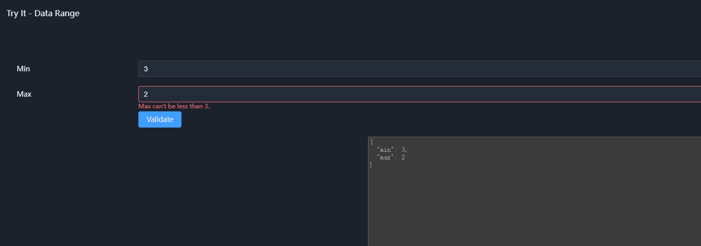

# 02. How to Construct the Multi-Dimensional Semantic Space

The previous chapter discussed one question:

> **Why do we need a semantic layer that is independent of code?**

If business semantics should not remain hidden in databases, backends, APIs, and frontends, then the next question is:

> **How exactly should semantics be structured so that it becomes a semantic space that can be composed, propagated, and executed?**

SchemaNode's answer is not to redesign a universal language that describes all businesses, but to start from the most basic data structures and gradually add semantic capabilities.

The basic process can be summarized as:

```text
Structure
  ↓
Property
  ↓
Relation
  ↓
Function
  ↓
Semantic propagation and composition
  ↓
Multi-dimensional semantic space
```

---

## 1. Starting from Data Structures

Any structured semantics needs a foundation.

Traditional data types answer:

> **What structure is this data composed of?**

For example:

```text
string
number
boolean
struct
array
```

They describe the representation form and organization of data.

A struct can be further composed of multiple fields:

```json
{
  "name": "string",
  "age": "number"
}
```

This description already contains more information than the raw data itself.

But it still mainly answers:

> What data is there?

not:

> What does this data mean?

For example, a `number` could represent an age, an amount, a temperature, a percentage, or a coordinate.

From the data structure alone, there is no way to know how these numbers should be understood.

Therefore, **structure is the foundation of a semantic entity, but not the whole of it.**

---

## 2. From Structure to Semantic Properties

If a `number` also has constraints such as a minimum value, a maximum value, a default value, a read-only state, and display precision, then this information clearly goes beyond `number` itself.

For example:

```json
{
  "type": "number",
  "min": 0,
  "max": 100
}
```

Here `min` and `max` have not changed the basic structure of the data.

It is still a `number`.

But it has acquired new semantics.

This is what **Property** solves:

> **Enabling a structured entity to carry multiple composable semantic properties.**

An entity can simultaneously have:

```text
          ┌── display
          ├── validation
          ├── permission
number ───┼── default
          ├── source
          └── ...
```

These properties are not data structures themselves, but different semantic dimensions attached to the structure.

Therefore, the "multi-dimensional" in the multi-dimensional semantic space does not first refer to having many kinds of data types, but rather:

> **The same semantic entity can be described from multiple independent dimensions.**

This is also the first step from traditional data types to semantic types.

---


## 3. Making Semantics Within an Entity Interrelate

Adding Properties to an entity lets it carry more semantics. But if these properties are independent of each other, they remain just a set of parallel definitions.

Consider a struct representing a numeric range:

```json
{
  "min": 0,
  "max": 100
}
```

There are two fields here, representing the minimum and maximum values.

We can set a numeric lower bound for `min` and a numeric upper bound for `max`. But if we want `max` to always be no less than `min`, merely defining constraints on the two fields separately is not enough.

We need to describe the semantic association between the fields.

For example, when the value of `min` changes, the valid range of `max` should change accordingly:

```text
struct: minMax
    │
    ├── min: number
    │
    └── max: number
          ↑
          │ lowlimit
          │
        min
```

Here, the `lowlimit` of `max` is no longer a fixed value, but is provided by `min`.


Through a Relation, we can express this dependency as a structured definition, instead of hiding it inside some function's implementation.

When the value of `min` changes, the related semantics can be re-interpreted and re-executed accordingly.



This reflects a fundamental role of Relation:

Property describes what semantics an entity has, while Relation describes how those semantics are connected.

At this point, the connection occurs between fields within the same struct. For struct types, this connection is internal semantics — **this kind of semantic type is no longer a flat property table, but a traceable local semantic space.**

From here on, semantics is no longer just a static description; it gains the ability to express dynamic associations.

---

## 4. From Association to Semantic Effect

In the previous example, `min` and `max.lowlimit` have established a semantic association.

But Relation itself is not responsible for performing the concrete computation.

What it describes is:

> **Which semantics is associated with which semantics.**

How this association produces an actual effect is determined by the kind of Relation; the diagram above uses the most common approach, execution based on a `Function`.

In `minMax`, the semantic association can be understood as:

```text
min
 │
 │ Relation
 ↓
max.lowlimit
```

And the execution effect associated by the Relation can be further expressed as:

```text
min
 │
 │ Relation
 ↓
Function
 │
 ↓
max.lowlimit
```

When the value of `min` changes, the Function recomputes `max.lowlimit` according to the semantic association provided by the Relation.

Therefore:

> **Relation describes how semantics is associated; Function describes how this association produces effects.**

Function does not need to prescribe what specific technology is used.

The same semantic function can be compiled into different execution forms according to different execution purposes:

```text
                 Semantic function
                    │
          ┌─────────┼─────────┐
          ↓         ↓         ↓
       SQL query   C# code   Semantic reasoning
```

The execution methods may differ, but they express the same semantic effect.

This makes semantic definitions no longer merely static descriptions — they begin to become executable.

---

## 5. From Local Semantics to the Multi-Dimensional Semantic Space

The `minMax` example looks simple, but it already has the basic characteristics of a complete semantic entity.

It first has structure:

```text
struct: minMax
├── min: number
└── max: number
```

Then, fields can carry different Properties:

```text
min
 └── ...

max
 ├── lowlimit
 └── ...
```

Entities can affect the Properties of other entities through Relations:

```text
min
 │
 │ Relation
 ↓
max.lowlimit
```

And finally, Function produces the concrete semantic effect.

Therefore, this struct is no longer a simple field collection.

It forms a traceable **local semantic space**:


Here, "multi-dimensional" does not mean that `min`, `max`, Relation, and Function are four parallel data dimensions.

The true multi-dimensionality comes from:

> **The same structured entity can simultaneously have multiple composable semantic Properties, and these Properties can in turn form dynamic semantic structures through Relations and Functions.**

Therefore, a semantic type is no longer just:

```text
field + field + field
```

but a semantic entity jointly constituted by:

```text
Structure
 + Property
 + Relation
 + Function
```

---

## 6. From Local Semantic Space to a Larger Semantic Space

The preceding `minMax` is a very small semantic entity.

It consists of two fields:

```text id="0qzj7g"
minMax
├── min
└── max
```

And `min` and `max` each have their own structure and semantics.

Therefore, structured semantics does not start by defining a huge entity; it can start from smaller semantic entities one by one and gradually form larger entities through structural composition.

```text id="w3w2a8"
Small entity
  ↓
Structural composition
  ↓
Larger entity
  ↓
Continued composition
  ↓
Complex semantic entity
```

For example:

```text id="lq4d9x"
        Entity A
       ┌────┴────┐
       ↓         ↓
    Entity B   Entity C
      │           │
      ├── P1      └── P2
      └── P2
```

Composition here is not just putting several fields into a struct.

When an entity is composed into a larger entity, the parent entity can, according to its own semantics, add new Relations to the child entities.

For example:

```text id="3q0q5v"
             Parent entity
            /        \
           /          \
    Child entity A   Child entity B
           │
           │ Relation
           ↓
       B.Property
```

Therefore, a child entity is not locked into fixed semantics once defined.

Within different composition contexts, it can be given new semantic associations by parent entities.

This gives semantic entities an important compositional capability:

> **Entities define their own semantics, and parent entities can further define the role these entities play in the current semantic context through Relations.**

As a result, the same base entity can be reused in different parent entities, and different parent entities can establish different semantic associations.

This is fundamentally different from traditional field nesting.

Traditional structural composition mainly solves:

> **How data is organized.**

Semantic composition further solves:

> **After composition, what new meaning arises between these entities, and how that meaning takes effect.**

Thus, the semantic space can keep expanding outward:

```text id="d1q6l9"
              Problem domain
                 │
        ┌────────┴────────┐
        ↓                 ↓
     Large entity A     Large entity B
      │   │              │
      │   └──Relation────┤
      │                  │
      ├── Small entity   ├── Small entity
      │                  │
      └── Small entity   └── Small entity
             │
          Property
             │
          Relation
             │
          Function
```

Every structural composition can produce new semantic associations; and each layer of entity can establish new Relations for the entities in the layer below.

Therefore, the semantic space is not a pre-designed fixed model, but a space that can keep expanding through **structural composition, Property stacking, Relation association, and Function execution**.

As this composition deepens and eventually covers a complete problem domain:

> **The whole formed by these interrelated, composable, and executable semantic entities is a complete multi-dimensional semantic entity space.**

"Multi-dimensional" thus acquires a more complete meaning:

* **Structural composition** lets semantic entities grow from small to large into complex entities;
* **Property** gives each entity multiple independent semantic dimensions;
* **Relation** creates dynamic semantic associations between parent and child, and between entity and entity;
* **Function** enables these associations to produce deterministic semantic effects.

Because semantic entities adopt a recursively composed hierarchical structure, and Relations are constrained by explicit direction of effect, this ever-expanding semantic space is not an arbitrary network of relations — it naturally maintains a directed acyclic structure.

What ultimately forms is neither a pure data-structure tree nor a simple relation graph, but an **executable semantic space** that can keep expanding as entities compose.


---

## 7. The Semantic Space Is Not a Static Description — It Is Executable

If the semantic space ultimately is just a more sophisticated description file, then it is still just another kind of Metadata.

The key difference of SchemaNode is:

> **Semantic definition and semantic execution are two different levels.**

Semantics describes:

```text
What I want to express
```

The execution layer decides:

```text
How I execute it
```

Therefore, the same semantics can be interpreted by different execution layers:

```text
                Structured semantics
                     │
                     ↓
                Semantic parsing
                     │
              ┌──────┼──────┐
              ↓      ↓      ↓
             UI     SQL    Code
              │      │      │
              └──────┼──────┘
                     ↓
                  Execution
```

For example, a semantic Property can:

* Appear in the frontend as a constraint on an input control;
* Appear in the backend as data validation;
* Appear in database queries as a filter condition;
* Appear in other execution layers as a reasoning condition.

These execution approaches can be completely different.

But they all interpret the same semantics.

Therefore, SchemaNode does not attempt to prescribe what technology all execution layers should use, but separates:

> **What the semantics is**

from:

> **How the semantics is executed**

This also means that semantic definitions themselves can remain stable, while execution layers can evolve independently.

---

## 8. Semantic Dialects: Letting Different Domains Express Their Own Semantics

If all domains used exactly the same semantic definitions, another problem would naturally arise:

> **The semantics of different domains are obviously not the same.**

Permission systems need permission semantics.

Data processing systems need ETL semantics.

Workflows need state and event semantics.

Healthcare, finance, industry, and other fields also have their own professional semantics.

Therefore, SchemaNode does not attempt to build a universal business language containing all domain concepts.

Instead, it allows different **semantic dialects** to form on top of the public semantic foundation.

A semantic dialect can also be understood as a kind of **Schema DSL**:

```text
Public semantic foundation
      │
      ├── App dialect
      ├── Workflow dialect
      ├── Data processing dialect
      └── Domain dialects
```

What a dialect defines is:

* Which semantic entities exist in this domain;
* What properties these entities may have;
* What relations can be established;
* What functions can be used;
* How these semantics are projected onto the corresponding execution layers.

Therefore, domain extension is not about continually adding special business code to the core, but about adding new semantic definition capabilities on top of the public semantic foundation.

---

## 9. The DSL Itself Is Also Structured Semantics

If a Schema DSL is used to describe:

```text
Entities
Properties
Relations
Functions
```

then what the DSL itself describes is also structured data.

For example:

```text
Schema DSL
   │
   ↓
Defines a semantic type
   │
   ↓
The semantic type itself is also a Schema
```

This means:

> **The language that describes semantics can itself become the semantics being described.**

Thus, the possibility of bootstrapping begins to appear in the system:

```text
Semantics
 ↓
Schema
 ↓
Schema that defines Schemas
 ↓
Higher-level semantic definitions
```

This is not for the sake of building a complicated metaprogramming system, but because:

> If semantics itself has already been structured, then the tools that describe semantics should no longer rely on a completely different description mechanism hidden in code.

SchemaNode's subsequent bootstrapping capability starts exactly from here.

---

## 10. The Public Semantic Foundation

When different semantic dialects are all built on the same foundational capabilities, an important value emerges:

> **Different semantics begin to share a common basis of understanding.**

For example, no matter what business entities a domain defines, it needs some way to express:

```text
Types
Properties
Relations
Functions
Constraints
```

These do not belong to any specific business domain; they belong to:

> **"How to define and process structured semantics" itself.**

Therefore, public semantic consensus does not attempt to prescribe:

> That all industries must use the same business model.

but rather:

> **That different semantic dialects should at least be able to use a common foundational structure to define, carry, exchange, and understand semantics.**

This provides the basis for compatibility between different execution layers, different domains, and different semantic dialects.

---

## 11. From Describing Data to Describing Meaning

At this point, we can look at traditional data models afresh.

Traditional data types:

```text
string
number
boolean
struct
array
```

solve the problem of data structure.

Adding Property on top of them can express:

```text
Constraints
Display
Permissions
Default values
States
Sources
...
```

Then through Relation and Function:

```text
Entity
 ↓
Semantic properties
 ↓
Semantic relations
 ↓
Semantic effects
 ↓
Semantic propagation
```

Thus, data gradually shifts from:

> **"What structure it is"**

to:

> **"What meaning it has, and how that meaning interacts with other meanings."**

This is the process from **data types** to **semantic types**, and ultimately to the **multi-dimensional semantic space**.

---

## 12. From Semantic Space to Semantic Language

By now, we can see a complete construction path:

```text
Data
 ↓
Structure
 ↓
Property
 ↓
Relation
 ↓
Function
 ↓
Local semantic space
 ↓
Larger semantic space
 ↓
Semantic dialects
 ↓
Public semantic foundation
```

If these capabilities can keep being combined, the next question naturally arises:

> **What is the minimal element that constitutes this semantic space?**

SchemaNode further summarizes it into four fundamental semantic primitives:

> **Meta, Property, Relation, Function.**

They are not four kinds of business objects, but the basic capabilities for constructing **executable structured semantics**.

The next chapter starts from SchemaNode's actual definition mechanism, explaining what role each of these four primitives plays and how they jointly constitute the semantic definition domain.

---
