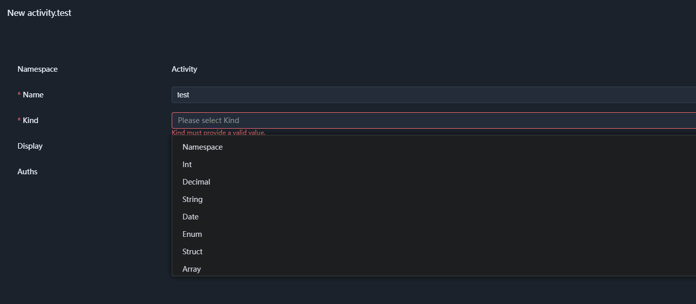
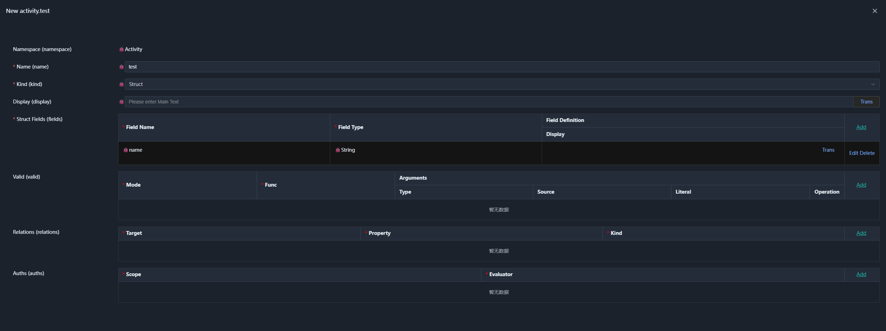
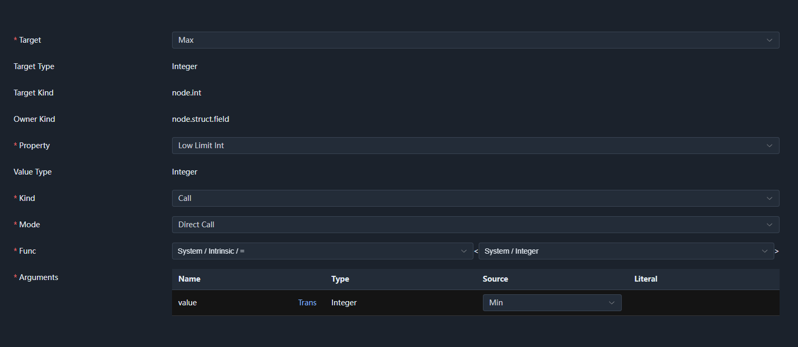
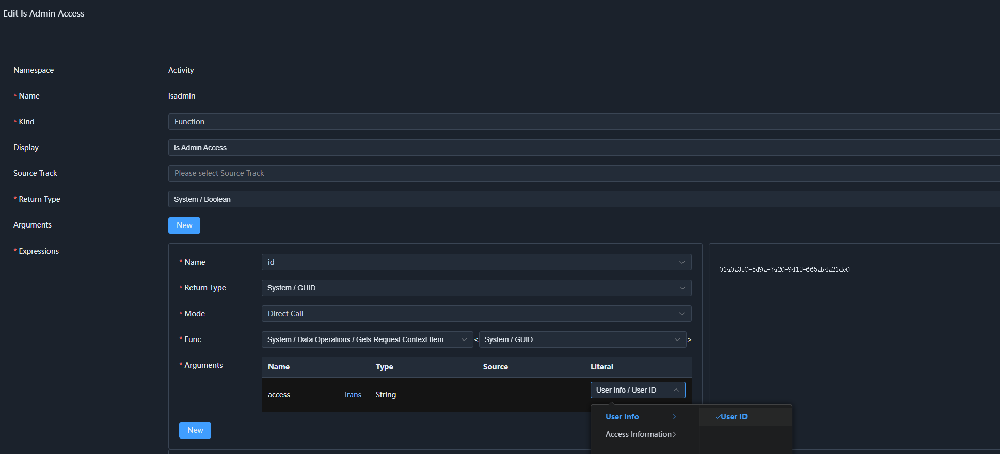

# 04. The Definition Domain and Public Semantic Consensus

The previous three chapters started from the relationship between code and semantics, gradually constructed the multi-dimensional semantic space, and formed semantic entities from the four semantic primitives: Meta, Property, Relation, and Function.

We then further introduced the **Prototype**, giving semantic types a stable structure and capability boundary, and establishing the minimal contract between semantics and the execution layer.

At this point, the theoretical deduction is complete.

As mentioned earlier, we cannot define a unified set of semantic prototypes for all business domains, but we can build a **public semantic consensus** around the **definition domain of prototypes**.

---

## 1. The Definition Domain

The definition domain is the engineering discipline that solves "how to define entities in the semantic space." Following the previous discussion, it can be divided into three stages:

1. How to define semantic prototypes, and how to manage semantic prototypes.
2. How to define semantic types from semantic prototypes, and how to manage semantic types.
3. How to construct semantic entities from semantic types.

The definition domain must cover the definition of semantic prototypes for unknown domains — this is the key difference from a fixed business model.

If the definition domain could only define a few pre-determined kinds of entities, it would essentially still be a fixed model, not the definition foundation of a semantic language.

On the other hand, semantics that can be parsed and executed by different execution layers must have structured data as its intermediate form. Therefore, the **definition domain** itself must cover the **data processing domain**.

Meanwhile, as the basic elements constituting semantics, Property, Relation, and Function must also be definable, composable, and processable within the definition domain. This means the definition domain cannot be just a "description tool" — it must itself be describable by the same set of semantic mechanisms.

Therefore, the definition domain must ultimately achieve its own bootstrapping:

```text
Define prototypes
    ↓
Define semantic types
    ↓
Define semantic entities
    ↓
Define Property / Relation / Function
    ↓
Define how semantics itself is processed
    ↓
Continue defining new prototypes and types
```

This is also an important difference between the definition domain and ordinary metadata systems.

It does not merely describe business data — it describes **how to describe data itself**.

---

## 2. Semantic Prototypes

### 2.1 Prototype Identifiers

Semantic prototypes are used to classify entities, and they are also the key for the execution layer to determine how semantics is interpreted and executed.

The execution layer needs to know which prototype an entity belongs to before it can determine the corresponding Meta, which Properties can be mounted, and how to load and process the semantic types defined by that prototype.

Therefore, both the semantic space and the execution layer must have a clear understanding of prototypes.

Prototypes themselves do not need to carry complex abstract descriptions. It is enough to uniquely identify a prototype so that the semantic space and the execution layer can form a shared understanding of it. For cross-language and cross-platform compatibility, we use unique string identifiers to represent prototypes.

For example, struct, enum, array, etc. that appeared in the previous chapter are, first of all, classifications of nodes (Node Kind); the corresponding concrete prototypes are established by the definition domain. For example, in SchemaNode Core, the prototype corresponding to a struct is node.struct.

Directly using struct, enum, array as top-level prototypes would easily cause naming conflicts between different definition domains, so prototype families need to be introduced.

---

### 2.2 Prototype Families

In the semantic dialects discussed earlier, each dialect may define its own prototypes. To avoid naming conflicts between different dialects, prototype identifiers need a clear scope.

Therefore, similar to namespaces, we can establish a top-level prototype classification for each definition domain or semantic dialect, and then define concrete prototypes under it, forming a **prototype family**.

SchemaNode Core currently uses `node` as the top-level prototype name:

```text
node
├── scalar
├── int
├── enum
├── array
├── struct
│   └── field
├── function
│   └── arg
└── ...
```

The corresponding full identifiers can be expressed as:

```text
node.struct
node.enum
node.array
node.struct.field
node.function
node.function.arg
```

Here, node is the top-level prototype chosen by SchemaNode Core's public definition domain, and node.struct is the concrete prototype in the node prototype family used to describe struct nodes.

Note that struct itself is a Node Kind, while node.struct is the corresponding Node Prototype. This distinction keeps node classification independent from prototype definitions, and avoids hard-coding the concrete implementation of one definition domain into semantic declarations.

Although semantic declarations rely on the Meta and Property provided by prototypes for interpretation, the semantic declarations themselves usually do not need to carry the full description of the prototypes they belong to.

This means that semantic declarations and concrete prototype implementations can remain relatively independent:

```text
Semantic declaration
    │
    ├── Meta
    └── Property
          │
          ↓
    Prototype interpretation
```

Therefore, SchemaNode Core's choice of `node` as a neutral top-level prototype name also leaves room for future replacement.

If a more complete definition domain implementation emerges in the future that remains compatible with the `node` public semantics, then existing semantic declarations could theoretically be interpreted directly by the new prototype system, without needing to modify large amounts of implementation-specific information in the semantic data.

This is also the boundary that should be maintained between public semantic consensus and concrete definition domain implementations.

---

### 2.3 How to Design Prototypes

When we classify semantic entities, we are defining prototypes.

A prototype is not a simple naming of some data; it prescribes what definite structure this kind of entity has, and which semantic properties it can carry.

For example, a function argument, in addition to having a name and a type, may also have semantics such as `Require` and `Variadic`.

Taking the function:

```text
add(1, 2, 3, 4)
```

as an example, its semantic declaration could look like:

```jsonc
{
  "name": "add",
  "args": [
    {
      "name": "values",
      "type": "int",
      "variadic": true
    }
  ]
}
```

For `node.function.arg`:

```text
Meta
├── name
└── type

Property
└── variadic
```

Here, `name` and `type` are Meta that definitely exist in the argument structure, while `variadic` is an optional semantic Property.

`variadic` itself has no special data representation. It can be understood because the `node.function.arg` prototype defines the `Variadic` Property, so the execution layer knows that this property indicates whether the argument is variadic.

This is also the significance of prototypes:

> **Prototypes do not carry semantics; they prescribe how a set of semantics is interpreted.**

Only after a data value is placed into a definite semantic structure does an otherwise meaningless data field acquire clear semantics.

Therefore, when designing prototypes, the consideration is not "what objects exist in the business," but:

> **What definite structure does this kind of semantic entity need, and which composable semantic extensions should it allow?**

---

## 3. Semantic Types

Prototypes solve "how to define a class of semantic entities," while semantic types are concrete, reusable semantic definitions formed on top of prototypes.

For example:

```text
Prototype
    ↓
node.int
    ↓
   int
    ↓
   age
    ├── unit: 'years'
    └── lowlimit: 0
```

`node.int` prescribes what structure and capabilities an integer node has; `age` is a concrete semantic type defined on this basis.

Semantic types themselves are still structured semantic data, so they can continue to be composed, inherited, or extended, and ultimately used to construct actual semantic entities.


### 3.1 Execution-Layer Carriers of Semantic Types

Starting from this section, I will use the execution layer implemented by SchemaNode Core to demonstrate the definition and management of semantic types. Since this part is code-level semantic declaration, it is easier to understand than pure explanation. But please note that this is only one implementation built by SchemaNode in its exploration of the multi-dimensional semantic space.

SchemaNode Core declares the `node` prototype for implementing type definition and management. It provides namespace management of types, focusing on the organization of types rather than concrete functionality. Its declaration code is as follows:

```C#
// Declare the node prototype, and actively register the Display property into the prototype
[Meta<SchemaKind>("node")]
[Meta<Append>(typeof(Display))]
public sealed class NodeKind;

// Declare the Meta used by the node prototype. Since it is a struct type, it is registered as a struct semantic type via SchemaType.
// Note that the prototype itself does not need to know this struct; instead, the struct type specifies via the Attach attribute that it uses the node prototype,
// i.e. it can hold all the semantic properties of node.
[Meta<SchemaType>("system.schema.node.schema")]
[Meta<Attach>("node")]
public sealed class NodeSchema: PropertyOwner
{
    // Namespace; SchemaType further restricts the semantic type it uses
    [Meta<SchemaType>(typeof(NamespaceType))]
    public string? Namespace { get; set; }
    
    // Type name; Identifier restricts its regex to letters, digits, or underscores
    [Meta<SchemaType>(typeof(Identifier))]
    public string Name { get; set; } = null!;
        
    // Data type classification, explained later
    [Meta<SchemaType>(typeof(NodeKind))]
    public string Kind { get; set; } = null!;
}
```

With this, in the configuration UI, a single view line `<schema-view v-model="nodeSchema" type='system.schema.node.schema' />` is enough to generate the configuration interface for the semantic type, without needing to know in advance the available data types or the actual structure and properties of those types.



In the figure, Display was actively registered when the `node` prototype was defined, while Auths was registered for the `node` prototype by the App domain dialect to provide permission management.

The above code adopts the **Code as Schema** design pattern, ensuring that execution-layer code and declarations are defined together, with no extra alignment or registration mechanism needed. "Code as Schema" here does not mean that semantics can only be defined through code; rather, it means that the execution layer of SchemaNode Core can directly use code declarations for the semantic structures it supports, thus avoiding maintaining a separate Schema that mirrors the execution code.

### 3.2 The Namespace Semantic Type

Although `node` itself has `namespace` and `name` fields, it is not really a semantic type; it is just a structure provided for generic type management. Its semantics are provided by the `kind` field. First, we need to introduce the real namespace semantic type.

```C#
[Meta<SchemaKind>("node.namespace")] // Declare the `node.namespace` prototype
[Meta<NodeKind>("namespace")]  // Declare a `namespace` semantic type classification to `NodeKind`
[Meta<NodeType>(typeof(RuntimeNamespaceType))] // Declare the execution-layer implementation of the `namespace` type
public sealed class NamespaceKind;
```

Note that the semantic type corresponding to `kind` in `NodeSchema` is `NodeKind`, which is an enum type that can collect all semantic type classifications registered via `Meta<NodeKind>(kind)`. This is also where the selectable items of the `kind` input box in the figure above come from.

A namespace indicates that it is only used for type organization, so it has no concrete functionality and no further settings.

---

### 3.3 Data Types

Taking `struct` as an example, this explains the definition rules of data semantic types, and effectively demonstrates how the four primitives accomplish the expression of semantics.

```C#
[Meta<SchemaKind>("node.struct")] // Declare the `node.struct` prototype
[Meta<NodeKind>("struct")] // Declare a `struct` semantic type classification to `NodeKind`
[Meta<NodeType>(typeof(RuntimeStructType))] // Declare the execution-layer implementation of the `struct` type
[Meta<SchemaGenerator>(typeof(StructGenerator))] // Declare the generator of the `struct` type, which generates semantic struct types from C# code via reflection
[Meta<Append>(typeof(Generics), typeof(Relations))] // Declare that the `struct` prototype has generics and relations properties
public sealed class StructKind;

// Declare the Meta of the `struct` type, defining the struct
[Meta<SchemaType>($"system.schema.struct.schema")]
[Meta<Attach>("struct")]  // Specify that this struct uses the struct prototype, i.e. it can hold all semantic properties of struct
public sealed class StructSchema : PropertyOwner
{
    // Struct fields
    public StructFieldSchema[] Fields { get; set; } = [];
}

// Define the `struct` property for the `node` prototype; generate the struct property based on the type name and mount it onto the node prototype
[Meta<ForSchema>("node")]  // Indicates this Property serves the node prototype — it answers "which prototype am I mounted on"
[Meta<OfNodeKind>("property")] // Indicates this class is parsed as the property semantic type classification under node — it answers "what semantic type am I"
[Meta<SchemaType>("system.schema.prop.struct.struct")] // Declare the semantic type name registered for this property
[Relation<Visible, Relation.Call>("struct", "system.logic.eq", $"@{nameof(NodeSchema.Kind)}", "struct")]
public sealed class StructProperty : Property<StructSchema>

// Declare the `node.struct.field` prototype
[Meta<SchemaKind>("node.struct.field")]
[Meta<Append>(typeof(Disable), typeof(Display), typeof(Visible), typeof(Require))] // More omitted
public sealed class StructFieldKind;

// Declare the Meta of the `node.struct.field` prototype, defining the struct
[Meta<SchemaType>("system.schema.struct.field.schema")]
[Meta<Attach>("node.struct.field")]
public sealed class StructFieldSchema : PropertyOwner
{
    // The field name
    [Meta<SchemaType>(typeof(Identifier))]
    public string Name { get; set; } = string.Empty;
    
    // The type name of the node.
    [Meta<SchemaType>(typeof(ValueType))]
    public string Type { get; set; } = string.Empty;
}
```

The most special one here is the `StructProperty` property definition. It takes StructSchema as its value type, mounts onto the `node` prototype, and declares a visibility relation.

```C#
[Relation<Visible, Relation.Call>("struct", "system.logic.eq", $"@{nameof(NodeSchema.Kind)}", "struct")]
```

It corresponds to the relation description:

```jsonc
{
    target: "struct", // The target is the struct property itself
    property: "visible",  // The associated property is visible
    call: "system.logic.eq", // Execution uses a function call; the function is an equality check
    args: [
        { source: "kind" },  // The struct attached to the `node` prototype has a `kind` field
        { value: "struct" }  // It effectively means: when `kind` selects struct, `struct` becomes visible
    ]
}
```



In this figure, after selecting `kind` as struct, the struct fields, relations, and other fields and properties belonging to the `struct` prototype below become visible.

Compared with traditional programming, the definition of the above struct moves the visibility determination of `struct` from frontend code into the relation description — that is, defining part of its semantics. After this step, the frontend configuration UI becomes the execution layer, no longer relying on special code to support `struct`.

In a similar form, SchemaNode Core provides structured data types such as `bool`, `int`, `decimal`, `string`, `date`, `enum`, `struct`, and `array`. These are further introduced in the Core documentation.

Below is a simple struct example:

```jsonc
{
  "namespace": "test",
  "name": "minmax",
  "kind": "struct",
  "struct": {
    "fields": [
        {
          "name": "min",
          "type": "system.int",
          "display": "Min Value"
        },
        {
          "name": "max",
          "type": "system.int",
          "display": "Max Value"
        }
    ],
    "relations": [
      {
        // Assign min to max.lowlimit
        "call": {
            "args": [
                {
                    "type": "system.int",
                    "source": "min"
                }
            ],
            "func": "system.intrinsic.assign<system.int>", // Assignment function
            "mode": "call"
        },
        "kind": "call", // Relation execution type, using a function call
        "target": "max",
        "property": "lowlimit", // Lower limit
      }
    ]
  }
}
```

Here we can also see that the actual semantic declaration contains no special `node`-related markers, or special types like `system.schema.struct.schema`. And `property: "lowlimit"` only expresses "the target entity has a semantic property named lowlimit"; which Property interprets this property is resolved by the current definition domain according to the prototype the target entity belongs to.

Types under `system.schema` are definition-related, while semantic functions like `system.intrinsic.assign` are part of the public semantics. Definition-related types may differ across definition domain implementations, but public semantic types must be implemented by all execution layers.


---

### 3.4 Property Types

Property is an important primitive constituting the multi-dimensional semantic space. It declares which prototypes it supports, and is used to describe the properties of semantic entities. Taking the `lowlimit` used above as an example:

```C#
[Meta<Alias>("lowlimit")] // When the type name cannot directly serve as the property name, use Alias to declare the property name
[Meta<ForSchema>("node.int", "node.int.define", "node.int.usage")]
[Meta<OfNodeKind>("property")]
[Meta<SchemaType>("system.schema.prop.int.lowlimit")]
public class LowLimitInt : Property<long>, IConstraintProperty
{
    public bool? ValidateInt(SchemaContext context, IntNode node)
    {
        if (!HasValue || node.IsEmpty) return null;
        return node.GetValue<long>() >= Value;
    }
}
```

* Properties can share the same name; what is defined here is the lower-limit property for the `int` type. They are distinguished by prototype. In the relation above, the prototype of `max`'s type `system.int` is `node.int`, so it is guaranteed that the relation uses the `system.schema.prop.int.lowlimit` property rather than `system.schema.prop.string.lowlimit`.
* SchemaNode Core also has prototype variants for definition and usage scenarios; they ultimately still belong to the public semantic capabilities of node.int. The specific mechanism is a Core implementation detail and will not be expanded here.
* A large class of properties are constraint properties, which describe the constraint conditions of semantic entities. For example, the `lowlimit` property is used to validate `int` data nodes; violations of constraints by any data node are recorded as error messages.
* The semantic entities passed between execution layers contain only `lowlimit`, not the concrete property type. Therefore, different execution layers can consume the semantics using properties defined by different mechanisms. This is also why, as mentioned before, SchemaNode Core is replaceable — as long as the public semantic consensus is implemented.


---

### 3.5 Relation

In `test.minmax`, `min` and `max` are two semantic entities, and `test.minmax` defines the association between them. Larger complex structured types built on `test.minmax` can define associations for the other semantic entities under them.

For example, in the App dialect, each App Field corresponds to a database table, and an App can define associations for multiple App Fields. In summary, through this tree-like association from ancestors to descendants, a stable directed acyclic graph can be achieved.

The code declaration of Relation is:

```C#
[Meta<SchemaKind>("node.relation")]
[Meta<SchemaType>("system.schema.relation.schema")]
[Meta<Attach>("node.relation")]
public class RelationSchema : PropertyOwner
{    
    // The target semantic entity of the association
    public string Target { get; set; } = null!;

    // The associated property name
    public string Property { get; set; } = null!;
    
    // The association type
    [Meta<SchemaType>(typeof(RelationKind))]
    public string Kind { get; set; } = null!;
}

[Meta<OfNodeKind>("property")]
[Meta<SchemaType>("system.schema.prop.core.relations")]
public class Relations : Property<RelationSchema[]>;
```

Here RelationSchema is not a business semantic type, but a definition type used to describe the structure of the Relations property value.

In this way, anywhere it is needed can actively declare having the Relations property. For example, the `node.struct` prototype declares that struct types have the Relations property.

The association type is similar to the `kind` of `node`, allowing the outside world to register custom association execution types. SchemaNode Core provides three association execution types: `assign`, `call`, and `any`. In the `test.minmax` example, we saw the usage of the `call` association execution type.

Associations are more often configured in the UI configuration interface. For example, in `test.minmax`, the association between `min` and `max` is as follows:



Properties and relations constitute the complete definition of a semantic entity, and their implementation depends on semantic functions.

---

### 3.6 Function Types

A semantic function consists of two parts:

1. Atomic semantic functions, such as `system.intrinsic.assign`. It has two sources:

    * One is defined by the public semantic consensus and must be implemented by each execution layer (in practice, it is the execution layer implementations that register into the semantic space), such as `system.intrinsic.assign`.
    * The other is registered by the execution layer itself. For example, for transition purposes, the handling of legacy microservices can be registered into the semantic space and likewise be invoked.
    
    In any case, their registration method is the same:

    ```C#
    [Meta<SchemaType>("system.intrinsic")]
    public static class SystemIntrinsic
    {
        // Defines the system.intrinsic.assign helper function
        public static T? assign<T>(T? value) => value;
    }
    ```

2. Custom semantic functions, defined through the UI configuration interface by declaring parameters, return values, and the expression used for execution. For example:

    

    > Its design is based on pure functional programming: the function's inputs and outputs are deterministic, with no side effects.


An ordinary function, apart from its parameters and return value, contains no external information. Many specific restrictions can only be determined internally through mechanisms like `assert`. Such implicit conventions make the function's own semantics incomplete.

The semantics of a semantic function is provided by two places:

1. The semantics of the function arguments
    
    Besides the `node.function` prototype, `node.function.arg` is the prototype defined for function arguments. It can not only describe arguments through properties, but also supports configuring associations for arguments, similar to how a struct declares associations for its fields.

    When the function is called, these associations are applied to the call arguments. For example, in the figure above, when using the `get request context` semantic function, its argument provides a cascade selection rather than direct input. This is not support provided by the UI, but something carried by the semantic function itself.

    Taking getcontext as an example below, this shows how function arguments obtain a complete semantic description through Property and Relation. The specific mechanism will be expanded in the Core documentation.

    Through this mechanism, quite complex argument selection can be achieved. At this point, we can say this semantic function is semantically complete, because its originally built-in conventions have been exposed to the caller.

    ```C#
    [Meta<SchemaType>("system.data")]
    public static class SystemData
    {
        // Get the request context.
        // This relation configures a cascade-selection consumer for the access argument,
        // i.e. the type corresponding to the cascade selection content must satisfy the return value type of the function call.
        [Relation<AccessEntryConsumer, Assign>($"{nameof(access)}.{nameof(CallArg.Value)}", $"{NS_SYSTEM_SCHEMA_REFLECT_TYPE}.{nameof(Reflect.Type.isassignableto)}", NODE_SELF, false, $"@{FUNC_RETURN}")]
        public static T? getcontext<T>(
            // C# execution context, automatically ignored when registered as a semantic function
            SchemaContext context,
            
            // EntrySource provides the cascade data source for the access argument
            [Meta<EntrySource>($"{NS_SYSTEM_SCHEMA_REFLECT_TYPE}.{nameof(Reflect.Type.getaccessentries)}", NS_SYSTEM_CONTEXT, NODE_SELF)]

            // AccessValueTypeProvider converts cascade-selected values like `user.id` into actual data types
            [Meta<AccessValueTypeProvider>($"{NS_SYSTEM_SCHEMA_REFLECT_TYPE}.{nameof(Reflect.Type.getaccessvaluetype)}", NS_SYSTEM_CONTEXT, NODE_SELF)]
            string access)
        {
            IValueAccess? item = context.GetContextItem(access);
            return item != null ? item.GetValue<T>() : default(T?);
        }
    }
    ```

2. Datafied semantic expressions

    Semantic function expressions defined in this form are purely datafied, with no temporary variables and no control structures. They are based on pure functional programming, can be easily converted into AST syntax trees at compile time, and can thus be understood, modified, compiled, and executed by execution layers.

    They are reason-able: for example, in App applications, data lineage can be directly located based on ETL data transformation functions, and then the functions that originally relied on repeated manual implementation can be completed automatically.

---

### 3.7 The Definition Domain

Based on the above namespaces, data types, Properties, Relations, and Functions, we have built a complete semantic definition domain. And the prototypes and types used to define semantics are themselves also defined by the same definition domain.

SchemaNode Core merely provides a definition domain implementation based on the node prototype family. The definition domain and the semantic declarations it defines are not strongly coupled; the definition domain can be replaced, extended, and iterated independently of the semantic declarations.

This is consistent with the separation of semantics and execution discussed earlier: semantic declarations can remain stable, while the definition domain and execution layer that interpret and execute these semantics can develop independently.

---

## 4. Public Semantic Consensus

The definition domain solves how to define and process semantics, while public semantic consensus solves:

Among different semantic execution layers, which definition capabilities must be commonly understood.

This consensus does not require different definition domains to adopt exactly the same internal implementations, nor even identical prototype names. For example, SchemaNode Core uses node.int, while another implementation could use atom.int.

What really needs to stay consistent is the Meta expressed by the prototypes, the Properties, and the semantic constraints between them. Different implementations can complete the mapping through their own prototype systems, but ultimately they must be able to form a consistent interpretation of the same public semantics.

Therefore, public semantic consensus needs to cover at least three levels:

1. Public prototype capabilities
    It must be able to express basic semantic entity classifications, such as structs, arrays, and basic data types. The concrete prototype names may differ, but the semantic capabilities expressed must correspond.

2. The Meta and Properties of prototypes
    For example, the prototype representing a struct must be able to express a structure like fields: {name: string, type: string}[], and be able to carry its necessary semantic properties.

3. Public semantic types and functions
    The semantic types constructed on the above definition domain, as well as public semantic functions such as system.intrinsic.assign, need to have semantics that is understandable across execution layers.

Types under system.schema belong to the current definition domain's implementation, while semantic functions like system.intrinsic.assign belong to the public semantics. The former can change with the definition domain implementation, while the latter must be provided by different execution layers with corresponding implementations.

Therefore, public semantic consensus does not prescribe a fixed internal implementation of SchemaNode, but prescribes the minimal semantic capabilities that must be commonly understood between different execution layers.

---

## 5. An Unsolved Problem: Prototype and Protocol

In the current implementation, the Prototype is responsible for determining semantic definitions, while the execution-layer API is responsible for providing the access and execution entry points for these semantic definitions.

There is a clear correspondence between Prototype and API, but this correspondence is currently managed by the execution layer and has not become part of the Prototype itself.

This is an intentionally reserved boundary.

If in the future semantics needs to propagate across execution layers, across systems, and even across networks, then the following question needs further discussion:

> Should the Prototype become part of the protocol description?

Protocols such as HTTP and MCP can solve how different execution nodes communicate, but they do not directly solve how different nodes understand the same set of semantic definitions.

Therefore, in the future it may be necessary to further establish a common semantic protocol between:

```text
Semantic definition
    ↓
Prototype
    ↓
API
    ↓
Communication protocol
```

This goes beyond the scope of the current definition domain and will be left to later discussions on semantic network protocols.
