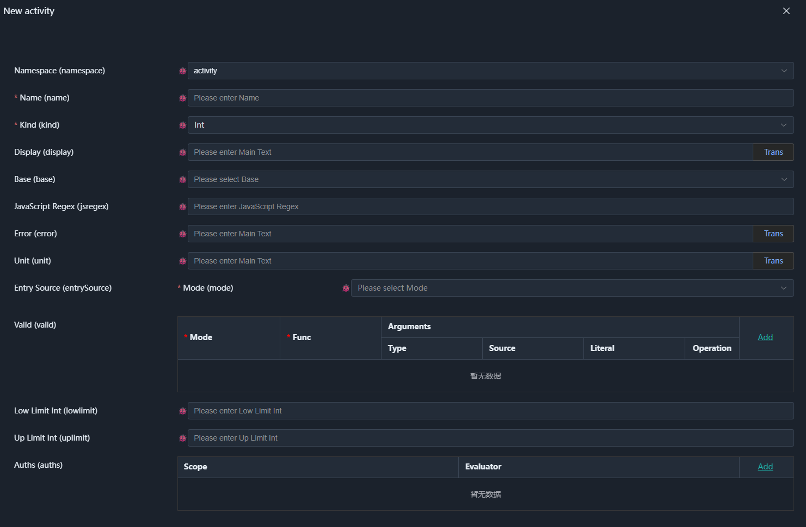

# 02. SchemaNode.Core and the node Prototype Family

SchemaNode's original version was called `DataNode`, and was mainly used to handle complex data nodes. As practice deepened, we gradually discovered that separating semantics from execution can minimize the coupling between the essential complexity of the business itself and the accidental complexity brought by concrete technical implementations, enabling relatively independent parallel development.

In the original practice, this shift brought a development efficiency improvement of more than 10x without AI assistance. As semantics accumulated, feature iteration also became faster and faster. This not only improved development efficiency, but also, to a certain extent, escaped the problem of constantly accumulating technical debt in traditional development models.

This is precisely the original motivation for turning toward semantic programming, and also the reason the foundational prototype family of SchemaNode.Core was ultimately named `node`.

As stated in the previous chapter, prototype names are mainly used by execution layers to recognize prototypes, and do not need to appear in semantic type declarations. Therefore, `node` is merely a set of prototype identifiers adopted by SchemaNode.Core, and does not mean that execution layers must depend on a particular implementation.

SchemaNode.Core is used to provide the public semantic space. It is neither a web framework nor a database framework, but a semantic framework. Whether a web application, a database application, or a desktop program, each can build its own semantic model and execution capabilities on top of it.

This chapter starts with the `node` prototype family, introducing the relationships between prototype declarations, semantic type structures, semantic properties, and runtime types, and explaining how they together form the foundation of the public semantic space.

Below we begin the discussion with the definition of the `int` type:



This is the screen for adding an "integer type" in SchemaNode's definition-domain execution layer (the configuration tool).

Observe the input items on the left: in addition to the basic "name" and "namespace", it also shows properties such as "base type", "JS regex", "integer lowlimit", "integer uplimit", and "valid".

Now, there are two key questions:

Why, after selecting the "integer" classification (Kind), does the interface automatically show integer uplimit and integer lowlimit? (Rather than showing the length limit used only for strings?)

Who specifies that these properties must be configured when defining an "integer"?

The answer is not in the code of this frontend interface. The configuration interface itself does not write any special logic for "integer". It is merely a generic renderer, faithfully laying out the "property list" passed in from the backend Schema engine.

---

## Prototype Declaration

SchemaNode.Core's prototype definitions are located in the project's `Schema` directory, and each prototype has a corresponding declaration file. For example, the declaration of the `node` prototype is located in `NodeSchema.cs`.

In the actual C# code, we adopt the "code as Schema" declaration pattern. This means the C# classes you see are both strongly typed definitions at compile time and metadata injected into the semantic space at runtime.

Although it looks somewhat complex due to the large amount of metadata description, this is the key to ensuring that all definition semantics can be configured correctly and centrally. There is no need to additionally maintain a set of JSON/YAML configuration files; the code itself is the semantic declaration. This is the practice that avoids configuration-based semantic drift.

Below is an excerpt from `NodeSchema.cs`:

```csharp
[Meta<SchemaKind>(SCHEMA_KIND_NODE, SCHEMA_KIND_ORDER_NODE)]
[Meta<Append>(typeof(Display))]
[Meta<SchemaType>($"{NS_SYSTEM_SCHEMA_NODE}.schema")]
[Meta<Attach>(SCHEMA_KIND_NODE)]
public sealed class NodeSchema : PropertyOwner, IErrorProvider
{
    /// <summary>
    /// The namespace which includes the schema
    /// </summary>
    [Meta<PrimaryIndex>(0)]
    [Meta<SchemaType>(typeof(NamespaceType))]
    [Relation<ReadOnly, Call>(
        NODE_SELF,
        $"{NS_SYSTEM_LOGIC}.{nameof(SystemLogic.notempty)}",
        $"@{nameof(Name)}")]
    public string? Namespace { get; set; }

    /// <summary>
    /// The schema name
    /// </summary>
    [Meta<PrimaryIndex>(1)]
    [Meta<SchemaType>(typeof(Identifier))]
    [Meta<Immutable>(true)]
    public string Name { get; set; } = null!;

    /// <summary>
    /// The full namespace name
    /// </summary>
    [SchemaIgnore]
    [JsonIgnore]
    public string FullName => $"{Namespace}.{Name}".Trim('.');

    /// <summary>
    /// The node kind
    /// </summary>
    [Meta<SchemaType>(typeof(NodeKind))]
    public string Kind { get; set; } = null!;
}
```

To understand this code, we first need to distinguish two kinds of metadata: metadata that declares prototypes, and metadata that describes the structure of semantic types.

---

### SchemaKind and Append

The core of a prototype declaration lies in `SchemaKind` and `Append`.

`SchemaKind` is used to declare the prototype's identifier. Here `SCHEMA_KIND_NODE` declares the `node` prototype, while also specifying its ordering information.

`Append` is used to declare the semantic properties supported by the prototype. Here `Display` is added to `node`; it provides localized information for presentation, and can also provide readable descriptions of types for humans and AI.

A prototype can support multiple semantic properties. Property types are responsible for defining the corresponding semantics, while a prototype, by declaring the properties it supports, determines which semantic conventions its derived types can adopt. The execution layer then interprets and consumes these properties according to the capabilities it supports.

Usually, a semantic property declares the prototypes it applies to through its own metadata, so explicit use of `Append` is not common. But when understanding prototype declarations, it is an important entry point.

Conceptually, the above prototype declaration can be represented independently as:

```csharp
[Meta<SchemaKind>(SCHEMA_KIND_NODE, SCHEMA_KIND_ORDER_NODE)]
[Meta<Append>(typeof(Display))]
public sealed class NodeKind;
```

Here `NodeKind` is merely a C# type used to declare the prototype name, not the data structure (Meta) of the `node` semantic type.

In the actual project, the prototype declaration (Kind) and its semantic type structure (Meta) can be placed on the same C# type for unified management. They only need to be separated when properties are defined for the prototype: prototype properties apply to all semantic types derived from the prototype, whereas properties defined for a structure declaration apply only to that struct semantic type itself.

---

## Semantic Type Structure Corresponding to the Prototype

After stripping away the prototype declaration, the remainder is the semantic type structure (Meta) with `node` as its prototype.

```csharp
[Meta<SchemaType>($"{NS_SYSTEM_SCHEMA_NODE}.schema")]
[Meta<Attach>(SCHEMA_KIND_NODE)]
public sealed class NodeSchema : PropertyOwner, IErrorProvider
{
    [Meta<PrimaryIndex>(0)]
    [Meta<SchemaType>(typeof(NamespaceType))]
    [Relation<ReadOnly, Call>(  // Declares that Namespace becomes read-only when Name exists
        NODE_SELF,
        $"{NS_SYSTEM_LOGIC}.{nameof(SystemLogic.notempty)}",
        $"@{nameof(Name)}")]
    public string? Namespace { get; set; }

    [Meta<PrimaryIndex>(1)]
    [Meta<SchemaType>(typeof(Identifier))]
    [Meta<Immutable>(true)]  // Declares that Name cannot be modified when it exists
    public string Name { get; set; } = null!;

    [SchemaIgnore]
    [JsonIgnore]
    public string FullName => $"{Namespace}.{Name}".Trim('.');

    [Meta<SchemaType>(typeof(NodeKind))]
    public string Kind { get; set; } = null!;
}
```

The `SchemaType` metadata declares the semantic type name corresponding to this C# type. Because `OfNodeType` is not used, the system by default registers it as a struct semantic type under the given namespace name.

`Attach`, in turn, declares that this struct semantic type needs to attach the semantic properties associated with the `node` prototype. It is not declaring that this C# type itself is the prototype; rather, it states that semantic types declared based on this struct type also need to attach the properties supported by the `node` prototype. The `Display` property seen in the earlier type definition diagram comes from the `node` prototype.

Two mechanisms need to be distinguished here:

- `Append`: declares which semantic properties a prototype supports.
- `Attach`: declares which prototypes' semantic properties a semantic type needs to attach.

Working together, the two allow prototypes to manage properties centrally, while semantic types choose which properties to attach according to their own needs.

---

### Field Metadata

Metadata on fields further constrains the structure of a semantic type.

`PrimaryIndex` is used to declare primary keys. A struct type with a primary key declaration can automatically construct the corresponding array type. When `NodeSchema[]` or `List<NodeSchema>` is used somewhere, the parser maps it to the corresponding array semantic type.

Here `SchemaType` is used to specify the semantic type of a field. For example, the C# type of `Namespace` is `string?`, but semantically it needs to use `NamespaceType`, not the ordinary string type.

This shows that **a type in the host language is only one source of a semantic type, and is not necessarily equal to the semantic type ultimately adopted.** When necessary, the semantic type can be explicitly specified through metadata.

`Relation` declares a relational constraint for `Namespace`. Here `SystemLogic.notempty` checks whether `Name` satisfies the non-empty condition, and marks the relation as `ReadOnly`. The specific way the relation is handled is determined by the corresponding semantic mechanism.

`SchemaIgnore` is used to exclude members that do not participate in semantic type parsing. `FullName` is a helper property computed from `Namespace` and `Name`, and therefore is not part of the semantic type's data structure.

Thus, the above C# type can describe the following structured data (camelCase is used by default):

```json
{
    "namespace": "system",
    "name": "int",
    "kind": "int"
}
```

The `node` prototype family manages semantic types by namespace. `Namespace` and `Name` together determine the unique identity of a type, while `Kind` determines the prototype classification to which the type belongs.

This constitutes the most basic type management mechanism of the `node` prototype family: semantic types are described through a unified structure, and their concrete meanings are extended through attached semantic properties.

> Although configuring `ReadOnly` relations and `Immutable` properties in a type declaration may look unusual, they ensure the integrity of the semantic type definition itself, and prevent related intentions from being declared repeatedly in different configuration execution layers, which would scatter the semantics.

> Note that semantic properties express intent, not a specific execution approach. Although `ReadOnly` looks like a property mainly used by the frontend, the read-only intent it expresses is not limited to the frontend. How it is specifically interpreted and executed is determined by the execution layer according to its own responsibilities.

> This is also one of the reasons why the public semantic space is necessary. For properties like `ReadOnly` and `Immutable`, the intents they express can form public consensus, and are therefore worth including in the public semantic space. The public semantic space only needs to cover data types and the general semantic properties needed to process them, and does not have to include all domain-specific requirements. Other special properties can be added by semantic dialects, and are interpreted and executed by the execution layers that support the corresponding dialect.

> The actual semantic type of the `node` definition body is `system.schema.node.schema`. The semantic types in `system.schema` are all auxiliary types used for semantic type construction, and are implementations provided by a specific execution layer. They can differ across definition-domain execution layers, and therefore do not belong to public semantics.

> The semantic types in `system` other than `system.schema` are public semantic types, such as `system.string`. Together with public prototypes, these types constitute the public semantic space. Execution layers need to follow the corresponding public semantic conventions and be able to consume the semantic capabilities involved in the declarations and promised by themselves.

---

## The Int Prototype: From Declaration to Runtime

Next, using the `Int` prototype, we explain how to declare a new prototype in the `node` prototype family, and how to add semantic properties, runtime types, and definition structures for different purposes to a prototype.

The relevant implementation is located in `Schema/Scalar/IntSchema.cs`.

```csharp
/// <summary>
/// The int schema kind
/// </summary>
[Meta<SchemaKind>(SCHEMA_KIND_NODE_INT, SCHEMA_KIND_ORDER_INT)]
[Meta<NodeKind>(NODE_KIND_INT, SCHEMA_KIND_ORDER_INT)]
[Meta<NodeValueKind>(NODE_KIND_INT, SCHEMA_KIND_ORDER_INT)]
[Meta<NodeType>(typeof(Runtime.IntType))]
[Meta<SchemaUsage>(typeof(IntUsage))]
[Meta<Append>(
    typeof(EntrySource),
    typeof(AsSuggest),
    typeof(Default),
    typeof(BlackList),
    typeof(WhiteList),
    typeof(Unit),
    typeof(Error),
    typeof(StackUpLimit),
    typeof(Valid))]
[Meta<IntValue>]
public sealed class IntKind;
```

Through various kinds of metadata, `IntKind` links the prototype name `node.int` with the related mechanisms.

These metadata bear different responsibilities:

| Metadata | Responsibility |
|---|---|
| `SchemaKind` | Declares the `node.int` prototype and its ordering information |
| `NodeKind` | Registers `int` as a classification of `node` |
| `NodeValueKind` | Declares `int` as a value-type classification |
| `NodeType` | Registers the runtime type used to load and handle this kind of semantic type |
| `SchemaUsage` | Specifies the definition corresponding to the prototype's usage form |
| `Append` | Declares the semantic properties supported by the prototype |
| `IntValue` | Incorporates the `Int` constraint properties into the prototype declaration, i.e. the constraint properties associated with the prototype |

These declarations link the prototype identifier, classification, runtime handling, and property support together, enabling a new prototype to plug into the existing semantic type system without designing a separate mechanism for it.

This code can be understood as issuing an "ID card" to `node.int` and assigning it a "workstation":

It tells the system: this is an independent prototype (SchemaKind).

It mounts the classification and runtime implementation (NodeKind / NodeType).

It carries its own dedicated property package (Append).

---

### NodeKind: Type Classification

`NodeKind` is used to declare type classifications within the `node` prototype family.

For example:

```csharp
[Meta<SchemaType>(typeof(NodeKind))]
public string Kind { get; set; } = null!;
```

The `Kind` field of `NodeSchema` uses `NodeKind` as its semantic type. Through metadata registration, `int` can become a valid value in the corresponding enum type. That is why the type classification in the diagram can select the `int` integer classification.

Therefore, when extending a new `node` classification, the extension can be completed by adding a classification declaration, without modifying the basic data structure of `node`.

Here `NodeKind` is a classification mechanism, and is not equivalent to `SchemaKind`: the former describes which class a node belongs to, while the latter is used to identify the prototype itself.

---

### IntValue: Constraint Property

Let's look at the declaration of `IntValue`:

```csharp
[Meta<Alias>("int")]
[Meta<ForSchema>(SCHEMA_KIND_NODE_INT)]
[Meta<OfNodeKind>(NODE_KIND_PROPERTY)]
[Meta<SchemaType>($"{NS_SYSTEM_SCHEMA_PROP_INT}.valid")]
[Meta<Default>(true)]
[Meta<InVisible>(true)] // root only
[Meta<Static>(true)]
public class IntValue : Property<bool>, IConstraintProperty;
```

`IntValue` is a constraint property declared for the `node.int` prototype. It specifies the applicable prototype through `ForSchema`, and its own semantic type through `SchemaType`.

Note that `IntValue` is not bound to a specific business integer type (such as age or year); it is mounted on the `node.int` prototype. This means that once a type is declared to belong to this prototype, it automatically inherits the constraint capability of `IntValue`. This is precisely the embodiment of a prototype's built-in property reuse capability.

`IConstraintProperty` indicates that this property bears a constraint responsibility, used to describe validation requirements for integer values. This type has no implementation because in the C# execution layer, integer validation is already completed when data is loaded as entities, so here it is more of a declaration.

For example, the frontend kernel of `schema-node-core` can provide the validation logic corresponding to this property. Different execution layers can provide different validation logic based on their own needs.

This also reflects a characteristic after semantics and execution are separated: properties declare constraints, and execution layers consume constraints in ways that suit them.

---

### NodeType: Runtime Type

`NodeType` is used to register the runtime type for the `int` classification:

```csharp
[Meta<NodeType>(typeof(Runtime.IntType))]
```

`Runtime.IntType` is responsible for loading semantic type declarations constructed based on this prototype, and providing support for handling the corresponding integer semantic entities at runtime.

Prototype declarations describe the structure and capabilities of semantic types, while runtime types are responsible for connecting these declarations to the actual execution process. The two are linked through metadata, but have different responsibilities.

The specific loading, parsing, and runtime mechanisms will be explained in later chapters together with more prototypes.

---

### IntSchema and IntProperty: Definition and Usage

Defining a semantic type and using it in other semantic types do not necessarily require the same set of properties.

For example, when defining a `node.int` type, usage constraints such as blacklists and whitelists usually do not need to be configured; but when an integer type is used as a struct field, these properties may be needed. There are similarly cases where something can be configured at definition time but not at usage time.

However, these properties still belong to the semantic properties supported by the `node.int` prototype. The difference lies in the applicable scenario.

For this purpose, SchemaNode.Core can configure properties separately for definition and usage scenarios through sub-prototypes such as `node.int.define` and `node.int.usage`.

These two kinds of prototypes do not thereby become independent integer value types. They mainly provide different property sets for semantic declarations in different scenarios through the `Attach` mechanism.

Below, take the definition body of an integer type as an example.

```csharp
/// <summary>
/// The int define schema
/// </summary>
[Meta<SchemaKind>(SCHEMA_KIND_NODE_INT_DEFINE, SCHEMA_KIND_ORDER_INT)]
[Meta<Append>(
    typeof(EntrySource),
    typeof(Unit),
    typeof(Error),
    typeof(Valid))]
[Meta<SchemaType>($"{NS_SYSTEM_SCHEMA_INT}.schema")]
[Meta<Attach>(SCHEMA_KIND_NODE_INT_DEFINE)]
public sealed class IntSchema : ScalarSchema
{
    /// <summary>
    /// The base int type to inherit from
    /// </summary>
    [Meta<SchemaType>(typeof(IntType))]
    public override string? Base { get; set; }
}

/// <summary>
/// Attach int to the node
/// </summary>
[Meta<Alias>("int")]
[Meta<ForSchema>(SCHEMA_KIND_NODE)]
[Meta<OfNodeKind>(NODE_KIND_PROPERTY)]
[Meta<SchemaType>($"{NS_SYSTEM_SCHEMA_PROP_INT}.int")]
[Relation<Visible, Call>(
    "int",
    NS_SYSTEM_LOGIC_EQ,
    $"@{nameof(NodeSchema.Kind)}",
    NODE_KIND_INT)]
public sealed class IntProperty : Property<IntSchema>;
```

Here `IntSchema` is the definition body of the integer semantic type. It uses the property set corresponding to `node.int.define`, exposing only the properties needed to define an integer type.

`IntProperty` declares a semantic property attached to the `node` prototype, used to express the semantic property of an integer type definition.

Thus, an integer type can be declared as:

```json
{
    "namespace": "system",
    "name": "year",
    "kind": "int",
    "int": {
        "base": "system.int",
        "lowlimit": 0
    }
}
```

Here, `namespace`, `name`, and `kind` describe the basic identity of the type, while the `int` property carries the definition specific to this integer type.

This structure allows the `node` prototype to support different semantic types through property extension, without writing all type-specific fields into the base structure.

---

### Relation: Driving Semantic Configuration

Finally, look at the `Relation` on `IntProperty`:

```csharp
[Relation<Visible, Call>(
    "int",
    NS_SYSTEM_LOGIC_EQ,
    $"@{nameof(NodeSchema.Kind)}",
    NODE_KIND_INT)]
```

It declares a visibility relation whose semantics can be summarized as:

```text
int.visible = (kind == "int")
```

That is, only when the `kind` of the `node` is `int` should the integer type configuration be shown. This is also shown in the diagram.

The key here is not how the frontend implements showing and hiding, but that **the visibility rule has become part of the semantic declaration**. The definition-domain execution layer only needs to interpret this relation to decide how to render the configuration interface, without specifically knowing the internal implementation of `node.int`.

This also means that when other `node` prototypes are added, configuration behavior can be provided through the corresponding properties and relation declarations, without continuously modifying the logic of the generic configuration interface.

How `IntUsage` provides another set of properties for usage scenarios will be further explained when introducing structs and their fields.

---

## The node Prototype Family and Semantic Contracts

Through `NodeSchema` and `IntKind`, we have seen the basic working pattern of the `node` prototype family:

- Prototype declarations determine the type classification and the semantic properties it supports.
- Semantic type structures describe the basic data structure of a type.
- `Append` and `Attach` work together to provide the corresponding properties for prototypes and their derived types.
- Runtime types provide loading and processing capabilities for semantic declarations.
- Semantic properties and their relations further express semantic intents such as constraints and visibility.

These mechanisms together constitute a semantic type system managed by namespace. By adding prototypes and semantic properties, the system can extend definable semantic types without continuously modifying the base structure.

It should be noted that semantics and execution are not completely isolated. Prototypes and their associated semantic properties form the contract between the two: the semantic layer is responsible for expressing intent, while the execution layer needs to be able to recognize and consume the corresponding semantic declarations. The public semantic space provides general semantic conventions, and semantic dialects can extend domain-specific prototypes and properties on top of it.

On the other hand, the types under the `system.schema` namespace are used to describe how semantic types are defined, configured, and constructed. These definition-domain semantic types are part of the construction mechanism, and their concrete implementations can evolve with definition tools and execution layers without necessarily changing existing public semantic conventions.

In this way, SchemaNode can not only describe semantic types, but also bring the definition mechanism of semantic types themselves into the semantic system. Subsequent chapters will start from concrete prototypes and further introduce the composition of this semantic space.


## Namespace: The Namespace Prototype

Although the structure of `node` itself can already be used to manage namespaces, it is not itself the namespace prototype; rather, it is the starting point of the entire prototype family. The declaration of the dedicated namespace prototype is relatively simple:

```csharp
[Meta<SchemaKind>(SCHEMA_KIND_NODE_NAMESPACE, SCHEMA_KIND_ORDER_NAMESPACE)]
[Meta<NodeKind>(NODE_KIND_NAMESPACE, SCHEMA_KIND_ORDER_NAMESPACE)]
[Meta<NodeType>(typeof(RuntimeNamespaceType))]
public sealed class NamespaceKind;
```

This declaration only registers the prototype identifier, type classification, and corresponding runtime type, without declaring additional semantic properties. `RuntimeNamespaceType` is responsible for handling the runtime behavior of the namespace type.

The namespace type itself mainly serves as a container for other semantic types. For the specific implementation, see `RuntimeNamespaceType`; you can also add a namespace through the semantic editor and observe its actual behavior.
