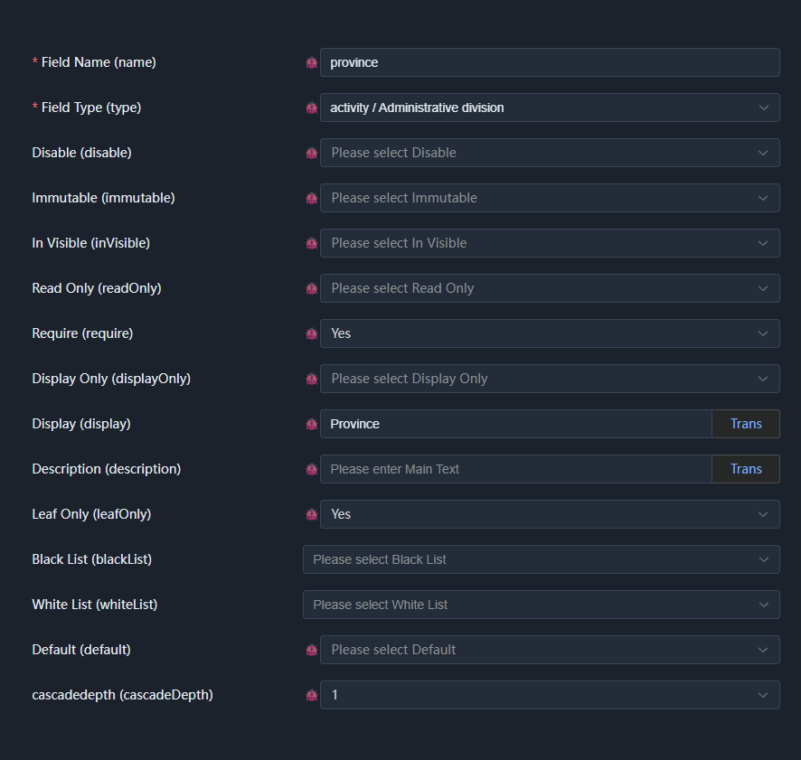
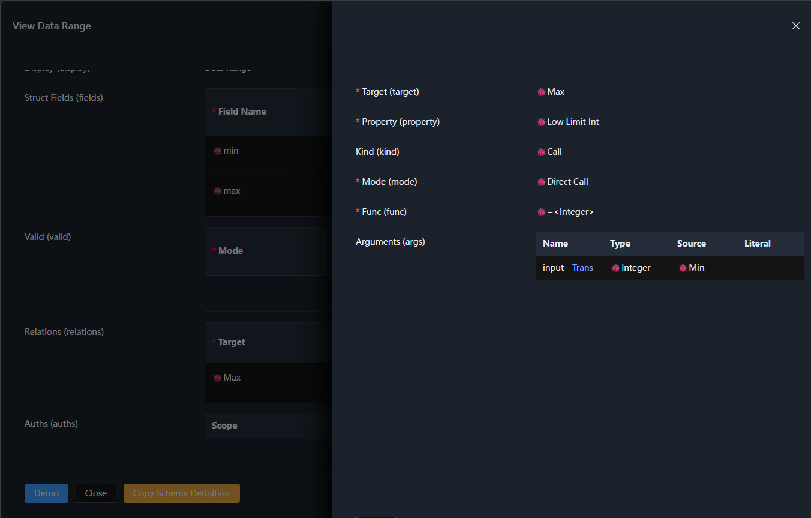
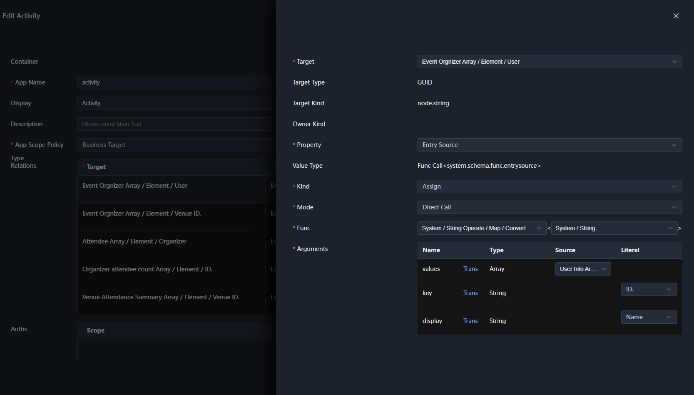

# 05. Struct Prototype

The struct prototype describes a set of named fields. Unlike scalars and enums, the value of a struct consists of multiple fields, and each field is itself a complete semantic type, which can be a scalar, enum, array, or another struct.

The implementation related to structs is concentrated in the following locations:

- `Schema/StructSchema.cs`: struct prototype, definition body, fields, and usage form;
- `Runtime/Type/StructType.cs`: runtime implementation of struct types and fields;
- `Node/StructNode.cs`: struct value node;
- `Generator/StructGenerator.cs`: generating Schema from C# types;
- `Property/Struct/`: struct-related properties such as `StructValue`, `DisplayOnly`, `Unpack`, `Attach`, and `OverrideFields`.

## 1. Generics and Relations

The declaration of the struct prototype is similar to the prototypes introduced earlier. Here we focus on the newly added `Generics` and `Relations`:

```csharp
[Meta<Append>(
    typeof(Generics),
    typeof(Relations),
    typeof(EntrySourceProvider),
    typeof(AccessValueTypeProvider),
    typeof(TypeProvider),
    typeof(KindProvider),
    typeof(Valid))]
```

`Generics` provides generic support, while `Relations` allows structs to participate in the definition and processing of semantic relations. The other properties will not be expanded here for now; they can be understood later in combination with actual usage in the definition domain.

For example, `system.entry<system.string>` is a struct type with a specified generic argument, whose `value` field type is narrowed from the general type `system.object` to `system.string`.

Generics also apply to semantic functions, for example `system.math.add<T>`, whose generic arguments can be constrained to numeric types. Through generic arguments and type constraints, semantic types and functions can reuse structures while preserving type information.


## 2. Struct Fields

The struct definition body stores the field list through `Fields`, and each field is described by `StructFieldSchema`. Its basic structure only has `name` and `type`:

```csharp
[Meta<SchemaType>($"{NS_SYSTEM_SCHEMA_STRUCT}.field")]
[Meta<TypeProvider>(nameof(Type))]
public sealed class StructFieldSchema : PropertyOwner, IErrorProvider
{
    [Meta<SchemaType>(typeof(Identifier))]
    [Meta<PrimaryIndex>]
    public string Name { get; set; } = string.Empty;

    [Meta<SchemaType>(typeof(ValueType))]
    public string Type { get; set; } = string.Empty;

    [SchemaIgnore]
    public string? Error { get; set; }
}
```

Although the `node.struct.field` prototype is declared here, `StructFieldSchema` in C# does not directly attach this prototype. The reason is that the complete definition of a field needs to combine different semantic properties according to the actual usage scenario.

For example, a field itself can have properties such as `Visible`, `ReadOnly`, and `Require`; when the field type is an enum, enum usage properties such as `Cascade` and `Root` may also be needed; if the field type is an array, array-related configuration also needs to be supported.

The frontend `schema-node-core/src/schema/struct/meta.ts` demonstrates this composition process:

```ts
// Declares the definition body of a struct field, attaching the `node.struct.field` prototype
@Meta(SchemaKind, [SCHEMA_KIND_NODE_STRUCT_FIELD, SCHEMA_KIND_ORDER_STRUCT_FIELD])
@Meta(Append, [Disable, Display, Description, Visible, InVisible, Immutable, ReadOnly, Require, OverrideType, Init])
@Meta(SchemaType, `${NS_SYSTEM_SCHEMA_STRUCT}.fielddefine`)
@Meta(Attach, SCHEMA_KIND_NODE_STRUCT_FIELD)
class StructFieldDefine {}

// The complete definition of a struct field, including all possible properties
@Meta(SchemaType, `${NS_SYSTEM_SCHEMA_STRUCT}.field`)
@Meta(TypeProvider, 'type')
class StructFieldSchemaMeta implements StructFieldSchema {
  @Meta(SchemaType, NS_SYSTEM_IDENTIFIER)
  @Meta(Require, true)
  @Meta(PrimaryIndex)
  name!: string;

  @Meta(SchemaType, NS_SYSTEM_SCHEMA_NODE_VALUE_TYPE)
  @Meta(Require, true)
  type!: string;

  // Uses the definition body of the struct field and unpacks all of its content,
  // i.e. all properties associated with node.struct.field
  @Meta(SchemaType, `${NS_SYSTEM_SCHEMA_STRUCT}.fielddefine`)
  @Meta(Unpack, true)
  fieldDefine?: {};

  // When type is an array, unpack the array properties separately
  @Meta(SchemaType, `${NS_SYSTEM_SCHEMA_ARRAY}.usage`)
  @Meta(Unpack, true)
  @Relation(Visible, 'call', buildFuncCall(NS_SYSTEM_SCHEMA_REFLECT_IS_NODE_KIND, "@type", false, NODE_KIND_ARRAY))
  arrayDefine?: {};

  // Unpacks the properties used by the value type of type; if type is an array,
  // the element type of the array is used
  @Meta(SchemaType, NS_SYSTEM_OBJECT)
  @Meta(Unpack, true)
  @Relation(Visible, 'call', buildFuncCall(`${NS_SYSTEM_LOGIC}.notempty`, "@type"))
  @Relation(OverrideType, 'call', buildFuncCall(`${NS_SYSTEM_SCHEMA_REFLECT_TYPE}.getusagetype`, "@type", true))
  valueDefine?: {};
}
```

`StructFieldDefine` declares the properties supported by the field itself, and associates the `node.struct.field` prototype with this definition body through `Attach`.

The complete structure of a field also includes three unpacking entry points:

- `fieldDefine`: unpacks the field's own properties;
- `arrayDefine`: when the field type is an array, provides array usage properties;
- `valueDefine`: unpacks the usage properties corresponding to the field type, and dynamically determines the type used by the properties through `OverrideType`.

Therefore, the final definition of a field is not a simple mapping of a single prototype, but a combination of multiple property sets according to the field type and usage scenario.
This also reflects the actual meaning of `Attach`: it describes the association between a specific definition structure and a prototype, and cannot simply be understood as a C# type naturally being the definition body of that prototype.



> This is also why it was explicitly stated earlier that an entity may attach multiple prototypes. So sometimes it is simpler to view a prototype as an interface, or as an attachment point for properties.


## 3. Data Access Paths

Relations between struct fields often need to locate the target and the source of its arguments through access paths.

For example, simple minimum and maximum constraints can reference fields within the same struct.



But in actual business, the access target may be located within multiple nested layers of arrays and structs. As semantic types keep composing, the depth and structure of access paths cannot be predetermined by the kernel.



For this purpose, SchemaNode provides access-path-related capabilities through `IValueTypeAccess`:

```csharp
IValueTypeAccess? GetAccessValueType(string path);
IEnumerable<Entry<string>> GetAccessEntries();
bool HasAccessEntries { get; }
```

For `StructType`, the accessible entries come from its field list. Each field in turn has its own value type; if that type continues to provide access paths, access can continue along the type structure.

In this way, the relation mechanism does not need built-in path parsing rules for various data structures. Instead, it determines paths and target value types layer by layer through the access information provided by types.

## 4. General Access Paths

In addition to the access paths provided by types themselves, the system also defines general access paths. For example, `SelfAccessPath` provides `$self`, used to access the current node itself:

```csharp
public class SelfAccessPath : IValueAccessPathHandler
{
    public Task LoadAsync(ISchemaContext context) => Task.CompletedTask;

    public string Path => NODE_SELF;

    public IValueTypeAccess? GetAccessValueType(IValueTypeAccess owner)
        => owner;

    public IValueAccess? GetAccessValue(
        IValueAccess owner,
        IValueAccess? node = null)
        => node ?? owner;
}
```

Such general paths are the part of the existing implementation that has not yet fully converged into the prototype contract. At present it mainly serves type usage in the definition domain, and can be understood as an independent auxiliary mechanism for now, rather than as established public semantics.

## 5. Struct Validation

`StructValue` is the validation property dedicated to structs. When struct data triggers validation, it is responsible for iterating over the fields and executing the corresponding constraint validation, then handling the relation validation declared by the struct type.

The core logic can be summarized as:

```csharp
foreach (var field in type.GetFields().Where(f => f.Type != null && f.DisplayOnly != true))
{
    if (node.GetAccessValue(field.Name) is not { } dataNode)
        continue;

    // Validate based on field constraints
    foreach (IConstraintProperty constraint in field.Constraints)
    {
        bool? result = await constraint.ValidateAsync(context, dataNode);
        if (result.HasValue)
            dataNode.RecordConstraint(constraint, result.Value);
    }
}

await type.ValidateWithRelationsAsync(context, node);
```

Field constraints and relation validation jointly participate in the struct validation process. Relations can provide additional validation grounds, so struct validation cannot simply be understood as independently performing one check on each field; the final behavior depends on the specific definitions of field constraints and related relations.

The key here is the separation of responsibilities: `StructValue` is responsible for organizing the struct validation process, specific constraints are handled by the corresponding semantic properties and their execution logic, and relations describe the associations between properties.


## 6. The Unpack Property

`Unpack` can unpack the internal structure of a field into the parent structure. For example, in a dynamic column scenario, `data` can first be declared as `system.object`, and then the actual type can be provided through `OverrideType` or `OverrideFields`.

The default data structure might be:

```json
{
  "name": "Alice",
  "data": {
    "age": 18,
    "gender": "Male"
  }
}
```

When the `data` field is unpacked with `Unpack`, the presented data structure can become:

```json
{
  "name": "Alice",
  "age": 18,
  "gender": "Male"
}
```

`Unpack` shows how semantic properties can affect how a structure is unpacked, without defining dedicated types for different data structures. It also shows that a semantic type describes not only fields and data values, but can also express how data is organized in a particular scenario through properties.

Other field properties, such as `Require`, `Visible`, and `ReadOnly`, can also be further understood by combining the semantic configuration interface and the corresponding property implementations.


## 7. Summary

The struct prototype builds composite semantic types from a field list, supports nested paths through the type access mechanism, describes associations between fields through relations, and organizes constraint execution through the struct validation property.

The definition of a field itself reflects the composition of prototypes and properties: the basic structure of a field is relatively simple, and the complete semantic definition is unpacked according to the field type and usage scenario. Properties such as `Unpack` further show that the semantics of a struct includes not only the data structure itself, but also how the data is organized and used.
