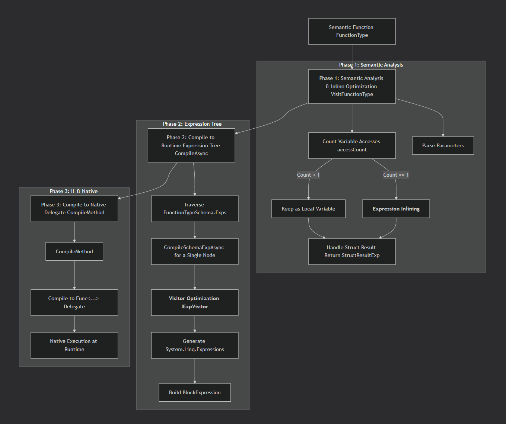

# 08. Function Prototype

The function prototype describes a callable computation unit. A function accepts a set of named arguments, returns a value, and can also be composed into more complex computations through expressions.

Unlike other prototypes, a function is not a data value, does not create ordinary data nodes, and does not participate in struct field layout. It describes computation, and is referenced by properties, relations, and expressions through function calls.

The implementation related to functions is mainly concentrated in the following locations:

- `Schema/FunctionSchema.cs`: function definition, arguments, expressions, and call structures.
- `Runtime/Type/FunctionType.cs`: function type loading and call execution.
- `Generator/FunctionGenerator.cs`: generating function Schema from C# static methods.

## 1. Prototype Declaration and Definition Body

The function prototype is declared through `FunctionKind`:

```csharp
[Meta<SchemaKind>(SCHEMA_KIND_NODE_FUNCTION, SCHEMA_KIND_ORDER_FUNC)]
[Meta<NodeKind>(NODE_KIND_FUNCTION, SCHEMA_KIND_ORDER_FUNC)]
[Meta<NodeType>(typeof(FunctionType))]
[Meta<SchemaGenerator>(typeof(FunctionGenerator))]
[Meta<Append>(typeof(Generics), typeof(Relations))]
public sealed class FunctionKind;
```

This declaration determines the function's classification, runtime type, generation approach, and the generics and relations the function supports. The function definition is attached to the corresponding semantic type through `FunctionProperty`. A function's relations mainly manifest on its arguments; when the function is called, the actual arguments are constrained by relations, ensuring that argument usage conforms to the function definition.

The function definition body `FunctionSchema` contains three main fields:

```csharp
public sealed class FunctionSchema : PropertyOwner
{
    public string Return { get; set; } = string.Empty;
    public FuncArg[]? Args { get; set; } = [];
    public FuncExp[] Exps { get; set; } = [];
}
```

- `Return`: the semantic type of the function's return value.
- `Args`: the list of named arguments; each argument declares a name and type, and can have properties such as required and default value attached.
- `Exps`: the list of expressions, used to compose function calls and form the function body.

For example, an age validation function can be declared as:

```json
{
  "namespace": "example",
  "name": "checkAge",
  "kind": "function",
  "function": {
    "return": "system.bool",
    "args": [
      {
        "name": "age",
        "type": "system.int",
        "require": true
      }
    ],
    "exps": [
      {
        "name": "E1",
        "return": "system.bool",
        "call": {
          "func": "system.logic.gt",
          "mode": "call",
          "args": [
            { "source": "age" },
            { "value": 18 }
          ]
        }
      }
    ]
  }
}
```

This definition declares a function that accepts an integer argument and returns a boolean. Expression `E1` calls `system.logic.gt`, comparing whether the argument `age` is greater than or equal to 18.

Expressions can reference function arguments, and can also reference the results of previous expressions, thereby forming a computation chain. By default, the value of the last expression is used as the function's return value.

However, if the function's return type is a struct and the return value of the last expression does not satisfy it, then based on the struct's field names, matching values are found from the function's arguments and expressions, and their values are constructed into the struct to return. Therefore, when the return type is a struct, the struct's fields become an optional list of expression names, making configuration easier.


## 2. Function Calls

`FuncCall` describes a single function call, as distinguished from `FunctionSchema` which describes the function itself. It contains the function being called, the call mode, the arguments, and type information related to the call result.

Call arguments are represented by `CallArg`, with two sources:

- `Source`: a value read from the current context, such as a function argument, an expression result, or an access path.
- `Value`: a directly provided literal constant.

For example:

```json
{
  "func": "system.logic.gte",
  "mode": "call",
  "args": [
    { "source": "age" },
    { "value": 18 }
  ]
}
```

Here `age` is an argument read from the context, while `18` is a literal constant.

`FuncCall` unifies the description of function calls, so expressions, properties, and relations can reuse the same call structure without each defining its own function call format.

## 3. Call Modes

Function calls are not limited to direct single execution. `ApplyMode` also defines application modes for collections:

| Mode | Meaning |
| --- | --- |
| `Call` | Call once directly |
| `Map` | Call on each collection element separately, forming a result collection |
| `Reduce` | Perform an accumulating computation over a collection |
| `First` / `Last` | Find the first or last element satisfying a condition |
| `Filter` | Filter elements satisfying a condition |
| `Count` | Count the elements satisfying a condition |
| `All` / `Any` | Determine whether all elements or any element satisfy a condition |

These modes are carried by the same call description. The call mode determines how the function is applied to an argument collection, rather than requiring each mode to define an independent function type.

This design is that of functional higher-order functions, but we do not want to pass functions as arguments, so we weaken higher-order functions into call modes, allowing the system to call functions based on the mode.

The actually available modes are provided by the runtime according to information such as the function's return type, and are constrained by relations in the call definition.


## 4. Runtime and Execution Sources

`FunctionType` is responsible for loading function definitions and converting arguments, expressions, return types, and relations into structures usable at runtime.

There are three main execution sources for functions:

- **System functions**: implemented by C# static methods, such as `system.logic.gte`.
- **Expression functions**: compose other function calls through `Exps`, interpreted or compiled for execution by the runtime.
- **Remote functions**: have no local expression implementation, and are handed over to an external provider for execution through `IFunctionSchemaProvider`.

The three sources share the same function definition and call contract, but their concrete execution approaches differ. Especially for remote functions, the caller can depend only on the function Schema without holding its actual implementation.

The function prototype also supports generics, argument default values, variadic arguments, and flags such as `ServerOnly`, `NoCache`, and `Converter`. This information is attached to functions or arguments through properties and relations, and consumed by the runtime during loading, validation, and execution.


## 5. Generation from C# Static Methods

In addition to declaring JSON Schema directly, SchemaNode can also convert C# static methods into function definitions through `FunctionGenerator`.

The generator parses arguments and return types from the method signature, and reads related metadata. For example, argument default values, nullability, variadic declarations, and type overrides can all affect the generation result; XML documentation comments can be used to generate descriptions for functions and arguments.

For example:

```csharp
/// <summary>Logic operations</summary>
[Meta<SchemaType>("system.logic")]
public static class SystemLogic
{
    /// <summary>Greater than or equal</summary>
    public static bool Gte(long left, long right)
        => left >= right;
}
```

This method can generate the `system.logic.gte` function Schema, containing two integer arguments and a boolean return type. Since system functions already have a C# implementation, their definitions do not need to provide an expression body.

The generation mechanism allows existing code to enter the unified semantic description system; while directly declared expression functions and remote functions can use the same call structure without requiring a local C# method implementation.


## 6. The Multi-Target Compilation System for Functions

In C#, semantic functions go through two compilations: one for the semantic execution tree, and one for the expression execution tree. They are ultimately compiled into a Delegate to ensure native execution performance.



But the main purpose of the second compilation is to transform the compiled result based on the intent of the semantic function and the call scenario.

For example, in the App dialect, access to a table may be defined across multiple calls: the first specifies the data source, then the `Filter` mode may be used multiple times for filtering. If the function were executed rigidly expression by expression, the first request specifying the data source would pull all the data, which is not allowed (in fact, direct execution returns nothing). During compilation, such processing is merged, and function calls such as `Skip` and `Take` are added, finally forming a request.

There are many more such transformations, so this system does not simply compile semantic functions directly. Instead, it treats semantic functions as intent together with the call scenario, performs semantic reasoning, and then completes compilation. This ensures performance while also ensuring uniqueness based on semantics, achieving substantial system optimization and specialization. More examples can be seen in the App dialect.

The foundation of this system is implemented in `Runtime/Compile`. Those interested can ask AI to help guide the reading, because first implementing the semantic execution tree and then the expression execution tree are both compiler-oriented implementations.


## 7. Summary

The function prototype organizes computation descriptions into several interrelated parts:

- The **function definition body** describes the return type, arguments, and expressions.
- **`FuncCall`** describes a single call, including the function, call mode, and argument sources.
- **Expressions** compose multiple calls into more complex computations.
- The **runtime** is responsible for loading function definitions and choosing the corresponding execution approach according to the function's execution source.
- The **generator** allows generating function definitions conforming to the unified structure from C# static methods.

A function does not need to hold business data, nor depend on a fixed execution approach. Through unified semantic definitions and call structures, it is reused by properties, relations, and expressions; concrete computation can be completed by local methods, expression execution mechanisms, or remote providers.
