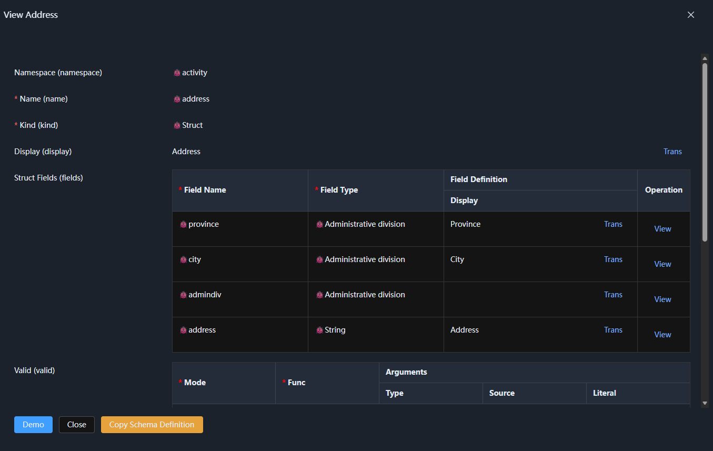
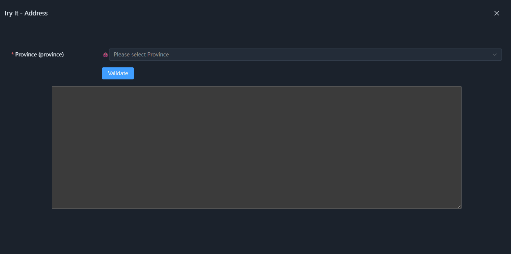
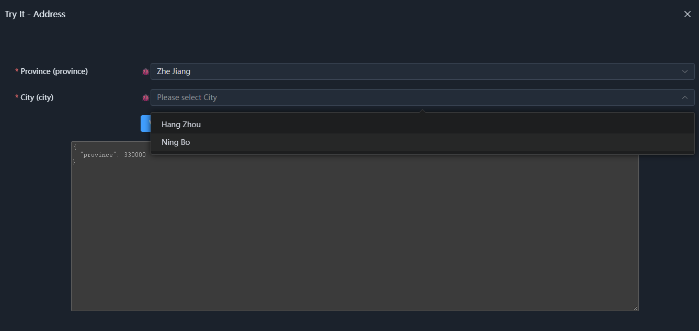
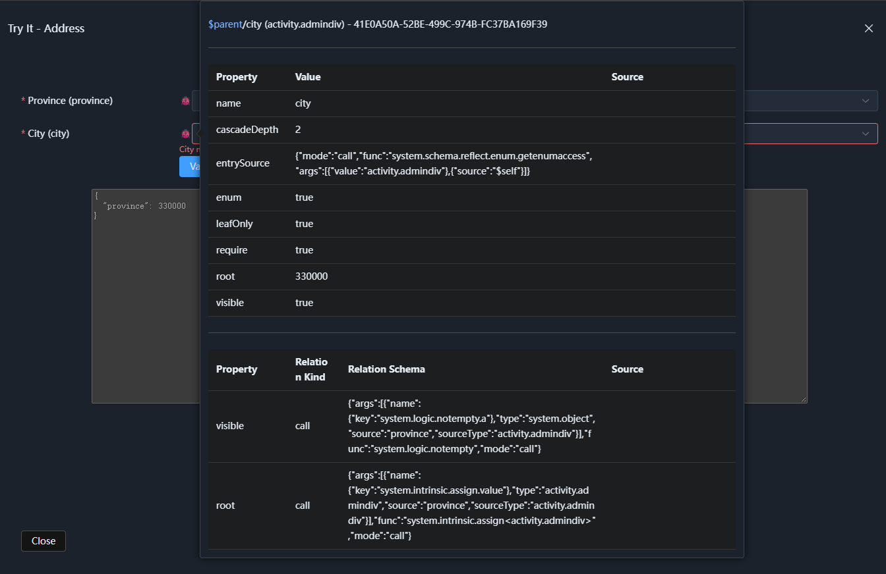
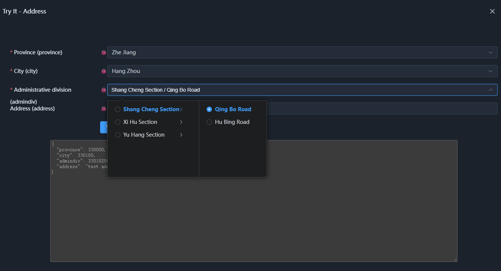
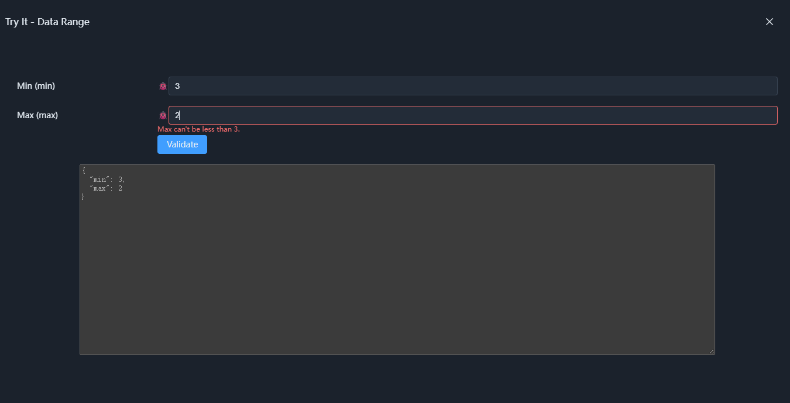
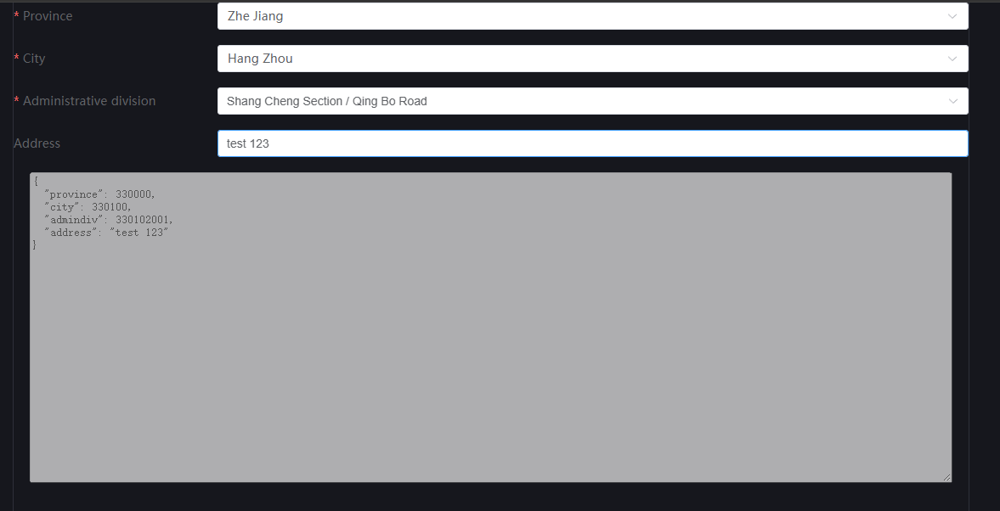

# 01. Semantic Type Demo

This section demonstrates the basic usage of semantic types. No need to download the source code — you can run it directly in the browser.

1. Download the [/schema/type.json](./schema/type.json) file, which contains three test types. After downloading, you can inspect it yourself, or use it directly.

2. Open [https://kurapica.github.io/schema-node-man/#/type](https://kurapica.github.io/schema-node-man/#/type), as shown:

    

    It is recommended to enable **Debug Mode** so you can view the dynamic properties and relations of semantic nodes.

3. Click upload and select the `type.json` file you just downloaded. You will see a new namespace called `activity` has appeared. Click into it to see three semantic types:

    

    The `address` type depends on the `admindiv` (administrative division) type, so this test is based on the `address` and `minmax` types.

4. Click the view button of the `address` type. You can see that its first three fields all use the `admindiv` semantic type, as shown:

    

    You can skip the details and directly click the **Demo** button at the bottom left to view sample data of the address type.

    

    After selecting a `Province`, you can see the choices for `City`:

    

    Because **Debug Mode** is enabled, a 🐞 icon appears on the left side inside the input box. Hovering the mouse over it shows all the properties and relations of this node. Here `root` corresponds to the selected `Province` value, which limits the selection range of the city. Meanwhile, `cascadeDepth` limits the depth of the cascade selection, ensuring that only the city can be chosen, not lower-level administrative divisions.

    

    Continue selecting until the entire address input is completed.

    


5. You can also view the `minmax` type, which is simpler: it restricts the lower limit of the maximum value to the entered minimum value:

    

    After closing the demo panel, you can find it in the relation configuration below:

    

    If you open `type.json` manually, you can also find the declaration of this relation:

    ```json
    "relations": [
        {
        "call": {
            "args": [
            {
                "type": "system.int",
                "source": "min"
            }
            ],
            "func": "system.intrinsic.assign<system.int>",
            "mode": "call"
        },
        "kind": "call",
        "target": "max",
        "property": "lowlimit"
        }
    ]
    ```

The above introduction covers enum and struct types, as well as relation configuration. Feel free to modify them yourself. If anything goes wrong, just select `Clear Cached Types` in the interface.

**Type Management** corresponds to the definition domain and public semantic prototypes provided by SchemaNode Core, used to define and manage semantic types. If more sub-type prototypes are defined for the `node` prototype, their definition and management can also be completed here based on the semantics carried by the prototypes,


## How to Integrate into a Frontend Project

If you are not considering the backend and want to bring semantic types into a frontend project, you can refer to the following steps:

# Create a Frontend Project Based on SchemaNode

A SchemaNode frontend project consists of the following three core packages:

- `schema-node-core`: the SchemaNode core runtime
- `schema-node-app`: application-layer capabilities
- `schema-node-vue-view`: the Vue 3 UI view layer

In addition, you need to install:

- Vue 3
- Element Plus

## 1. Create a Vue 3 Project

Use Vite to create a new Vue 3 + TypeScript project:

```bash
npm create vite@latest my-schema-app -- --template vue-ts
cd my-schema-app
npm install
```

You can also create the Vue 3 project in other ways, as long as you ultimately use Vue 3 + TypeScript.

## 2. Install SchemaNode

Install the SchemaNode core packages:

```bash
npm install schema-node-core schema-node-app schema-node-vue-view
```

Install Vue 3 and Element Plus:

```bash
npm install vue element-plus
```

If Vue was already included when creating the project, there is no need to install it again.

## 3. Configure the Entry File

Put the previously downloaded `type.json` file into the project's `src/assets` directory.

Open `src/main.ts`, import Element Plus, and load `type.json` and the SchemaNode core packages:

```ts
import { createApp } from 'vue'
import './style.css'
import App from './App.vue'
import ElementPlus from 'element-plus'
import 'element-plus/dist/index.css'
import schema from './assets/type.json' // Load the semantic type file
import { initSchemaRuntime, saveNodeSchema, setLanguage } from 'schema-node-core'

setLanguage('zhCN') // Set the language to Chinese
initSchemaRuntime() // Initialize the SchemaNode runtime
saveNodeSchema(schema) // Register the semantic types from the JSON file

const app = createApp(App)

app.use(ElementPlus)

app.mount('#app')

```

## 4. Modify the Code in `App.vue`

Change it to:

```ts
<template>
  <el-form label-width="240px" :model="data!" label-position="left" >
    <schema-view
      text="left"
      type="activity.address"
      :in-form="SchemaNodeFormType.ExpandAll"
      v-model="data"
    ></schema-view>
    <section style="width: 100%;text-align: center;">
      <textarea style="width:72lh;height: 20rem;" disabled>{{ data }}</textarea>
    </section>
  </el-form>
</template>

<script lang="ts" setup>
import { _LS } from "schema-node-core"
import { ElForm } from "element-plus"
import { schemaView, _L, SchemaNodeFormType } from "schema-node-vue-view"
import { ref } from "vue";

const data = ref(null)

</script>
```

`schema-view` is the universal component provided by `schema-node-vue-view` for rendering SchemaNode semantic data nodes. Here, `type="activity.address"` specifies the semantic type to render.

After saving, you can use `npm run dev` to see the result:



Among the three packages, only `schema-node-core` is the core package. Something like `schema-node-vue-view` is a sample view library that is relatively easy to replace, though for internal or configuration UI purposes it is sufficient.

More detailed customization will be introduced in the `schema-node-core` documentation.
