# 02. App Application Demo

This demo takes about 10 minutes, walking through the complete process from application configuration to automatic data flow. If you only want a quick look at the core capabilities, you can jump directly to **Application Demo**.

SchemaNode Core is a pure class library implemented in C#, responsible for the definition domain, public semantic consensus, and related semantic runtime capabilities, but it does not directly provide a complete business application execution environment or external service interfaces.

The business application and its execution capabilities demonstrated in this chapter are provided by the SchemaNode App dialect.

SchemaNode App is not part of Core; it is a set of application prototypes and their execution implementations built on actual business practice, oriented toward conventional business development.

It provides application management, tenant isolation, data models and views, CRUD, role permissions and data permissions, data push, and data lineage tracing based on semantic functions. The workflow part is not yet open.

App is a dialect implementation built on top of public semantic consensus. It can be used as a reference, or modified directly according to actual needs. The SchemaNode project focuses on the stability of the public semantic core, rather than requiring all applications to adopt the same business implementation.

The following example demonstrates access permission management, row-level data permissions and filtering, data push, data lineage tracing resolved via semantic functions, and some cross-table data associations, all built on App.


## Environment Preparation

1. Download this project `https://github.com/kurapica/schema-node-csharp`. After extracting, open `SchemaNode.sln`, then open the `Program.cs` file of `SchemaNode.Example`.

    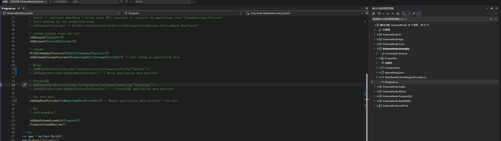

    The key point here is the database configuration. The project ships with MySql, PostgreSQL, and an in-memory simplified data source for testing only.

    If you have no special requirements, keep the defaults and use the test data source. If you want to see the database table structures automatically generated and maintained by App, you can comment out `.AddAppDataProvider<InMemoryAppDataProvider>()`, then enable the code for the corresponding database and modify the connection strings in `appsettings.json`.

---

2. Start `SchemaNode.Example`. For now, no other startup details matter.

    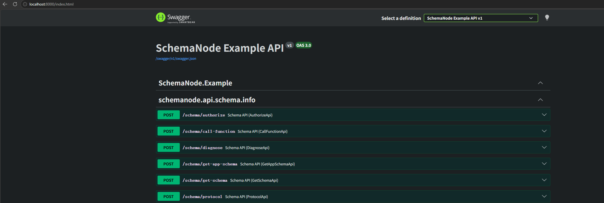

    After startup, you can see the project's `Swagger`. These API endpoints are all provided by the SchemaNode.App project. The project's APIs are designed around prototypes, not around semantic types. Therefore, the number of APIs only relates to the number of semantic prototypes.

    For now, there is no need to pay attention to these APIs either. Change the browser address to `http://localhost:8000/schema-node-man#/app`, and you will see the application configuration interface.

---

3. This UI is a compiled version of `schema-node-man`; you can replace it by replacing `SchemaNode.App/www.zip`. Unlike `Type Management`, which can be used purely on the frontend, `Application Management` can only be used when connected to the backend server.

    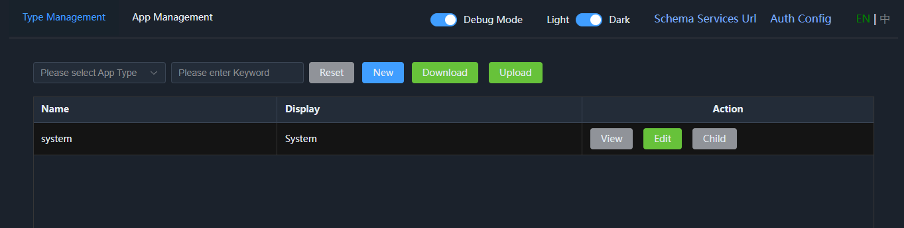

---

4. Download the following app definition files and upload them in order:

    * [User domain - User management](./app/user.json)
    * [Organization domain - Venue management](./app/org.json)
    * [Activity domain - Activity management](./app/activity.json)

    After uploading, you will see three more applications, and the preparation is complete.

    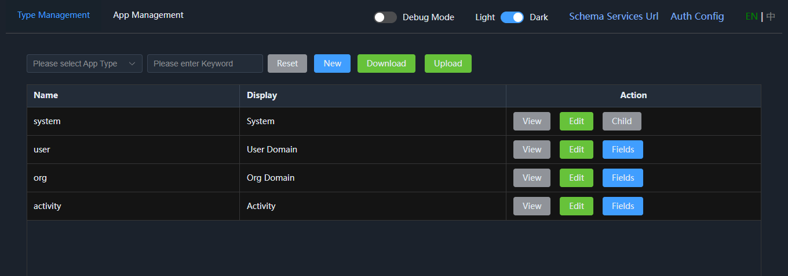

    Although this is a configuration interface, through the application field demos we can also perform actual CRUD operations. Below is a demonstration of driving several applications to execute based on semantic configuration.

    > The JSON files uploaded here are not hand-written configuration files; they are complete application definitions exported after operations in the configuration interface. In actual use, you usually do not need to touch these JSON files at all — all applications, fields, permissions, and relations are completed in the configuration interface. JSON is only used to migrate applications between different environments, or to send separately for troubleshooting.


## User Preparation and Configuring Access Permissions

1. Add users

    In the figure above, click the `Fields` button of the row corresponding to the user domain, then click `Demo`, then click `Load Data`. Click the `Add` button to add a few users, configure the first user as `Is Admin`, and make note of these users' IDs. Then save.

    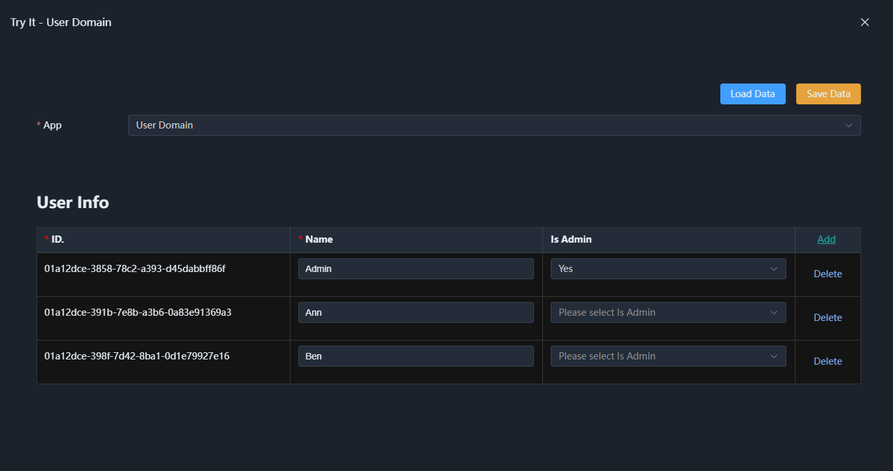

---

2. Configure user request headers

    In web services, after a request passes through the gateway, information such as the user and tenant is usually attached to the request headers. This is important request context.

    Returning to the application management page, click `Authentication Configuration`. Here we configure the request headers to simulate the context:

    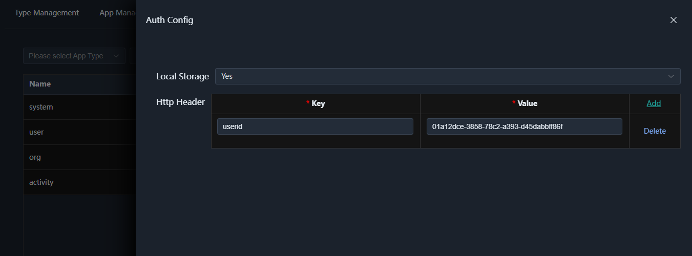

    Note: select `Yes` for `Local Storage`, enter `userid` for the HTTP header, and use the admin's ID as the value.

---

3. Enable access permissions

    In the previous chapter and when uploading the types and applications above, there were no permission restrictions — everyone could access everything. Now that we have users, we can begin fine-grained permission management for the entire system.

    3.1 Configure semantic type access permissions
    ---

    Switch to the `Type Management` screen, find the `system` type, then edit it and add permission management for it. The `Auths` property is a property that SchemaNode.App attaches to the `node` prototype. It can configure parameterless functions returning boolean values as its evaluators. Inside, these functions obtain the current visitor's userid, orgid, etc. from the request context to complete the validation.

    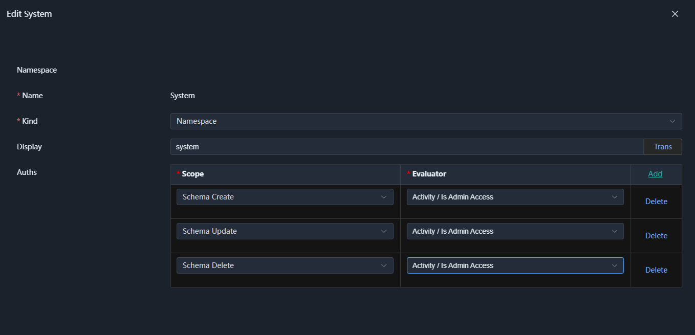

    > Be careful not to configure `Type definition read`, as it will affect subsequent tests

    Here, select `Activity/Is Admin Access` as the evaluator. If you don't see this function, refresh the browser so it fetches from the server again. This function comes with the App uploaded earlier; if interested, you can inspect it yourself — its implementation simply queries the user domain's table by `userid` to check whether the user exists and is an admin.

    After configuration, try changing the id in `Authentication Configuration`. After refreshing, you will see that editing and adding are disabled. Of course, the actual restriction is enforced on the backend. The frontend adjusts the interface operations according to permission evaluation results, but this is only the visual manifestation of the permission mechanism. Actual access control is still enforced by the backend — security must not rely solely on the frontend disabling buttons.

    The system namespace is used here for configuration because permission checking uses inheritance: if a user has permission on a parent type, they have the corresponding permissions on all child types. But the parent namespace of system cannot be accessed, while the system namespace always exists. So just use its permission configuration as the permission configuration of the top-level namespace. This way, the admin has all permissions on the topmost namespace, and naturally can access and modify all semantic types.

    
    3.2 Configure application access permissions
    ---

    After switching to `Application Management`, you can likewise configure the `system` application container. However, compared with types, there is an additional data management permission to configure:

    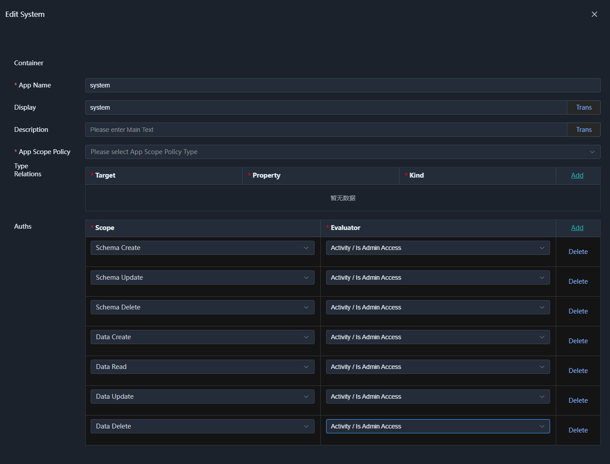

    > Note: do not configure `Type definition read`, as it will affect subsequent tests

    Afterwards, you can also configure access permissions on the application's fields for fine-grained management. Application fields inherit the permissions of the application they belong to, and applications inherit the permissions of the application container they belong to, and so on.

---

## Application Demo

1. Add activity venues. Use `Organization domain` - `Fields` - `Demo` to add a few venues for later use:

    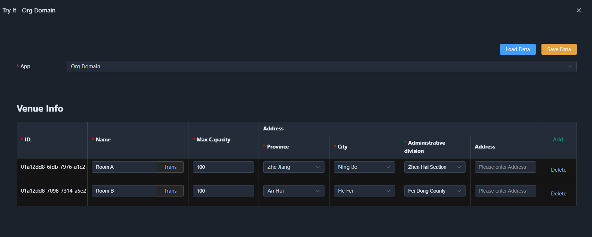

---

2. Open `Activity domain` - `Fields` - `Demo`. Unlike the two applications above, the `user` and `org` applications are system-level applications whose data is used globally, while the activity domain uses the `Business Target` configuration. It requires a `target` as the application's target, which can be a user id, organization id, project id, etc.

    > The App system was initially designed to integrate into microservices rather than replace them. Therefore, things like project management do not necessarily have to be managed in the SchemaNode App project; SchemaNode is mainly responsible for the project's business implementation and future iteration.

    > Semantic programming is also not a replacement for existing project development models; it is more suitable for scenarios with complex business and long-term iterative maintenance.

    > So in practice, we adopt a hybrid mode. Forcibly requiring everything to go through semantic declarations would, in some cases, cost more than it returns.

    > In the detailed introduction of the App system, you will see further configuration approaches for access isolation based on tenants.

    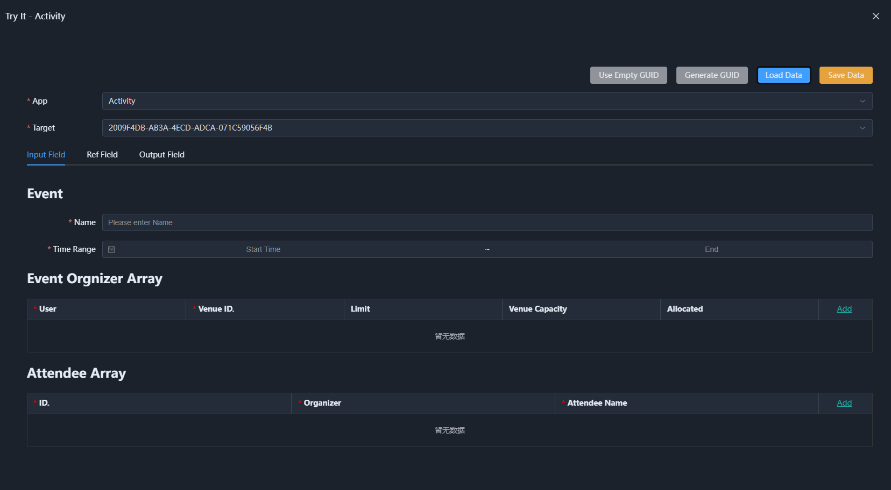

    Use `Generate GUID` to construct a target, then `Load Data`. Now let's fill in some activity information:

    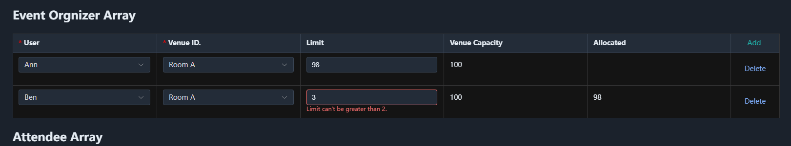

    In fact, you may notice here that both users and venues are selected from the previously entered users and venues. If you go back to the activity's field list, you will find:

    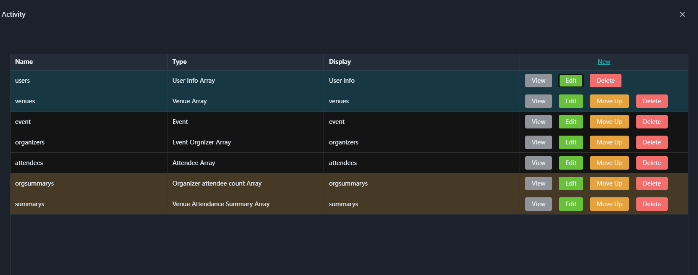

    The `users` and `venues` at the top are view fields. Since the source application is system-level, referencing is simple: as long as the field type matches the type of the target application's field, it can be selected.

    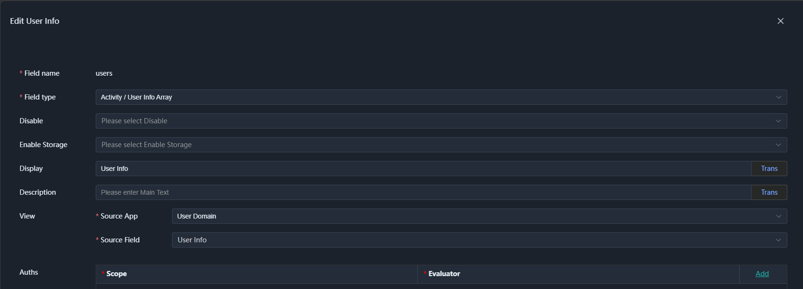

    Back on the demo panel, you can view the referenced data and see the entered data.

    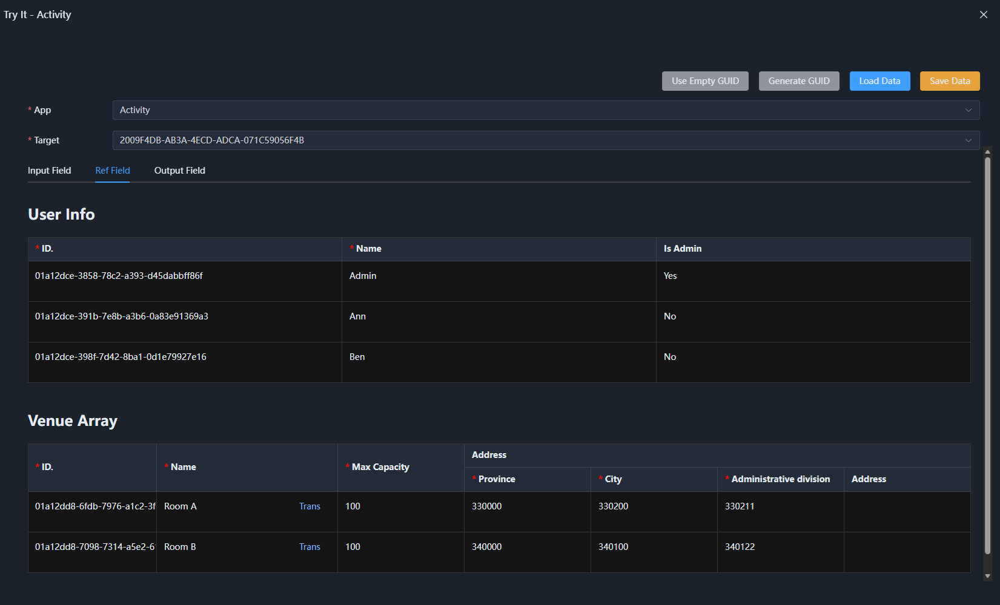

    After confirming this, return to the `Application Management` interface, then edit `activity (Activity domain)`. You can see some associations, like:

    

    The node corresponding to the App is the parent node of all the field nodes, so it can configure cross-field associations. However, note that App associations differ from associations inside semantic types: the data on the page may be paginated and thus incomplete, so their use is generally limited, and the backend almost never processes based on such associations.

    Here we use `User List` and `Venue List` to provide name lists for entering `Attendee Array`, so we don't need to input IDs.

    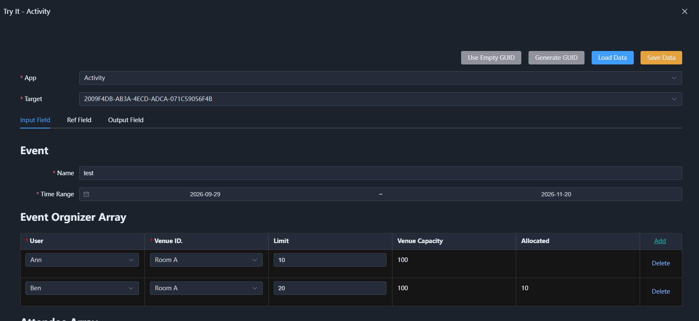

    Finally, enter two records like this to create two activity organizers. After saving, enter Ann's user ID into `Authentication Configuration`, then refresh the interface. We switch users and visit the `Activity domain` again.

---

3. Fill in attendee data as an organizer. There is also a column for the organizer's own ID, but it is set to hidden when the user is the organizer.

    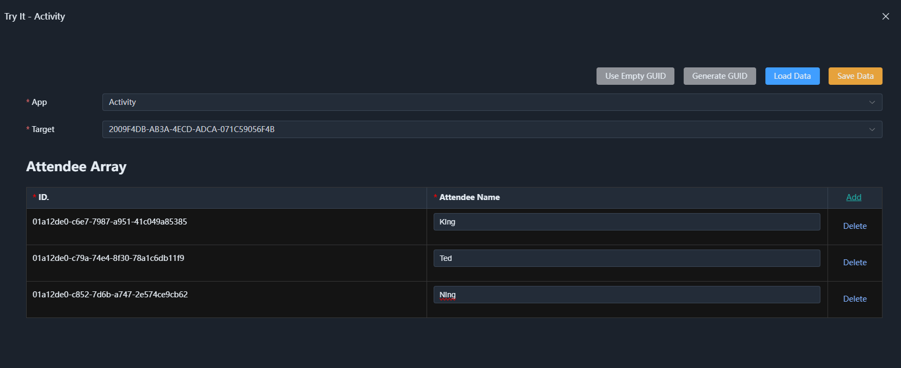

    If you are not using the in-memory data source but something like MySql, after saving you can `Load Data` again and then view the SQL — you will see that the organizer's own ID is used in the query.

    This configuration is set in the row-level data permissions and filtering of the attendee:

    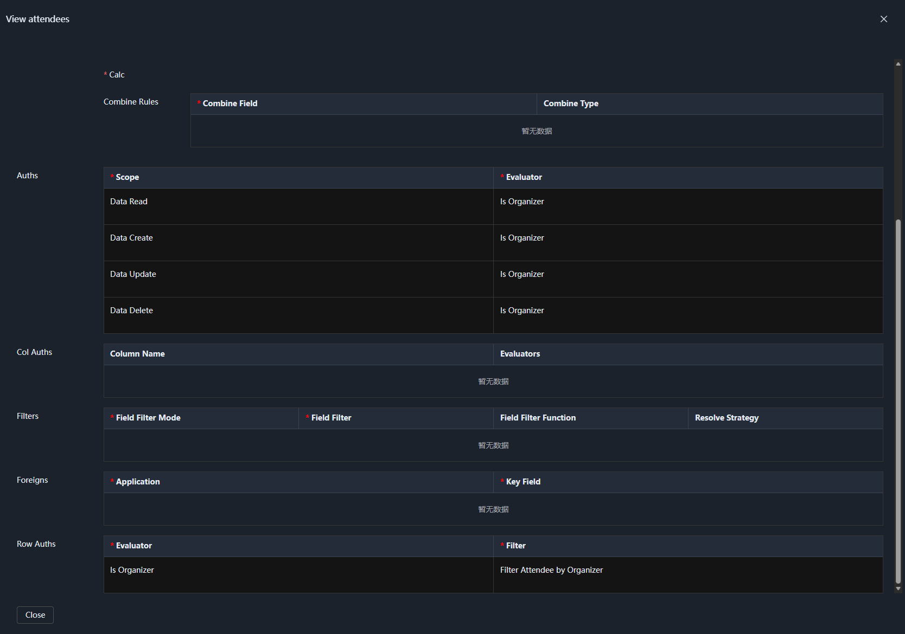

    Filtering by organizer is a fairly simple function: the current user id equals the data's orgnizer:

    ```js
    (attendee) => attendee.orgnizer = system.data.getcontext('user.id')
    ```

    This row filter condition serves as validation when uploading data, and as a filter condition when querying. It is merged with other query conditions and passed as the final query execution tree to the data layer to complete the query.

---

4. Change `Authentication Configuration` to the admin ID, then reopen the project and look at `Output Fields`:

    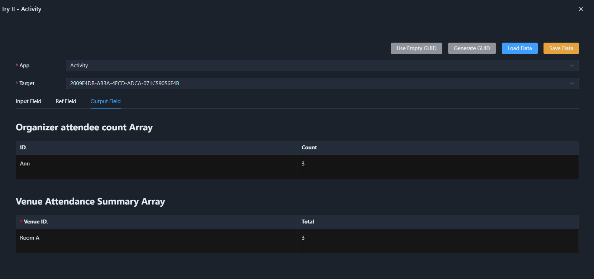

    `Organizer attendance summary` is a summary record obtained by counting with the attendee's `orgnizer` as the key.

    `Venue summary` is aggregated using the venue id that the `orgnizer` belongs to as the key. Here lineage tracing is actually already required, because the aggregation is done across tables.

---

5. **Modify Ann's venue**, and you can see the summary data transfer:

    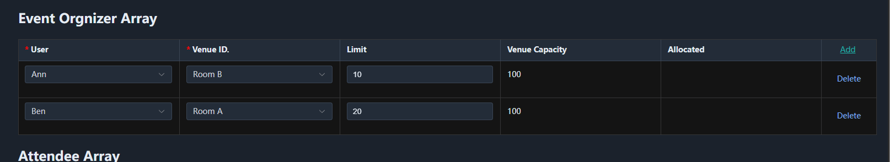

    Then save and reload the data:

    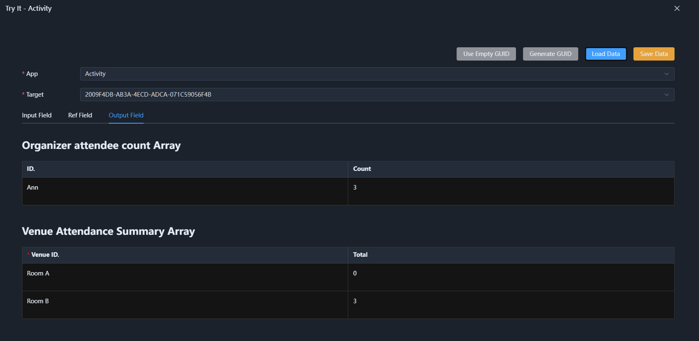

    The attendee count summary with Ann as organizer has not changed, but the venue attendance summary data has transferred.

---

6. Now return to the field list and view or edit `Venue Attendance Summary Array`. You can see:

    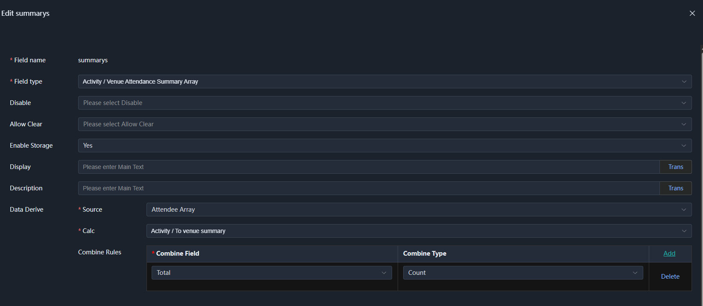

    It specifies the data source field and the function used for computation, then configures the aggregation rule as counting. Other than that, no special configuration is needed.

    You can further go to Type Management to view the semantic function `Activity/Generate venue summary`. In its definition:

    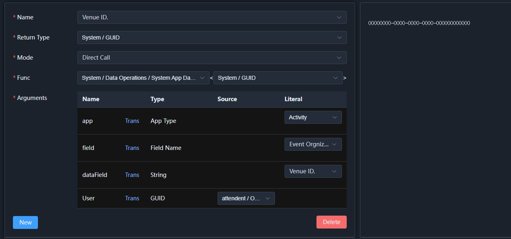

    The venue ID is obtained using a specific semantic function, fetched from a third-party field. Both the key it fetches and the key it queries are explicit in this call, and the records obtained by resolving via semantic functions will be registered. Therefore, when the organizer's venue is modified, the system can determine based on the registered records that the venue attendance summary needs to be recomputed, and that the venues involved are the old and new values of this organizer's venue.


## Workflows

### Workflow Example

A workflow defines a business process triggered by events, timers, manual invocations, or other triggers. The Activity app includes a sample workflow, which is currently inactive. Click **Edit** to explore its configuration.

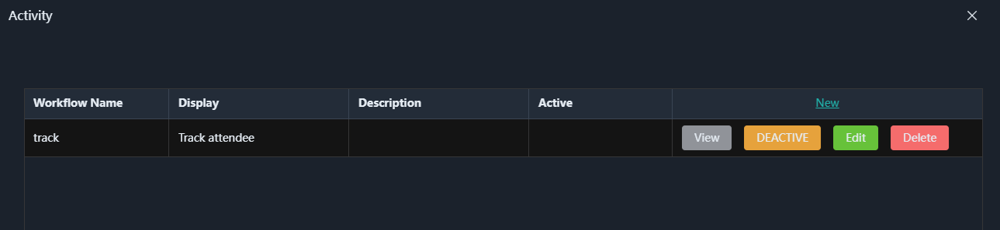

A workflow consists of multiple nodes organized as a directed acyclic graph (DAG). When an upstream node completes, its downstream nodes can be triggered for execution.

The workflow shown here consists of the following nodes:

- `start`: Waits for an application data creation event and captures the event payload for subsequent processing.
- `totrack`: Transforms the newly created data record into a tracking record.
- `savetrack`: Saves the tracking record to the database. This node invokes a function designated exclusively for workflow use, which cannot be called externally.

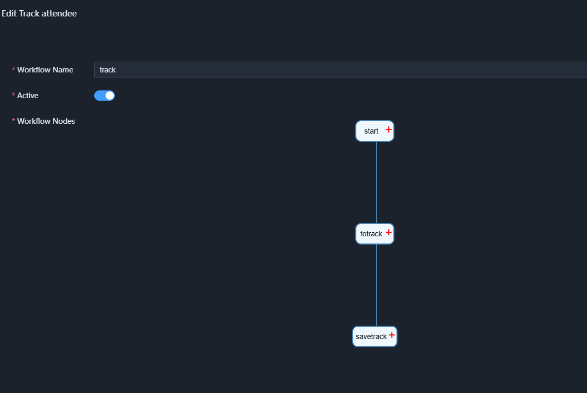

Open the `start` node to inspect its configuration.

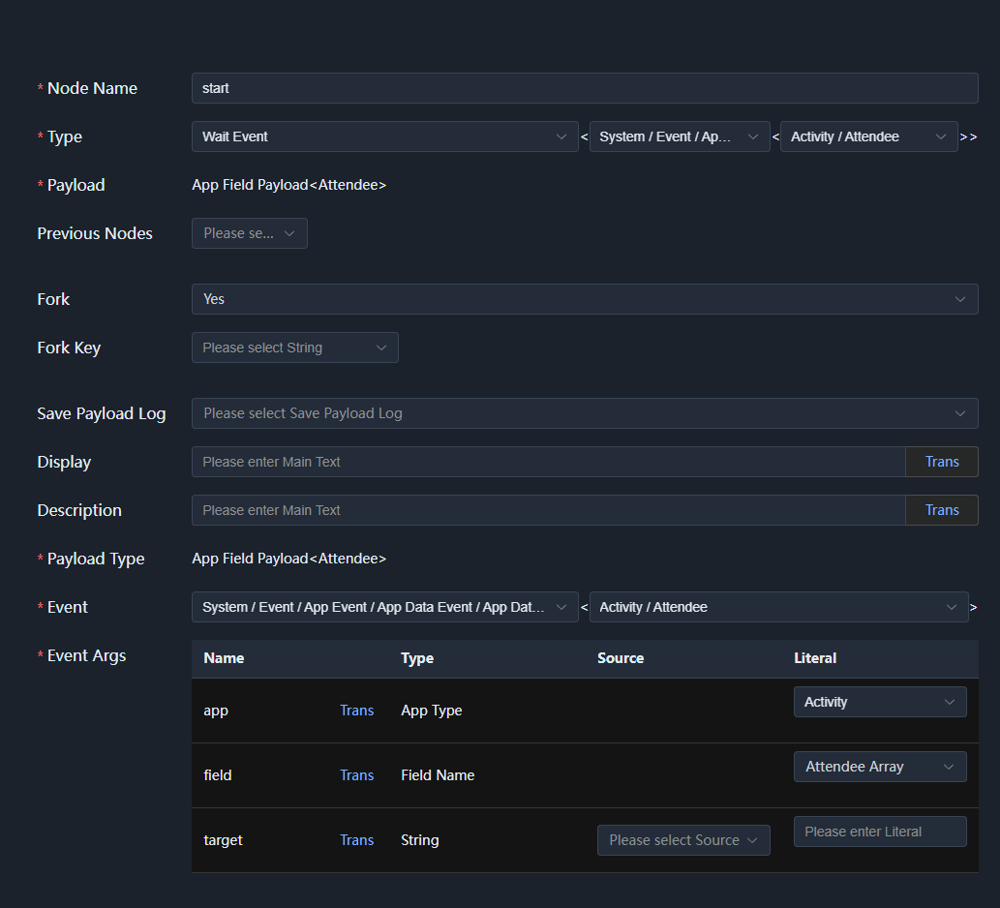

This node uses the **Wait for Event** type, which is generic and requires a payload data type to be specified for the event. You do not need to explore the details of this generic type at this stage.

The selected event is an **Application Data Created** event, which is triggered when a new data record is created.

The key configuration is **Fork**. When the event is triggered, a child workflow context is created for subsequent processing. Since a wait-for-event node can be triggered multiple times, each event must be processed in an independent context. Once the child workflow completes, its context is destroyed.

The next two nodes are both **Function Call** nodes and are relatively straightforward.

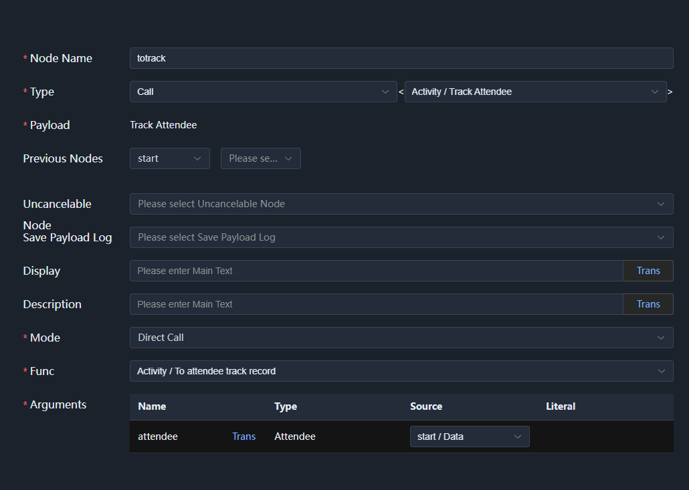

The key configuration here is **Previous Nodes**. A node can depend on multiple upstream nodes. The current node is triggered only after all its dependencies have completed. For example, a delay node can be inserted to ensure that all upstream tasks finish before downstream processing begins.

The function calls in subsequent nodes can use data produced by preceding nodes as arguments.

In addition to **Wait for Event** and **Function Call**, workflows support control nodes such as delay, conditional branching, and forced termination. Workflows can also be triggered manually. These features are not covered in detail here.

Once activated, this workflow is triggered when a participant is registered and writes a corresponding record to the database. The resulting execution log is shown below.

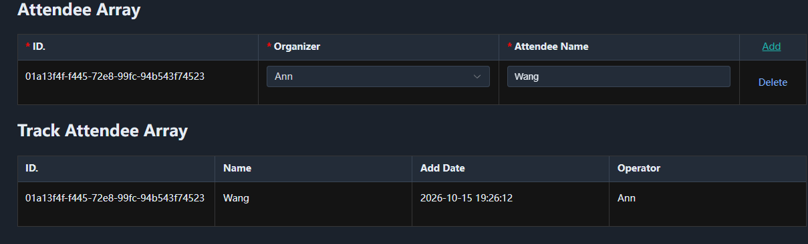

### Declaring Workflow Node Types

Workflow nodes are also semantic types. Unlike ordinary semantic types, however, they are closely coupled with execution and cannot be declared entirely on the frontend.

The following example declares a conditional branching node:

```csharp
[Meta<SchemaType>($"{NS_SYSTEM_WORKFLOW_CONTROL}.goto")]
[Meta<OfNodeKind>("node.workflow")]
public class GotoWorkflow: BaseWorkflow
{
    public async Task ProcessAsync(WorkflowContext context, bool flag,
        [Meta<SchemaType>(typeof(NodeName))] string? trueNode,
        [Meta<SchemaType>(typeof(NodeName))] string falseNode)
    {
        await Task.Yield();
        context.Goto(this, flag ? trueNode : falseNode);
    }
}
```

All workflow node types are based on the `node.workflow` prototype.

This node evaluates `flag` to select either the true branch or the false branch, directing subsequent workflow execution accordingly.

Third-party libraries can also define their own workflow node types to extend the workflow system. This extensibility is a core capability for implementing complex business processes.

Workflow nodes also support the `Args`, `Settings`, and `Session` configurations, corresponding to workflow execution arguments, global configuration, and session configuration, respectively. These features are documented in detail in the SchemaNode App documentation.

## Events

Event handling is one of the most common event-driven programming patterns. A simple event declaration looks like this:

```csharp
[Meta<OfNodeKind>("node.event")]
[Meta<SchemaType>($"{NS_SYSTEM_EVENT}.schema.create")]
[Meta<PayloadType>(typeof(AnyType))]
public class SchemaCreateEvent: BaseEvent, IEventPayload<string>;
```

An event must implement `IEventPayload` to specify its payload data type. In this example, the generic argument `string` does not identify the corresponding semantic type by name, so the additional `PayloadType` metadata is used to specify the payload's semantic type. This information is used by subsequent workflow processing.

The event can be raised as follows:

```csharp
context.RaiseEvent<SchemaCreateEvent, string>(schema.Name);
```

Events support `Args`, which can be used to construct a `Topic` for event topic matching.

The project includes two event integration libraries, `SchemaNode.Kafka` and `SchemaNode.RabbitMQ`, for Kafka and RabbitMQ, respectively. Similar to `SchemaCreateEvent`, event types can be declared and automatically registered for use in workflows.

For implementation details, refer to the SchemaNode App documentation.


## Conclusion

Through the preceding type definitions and the App application demo, we have shown SchemaNode's core design from different angles: based on public semantic consensus, building composable semantic structures through semantic types, orthogonal properties, relations, and functions, and having execution layers project them into actual execution capabilities.

Type Management demonstrated the definition and extension of semantic structures, while App further demonstrated how these semantics apply to real business scenarios, including data access, permission control, cross-table associations, data processing, and dependency tracing.

It should be emphasized that SchemaNode App is only one dialect implementation built from practice — it is not the entirety of SchemaNode, nor a restriction on business development models. What SchemaNode Core focuses on is the expression and composition of public semantics; concrete business models, execution approaches, and their extensions can still be designed according to actual needs.

At present, SchemaNode already has the basic implementation from semantic definition to actual execution, but this does not mean the semantic space it explores is complete. Public semantic consensus can continue to evolve, and new semantic dialects can keep being built on top of it. For SchemaNode, the current implementation is a starting point, not an endpoint that pre-defines all application scenarios.

**What SchemaNode hopes to explore is not just how to build applications more efficiently, but how to make structured semantics the common foundation connecting requirements, data, and execution.**
