# 01. Configuring Semantic Types (Core)

This chapter explains how to define semantic types through the frontend configurator. The whole process does not depend on a specific execution layer: you can complete type definition and debugging without starting a backend. The semantic types configured here are execution-layer agnostic, so they can be used in any execution layer.

If you want to go further with data read/write, permissions, and workflows, continue with the next chapter.

**Note:** JSON is the serialization format used when the configurator imports/exports and when the execution layer passes data. It is not the semantic type itself. You can think of it as a structured representation that an execution layer can parse.

## 1. Before You Start: Understanding Semantic Types

If you have already read the architecture documentation, you can skip to the next section.

SchemaNode turns requirements into deterministic semantic expressions, so that semantic definitions do not have to be bound to concrete execution logic. Different execution layers can interpret and process the same semantic definition according to their own capabilities.

For example, the number `55` by itself only represents a numeric value. When we attach attributes such as `Display: "Age"` and `LowLimit: 0` to it, it acquires a clear business meaning.

We call such data together with its semantic description a **semantic entity**. A semantic entity contains three basic elements:

- **Data**: the value or structure the entity actually carries.
- **Properties**: describe the entity's meaning, constraints, and other characteristics.
- **Relation**: describes the relationships between entities, and how properties are influenced or computed through those relationships.

Semantic entities of the same kind can define their structure, properties, and relations uniformly through a **semantic type**. Concrete entities provide the actual data and acquire their semantics according to the type definition.

Therefore, configuring a semantic type means defining the data structure together with its semantic properties and relations, so that it can be understood and used by an execution layer.

## 2. Using the Online Configurator

### 2.1 Open the Configurator

Visit:

<https://kurapica.github.io/schema-node-man/#/type>

This is a static build of [`schema-node-man`](https://github.com/kurapica/schema-node-man).

Its startup logic is described in [main.ts](../../../../schema-node-man/src/main.ts#L27-L38): first initialize the Core runtime via `initSchemaRuntime()`, then restore type definitions from browser cache via `reloadStorageSchemas()`.

The whole process does not require a backend.

### 2.2 Basic Operation Flow

1. Open the page. It is recommended to turn on `Debug Mode` in the upper-right corner first, so that you can inspect an entity node's properties and relations.
2. Click `Upload` to import an existing JSON file, for example [type.json](../tryit/schema/type.json), or click `New` directly.
3. In `Type Management`, create and maintain namespaces, scalars, enums, structs, arrays, and function types.
4. When configuration is complete, click `Download` to export JSON, which can be committed to version control or handed to a frontend project.

**Note:** The `Upload` and `Download` operations here target the selected type and do not automatically include its dependent types. Import/export in App application management targets the complete application, and can include all semantic types associated with the application.

For the full online walkthrough, see [01. Semantic Type Demo](../tryit/01-type.md).

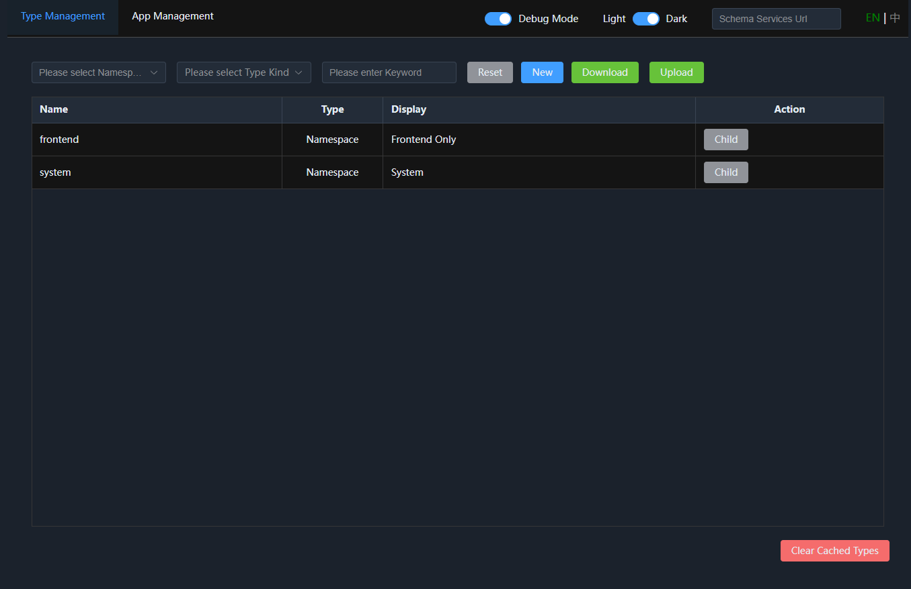

## 3. Type Management

Click `Type Management` at the top. The page is mainly divided into three areas:

| Area | Content | Function |
| --- | --- | --- |
| Filter bar | `Namespace`, `Type`, `Keyword`, `Filter`, `Reset` | Filtering and navigation |
| Type list | `Name`, `Type`, `Display`, `Operations` | Browse and manage types |
| Bottom | `Clear Cached Types` | Clear cached type definitions |

The `Schema Service Address` in the upper-right corner is used to connect to a backend SchemaNode service. Usually you do not need to configure it when experiencing Core standalone; the `SchemaNode.App` project ships with a complete `schema-node-man` static build, so you can use it directly there as well.

### 3.1 Browsing and Namespace Drill-Down

| Operation | Description |
| --- | --- |
| `Sub` | Appears only on namespace rows; enter that namespace to view child types |
| `View` | Open the type definition in read-only mode |
| `Edit` | Open an editable drawer |
| `Delete` | Displayed only when the deletion conditions are met |

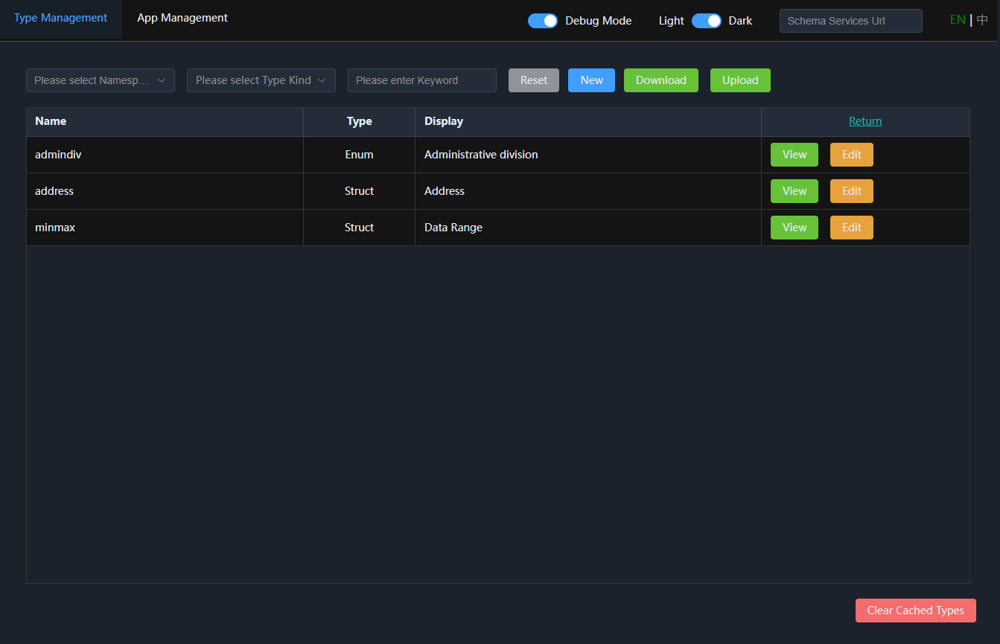

## 4. Creating Semantic Types

Click `New`, and the editor creates a struct used to build a semantic type. Choosing different type categories lets you define semantic types for different purposes.

### 4.1 Namespace

First create a namespace to organize the types defined later.

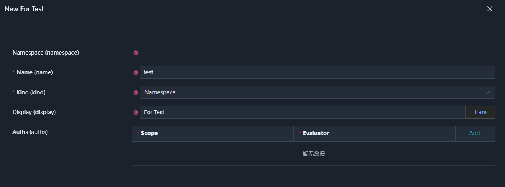

A namespace only carries hierarchy and has no business fields of its own. It provides a stable naming path for types, for example `demo.sport`.

Permission configuration can be ignored for now; it will be introduced later in the App application.

After creation, you can enter the namespace from the type list via `Sub`.

### 4.2 Scalar Types

Scalar types are used to define basic data such as strings, integers, and dates, as well as business types extended from them.

For example, we can create a phone number type:

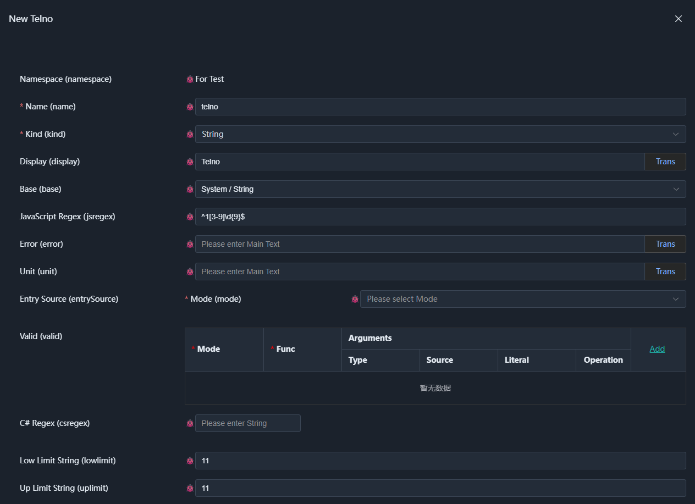

Choose a base type to inherit its properties, then configure the required semantic properties, such as `Display` (display name) and validation rules.

The properties shown in the UI are not a fixed list. Core can extend the available semantic properties through property definitions; the related implementation can be found in `schema-node-core` by searching for the property name. The specific kernel parsing mechanism will be introduced in later documentation.

### 4.3 Enums

Enums are used to define a finite set of selectable values, and can also express multi-level options through a cascading structure.

For example, the following uses administrative divisions to show a four-level cascade: province, city, prefecture, county.

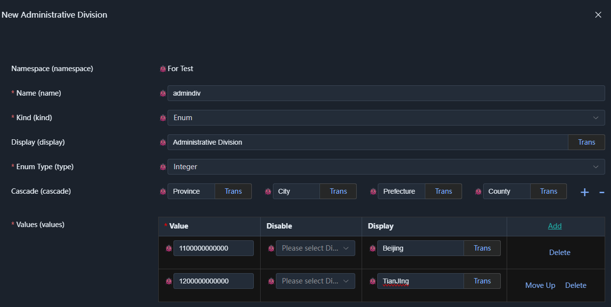

First add test enum items and save. Before defining cascading sub-items, you need to save the parent enum.

When you edit it again, you can see the child entry:

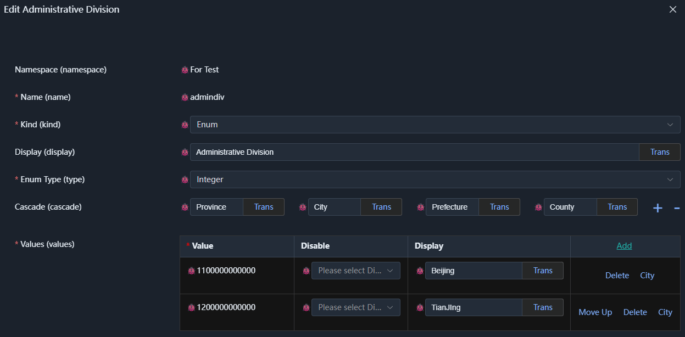

Click the cascade name of the child level to expand the lower-level enum and add options:

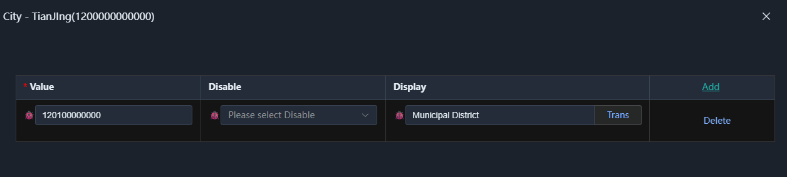

Following the same approach, you can define cascading enums of any depth.

If you do not specify a cascade level name, there is only one level by default, that is, a normal enum.

### 4.4 Structs

Structs are an important semantic data type in Core, used to combine multiple fields. In addition to defining a field list (Fields), you can also define relations between fields and their child elements (Relations).

#### 4.4.1 Field Definition

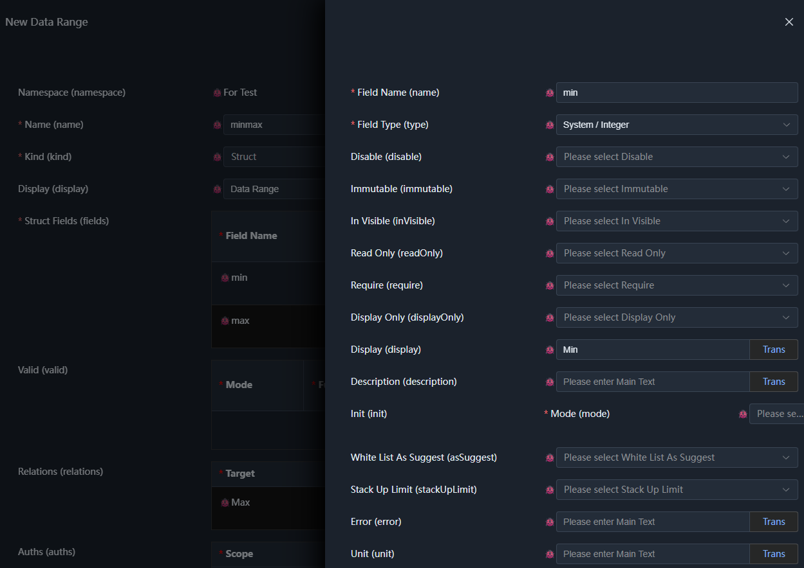

Struct fields can be configured with common properties such as `Require` and `Readonly`, as well as properties related to the field type, such as `LowLimit` and `UpLimit` for integer types.

A few commonly used properties deserve separate explanation:

- `DisplayOnly`: used only for display and not stored as persistent data. A common use is to provide its `Default` property with a computed result through a Relation. In the App application, it is also often used for display fields obtained from cross-table queries. If a complex relation needs intermediate computation results, you can also set a `DisplayOnly` field to hold the intermediate value, and hide the field with `Invisible`.
- `Display`: display name, such as form labels and table headers. Its value supports localized strings, so it can be used in multilingual scenarios.
- `Init`: initialization value or initialization behavior. Currently this mechanism is used when adding a row to an array, for example fetching a UUID from the backend and setting it as the primary key of the new row.

Other properties can be understood in the context of specific scenarios.

#### 4.4.2 Relation Definition

Field properties can directly describe characteristics of the entity itself. When a property needs to depend on data from other entities, you can define such an association through a Relation.

Below we again use the `minmax` example to configure the lower-limit constraint of `max` by `min`:

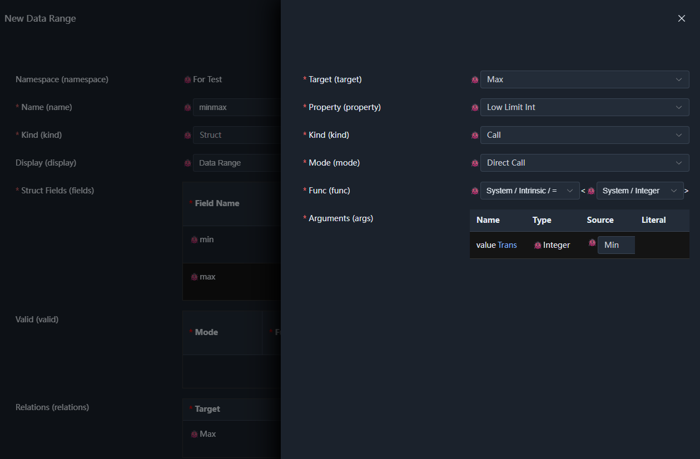

A relation records its provider, so that it can locate the entity it needs to access during execution. Two key things must be specified when configuring:

- **Target**: which entity the relation affects, determined by the structure of the current type.
- **Target property**: which property of the target entity the relation affects; the available options are determined by the target and its property type.

In this example, the target is the `max` field, whose type is integer, so the integer lower-limit property can be selected.

The property provided by a relation can also be a function call. For example, the `EntrySource` property of an input field can provide cascading data through a function, and the function parameters may come from other entities, in which case the parameter sources also need to be bound through a relation.

If you configure this property directly on the input field, the field itself becomes the property provider and cannot correctly locate sibling fields or other entity nodes. Therefore, you need to use a relation to explicitly specify the data source.

Relation execution modes can be extended and registered. The system provides the following by default:

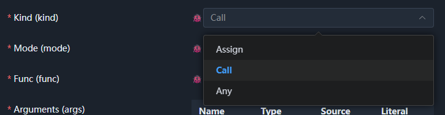

- **Assign**: assign the configured value directly to the target property; executed only once.
- **Call**: call the specified function and assign its return value to the target property. The system can subscribe to data changes of related entities according to the function parameters and automatically update the computed result.
- **Any**: configure multiple function calls; if any call returns `true`, the target property is `true`; otherwise it is `false`.

Among them, Call is the most commonly used mode and requires configuring three parts of the function call.

**Call Mode (Mode)**

Specifies how the function is invoked. Besides direct calls, higher-order modes such as `Map`, `Filter`, and `Reduce` are also supported. The available modes depend on the type of the target property.

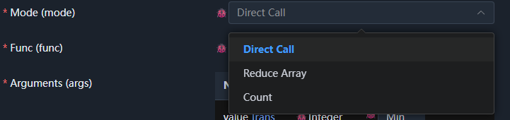

**Function (Func)**

Select the semantic function to call. Many preset functions are provided under the `system` namespace, and the configurator filters them based on the target property type.

Many system functions are generic and require specifying a concrete type. For example, in this case the integer type is passed as the function's type parameter to ensure the return value can be used for the integer lower-limit property.

**Arguments (Args)**

Bind parameter sources according to the function definition. In this example we use the direct assignment function and set the parameter source to `min`, which provides the value of `min` to the target property.

There are many system functions, and you can get familiar with them gradually while configuring. After connecting to the backend, you can also register your own functions for use in semantic types.

When configuration is complete, click `View` and then click the demo button in the lower-left corner to test the type's effect in real time.

When debugging, you can hover over the `bug` button to inspect the entity's current property and relation states:

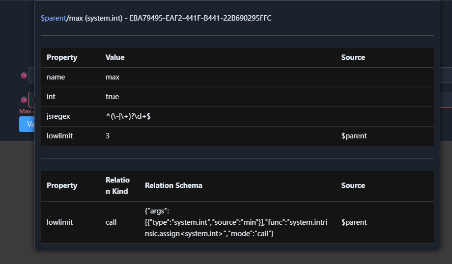

This is a convenient tool for observing how a semantic definition affects an entity's runtime state.

### 4.5 Arrays

Arrays are used to define a group of entities of the same type. Before creating an array, create a suitable struct type first.

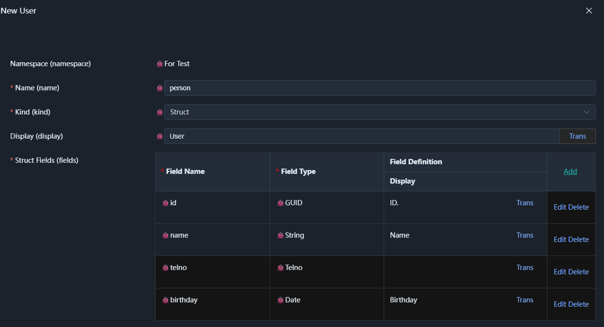

In this example, `system.guid` is used as the type of the `ID` field, and an initialization method is configured:

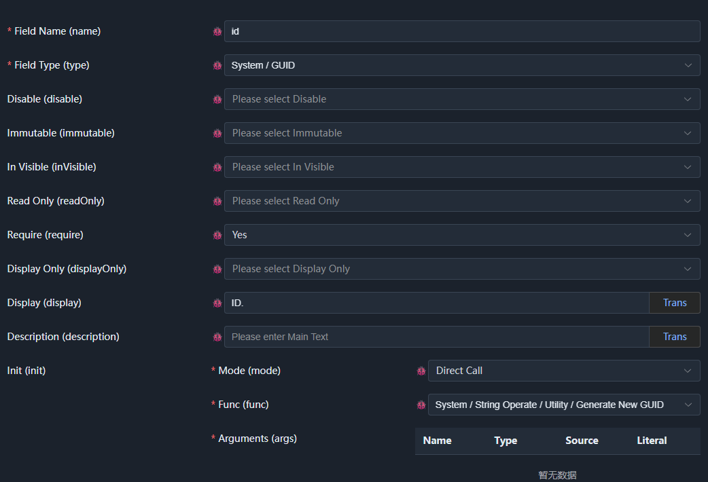

The phone number uses the `test.telno` type defined earlier, and the other fields use basic types from the `system` namespace.

Next, create an array type based on this struct. After choosing the array category, simply specify the element data type. Usually there is no need to manually set the array type name; `Name` and `Display` get default values. If you do not override these values, adjusting the `Display` of the element struct also updates the display name of the array type.

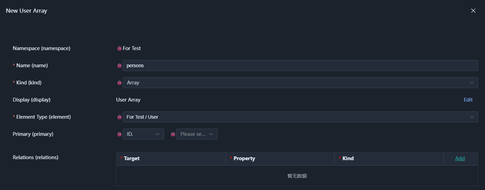

An array mainly needs two things configured:

- **Element data type**: determines the structure of each item in the array.
- **Primary key list**: used to identify elements in the array. In this example, `ID` is selected.

An array itself can also define relations.

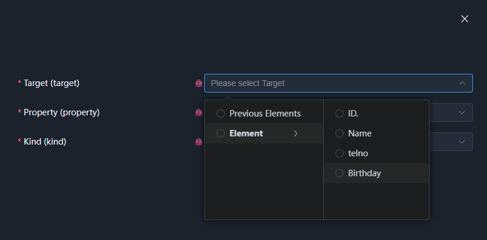

Array relations provide two special target options: `previous element set` and `element`. Among them, `element` can further select fields inside the element.

Do not directly use `previous element set` as a target, because it represents the collection context and should usually be used as a function parameter rather than a target property to be assigned.

For example, to compute the allocated amount of all rows before the current row, you can pass the previous element set to a function and then constrain the current row's value according to the computed result.

Since arrays define an element struct and primary keys, in the App application they can also be used as the type of a logical data table.

### 4.6 Functions

Functions are also a kind of semantic type. In fact, the properties used above also have corresponding semantic type definitions; they are currently declared in code and UI configuration is not yet available.

A function is a special semantic type: it has no ordinary data value, but instead executes computation according to parameters and expressions and returns a result.

Below we define a function for computing a user's age:

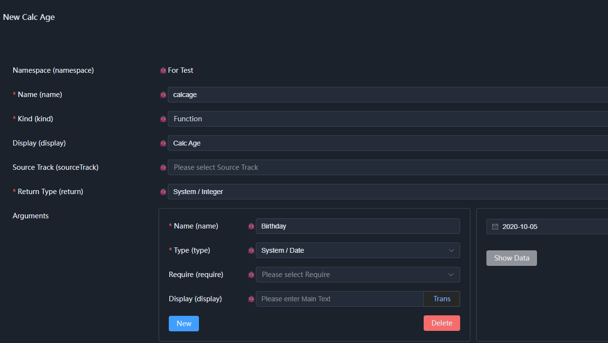

A function mainly consists of a return type, a parameter table, and an expression list. The return value type and parameter types form the main interface the function exposes.

Functions can also define relations for call parameters, but the related configuration is currently rather complex and only supports declaration through code.

Once the return type and parameters are determined, you can build the computation logic by calling existing functions:

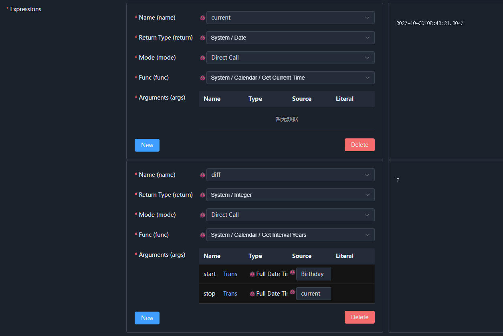

This example contains two expressions: the first gets the current time, and the second computes the difference between the birthday and the current time.

A complete age computation also needs to determine whether the birthday has already passed this year, and then decide whether to subtract one. Here we only show the basic configuration process. You can try using `Conditional Selection` under `Logical Operations` to supplement this logic.

Function expressions execute in list order. If the last expression's type matches the function's return type, its value is the function's return value.

If the return type is a struct and the last expression cannot directly return that type, you can build the returned struct through expressions (including parameters) corresponding to the struct's field names. This simplifies the construction of struct results.

Functions do not support traditional control statements. You can express conditional logic with `Conditional Selection` under `Logical Operations`; if you need to end execution early, use operations such as `Return When Condition Met` under `Basic Processing`.

For array operations, you can adjust the call mode and use higher-order functions such as `Map` and `Reduce`. Since the configurator lets you select the corresponding mode directly, we will not elaborate here.

Usually the semantic functions we configure only involve data transformation, so they are designed as pure functions: they express intent and are kept as easy to use as possible. Control statements are not allowed inside, since they would make debugging and reasoning difficult.

For complex processing, one option is to override it by registering semantic functions in the execution layer — for example, a proxy call function for an existing microservice API. The related types and functions are all registered as semantic types, and can be selected and configured in the UI.

The other option is to base the semantic intent of the function on a reasoning mechanism in the execution layer. For example, row permissions can simply be configured as a validation of submitted data, but the system can use the function's content to compile it into a generated query tree during queries, thereby filtering query results.

Of course, there is also support for more complex execution flows, which will be introduced in detail in the next chapter on workflows.

#### 4.6.1 Using Functions to Compute Dynamic Properties

Once the function is defined, add an `age` field to the `Person` struct, set it to `DisplayOnly`, and configure its default value through a relation:

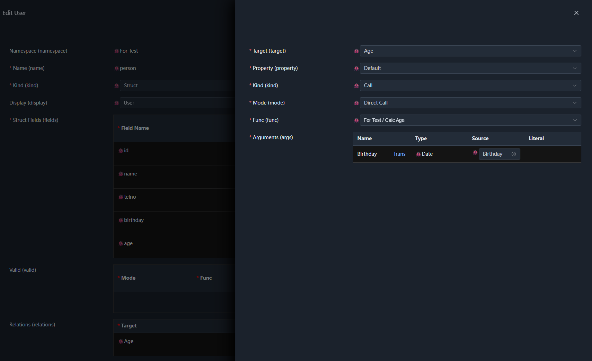

After saving, demo this user array:

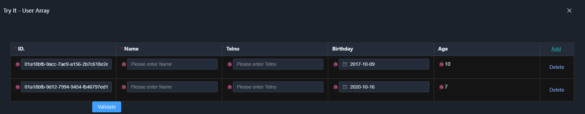

As you can see, `age` is computed dynamically from the birthday. If you change the birthday, the age updates accordingly.

At this point we have completed the configuration example covering data structures, semantic properties, functions, and relations.

## 5. Using It in Your Own Frontend Project

Once the type definitions are complete, you can commit the exported JSON to your project's version control and load and use it in your own frontend project.

For the full steps and runtime effect, see [How to Integrate into a Frontend Project](../tryit/01-type.md#how-to-integrate-into-a-frontend-project).

If you need to customize view components or replace the frontend component library, see [05. Customizing Frontend Views](05-views.md).

## 6. What Changes After Connecting to a Backend

All the operations above can be done while using Core standalone. If you later connect the manager to `SchemaNode.App`, the main change is where types are saved and how they are read; the type definitions themselves do not need to change.

| Scenario | Storage location |
| --- | --- |
| Types in the browser, or no service address configured | Browser `localStorage` |
| Newly created types, or server-originated types, with a service address configured | Server-side `IAppDataProvider` |

For connection methods and storage rules, see [02. Starting SchemaNode.App and Configuring Applications](02-apps.md).

## 7. Summary

This chapter introduced how to define semantic types through the online configurator, including namespaces, scalars, enums, structs, arrays, and functions, and how to combine them through relations.

SchemaNode.Core defines the description of semantic types, common semantic properties, and the type loading mechanism, and constructs corresponding semantic entities from type definitions. The concrete execution capabilities are provided by the execution layer.

However, **defining semantic types is not the same as implementing a complete business application**. Types describe data and its semantics, while the execution layer is responsible for applying these semantics to concrete scenarios. For example, frontend view rendering, backend permission validation, and data processing are all interpretations and executions of the same semantics for different purposes.

You can continue with:

- Use it directly in the frontend → [05. Customizing Frontend Views](05-views.md)
- Start the execution layer and use the application → [02. Starting SchemaNode.App and Configuring Applications](02-apps.md)
