# 02. Starting SchemaNode.App and Configuring Applications

The semantic types from the previous chapter can exist independently of the backend, but just like code, defining types alone does not complete functionality. We need to use them together with execution flows, and execution flows are closely tied to specific execution layers.

Just as we extracted data types out of code into self-sufficient semantic types, we can also extract the mutable parts of a specific execution environment into special semantic declarations that describe the actual execution flow. This can be called a semantic dialect, because what it defines is not types — a dialect represents execution-layer-specific semantic descriptions.

This chapter introduces the execution layer: `SchemaNode.App`. It introduces a semantic dialect used to declare applications and application containers, logical table fields, workflow processing, and so on, so that through process configuration, semantic types gain actual execution purposes.

In addition, this execution layer also defines system-level applications used to carry semantic type definitions, so when `schema-node-man` is connected to the backend, semantic types are stored by the backend.

## 0. Environment Preparation

Refer to [Environment Preparation](../tryit/02-app.md#environment-preparation); it will not be repeated here. If you want to study more details of `SchemaNode.App`, refer to the [SchemaNode.App documentation](../app/01-overview.md).

After startup, you can directly access the built-in configuration management page:

```text
http://localhost:8000/schema-node-man
```

## 1. Application Management

Click `Application Management` at the top. The page is mainly divided into two areas:

| Area | Content | Function |
| --- | --- | --- |
| Filter bar | `Application Container`, `Keyword`, `Filter`, `Reset` | Filtering and navigation |
| Application list | `Name`, `Display`, `Operations` | Browse and manage applications |


## 2. Application Containers
An application container is a container for applications, used to organize and manage applications. An application container is an application without logical table fields; it is used only for application management, and can also carry multi-level permission configuration.

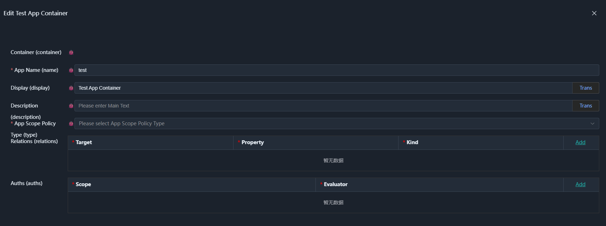

Enter the `test` application container. We will start by building a user domain for permission management.

## 3. User Domain

Similar to the `test` application container, create a `user` user domain under it to manage users. Note that the domain policy should be `System Level`, so that its data is global; tenant isolation and the like are not configured here.

### 3.1 User Types

First switch to `Type Management`, add a `test` namespace, then enter its child level and add the following user type:

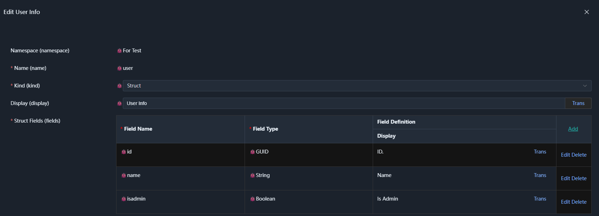

Both `id` and `name` are required; `id` can be configured to be auto-generated, as demonstrated in the previous chapter. Since this is for testing, no password or the like is configured.

> In fact, in most cases the SchemaNode system can integrate with existing microservices, so a user domain is usually not built on top of the SchemaNode system. Because it involves login, authentication, and other processing that depend on the execution layer implementation — that is, for non-generic capabilities, SchemaNode does not attempt to provide them in the kernel, but instead shows how to implement them through semantic dialects.

> What we need to ensure is that SchemaNode can fit into existing systems and conveniently provide secondary development capabilities, rather than doing everything itself.

Then create a `users` user list type:

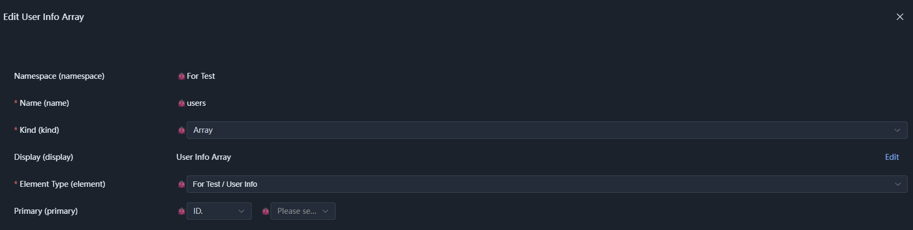

Be sure to select the primary key.

### 3.2 User List Logical Fields

Then switch to `Application Management`, enter the `test` application container, and click the field button of the user domain:

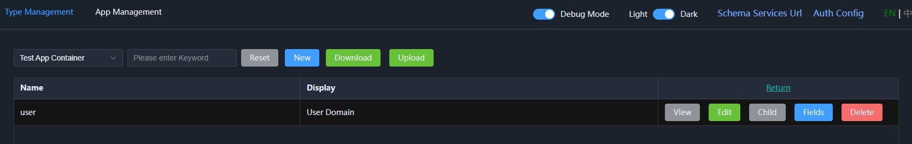

You can see its logical field list:

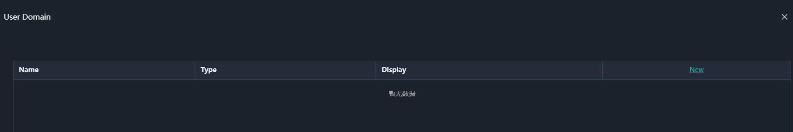

Click add and select the type just created; the name is filled in automatically. Remember to enable storage.

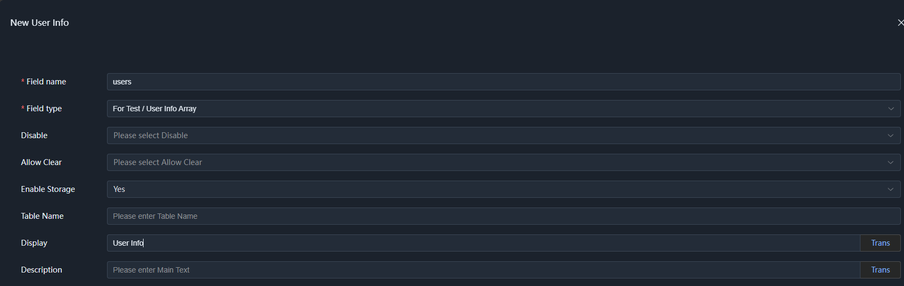


### 3.3 Filling in user list data

After saving, you can click the `Demo` button in the lower-left corner to perform actual data operations. Click `Load Data` to load data from the backend and initialize the display form; add a few users, and make sure one is set as administrator. Record its id.

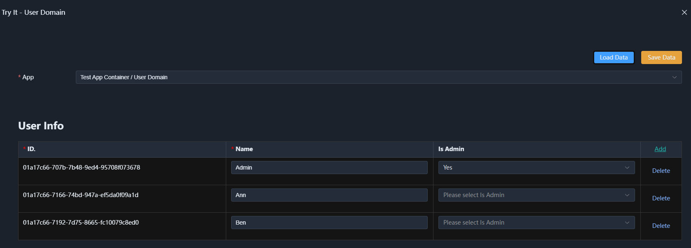


### 3.4 Authentication Configuration

After saving the data, press Esc to return all the way to the application management page. Click `Authentication Configuration` in its upper-right corner to enter the authentication configuration page.

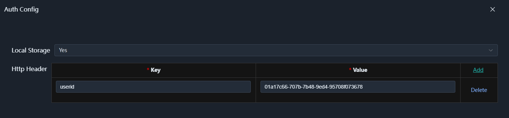

This simulates the authentication result of a microservice. Based on the configuration in `SchemaNode.Example`, we pass user information in the request header using userid. Fill in the administrator ID just created.


### 3.5 Defining the Administrator Check Function

Switch to the `test` namespace on the type management page. Having defined the user domain and fields, we can define a function to determine whether the user is an administrator. Note that this function returns a boolean and takes no parameters.


The first expression obtains the user id based on the current access context. This context is usually configured in SchemaNode.Example; microservices can register different contexts, such as tenant id, which can later be used for tenant isolation.

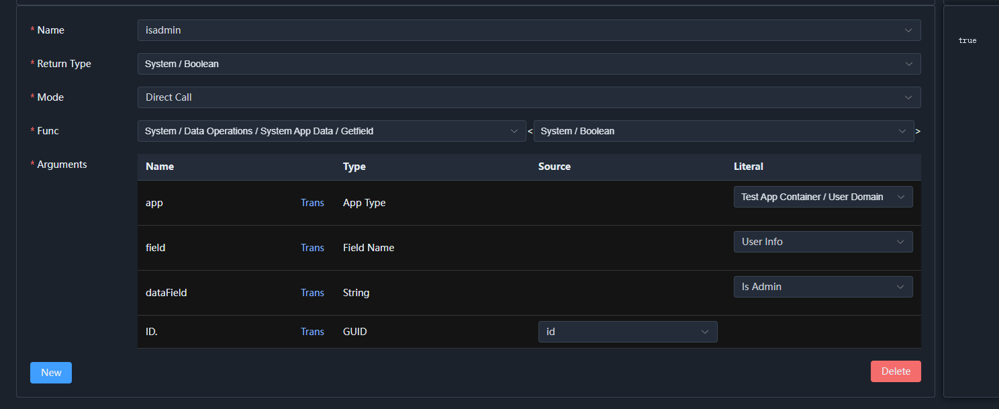

The App application registers multiple functions in data operations for getting and setting data. Note that the API for setting data is restricted to workflows only, to prevent direct calls and ensure data security. This kind of usage gets a single field value of a logical table based on primary key access.

Here we just need to get `Is Admin`. Since it matches the function's return type, we do not need further configuration. Just save.

> In real projects, administrator status is usually determined by a function registered by the microservice, but the approach above can perform additional role checks based on data, which is a useful supplement to permission models such as RBAC.


### 3.6 Permission Configuration

Go back to the type management page, return to the top-level namespace, and then edit the `System` namespace. Configure three type restrictions for it, first enabling `Type Definition Read` and `Function Execution`.

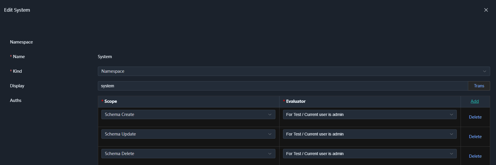

The App system designs permissions based on a tree structure of namespaces and application containers: users who have corresponding permissions at an upper level naturally have the corresponding permissions for lower-level namespaces (types) and application containers (applications). But because the upper-level namespace of System cannot be configured, the ever-present System namespace is used as the root for configuration.

Similarly, switch to the application management page and modify the permissions of the `System application container`, enabling `Type Definition Read` and `Function Execution`.

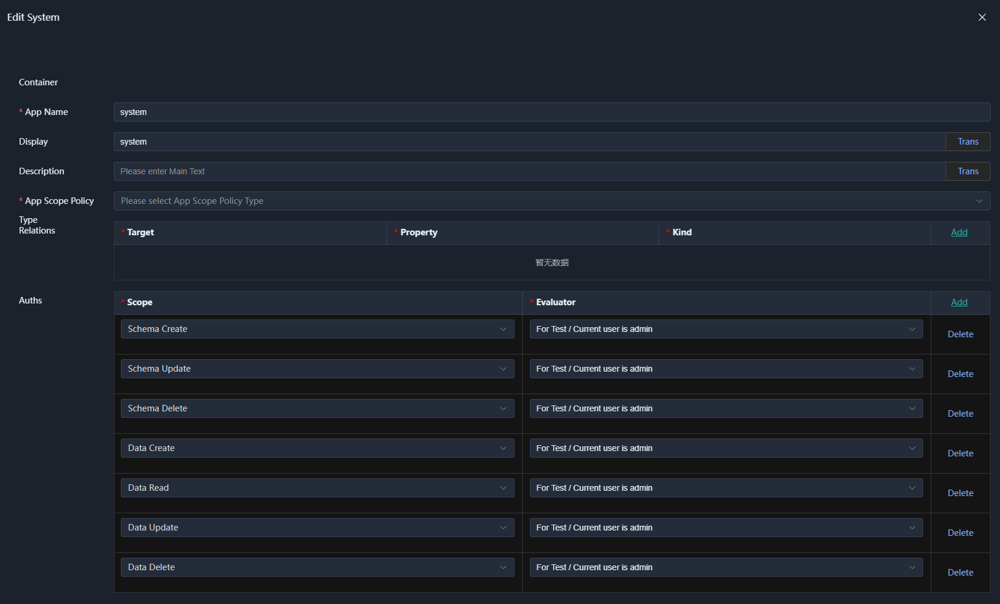

Compared with types, it has additional permissions related to data processing. After saving, you can modify the authentication configuration, for example switch to another id, then refresh the page. You will see that creation and editing are no longer possible. This restriction takes effect on the backend, and after the frontend fetches it, it makes judgments based on permissions.

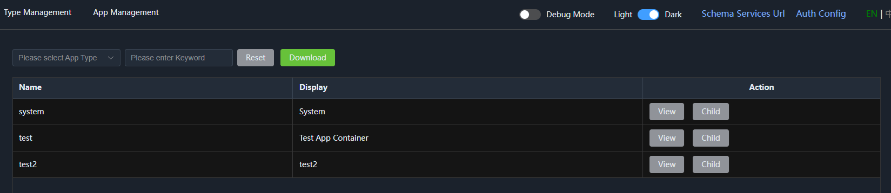

In order to work in various scenarios — both standalone and embedded in existing systems — the application system's permissions are designed based on semantic function configuration. They can call the microservice's permission-check functions internally, and can also perform further checks based on access user and project data.

Once an administrator is set at the system level, access permissions for other roles can be configured in lower-level namespaces and application containers, achieving multi-level permission management.

Later, we will also see configurations for row permissions and column permissions.


## 4. Project Domain

Next, construct a specific project management domain: administrators can create projects and purposes and assign managers, and managers can only view projects related to themselves.

### 4.1 Project Domain Logical Fields

Similarly, first create the struct and array types:

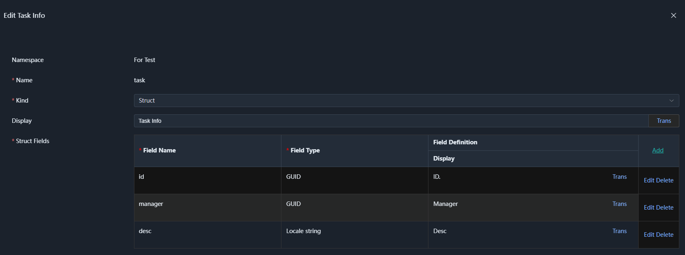

Array creation is similar to creating the user list, so we skip it here. Then go to `Application Management`, under the `test` application container, create the `task` task domain, still using system level. Add task fields:

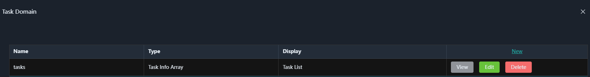

At the same time, add the user list of the user domain as a reference to the task domain, to make data references convenient.

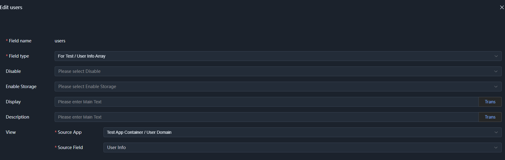

### 4.2 Using the User List as Options

After saving, press Esc to return to the application management page, and choose to edit the task domain. Add a relation that uses the user list field as the selection items for the manager.

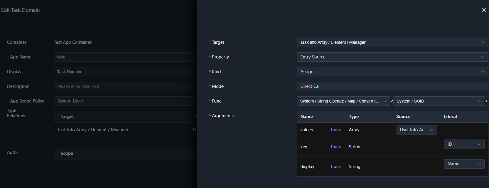

Now, as the administrator, we can demo the fields of the task domain and add projects for other users.

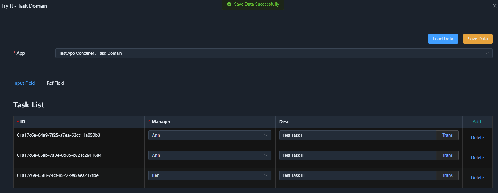

As you can see, the manager can be selected. Currently this page is still visible only to administrators. Now we add a function to determine whether the user is a manager, and a filter function, to ensure that managers can see projects related to themselves.

### 4.3 Determining Whether the User Is the Project Manager

The first step is the same as determining the administrator: get the user id from the current access context.

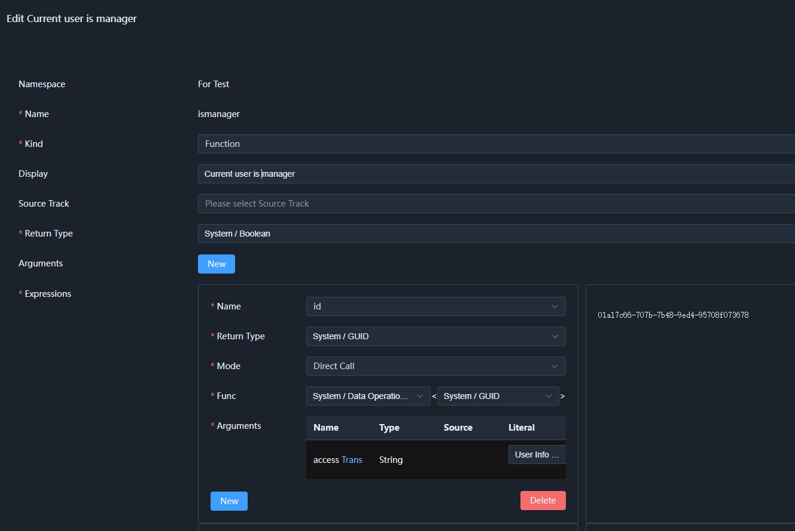

This time we determine it by processing the data source multiple times.

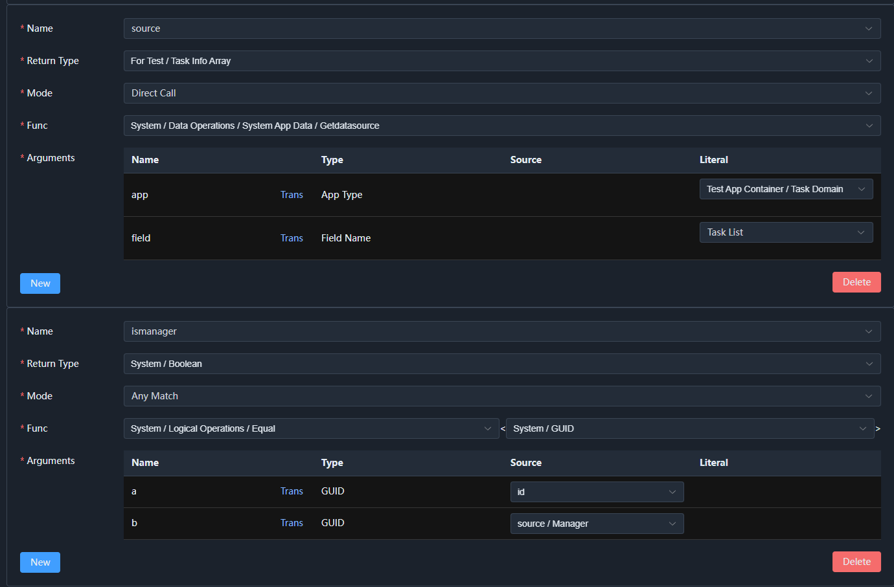

Getting the data source is used to obtain all data of the application's specified logical field. Of course, because it only indicates the data source, it does not actually perform a request. It is the subsequent processing of the data source that determines how the intent is executed; we will see the executed SQL shortly.

After declaring the data source, we first apply a filter: the current user id must match the manager id.


Then we add a count of the filtered result and a final determination: if the count is greater than 0, the current user is a manager; otherwise not.

Because this execution can only be done by the backend, the corresponding result cannot be displayed on the frontend right panel. We can test it with Postman.

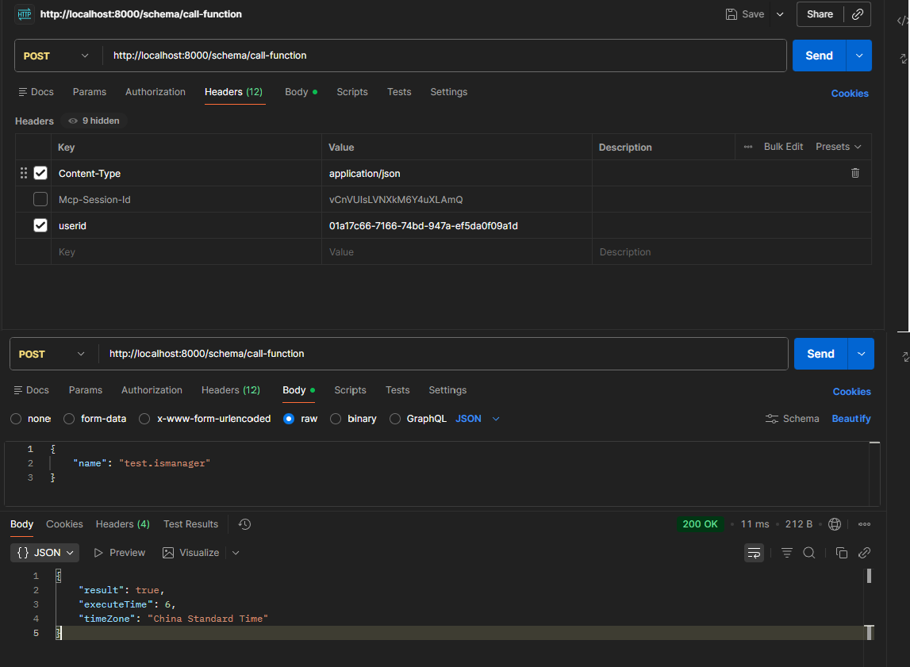

The executed SQL is as follows:

```sql
 SELECT EXISTS (SELECT 1  From `dyn_test_task_tasks` t0 WHERE (t0.`manager` = '01a17c66-7166-74bd-947a-ef5da0f09a1d') AND 1=1 LIMIT 1) AS exists_flag;
 ```

The actual compilation result is as follows:

 ```C#
.Block(System.Boolean $var1) {
    $var1 = (System.Boolean).Call SchemaNode.Utility.Extension.Convert(
        .Constant<System.RuntimeType>(System.Boolean),
        .Call (.Call (.Call SchemaNode.Data.AppDataQueryExtension.GetSchemaDataAsync(
            $var2,
            "test.task",
            "tasks",
            null,
            .Constant<SchemaNode.Data.AppSchemaDataResult>(Exist),
            .New SchemaNode.Data.AppSchemaDataFilterBinary(
                .Constant<SchemaNode.Enum.LogicType>(Equal),
                .New SchemaNode.Data.AppSchemaDataFilterField("manager"),
                .New SchemaNode.Data.AppSchemaDataFilterValue((System.Object).Call (.Call SchemaNode.Function.SystemData.getcontext(
                        $var2,
                        "user.id")).GetValueOrDefault()))),
            0,
            0,
            False,
            null,
            null)).GetAwaiter()).GetResult())
}
```

The system parses the semantic function into an AST semantic execution tree, then, based on semantic parsing, transforms and modifies it to obtain an expression execution tree. After one compilation, it is used for subsequent executions, and it is recompiled only after the function is modified — so the performance is native C# performance.
 

### 4.4 Manager Filter Function

We need a manager to see only projects related to themselves, so we can define such a filter function.

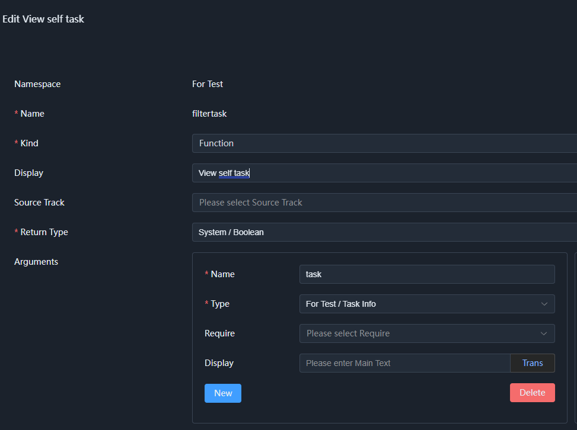
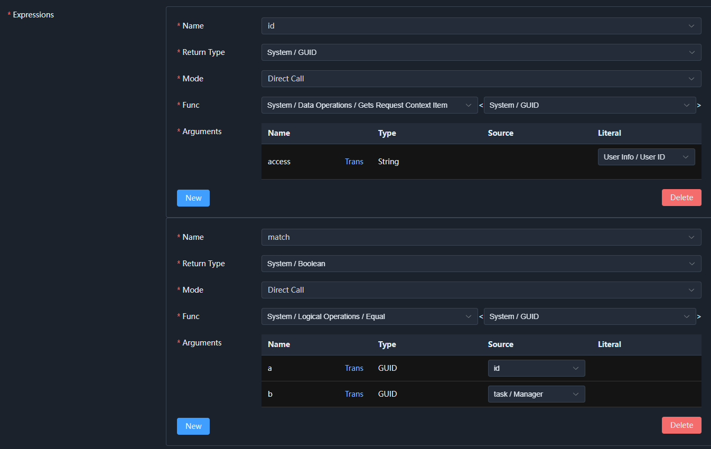

It is simple: pass in the task info struct, compare the user id with the manager id, and directly return the comparison result.

The manager determination function defined above and this filter function together form the row permission: when the current user is a manager, this filter function is enabled.

A filter function has two uses:

1. Validate directly when submitting data.
2. When querying data, the compiler modifies the returned result. The function returns a query execution plan, which is merged with other query conditions and only executed after validation.


### 4.5 Configuring Manager Access to the Task Domain

Now return to application management, open the field list of the task domain, and modify the task list field:

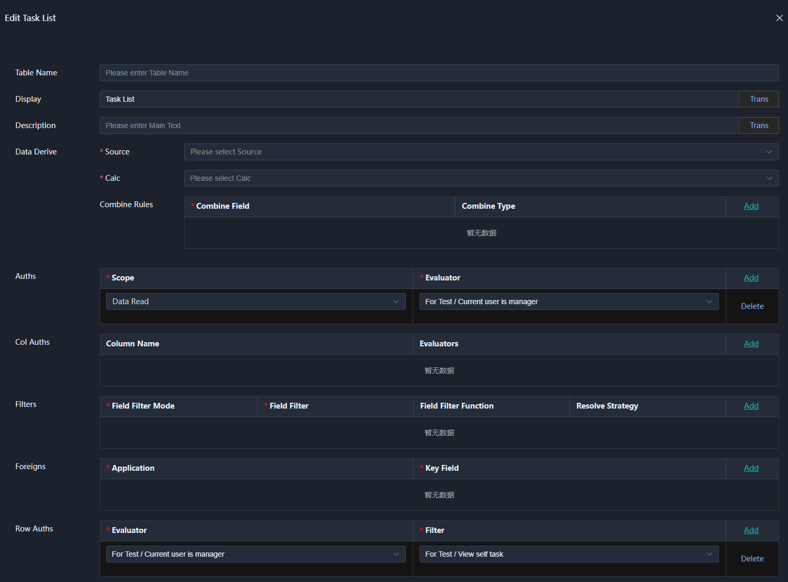

First we configured that managers can read the data of this field, and then we configured the filter condition for manager access. Now switch to the administrator account we used and check the result:

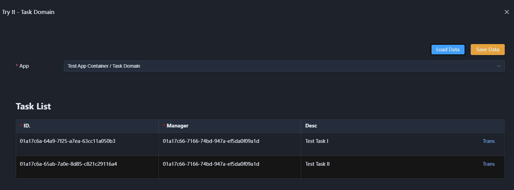

Because the user does not have access permission to the `users` field, the user names shown here are IDs rather than actual names. You can also add access permission to the `users` field to display user names.

Below is the SQL executed during the query:

```sql
SELECT t0.`id`, t0.`manager`, t0.`desc_key`, t0.`desc_trans` FROM `dyn_test_task_tasks` t0 JOIN (SELECT `_seqno`  From `dyn_test_task_tasks` t0 WHERE ('01a17c66-7166-74bd-947a-ef5da0f09a1d' = t0.`manager`) AND 1=1 ORDER BY t0.`_seqno`) t ON t0.`_seqno` = t.`_seqno` ORDER BY t0.`_seqno`;
```

This also shows that the simple filter function we defined was converted into an SQL execution plan.


## 5. Project Information Domain

The project domain mainly completed the storage and query of project information. Now we build a new application based on a project. Note that the domain policy type uses business target, meaning this application needs a target specified as its business target — for example project id, user id, organization id, and so on.

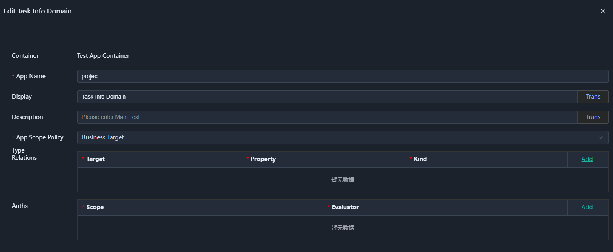

> One reason for this design is that when embedding an App into a microservice, the management of users, organizations, projects, and so on does not need to be done in a semantic-oriented system such as SchemaNode.App, because they may already exist, or may be highly coupled with other microservices. Also, in many cases, a purely semantic model is somewhat heavy for scenarios where almost nothing changes. So we can have other systems provide the business ID, and then manage business data around it within the App application system.


### 5.1 Configuring Foreign Key Relations

The main audience of this domain is the project manager. Before adding other business tables, we need to configure a foreign key relation in the `task` project domain. Edit its `tasks` field:

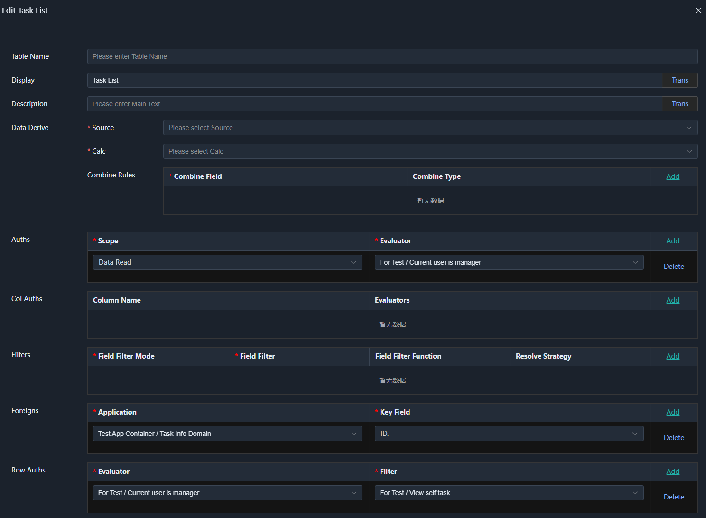

The key point here is the foreign key configuration, which associates the business target of the project information domain with the `id` field of the table. This means the `id` field of this table is the business ID of the project.


### 5.2 Configuring Views

Now we can add the corresponding view in the project information domain to ensure we can get the manager of the specified project. Note that this design is a necessary design to avoid direct cross-domain queries; all operations are designed to happen within the same application.

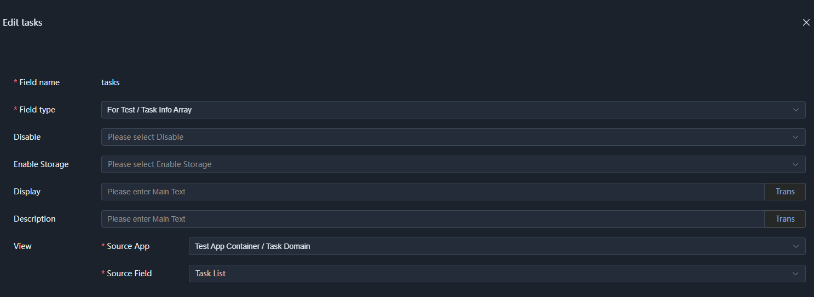

> When adding a view for the user table of the user domain, this operation is not needed because the user domain is system level and has no business target.

Now demo it directly; you can see that the project consistent with the business target we provided is queried.

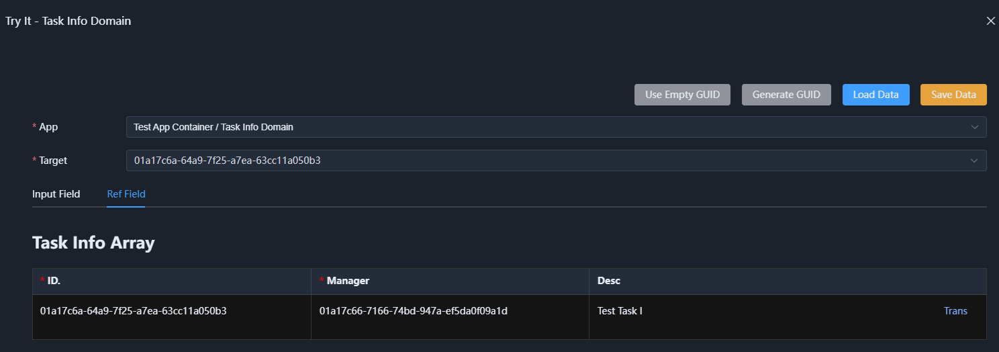


### 5.3 Configuring Manager Access Permissions

When a task id is given, its view is restricted to query only the manager of that task. So, as with the manager access permission configured earlier, we can add a new function for manager determination.

Here a small trick can be used: view the original `Current user is task manager` function, then click `Copy Type Definition`.

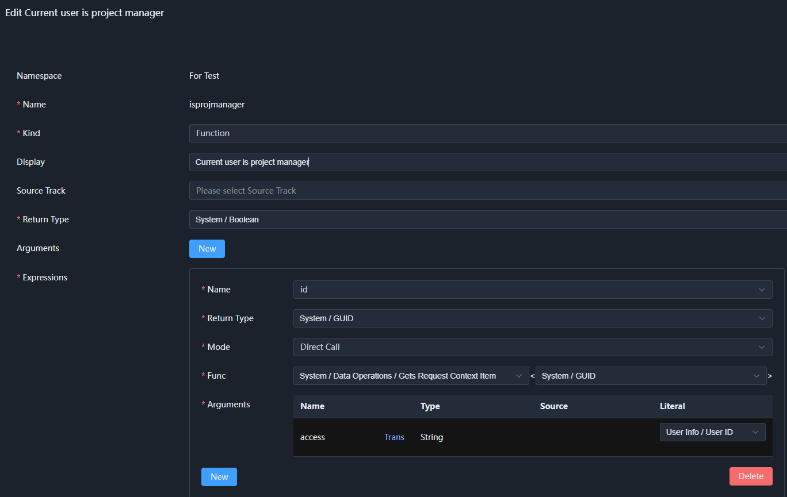
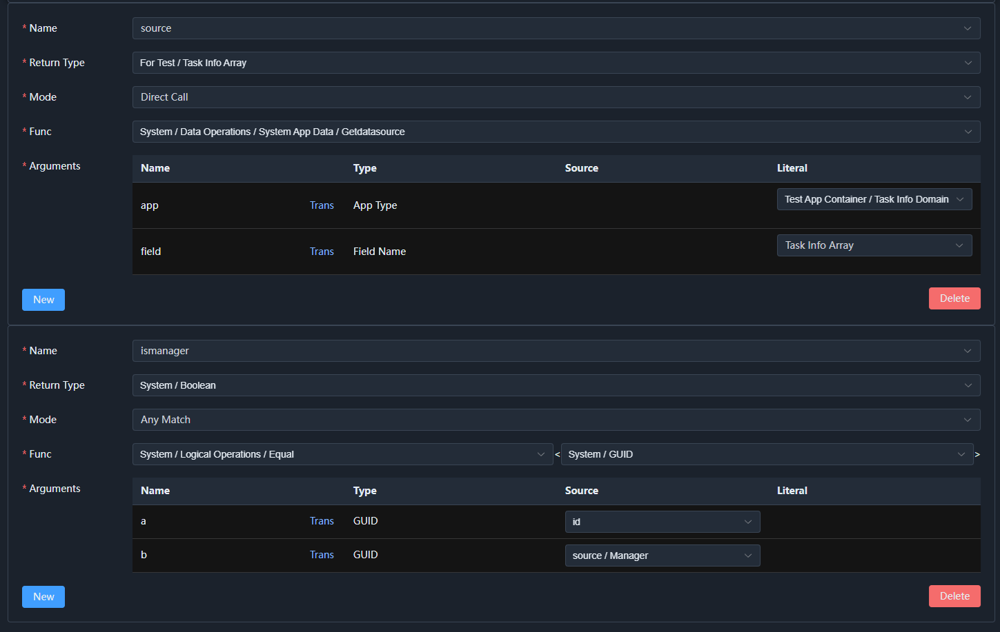

Then we grant the manager full access. Note that this edits the application itself; there is no need to handle each field of the application in detail:

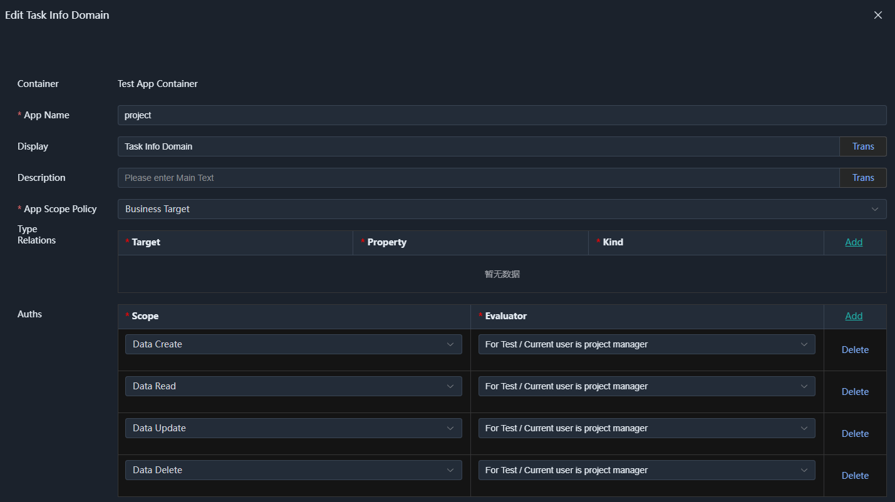

After saving, switch to the manager id of the first task through the authentication configuration, then demo the `Project Information Domain`. You can see the view fields' data correctly, which means the configuration succeeded. You can switch to another id in real time and check again; in that case the data will not be loaded.

> Field row permissions and data filtering are not configured further here, because access is already controlled at the entry point.


### 5.4 Adding the Project Branch Task Table

Next, we add a project branch task and its array. Branch tasks specify the project period. Then we will compute the project period as days and produce an overall summary.

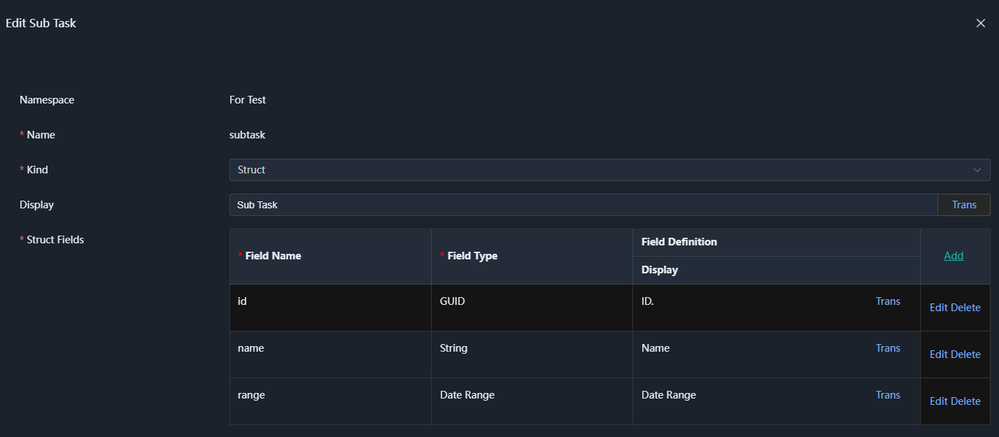

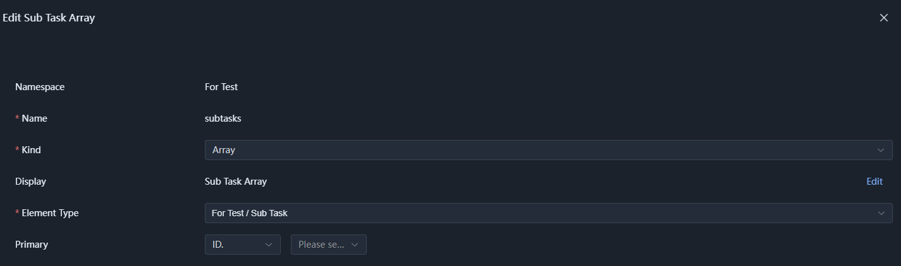
 
Then configure a function to compute the number of days of a branch task.

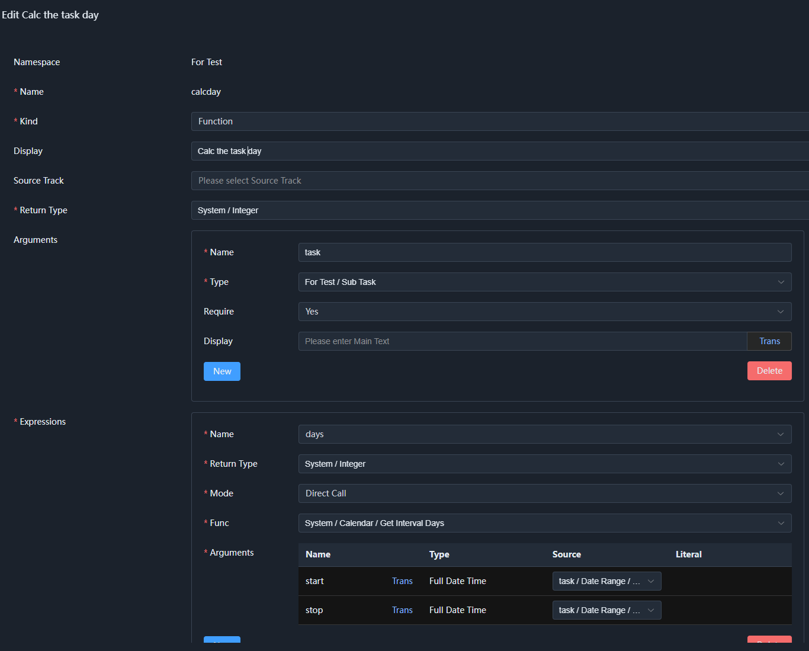


### 5.5 Adding Project Information Domain Fields and Push

Return to the project information domain and add a branch task field.

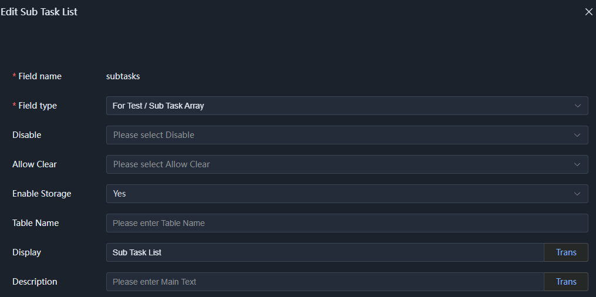

Then add a field for computing the total duration, and configure it to push data from the branch tasks.

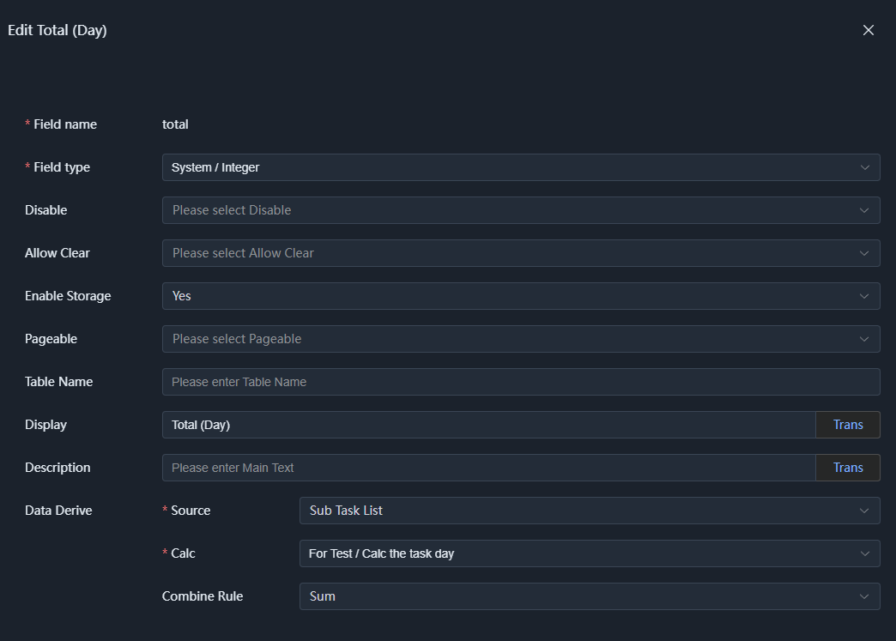

Now you can switch to Ann's account and demo this application, add some data, save it, then switch to the `Output Fields` page. You can see that the total duration of the branch tasks has been computed.

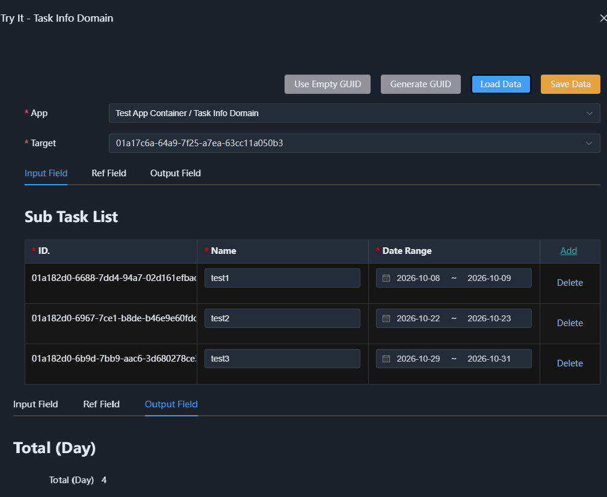

As for data lineage, it has already been demonstrated in [02. App Application Demo](../tryit/02-app.md); here we only introduce how to configure data push.


## Conclusion

Above, we walked through the complete loop of building applications for different problem domains based on the App application system, and implementing cross-domain queries through foreign keys and views. In this process, we demonstrated how to build complete business logic based on common semantic types combined with the application dialect.

You can see intuitively: once we completely strip away underlying execution details such as high concurrency, transactional exclusion, physical storage, and SQL assembly, how pure the business logic itself becomes. Configuration personnel (and even future AI) are no longer constrained by the accidental complexity of "how SQL should be organized and how the UI should interact." Developers only need to declare semantics, and the engine handles everything else. This is the dimensionality-reduction experience of returning business to its essence.

More importantly, this decoupling allows the execution layer to iterate independently of the business. For example, in the "determine whether the user is a manager" case demonstrated above, the underlying engine could perfectly well use the dumbest approach (query all data and determine in memory), but by recognizing the intent of "existence check," execution-layer developers compiled it directly into efficient SQL with LIMIT 1, achieving a huge performance leap.

Another notable example is queries with complex conditions. In past code, query forms passed from the frontend, the user's role-based row permissions, and filter conditions produced by other business logic often required developers to write extremely complex string concatenation logic. In SchemaNode, these conditions are uniformly merged into a single logical query tree. This query tree can be further algebraically expanded, pruned, and validated, ultimately automatically generating a highly optimized SQL. The whole process requires no human code intervention.

> Note: In actual applications, the logical tables of an App can also declare filter methods, among which filter functions can be configured. The parameters of a filter function automatically form the query form, and the function itself, like row permissions, is processed by the compiler and ultimately merged into that unified query tree.

> When creating an application, the third mode of the policy, `Isolate Context`, actually constructs data isolation based on organization id, tenant id, and so on in the context. However, because the Example's context only configures user id, it is not demonstrated here.
