# 03. Workflows

Although the workflow system relies on applications (for processing data, inheriting permissions, and so on), it is actually a sub-prototype under the application, so it is split out and explained separately. Of course, it was added only after the application system had been in use for three years — a product driven by requirements. Leveraging the existing semantic types and semantic functions, as well as App's control over business data, the complexity of workflows comes only from process scheduling.

It provides:

- Multiple trigger methods: event-triggered, scheduled, and manual triggering.
- Declarative process orchestration: describe workflows through nodes and their dependencies, using a directed acyclic graph to organize execution order.
- Extensible execution nodes: nodes declare parameters, payloads, state, and execution capabilities through semantic types, without redesigning a new workflow model for every business process.
- Conditional branches and concurrency control: configure branches, forks, and related execution control based on node capabilities.
- Event-driven process linking: connect different events with workflows through mechanisms such as waiting for events.
- Business data and permission inheritance: workflows run on top of their owning application and reuse App's business data access, role permissions, and data permission control, rather than building a separate permission system.
- Reuse of semantic functions: process nodes can use existing semantic types and semantic functions to complete business processing, avoiding reimplementing data operations and business logic in the workflow engine.
- Execution status and process records: through node state and the application's existing event handling mechanism, support process advancement and related operation records.
- Configurable execution policies: treat execution behaviors such as branching, cancellation, and saving as node capability configurations, rather than hard-coding all behaviors into the workflow engine.
- Workflow state persistence and recovery: by saving workflow execution state, restore unfinished processes in cases such as service restarts, reducing dependence on manual intervention and repeated execution.

The following is only a brief usage introduction; details are covered in [Workflows](../app/08-workflow.md).

Continuing from the previous chapter, we add a log record for modifications to sub-tasks, to record the modified content and time when task content is changed.

## 1. Create the Log Record

Create a log record. Its id should not be configured with initialization; it directly corresponds to the sub-task id.

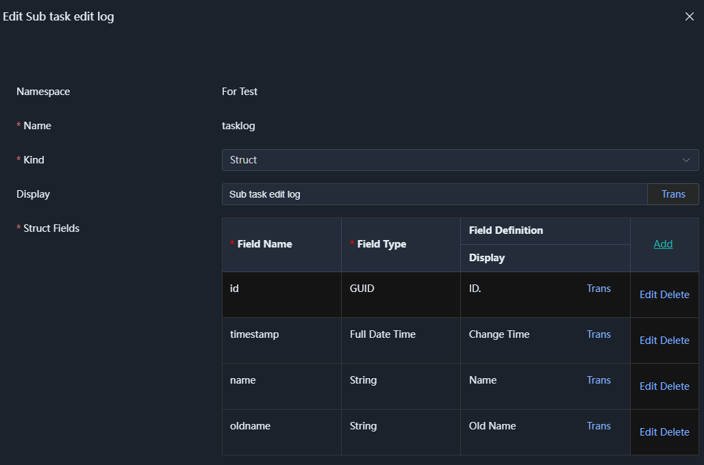

Create the corresponding array and configure the primary key as `id` and `timestamp`.

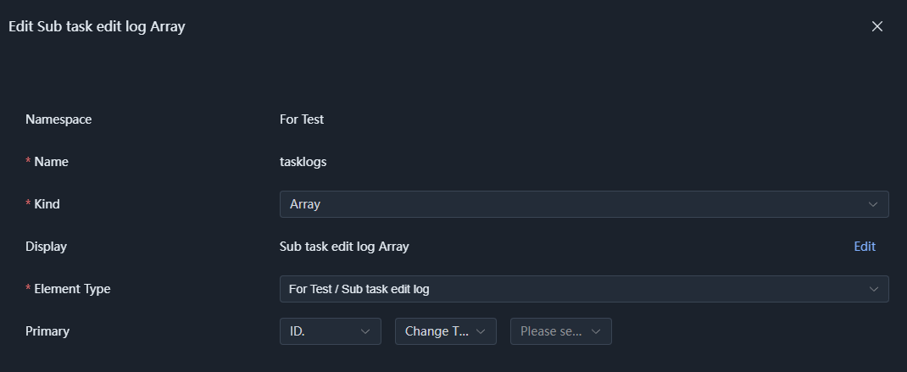

Then, in `project - Project Information Domain`, add a `log` logical table field. Do not configure data derivation; this time the data is written through a workflow.

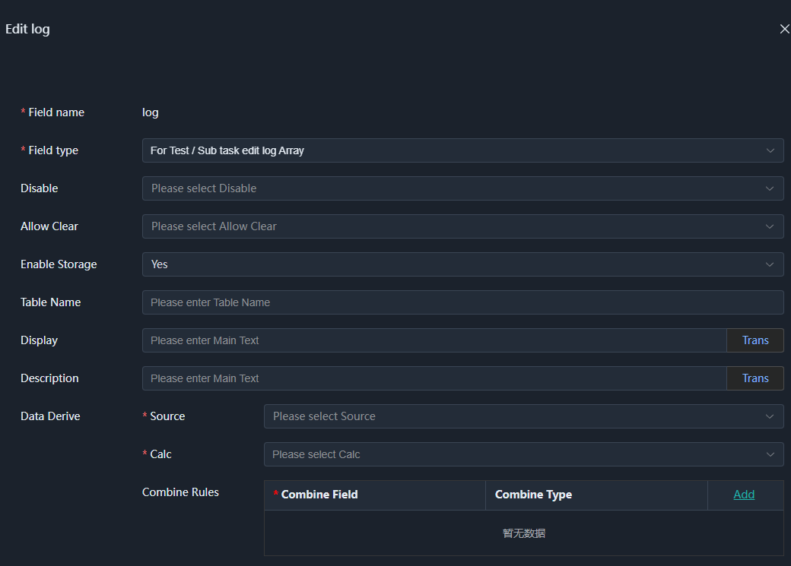

Finally, edit the `project` application and set this field to read-only to ensure it cannot be modified directly.

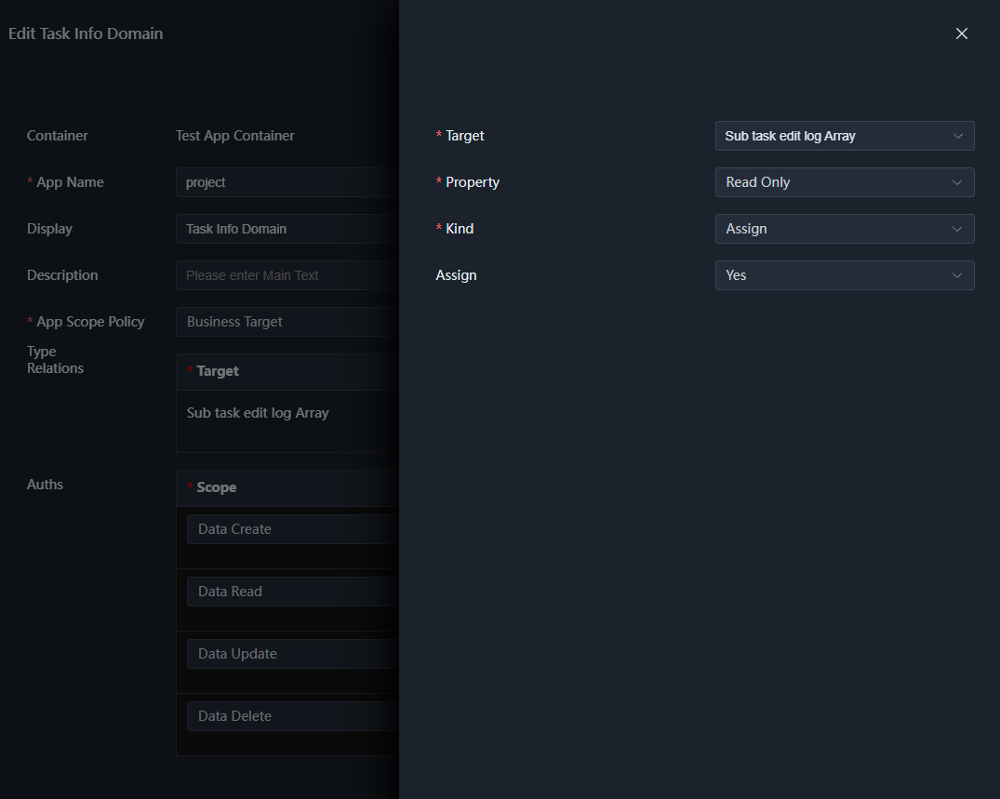

## 2. Create the Log Record Generation Function

Here we will generate a log record based on the content of the new and old sub-tasks.

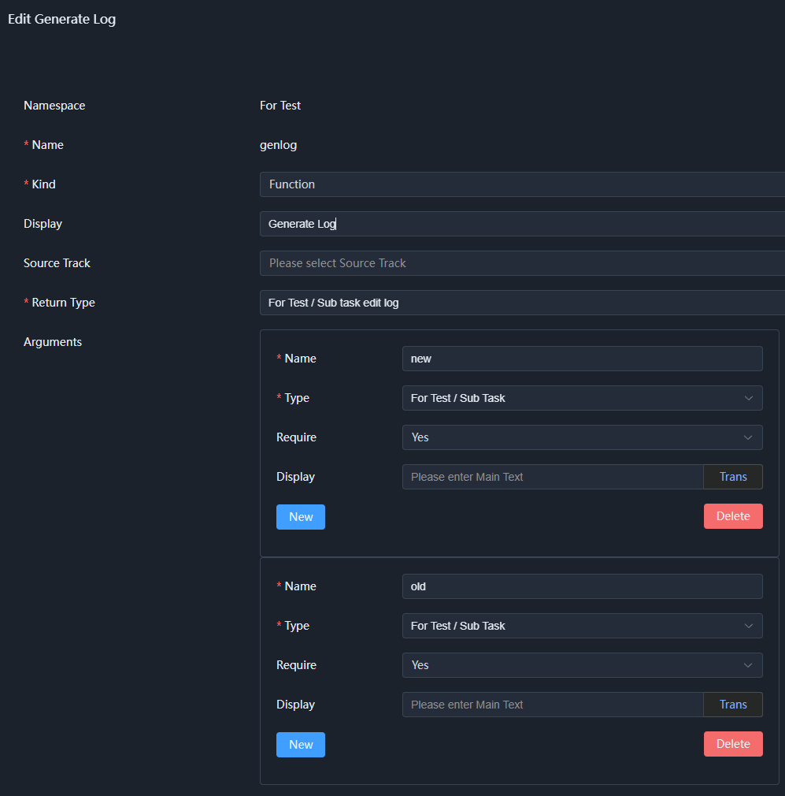

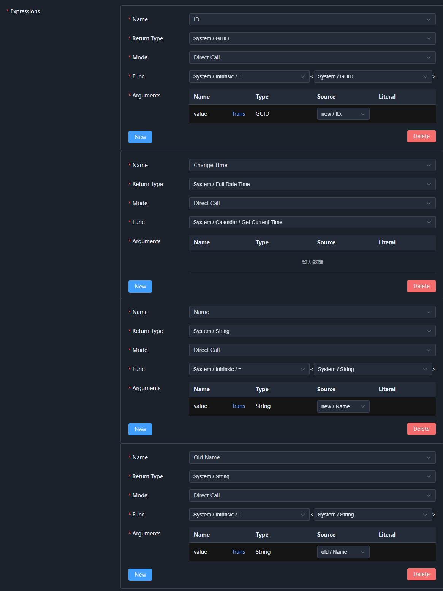

You only need the expression name to match the struct field name. In actual operation, you will find that the expression name dropdown can be selected directly.

Save it for later use.

## 3. Create the Workflow

Click the `Workflow` page of the `project` application, then choose to create a new workflow:

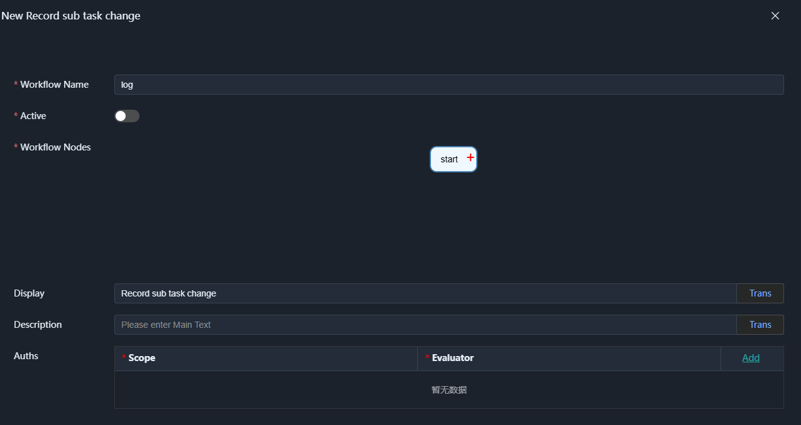

### 3.1 Waiting for Data Updates

Click `start`, the default first node. It is generally used to trigger workflow execution, for example waiting for an event, a timer, or manual triggering.

The node type determines the node's function and execution policy, as well as workflow configuration, parameters, and other details, and also determines the return value type of the workflow node.

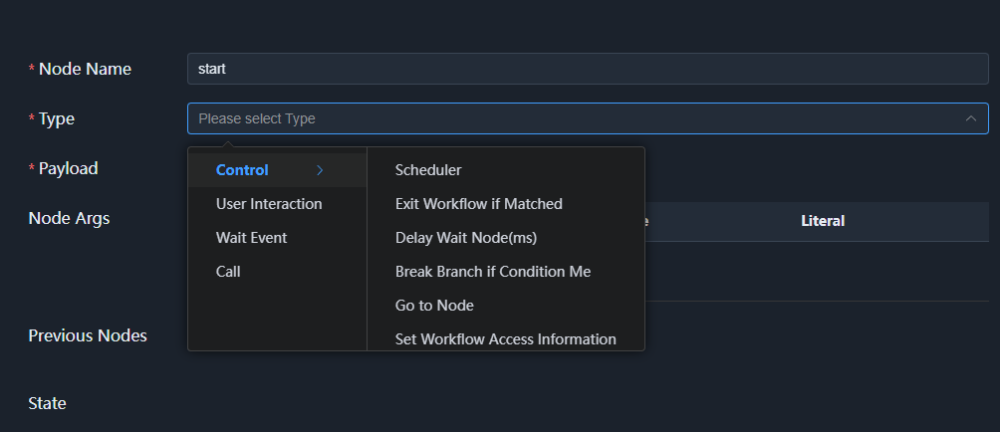

Workflow node types are declared by the App, but can likewise be extended by third parties. Here we need to track data update events:

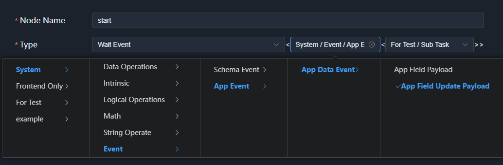

The generic here determines the node's return value type. Because this event subscribes to modifications, it returns the latest data and the original data. We will determine whether a modification happened based on the comparison. Note that here only the return value type and that the node type is waiting for an event are declared; which specific event to wait for is not yet specified.

Below is the complete configuration of `start`:

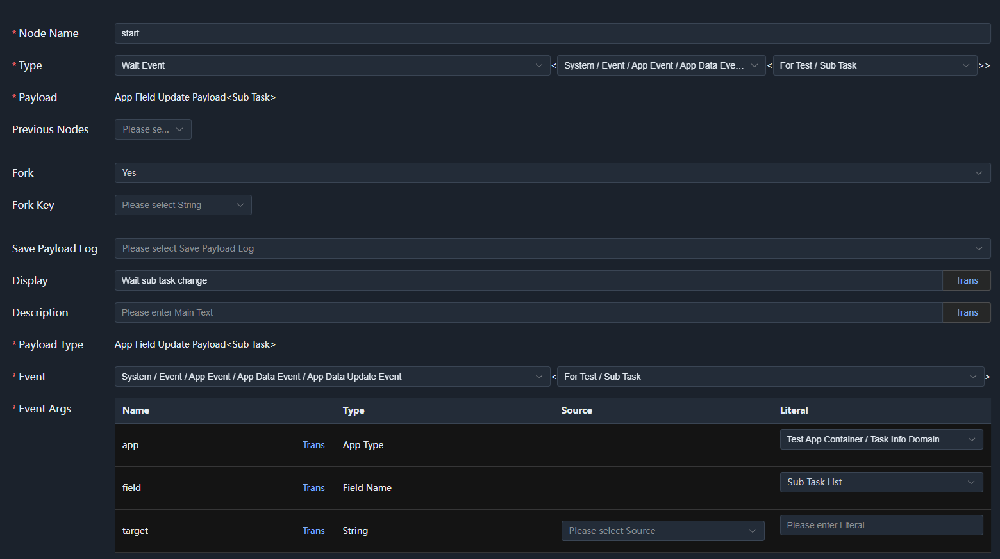

The key point here is that `Branch` must be selected as true. This ensures it does not end after a single execution; instead, each time an event is triggered, it forks a child workflow context to process the corresponding data package.

Then, in the event parameters we specified the application and logical field table to wait for, which narrows the range of events to wait for, processing only sub-task modification events.

> Payload logging is used to decide whether to write the current node's payload when saving workflow state, which is convenient for testing. However, in many cases the payload is of little significance and the data volume is large, so it is recommended to turn it off. But if the workflow is expected to run for a long time, the server may restart during execution and require recovery; then the payload can be restored, which is necessary to ensure workflow execution. This is a trade-off based on reality.

### 3.2 Determine Whether a Modification Happened

After saving the `start` node, click the + sign next to it to add a child node:

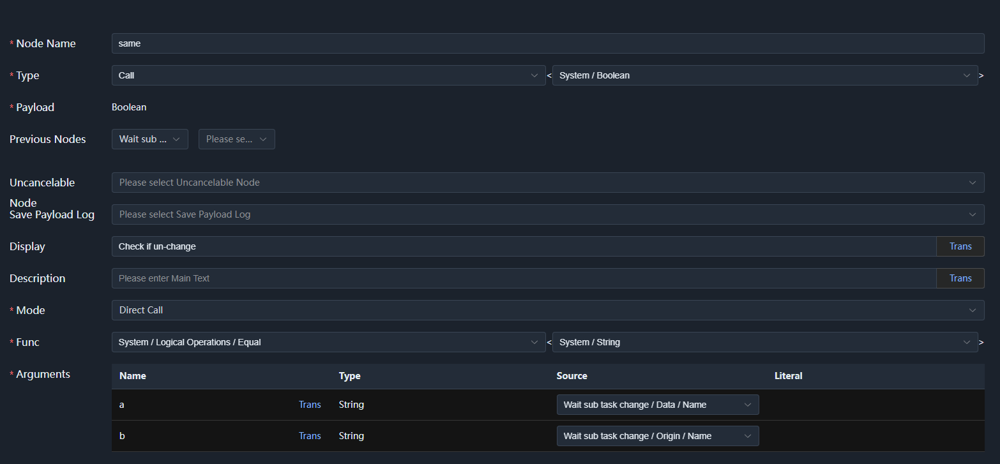

This node uses a function call, the most commonly used node. It can call a function and use the function's return value as the node's return value. It can also access the return values of previous nodes as function parameters. Here we simply compare whether the old and new sub-task contents are the same.

### 3.3 End If Unchanged

When there is no modification, we do not record anything and directly end the workflow. Similarly, click the + sign of the `Check whether unchanged` node to add a child node:
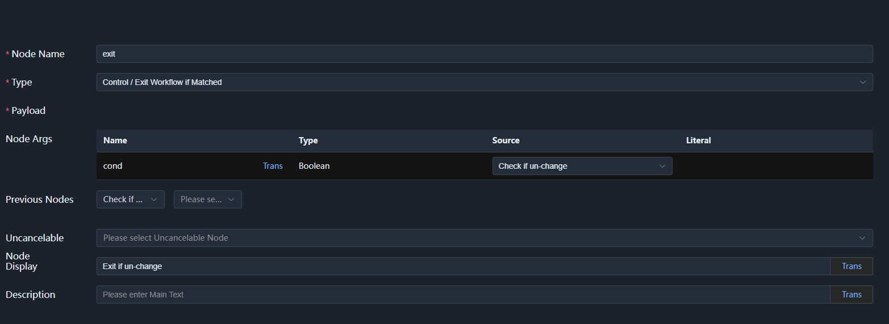

### 3.4 Generate the Log Record

Continue adding a child node, calling the log record generation function:

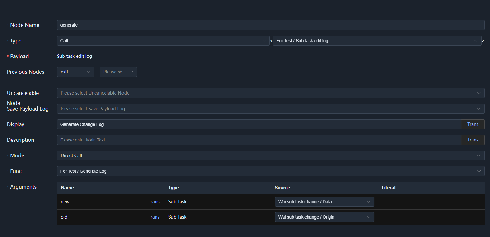

### 3.5 Write the Log Record

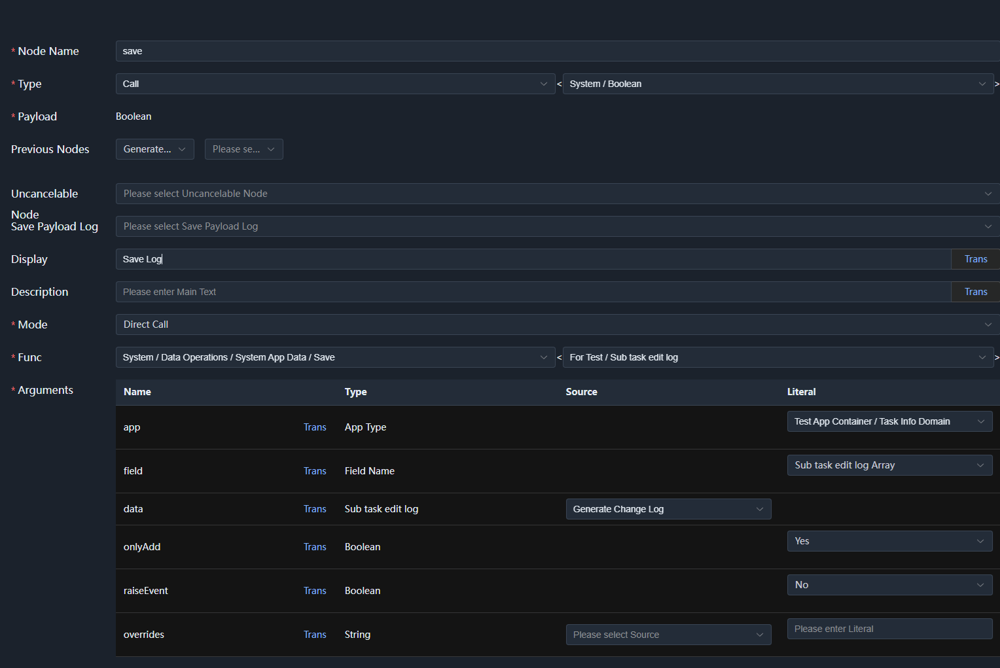

## 4. Activate the Workflow

On the workflow management page, click the `Activate` button to activate the workflow. If there are no errors, it becomes a `Deactivate` button.

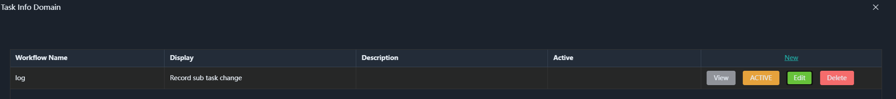

## 5. Testing

Now you can demo the fields of the `Task Information Domain`, load a task, modify the sub-task content, then save. Wait a moment, reload the data, and you will see that the log record has been written.

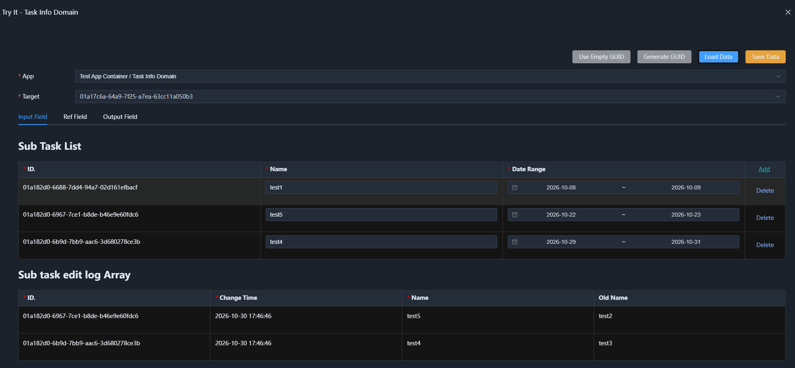

## Summary

The event system includes application data events, type change events (rarely used), and can also register message queues from microservices as events, which is implemented in both `SchemaNode.Kafka` and `SchemaNode.RabbitMQ`.
 
The workflow system actually mainly completes node orchestration. Nodes can be continuously extended: as long as they provide the `Settings` (configuration), `Session` (session), `Args` (execution parameters), and `Payload` (returned payload) configurations, workflow scheduling can work based on them.

This chapter is only an introductory overview.

Taken together, Core and App: Core defines data transformation as semantic functions, while App defines process scheduling as workflows. This is actually a special split — the former makes intent expression and analysis easier, while the latter faces actual complex business scenarios.
