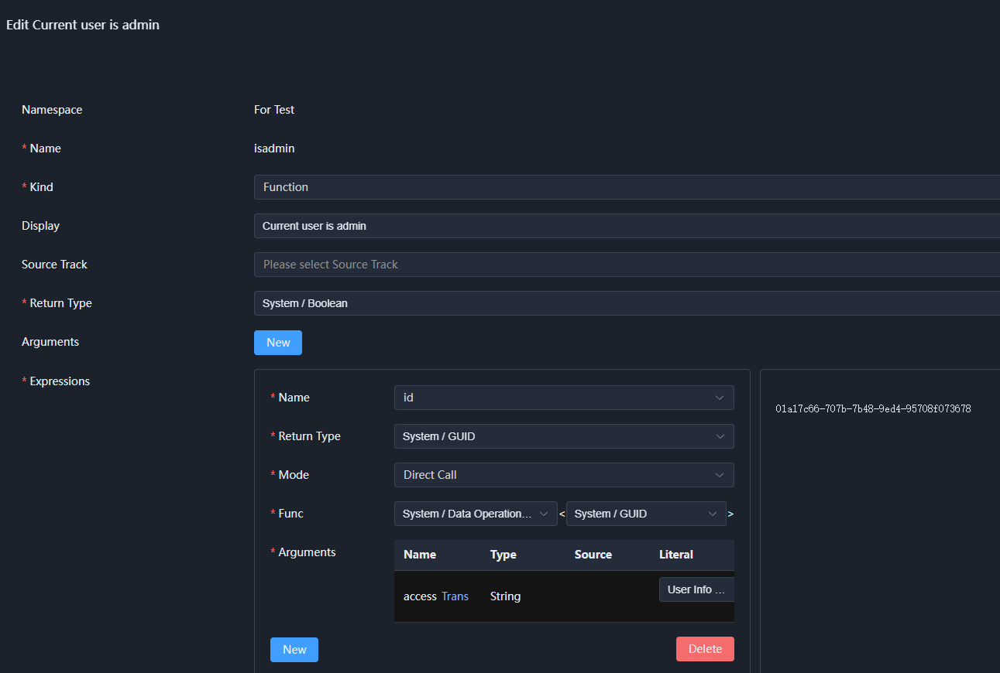

# 04. Embedding into Existing Microservices

The previous chapters are about "configuring from scratch": first define semantic types (which can be configured purely in the browser), then create applications, fields, and workflows in application management.

Real projects usually do not start from scratch: microservices already have DTOs, authentication contexts, business APIs, and message queues. This chapter explains how to connect these **existing capabilities** to SchemaNode, so that Core and App can be embedded into microservices as a semantic layer, rather than replacing them.

This chapter has four main threads:

| Existing capability | Integration approach | Semantic layer output |
| --- | --- | --- |
| Request identity (user, organization) | `ISchemaContextItemProvider<T>` | `system.context` struct |
| Existing types (DTOs, enums) | `[Meta<SchemaType>]` | Struct, enum, array types |
| Existing APIs | static methods calling existing wrappers | Functions + related types |
| Existing message queues | `KafkaEvent` / `RabbitEvent` + topic attributes | Events |

After completing these four steps, the microservice's original capabilities can be reused by semantic types, functions, events, and workflows. For underlying mechanisms, refer to [02-schema.md](../app/02-schema.md), [03-runtime.md](../app/03-runtime.md), and [09-event.md](../app/09-event.md).

---

## 1. Integration Overview

SchemaNode does not take over the microservice's HTTP routing, database, or message middleware. It only does three things:

1. Collect context from requests;
2. Map existing C# types and functions into Schema;
3. Convert messages from message queues into events.

```text
Existing microservice                   SchemaNode semantic layer
──────────                              ─────────────────
HTTP request / gateway ── UserInfoMiddleware ──► UserInfoProvider ──► system.context
Existing DTO / enum ── [Meta<SchemaType>] ──► struct / enum / array
Existing API wrapper ── static method ──────► semantic function (available to workflows)
Kafka / RabbitMQ ── KafkaEvent / RabbitEvent ──► semantic event (subscribable by workflows)
```

Server assembly still has only one main path:

```csharp
builder.Services
    // 1. Context: register the current request's user, organization instance, and provider
    .AddScoped<UserInfo>()
    .AddScoped<UserInfoProvider>()

    // 2. Types and functions: scan the entry assembly (types already marked with [Meta<SchemaType>] are registered automatically)
    .AddAppSchemaAssembly<Program>()

    // 3. Generate the system Schema, including system.context
    .PrepareSchemaRuntime();
```

This order is consistent with [Program.cs](../../../SchemaNode.Example/Program.cs#L48-L77). Only the three lines related to embedding are kept here; App also needs `WithSchemaApiProtocol`, `AddSchemaStorageProvider`, and an application data provider. For the complete code, see [Program.cs](../../../SchemaNode.Example/Program.cs#L52-L66).

In the request pipeline, fill the context first, then mount the Schema API:

```csharp
app.UseMiddleware<UserInfoMiddleware>();
app.UseSchemaApis(enableAppDataApi: true, enableSchemaManage: true);
```

See [Program.cs](../../../SchemaNode.Example/Program.cs#L82-L85).

Finally, start the semantic runtime:

```csharp
await app.Services.InitSchemaRuntimeAsync();
await app.Services.ActivateSchemaRuntimeAsync();
```

See [Program.cs](../../../SchemaNode.Example/Program.cs#L101-L102).

---

## 2. Request Context: UserInfoProvider and system.context

Context is the only entry point for reading "who the current user is and which organization they belong to" in authentication, derivation, and workflows. SchemaNode does not prescribe the identity source; it only requires that identity be placed into a provider.

### 2.1 Defining the Context Type

There is only one minimal example in `SchemaNode.Example`:

```csharp
[Meta<SchemaType>("example.user")]
public class UserInfo
{
    /// <summary>
    /// User ID
    /// </summary>
    public string? Id { get; set; }
}
```

See [UserInfo.cs](../../../SchemaNode.Example/Components/UserInfo.cs#L9-L15).

`[Meta<SchemaType>("example.user")]` does two things:

- Makes this ordinary C# class be generated as a struct type by `StructGenerator`;
- Makes the field name in `system.context` use the last segment of `example.user`, that is, `user`.

So the path to access the user ID in a function is `user.id`, not `userinfo.id`. For the field name generation rules, see [NodeRuntimeStageHandler.cs](../../../SchemaNode.Core/Service/NodeRuntimeStageHandler.cs#L214-L224).

Real microservices usually also need fields such as organization and tenant; just extend the same type directly:

```csharp
[Meta<SchemaType>("example.user")]
public class UserInfo
{
    public string? Id { get; set; }
    public string? OrgId { get; set; }
    public string? TenantId { get; set; }
}
```

The corresponding context paths are `user.id`, `user.orgId`, and `user.tenantId`.

### 2.2 Implementing the Provider

The provider hands "the C# instance in the current request" to SchemaNode:

```csharp
public class UserInfoProvider(UserInfo? userInfo) : ISchemaContextItemProvider<UserInfo>
{
    public bool HasItem => userInfo != null;

    public UserInfo GetItem()
        => userInfo ?? throw new InvalidOperationException("UserInfo is not available");
}
```

See [UserInfoProvider.cs](../../../SchemaNode.Example/Components/UserInfoProvider.cs#L8-L17).

The interface itself is thin; the key is its four members:

| Member | Purpose |
| --- | --- |
| `HasItem` | Whether the current request has this context item |
| `GetItem()` | Returns the strongly typed instance |
| `TryGetItem(out T?)` | The default implementation calls `GetItem()` and catches exceptions |
| `TrySetItem(T)` | Returns `false` by default; implement only when context needs to be copied across scopes |

The definition is in [ISchemaContextItemProvider.cs](../../../SchemaNode.Core/Context/ISchemaContextItemProvider.cs#L8-L79).

### 2.3 Filling It in the Request Pipeline

The example uses middleware to read the user ID from the request header:

```csharp
public class UserInfoMiddleware(RequestDelegate next)
{
    public async Task Invoke(HttpContext context, UserInfo user)
    {
        if (context.Request.Headers.TryGetValue("userid", out var userid))
        {
            user.Id = userid;
        }
        await next(context);
    }
}
```

See [UserInfoMiddleware.cs](../../../SchemaNode.Example/Components/UserInfoMiddleware.cs#L7-L23).

Here the `UserInfo user` parameter of `Invoke` is injected by DI per request scope, and it is the same instance that `UserInfoProvider` gets. Real projects can instead:

- read from `X-User-Id` and `X-Org-Id` headers injected by the gateway;
- read from JWT claims;
- read from an existing `IHttpContextAccessor` or tenant resolution service.

As long as the value is written into the scoped `UserInfo` before entering the Schema API, it works.

### 2.4 Registration Order and Lifecycle

```csharp
.AddScoped<UserInfo>()
.AddScoped<UserInfoProvider>()
```

See [Program.cs](../../../SchemaNode.Example/Program.cs#L48-L49).

Four easy pitfalls:

1. **The concrete type must be registered.** `OnServiceInitialized` scans the interface of `ServiceDescriptor.ServiceType`, see [NodeRuntimeStageHandler.cs](../../../SchemaNode.Core/Service/NodeRuntimeStageHandler.cs#L58-L71). When you write `AddScoped<ISchemaContextItemProvider<UserInfo>, UserInfoProvider>()`, the `ServiceType` is the interface itself and cannot be found by the scan; register `UserInfoProvider` as in the example.
2. **It must be placed before `PrepareSchemaRuntime()`.** `PrepareSchemaRuntime` immediately performs a scan with the current `IServiceCollection` and caches the provider types, see [Service.cs](../../../SchemaNode.Core/Service/Service.cs#L130-L147). Providers registered afterwards will not enter `system.context`.
3. **Follow the request scope.** `SchemaContext` is scoped, see [Service.cs](../../../SchemaNode.Core/Service/Service.cs#L117-L119). The provider should also be scoped; otherwise the previous request's user is carried into the next request.
4. **Field names cannot be duplicated.** The field name uses the last segment of the Schema type name; when multiple providers' types have the same last segment (for example `example.user` and `user`), duplicate fields appear in `system.context`.

### 2.5 How system.context Is Generated

During the system Schema loading stage, all providers are traversed, and each context type becomes a field of `system.context`:

```csharp
StructFieldSchema field = new()
{
    Name = schemaType.GetSchemaName(), // example.user -> user
    Type = schemaType
};
fieldTypes.Add(field);
provider.BindSchemaContextItemProvider(field.Name, schemaType, providerType, itemType);
```

See [NodeRuntimeStageHandler.cs](../../../SchemaNode.Core/Service/NodeRuntimeStageHandler.cs#L199-L228).

The final generated struct is:

```text
system.context
└── user : example.user
    ├── id : system.string
    ├── orgId : system.string
    └── tenantId : system.string
```

This structure appears in type management as a read-only system type, and the function editor's `system.data.getcontext` can choose the access path and return type accordingly.



### 2.6 Reading with system.data.getcontext

`getcontext` is a system function provided by Core:

```csharp
[Meta<SchemaType>(NS_SYSTEM_DATA)]
public static class SystemData
{
    public static T? getcontext<T>(SchemaContext context, string access)
    {
        IValueAccess? item = context.GetContextItem(access);
        return item != null ? item.GetValue<T>() : default(T?);
    }
}
```

See [SystemData.cs](../../../SchemaNode.Core/Function/SystemData.cs#L20-L36).

The access path rules are in [SchemaContext.cs](../../../SchemaNode.Core/Context/SchemaContext.cs#L632-L643):

- The first `.` is the separator; the first half is the field name in `system.context` (such as `user`);
- The second half is the access path inside the field (such as `id`, `orgId`);
- First find the provider by field name, convert the C# instance into a data node, then get the child field.

In the configuration manager's functions, typical usages are:

```text
system.data.getcontext<system.string>("user.id")
system.data.getcontext<system.string>("user.orgId")
system.data.getcontext<example.user>("user")
```

The return type must match the field's actual type. `SchemaNode.Example`'s `UserInfo.Id` is `string`, so use `system.string`; if the microservice's `Id` is `Guid` (in the demo application `activity.json` it is `system.guid`), write `system.guid` instead of copying the example.

### 2.7 Should the Organization ID Have Its Own Provider

Both approaches work:

| Approach | Applicable scenario |
| --- | --- |
| Put `OrgId` on `UserInfo` | Organization information is just an ID, or is simply a user attribute |
| Define a separate `OrgInfo` + `OrgInfoProvider` | The organization has multiple fields such as name, hierarchy, and configuration |

When defined separately, `system.context` gains an `org` field:

```csharp
[Meta<SchemaType>("example.org")]
public class OrgInfo
{
    public string? Id { get; set; }
    public string? Name { get; set; }
}
```

Then in functions you can write `system.data.getcontext<system.string>("org.id")`.

### 2.8 Getting the Context Directly in Static Functions

If you are not inside an expression but inside a C# static function, you can bypass `getcontext` and get it directly by type:

```csharp
UserInfo? user = context.GetContextItem<UserInfo>();
```

`GetContextItem<T>()` is implemented in [SchemaContext.cs](../../../SchemaNode.Core/Context/SchemaContext.cs#L618-L622).

This returns the strongly typed object returned by the provider, suitable for continuing to call existing services in static functions.

---

## 3. Existing Types: [`Meta<SchemaType>`]

Existing DTOs do not need structural changes; just add one attribute.

### 3.1 Registering a DTO as a Struct

```csharp
[Meta<SchemaType>("demo.order.info")]
public class OrderInfo
{
    public string Id { get; set; } = string.Empty;
    public decimal Amount { get; set; }
    public DateTimeOffset CreatedAt { get; set; }
}
```

`StructGenerator` will:

- read all readable and writable instance properties (getter is not private and has no `[SchemaIgnore]`);
- convert property names to camelCase field names: `Id` → `id`, `Amount` → `amount`;
- mark nullable properties as not required;
- use XML comments as field display names.

See [StructGenerator.cs](../../../SchemaNode.Core/Generator/StructGenerator.cs#L90-L119).

If a property should not be exposed, add `[SchemaIgnore]`; if you want to override the field's semantic type, add `[Meta<SchemaType>]` on the property.

### 3.2 Enums and Arrays

The same mechanism also applies to existing enums:

```csharp
[Meta<SchemaType>("demo.order.status")]
public enum OrderStatus
{
    Created,
    Paid,
    Shipped
}
```

If the struct has a primary key or index, `StructGenerator` also generates a companion array type:

```csharp
[Meta<SchemaType>("demo.order.info")]
public class OrderInfo
{
    [Meta<PrimaryIndex>(0)]
    public string Id { get; set; } = string.Empty;

    public decimal Amount { get; set; }
}
```

In this case you get both `demo.order.info` and `demo.order.infos`. For the rules, see [StructGenerator.cs](../../../SchemaNode.Core/Generator/StructGenerator.cs#L195-L217).

### 3.3 Registering Assemblies

Types are only scanned if they are in a "registered Schema assembly". `AddAppSchemaAssembly<T>()` registers the assembly containing `T`:

```csharp
.AddAppSchemaAssembly<Program>()
```

See [AppService.cs](../../../SchemaNode.App/Service/AppService.cs#L66-L70).

If existing DTOs are in a separate class library:

```csharp
.AddAppSchemaAssemblies(typeof(OrderInfo).Assembly)
```

`AddSchemaAssemblies` automatically puts the core assemblies first and the entry assembly last, and deduplicates internally by assembly, see [Service.cs](../../../SchemaNode.Core/Service/Service.cs#L39-L77).

Likewise, this step must be completed before `PrepareSchemaRuntime()`.

> **Screenshot placeholder (to be added)**: the `demo.order` namespace appears in type management, with `info`, `infos`, `status`, and other types underneath.

### 3.4 Who Generates Types, Functions, and Events

Which generators a type marked with `[Meta<SchemaType>]` is handed to is determined by `OfNodeKind`:

| C# form | Required attributes | Generated result |
| --- | --- | --- |
| Ordinary class / struct | `[Meta<SchemaType>]` | Struct (with a companion array when there is an index) |
| `enum` | `[Meta<SchemaType>]` | Enum |
| Static class | `[Meta<SchemaType>]` | Namespace + one function per static method |
| Event class | `[Meta<OfNodeKind>(NODE_KIND_EVENT)]` + `[Meta<SchemaType>]` | Event |

The dispatch logic is in [NodeRuntimeStageHandler.cs](../../../SchemaNode.Core/Service/NodeRuntimeStageHandler.cs#L335-L361).

---

## 4. Calling Existing APIs: Defining static Methods

Inside microservices, service-to-service calls are usually already wrapped: HTTP/RPC clients, service discovery, authentication headers, token passthrough, retries are all inside the wrapper. SchemaNode does not need to provide another layer of service invocation or authentication wrapping; just define a static method that calls the existing wrapper.

Static classes marked with `[Meta<SchemaType>]` are registered as namespaces, and each `public static` method is registered as a function, see [FunctionGenerator.cs](../../../SchemaNode.Core/Generator/FunctionGenerator.cs#L41-L65). The related DTOs also become semantic types because of `[Meta<SchemaType>]`, so these functions can be used directly by workflows, permission expressions, and derivation rules.

### 4.1 Writing a static Method

```csharp
[Meta<SchemaType>("demo.api.order")]
public static class OrderFunctions
{
    [Meta<SchemaType>("demo.api.order.get")]
    public static Task<OrderInfo?> GetOrder(SchemaContext context, string orderId)
        => context.GetRequiredService<IOrderApiClient>().GetOrderAsync(orderId);

    [Meta<SchemaType>("demo.api.order.pull")]
    public static Task<List<OrderInfo>> PullOrders(SchemaContext context, DateTimeOffset since)
        => context.GetRequiredService<IOrderApiClient>().ListOrdersAsync(since);
}
```

Four key points.

**First, call the microservice's existing wrapper directly.** `IOrderApiClient` is the microservice's original call wrapper; authentication, service discovery, and retries are all inside it, and SchemaNode does not intervene. `context.GetRequiredService<IOrderApiClient>()` only takes this wrapper out of the current scope; if the microservice uses a static entry point, you can also call the static method directly.

**Second, the class must be a static class.** `FunctionGenerator` only handles classes that are `IsAbstract && IsSealed` and marked with `[Meta<SchemaType>]`, see [FunctionGenerator.cs](../../../SchemaNode.Core/Generator/FunctionGenerator.cs#L44-L48).

**Third, `SchemaContext` is an optional first parameter.** It is not a business parameter and will be hidden automatically; the runtime injects the current context when calling, see [FunctionGenerator.cs](../../../SchemaNode.Core/Generator/FunctionGenerator.cs#L83-L88). Use it when you need the current user or organization:

```csharp
UserInfo? user = context.GetContextItem<UserInfo>();
```

**Fourth, parameters and return values must be resolvable to semantic types.** Scalars such as `string` and `DateTimeOffset` are directly usable; DTOs such as `OrderInfo` are recommended to add `[Meta<SchemaType>]` to name them explicitly. Without the attribute, the framework still generates a type by class name automatically, but the namespace and name are uncontrollable and easily conflict with existing types. If it cannot be resolved, a "Can't resolve parameter type" exception is thrown during the generation stage, see [FunctionGenerator.cs](../../../SchemaNode.Core/Generator/FunctionGenerator.cs#L156-L167).

### 4.2 Registering Types and Functions Together

The code above produces two kinds of semantic assets at the same time:

| C# declaration | Semantic layer output |
| --- | --- |
| `OrderInfo` | `demo.order.info` struct |
| `List<OrderInfo>` | `system.list<demo.order.info>`; if `OrderInfo` has a primary key, `demo.order.infos` array is also generated |
| `OrderFunctions` | `demo.api.order` namespace + `get`, `pull` functions |

There is no additional registration code here; as long as the static class and DTO are in a registered assembly, `FunctionGenerator` and `StructGenerator` take them over respectively. For how to register assemblies, see 3.3.

### 4.3 Function Names and Registration

`FunctionGenerator`'s default naming rule:

```text
<SchemaType namespace on the class>.<lowercased method name>
```

So `demo.api.order` on the class + method `GetOrder` yields `demo.api.order.getorder`. If you want a more natural name, write another `[Meta<SchemaType>]` on the method:

```csharp
[Meta<SchemaType>("demo.api.order.get")]
public static Task<OrderInfo?> GetOrder(SchemaContext context, string orderId) ...
```

Then the full function name is `demo.api.order.get`. For the rules, see [FunctionGenerator.cs](../../../SchemaNode.Core/Generator/FunctionGenerator.cs#L56-L63). To hide a method, add `[SchemaIgnore]`.

### 4.4 Using It in Workflows: Data Synchronization

Once functions are registered, workflows can call them directly by function name. For example, an order data synchronization:

```text
Scheduled trigger
  → demo.api.order.pull(since = last sync time)
  → system.list<demo.order.info>
  → iterate
  → system.data.app.save<demo.order.info>
```

The whole chain only references `demo.api.order.pull` and `demo.order.info`, and does not care whether the underlying protocol is HTTP, gRPC, or something else; authentication headers, tokens, and service addresses are all handled by `IOrderApiClient`. The ordinary C# objects returned by `PullOrders` are converted by the framework into semantic data nodes, and subsequent nodes can directly read fields such as `id` and `amount`.

### 4.5 Invocation Methods

| Scenario | Method |
| --- | --- |
| Configuration manager / frontend | Call `/schema/call-function` by function name |
| Permission, derivation, workflow expressions | Reference the function node directly |
| Server-side code | `context.CallFunctionAsync(func, args)` |

The HTTP request body corresponds to [CallFunction.cs](../../../SchemaNode.App/Api/Schema/Info/CallFunction.cs#L47-L80):

```json
{
  "name": "demo.api.order.get",
  "args": ["order-123"],
  "app": "demo.order",
  "target": "order-123"
}
```

`app` and `target` are optional and used to set the access context; `name` and `args` are required. The route prefix is determined by `UseSchemaApis(prefix: "schema")`; for the concatenation rules, see [Service.cs](../../../SchemaNode.App/Http/Service.cs#L154-L181).

### 4.6 Notes

- **Reuse existing wrappers; do not reimplement authentication.** Token passthrough, tenant headers, service discovery, and retries should all stay in the microservice's original call wrapper; SchemaNode is only responsible for exposing the call as a function.
- **Static methods should only forward, not accumulate business logic.** Business rules remain in existing services, avoiding two implementations in the semantic layer and the microservice.
- **Data synchronization must consider idempotency.** Workflows may retry; `PullOrders` or write nodes should upsert by primary key, or let the existing wrapper provide an idempotency key.
- **Exceptions should be thrown upward.** A failed workflow call makes the current node fail; when compensation is needed, explicitly add compensation nodes in the workflow rather than swallowing exceptions in static methods.

---

## 5. Converting Message Queues into Events

The previous sections exposed existing capabilities as types and functions; this section also brings message queues in — turning a Kafka or RabbitMQ message into an event the system understands: with an event type, a payload, and directly subscribable in workflows.


### 5.1 Writing an Event Class (Kafka as an Example)

```csharp
using SchemaNode.Attribute;
using SchemaNode.Kafka;
using SchemaNode.Property.Core;
using System.Text.Json.Serialization;
using static SchemaNode.Utility.Constant;

[Meta<OfNodeKind>(NODE_KIND_EVENT)]
[Meta<SchemaType>("demo.order.event.created")]
[KafkaTopic("order-created")]
public sealed class OrderCreatedEvent : KafkaEvent<OrderCreatedPayload>;

[Meta<SchemaType>("demo.order.payload.created")]
public sealed class OrderCreatedPayload
{
    [JsonPropertyName("orderId")]
    public string OrderId { get; set; } = string.Empty;

    [JsonPropertyName("orgId")]
    public string? OrgId { get; set; }
}
```

Each part handles one thing:

| Declaration | Purpose |
| --- | --- |
| `KafkaEvent<OrderCreatedPayload>` | The payload carried by the event is this type |
| `[KafkaTopic("order-created")]` | Which Kafka topic to subscribe to; write several for multiple topics |
| `[Meta<SchemaType>("demo.order.event.created")]` | The name displayed in type management and workflows |
| `[Meta<OfNodeKind>(NODE_KIND_EVENT)]` | Declares that this is an event class, not to be treated as an ordinary struct |

Two more points: the event class is just an empty shell; do not write a constructor, and put all needed data into the Payload; the Payload's field names must match the upstream JSON — if upstream uses camelCase, specify it explicitly with `[JsonPropertyName]`.

### 5.2 Registering and Starting Consumption

The Kafka consumer is still created by the host itself; SchemaNode does not take over connections to the message middleware:

```csharp
using Confluent.Kafka;

builder.Services.AddSingleton<IConsumer<string, byte[]>>(_ =>
    new ConsumerBuilder<string, byte[]>(new ConsumerConfig
    {
        BootstrapServers = builder.Configuration["Kafka:BootstrapServers"],
        GroupId = builder.Configuration["Kafka:GroupId"],
        AutoOffsetReset = AutoOffsetReset.Earliest
    }).Build());

builder.Services
    .AddSchemaKafkaEvent()           // Let the system know about Kafka events
    .AddAppSchemaAssembly<Program>() // Scan the event classes you wrote
    .PrepareSchemaRuntime();
```

Note that both `AddSchemaKafkaEvent()` and `AddAppSchemaAssembly<Program>()` must be placed before `PrepareSchemaRuntime()`.

`AddSchemaKafkaEvent()` is only responsible for "letting the system know which events exist"; it does not start consuming by itself. After the service starts, the event sources still need to be started; a minimal background service is enough:

```csharp
public sealed class SchemaEventSourceHost(IServiceProvider services) : BackgroundService
{
    protected override async Task ExecuteAsync(CancellationToken stoppingToken)
    {
        using IServiceScope scope = services.CreateScope();
        SchemaContext context = scope.ServiceProvider.GetRequiredService<SchemaContext>();

        foreach (IEventSource source in services.GetServices<IEventSource>())
            await source.StartAsync(context, stoppingToken);

        await Task.Delay(Timeout.Infinite, stoppingToken);
    }
}

builder.Services.AddHostedService<SchemaEventSourceHost>();
```

When the host starts with `app.Run()`, it starts the `BackgroundService`. At that point the runtime has already been initialized, so the event sources can scan the registered event classes.

### 5.3 Subscribing in a Workflow

Once events are registered, return to the application's workflow page, create a new `start` node, choose "wait for event", and select `demo.order.event.created` as the event type. The process is exactly the same as the task log in [03-workflow.md](03-workflow.md):

- Turn on `Branch`, so that each incoming message forks a sub-process instead of executing only once;
- If events of the same kind may also come from other applications or fields, narrow the range in the event parameters;
- Downstream nodes can directly read fields in the payload (such as `orderId`), and can also use `system.data.getcontext` to get the current user as usual.

There is no need to care how the message is parsed here: the system has already converted the JSON into the Payload type and handed it to the workflow.

### 5.4 Kafka Topics and Subscription Topics (Optional)

`[KafkaTopic]` determines which Kafka topic to consume from; workflow subscription looks at the event's own topic, which matches all topics by default, so generally you do not need to care. Only when you want the workflow to subscribe by a finer-grained topic do you need to override:

```csharp
public sealed class OrderCreatedEvent : KafkaEvent<OrderCreatedPayload>
{
    public override string Topic => "order/created";
    public override string MatchTopic => "order/#";
}
```

For the topic wildcard rules, see [09-event.md](../app/09-event.md#L37-L63).

### 5.5 RabbitMQ: The Same Approach

Just replace the base class and attributes with the RabbitMQ versions:

```csharp
[Meta<OfNodeKind>(NODE_KIND_EVENT)]
[Meta<SchemaType>("demo.order.event.created")]
[RabbitQueue("schema-order-created")]
[RabbitBinding("order-exchange", "order.created", "topic")]
public sealed class OrderCreatedEvent : RabbitEvent<OrderCreatedPayload>;
```

`[RabbitQueue]` is the queue name; `[RabbitBinding]` is the exchange, routing key, and exchange type, and both can be written multiple times.

The connection is likewise created by the host, then registered by calling `AddSchemaRabbitEvent()`:

```csharp
builder.Services.AddSingleton<IConnection>(_ =>
    new ConnectionFactory { Uri = new Uri(builder.Configuration["RabbitMQ:Uri"]!) }
        .CreateConnectionAsync().GetAwaiter().GetResult());

builder.Services
    .AddSchemaRabbitEvent()
    .AddAppSchemaAssembly<Program>()
    .PrepareSchemaRuntime();
```

Starting consumption is exactly the same as for Kafka; the background service in 5.2 does not need to change. Real projects usually choose only one transport; if the same event needs to be consumed from both transports, write two classes to avoid name conflicts.

### 5.6 A Few Practical Reminders

- **One Kafka topic corresponds to one event class.** When the same event needs multiple topics, write multiple `[KafkaTopic]` attributes.
- **Do not write constructors in event classes.** Put the needed data into the Payload.
- **Payload field names must match the upstream JSON.** When they do not, specify them explicitly with `[JsonPropertyName]`.
- **It is recommended to name Payload types explicitly.** Add `[Meta<SchemaType>]` to avoid auto-generated type names colliding with existing types.
- **Event sources must be started explicitly.** If you only register without starting, messages will not become events and workflows will not be triggered.
- **Retries and acknowledgements are left to the original messaging framework.** Configure Kafka's commit policy and RabbitMQ's retry and dead-letter policies as you would normally; SchemaNode does not redeliver.


---

## 6. Semantification Checklist

After connecting the four kinds of capabilities, most of the original microservice's capabilities can be reused by the semantic layer:

| Microservice capability | Integration point | Semantic layer output | Typical use |
| --- | --- | --- | --- |
| Request identity, tenant, organization | `ISchemaContextItemProvider<T>` | `system.context` fields | Permission expressions, derivation, auditing |
| Existing DTO / enum | `[Meta<SchemaType>]` | Struct / enum / array | Application fields, forms, queries |
| Existing business API | static method calling existing wrapper | Functions + types | Permissions, derivation, workflows, data synchronization |
| Existing message queue | `KafkaEvent` / `RabbitEvent` | Events + payload types | Event-driven workflows, async notifications |

The recommended implementation order:

1. Do the context first: make `system.data.getcontext` able to read `user.id` and `user.orgId`;
2. Then the types: add `[Meta<SchemaType>]` to the DTOs and enums the application needs;
3. Then the functions: write the most commonly used existing APIs as static methods that call the existing wrappers internally;
4. Finally the events: connect domain messages as `KafkaEvent` / `RabbitEvent`.

Each step can be verified independently; there is no need to transform the entire microservice at once. SchemaNode only reads and uses existing capabilities, and does not change the microservice's original data and call chain.
