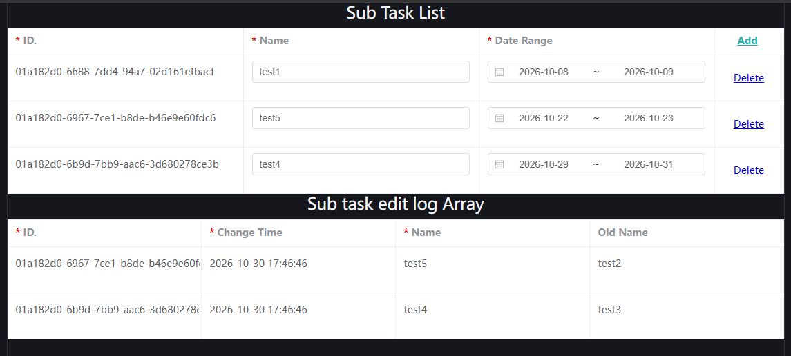

# 05. Frontend Usage and Customizing View Components

In [01. Semantic Type Demo](../tryit/01-type.md#how-to-integrate-into-a-frontend-project), we already demonstrated how to render a form based on a semantic type and data using `<schema-view type='xxxxx' v-model="data"/>`.

`schema-node-vue-view` is a view library built on Vue 3 + Element Plus. It was prepared for implementing `schema-node-man`, but of course it is also suitable for backend management, or scenarios with low requirements on frontend styling.

Below we use it to explain how to register view components for specific semantic types. In practice, the cost of replacing the entire view library is very low, because they are only responsible for presentation and are completely unrelated to business logic and data relations.


## 1. Semantic Data Nodes

The entire SchemaNode system is designed around three things: semantic entities, semantic types, and semantic prototypes.

`schema-node-core` is SchemaNode's TypeScript-based core library, providing the complete frontend semantic runtime.

It wraps data into `DataNode`s based on semantic types. Each node manages its own value and properties, and also updates properties and performs its own validation logic based on relations declared in the type. For example, a node configured with the `entrySource` property maintains its own cascading option list, similar to enum values. The various dropdown selections when configuring semantic types are also implemented based on this.

If you want to register views for a specific semantic type, you first need a rough understanding of `DataNode`'s public interface.

### 1.1 Available Properties

* `name` read-only, the node's name, similar to a struct field name.
* `access` read-only, the node's access path, needed by some special UI rendering libraries.
* `value` readable/writable, the computed value of the node's current value.
* `rawValue` read-only, the raw value of the node's current value.
* `original` read-only, the node's initial value.
* `submitValue` read-only, the node's submitted value.
* `changed` read-only, whether the node has been modified.
* `isValid` read-only, whether the node passes validation.

### 1.2 Common Methods

* `confirm()`, save the current value as the initial value and reset the modification state.
* `reset()`, reset the current value to the initial value.
* `getPropertyValue(property: string | PropertyCtor)`, get the value of the specified property.
* `getPropertyValues(property: string | PropertyCtor[])`, get an iterator over the specified property values. For accumulable properties there may be multiple values, for example validation properties; `PropertyCtor` is the property's type.
* `subscribe(func: Observer<[IValueAccess, unknown]>, immediate?: boolean): Function`, subscribe to node value changes, returning an unsubscribe function.
* `subscribeProperty(property: string | PropertyCtor, func: Observer<[IValueAccess, PropertyCtor, unknown, unknown]>, immediate?: boolean): Function`, subscribe to changes of the specified property value, returning an unsubscribe function. The last two return values are the current value and the old value.
* `subscribeViolated(func: Observer<[IValueAccess, boolean]>, immediate?: boolean): Function`, subscribe to changes in the node's validation state, returning an unsubscribe function.

### 1.3 Common Properties

Creating a custom view is essentially about subscribing to the node's value, properties, and validation state changes. However, validation state is already handled in the view wrapped around `el-form`, so you only need to subscribe to the node's value and property changes.

Below are some commonly used property types (they can be imported directly from schema-node-core). More can be determined based on the properties configured for the type.

* Default - default value
* Require - required
* Readonly - read-only
* Disable - disabled
* AsSuggest - cascading data is only a suggestion, not a constraint
* LeafOnly - cascading selection can only choose leaf nodes
* EntrySourceVersion - cascading data version. Because the original cascading data may become invalid after EntrySource and some related properties change, you need to subscribe to EntrySourceVersion changes.


## 2. Custom View Components

For detailed customization, refer to how each view is handled in the `schema-node-vue-view` project. Because it is decoupled from business, it only subscribes to data and property changes to drive rendering.
And AI is now capable of translating this view library entirely into an implementation based on other libraries. So below we only explain the property details.

### 2.1 Property Subscription

If you are not building a generic view but only handling a specific semantic type, then when configuring you already know which properties can be subscribed to. For generic views, you can ignore validation-related properties and focus only on rendering-related properties.

Refer to the handling logic of `inputView`:

```ts
// state change
if (props.readonly) {
  state.readonly = true;
}
else {
  subs.push(subscribeAncestorProperty(node, ReadOnly, (values: boolean[]) => state.readonly = values.some(v => v), true));
  subs.push(subscribeAncestorProperty(node, Disable, (values: boolean[]) => state.disable = values.some(v => v), true));
}
subs.push(node.subscribeProperty(Default, (owner: IValueAccess, propCtor: PropertyCtor, newValue: any, oldValue: any) => state.default = newValue, true));
subs.push(node.subscribeProperty(Require, (owner: IValueAccess, propChange: PropertyCtor, newValue: any, oldValue: any) => state.require = newValue as boolean, true));
subs.push(node.subscribeProperty(AsSuggest, (owner: IValueAccess, propChange: PropertyCtor, newValue: any, oldValue: any) => state.asSuggest = newValue as boolean, true));
subs.push(node.subscribeProperty(LeafOnly, (owner: IValueAccess, propChange: PropertyCtor, newValue: any, oldValue: any) => state.leafOnly = newValue as boolean, true));
```

Most use `node.subscribeProperty` to subscribe to property changes and drive page updates. Only `Readonly` and `Disable` need to subscribe to ancestor property changes.

`subscribeAncestorProperty` is a method provided by the schema-node-vue-view library for subscribing to ancestor property changes. You can simply copy it.

The handling of `EntrySourceVerson` is relatively complex; refer to the `rebuildOptions` method of `inputView` in the `schema-node-vue-view` project. It actually only gets cascading data from the node, and does not care how the cascading data is obtained or maintained.

### 2.2 Registering View Components

In `schema-node-vue-view/src/index.ts`, default view components are registered. Similarly, the third field corresponds to the skin; the default is `default`, and if the specified skin has no corresponding component, it falls back to the default component.

```ts
regSchemaTypeView(NS_SYSTEM_RANGE_FULL_DATE, rangeDateView[, 'default']);
```

In practice, you just register the corresponding view component based on the semantic type's name.


## 3. The SchemaView Component

SchemaView is a core component provided by the `schema-node-vue-view` project. Its function is actually quite simple: based on a specified semantic type or an existing node, it automatically selects a suitable view component for rendering.
Below are its common properties. Note that it can pass through properties not belonging to itself to the final view component, for example `el-table`'s own properties.


| Prop | Description |
| --- | --- |
| `node` | An existing `DataNode`; once provided, no new node is created |
| `type` | Type name; when there is no `node`, creates a node by it |
| `modelValue` | Node value used with `v-model` |
| `value` | Value used for read-only display, without establishing two-way binding |
| `props` | The set of properties to set when creating a new node |
| `skin` | View skin; default `default`, used for multiple view sets of the same type |
| `inForm` | Form display mode: ('expand', 'expand2', 'expand3', 'expandall', 'nest', '') |
| `text` | Read-only text alignment: `left`, `right`, `center` |
| `readonly` | Read-only mode |
| `rootDiv` | Scroll container for lazy loading of `AppNode` fields |
| `instantValid` | Validate immediately on input |
| `debug` | Display debugging information such as type and properties |

Two typical usages:

```vue
<!-- Hold the node yourself -->
<schema-view :node="fieldNode" :readonly="true" text="left" />

<!-- Create a node by type and get the value via v-model -->
<schema-view
  v-model="data"
  type="activity.address"
  :in-form="SchemaNodeFormType.ExpandAll"
  text="left"
/>
```

When `inForm` is passed `true`, the component automatically chooses: types that can be displayed as a single value use `Nest`, otherwise use `Expand`. This refers to the hierarchical expansion mode, especially for nested structs; if you want to flatten them, you can configure it.

The component passes the default slot through to the actual view, so you can wrap the input area of any field.


## 4. Displaying an App Application

We have demonstrated how to use the `SchemaView` component to handle semantic types and data, but the core is still how to handle business logic such as an App.

If you have not yet created a test project, follow the demo in [01. Semantic Type Demo](../tryit/01-type.md#how-to-integrate-into-a-frontend-project) to create one.

Next, we connect it to backend access, and actually display the application configuration completed in [02. Starting SchemaNode.App and Configuring Applications](02-apps.md) in the test project.

### 4.1 Connecting Backend Access

We need to configure the backend access path and a simplified authentication header, putting the user id used earlier into the authentication header to ensure access permission to the application.

```ts
setSchemaApiBaseUrl('http://localhost:8000/schema') // Set the schema api base url
setSchemaApiHeaders([{
    key: 'userid',
    value: '01a17c66-707b-7b48-9ed4-95708f073678'
}])
```

### 4.2 Displaying an App Application

Replace all content of `App.vue` with:

```vue
<template>  
  <el-form v-if="appNode" ref="form" label-width="140px" :model="appNode.rawValue">
    <template v-for="f in appNode.inputFields" :key="f.id">
      <h2>{{ _L(f.getPropertyValue(Display)) || f.name }}</h2>
      <schema-view text="left" :node="f" :in-form="true"></schema-view>
    </template>
  </el-form>
</template>

<script lang="ts" setup>
import { _LS, Display } from "schema-node-core"
import { ElForm } from "element-plus"
import { schemaView, _L } from "schema-node-vue-view"
import { onMounted, ref } from "vue";
import { getAppNode, type AppNode } from "schema-node-app";

const appNode = ref<AppNode | undefined>(undefined)
  
onMounted(async () => {
  appNode.value = await getAppNode({
    app: 'test.project',
    target: '01a17c6a-64a9-7f25-a7ea-63cc11a050b3',
    fields: [],
    take: 5,
    schemaOnly: true
  })

  console.log(appNode.value)
})

</script>
```

Use the `getAppNode` method and specify the application name and target id to get the application node. The target id is the `project id` used in the test in [02. Starting SchemaNode.App and Configuring Applications](02-apps.md).

Note that `schemaOnly: true` is configured here, meaning only the application schema is fetched, not the data. This way, fields are lazily loaded when entering display, avoiding a large initial data load.

You can see the data is loaded; what remains is just styling and layout.




### 4.3 Submitting App Data

If you want to see the complete App lifecycle, refer to the `tryapp.vue` component of `schema-node-man`; it is the demo component for the configuration UI.

App data submission involves two parts: validation and submission.

The validation part corresponds to:

```ts
// el-form's own validation; can trigger error display. On first display, error messages are usually not shown, to avoid affecting user operations
await form.value?.validate()

// Vue needs toRaw to get the original node; otherwise some access cannot be obtained through the proxy mode
// What is obtained here is the App node, containing all logical table fields
const node = toRaw(appNode.value!)

// Validate whether the node is valid; actually means whether all loaded inputtable logical table fields are valid
if (!node.isValid) {
  // If invalid, you can iterate over all error nodes and record the error information
  for(const n of node.getErrorNodes())
    logger.error(n)
  ElMessage.error(_L.value["frontend.view.error"])
  return
}
```

Then submission is simple:

```ts
const r = await node.submit(); // Submit all data modifications
if (!r?.result) {
  ElMessage.error(_L.value(r?.error || "frontend.view.savefailed"))
  return
}
else {
  ElMessage.success(_L.value("frontend.view.savesuccess"))
}
```
