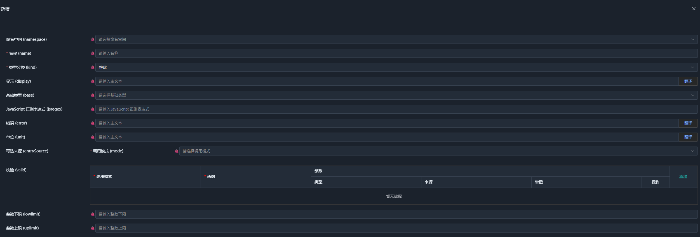

# 02. SchemaNode.Core 与 node 原型族

SchemaNode 最初的版本名为 `DataNode`，主要用于处理复杂数据节点。随着实践深入，我们逐渐发现，将语义与执行分离后，可以让业务本身的本质复杂度与具体技术实现带来的偶然复杂度的耦合降到最低，实现相对独立的并行开发。

在原有实践中，这一转变带来无AI辅助下了 10 倍以上的开发效率提升。随着语义积累，功能迭代也变得越来越快。这不仅改善了开发效率，也在一定程度上摆脱了传统开发模式中技术债不断累积的问题。

这正是我开始转向语义编程的初衷，也是最终将 SchemaNode.Core 的基础原型族命名为 `node` 的原因。

正如上一章所述，原型名称主要用于执行层识别原型，并不需要出现在语义类型声明中。因此，`node` 只是 SchemaNode.Core 采用的一套原型标识，并不意味着执行层必须依赖某种特定的实现。

SchemaNode.Core 用于提供公共语义空间。它既不是 Web 框架，也不是数据库框架，而是一个语义框架。无论是 Web 应用、数据库应用还是桌面程序，都可以基于它构建各自的语义模型与执行能力。

本章从 `node` 原型族入手，介绍原型声明、语义类型结构、语义属性和运行时类型之间的关系，并说明它们如何共同构成公共语义空间的基础。

下面我们基于`int`类型的定义开始讨论：



这是 SchemaNode 定义域执行层（配置工具）中，新增一个“整数类型”的画面。

请观察左侧的输入项：除了基础的“名称”和“命名空间”，它还展示了“基础类型”、“JS正则”、“整数下限”、“整数上限”，以及“校验（Valid）”等属性。

现在，有两个关键问题：

为什么选了“整数”分类（Kind）后，界面会自动出现整数上限和整数下限？（而不是出现字符串专用的长度限制？）

是谁规定了定义“整数”时，必须配置这些属性？

答案不在这个前端界面的代码里。这个配置界面本身，并没有针对“整数”写任何特殊逻辑。它只是一个通用的渲染器，忠实地把后端 Schema 引擎传递过来的“属性列表”平铺了出来。

---

## 原型声明

SchemaNode.Core 的原型定义位于项目的 `Schema` 目录下，每个原型都有对应的声明文件。例如，`node` 原型的声明位于 `NodeSchema.cs`。

在实际的 C# 代码中，我们采用了“代码即 Schema”的声明模式。这意味你看到的这些 C# 类，既是编译期的强类型定义，也是运行期注入到语义空间的元数据。

虽然因为存在大量元数据描述，导致看起来有些复杂，但这是确保所有定义用语义都能被正确且集中配置的关键。不需要额外维护一套 JSON/YAML 配置文件，代码本身就是语义申明，这是避免基于配置导致的语义漂移的实践。

下面摘取 `NodeSchema.cs` 中的部分代码：

```csharp
[Meta<SchemaKind>(SCHEMA_KIND_NODE, SCHEMA_KIND_ORDER_NODE)]
[Meta<Append>(typeof(Display))]
[Meta<SchemaType>($"{NS_SYSTEM_SCHEMA_NODE}.schema")]
[Meta<Attach>(SCHEMA_KIND_NODE)]
public sealed class NodeSchema : PropertyOwner, IErrorProvider
{
    /// <summary>
    /// The namespace which includes the schema
    /// </summary>
    [Meta<PrimaryIndex>(0)]
    [Meta<SchemaType>(typeof(NamespaceType))]
    [Relation<ReadOnly, Call>(
        NODE_SELF,
        $"{NS_SYSTEM_LOGIC}.{nameof(SystemLogic.notempty)}",
        $"@{nameof(Name)}")]
    public string? Namespace { get; set; }

    /// <summary>
    /// The schema name
    /// </summary>
    [Meta<PrimaryIndex>(1)]
    [Meta<SchemaType>(typeof(Identifier))]
    [Meta<Immutable>(true)]
    public string Name { get; set; } = null!;

    /// <summary>
    /// The full namespace name
    /// </summary>
    [SchemaIgnore]
    [JsonIgnore]
    public string FullName => $"{Namespace}.{Name}".Trim('.');

    /// <summary>
    /// The node kind
    /// </summary>
    [Meta<SchemaType>(typeof(NodeKind))]
    public string Kind { get; set; } = null!;
}
```

理解这段代码，首先需要区分两类元数据：声明原型的元数据，以及描述语义类型结构的元数据。

---

### SchemaKind 与 Append

原型声明的核心在于 `SchemaKind` 和 `Append`。

`SchemaKind` 用于声明原型的标识。这里通过 `SCHEMA_KIND_NODE` 声明 `node` 原型，同时指定其排序信息。

`Append` 用于声明原型支持的语义属性。这里为 `node` 添加了 `Display` 属性，它提供用于展示的本地化信息，也可以为人和 AI 提供类型的可读说明。

一个原型可以支持多个语义属性。属性类型负责定义相应的语义，而原型通过声明支持的属性，确定其派生类型可以采用哪些语义约定。执行层则根据自身支持的能力，解释并消费这些属性。

通常，语义属性会通过自身的元数据声明适用的原型，因此显式使用 `Append` 的情况并不多。但在理解原型声明时，它是一个重要的入口。

从概念上看，上述原型声明可以独立表示为：

```csharp
[Meta<SchemaKind>(SCHEMA_KIND_NODE, SCHEMA_KIND_ORDER_NODE)]
[Meta<Append>(typeof(Display))]
public sealed class NodeKind;
```

这里的 `NodeKind` 只是一个用于声明原型名称的 C# 类型，并不是 `node` 语义类型的数据结构(Meta)。

实际项目中，原型声明(Kind)与其语义类型结构(Meta)可以放在同一个 C# 类型上，以便统一管理。只有在存在属性定义给原型时，才需要将两者分开，原型属性作用于原型派生出的所有语义类型，而为结构申明定于属性则只作用于该结构体语义类型本身。

---

## 原型对应的语义类型结构

剥离原型声明后，剩余部分就是以 `node` 为原型的语义类型结构(Meta)。

```csharp
[Meta<SchemaType>($"{NS_SYSTEM_SCHEMA_NODE}.schema")]
[Meta<Attach>(SCHEMA_KIND_NODE)]
public sealed class NodeSchema : PropertyOwner, IErrorProvider
{
    [Meta<PrimaryIndex>(0)]
    [Meta<SchemaType>(typeof(NamespaceType))]
    [Relation<ReadOnly, Call>(  // 申明Namespace当Name存在时，变成只读
        NODE_SELF,
        $"{NS_SYSTEM_LOGIC}.{nameof(SystemLogic.notempty)}",
        $"@{nameof(Name)}")]
    public string? Namespace { get; set; }

    [Meta<PrimaryIndex>(1)]
    [Meta<SchemaType>(typeof(Identifier))]
    [Meta<Immutable>(true)]  // 申明Name存在时，不可修改
    public string Name { get; set; } = null!;

    [SchemaIgnore]
    [JsonIgnore]
    public string FullName => $"{Namespace}.{Name}".Trim('.');

    [Meta<SchemaType>(typeof(NodeKind))]
    public string Kind { get; set; } = null!;
}
```

`SchemaType` 元数据声明了这个 C# 类型对应的语义类型名称。因为没有使用`OfNodeType`描述，所以系统默认将它以给定的命名空间名称注册为一个结构体(struct)语义类型。

`Attach` 则声明这个结构体语义类型需要附着 `node` 原型关联的语义属性。它并不是在声明这个 C# 类型本身就是原型，而是在说明：基于该结构体类型申明的语义类型，还需要额外附着 `node` 原型所支持的属性。在开始的类型定义图中看到的`显示(Display)`属性，就来源`node`原型。

这里需要区分两个机制：

- `Append`：声明原型支持哪些语义属性。
- `Attach`：声明某个语义类型需要附着哪些原型的语义属性。

两者配合，使原型可以集中管理属性，而语义类型根据自身需要选择附着相应的属性。

---

### 字段元数据

字段上的元数据进一步约束了语义类型的结构。

`PrimaryIndex` 用于声明主键。具有主键声明的结构体类型可以自动构建对应的数组类型。当某处使用 `NodeSchema[]` 或 `List<NodeSchema>` 时，解析器会将其映射到相应的数组语义类型。

这里`SchemaType` 用于指定字段的语义类型。例如，`Namespace` 的 C# 类型是 `string?`，但它在语义上需要使用 `NamespaceType`，而不是普通字符串类型。

这说明，**宿主语言中的类型只是语义类型的一个来源，并不必然等于最终采用的语义类型。** 必要时，可以通过元数据显式指定语义类型。

`Relation` 为 `Namespace` 声明了关联约束。这里通过 `SystemLogic.notempty` 检查 `Name` 是否满足非空条件，并将该关系标记为 `ReadOnly`。具体的关联处理方式由相应的语义机制决定。

`SchemaIgnore` 则用于排除不参与语义类型解析的成员。`FullName` 是根据 `Namespace` 和 `Name` 计算得到的辅助属性，因此不属于该语义类型的数据结构。

由此，以上 C# 类型可以描述如下的结构化数据(默认采用驼峰命名法)：

```json
{
    "namespace": "system",
    "name": "int",
    "kind": "int"
}
```

`node` 原型族以命名空间管理语义类型。`Namespace` 与 `Name` 共同确定类型的唯一标识，`Kind` 则确定该类型所属的原型分类。

这构成了 `node` 原型族最基本的类型管理机制：通过统一的结构描述语义类型，再通过附着的语义属性扩展其具体含义。

> 虽然在类型声明中配置 `ReadOnly` 关联和 `Immutable` 属性看起来有些特别，但它们确保了语义类型定义本身的完整性，避免相关意图在不同的配置用执行层中被重复声明，导致语义分散。

> 需要注意，语义属性表达的是意图，而非特定的执行方式。虽然 `ReadOnly` 看起来是一个主要用于前端的属性，但它表达的只读意图并不局限于前端。具体如何解释和执行，由执行层根据自身职责决定。

> 这也是公共语义空间存在的必要性之一。像 `ReadOnly`、`Immutable` 这样的属性，其表达的意图可以形成公共共识，因此值得纳入公共语义空间。公共语义空间只需要覆盖数据类型及其处理所需的通用语义属性，而不必囊括所有领域特有的需求。其他特殊属性可以由语义方言追加，并由支持相应方言的执行层负责解释和执行。

> `node`定义体的实际语义类型是`system.schema.node.schema`。 `system.schema`中的语义类型均是用于语义类型构造的辅助类型，是特定执行层提供的实现，在不同的定义用执行层中可以不同，所以，它们并不属于公共语义。

> `system`中非`system.schema`的语义类型，则是公共语义类型，例如`system.string`等，这些类型与公共原型共同构成公共语义空间。执行层需要遵循相应的公共语义约定，并能够消费其声明所涉及且自身承诺支持的语义能力。


---

## Int 原型：从声明到运行时

接下来通过 `Int` 原型，说明如何在 `node` 原型族中声明新的原型，以及如何为原型添加语义属性、运行时类型和不同用途的定义结构。

相关实现位于 `Schema/Scalar/IntSchema.cs`。

```csharp
/// <summary>
/// The int schema kind
/// </summary>
[Meta<SchemaKind>(SCHEMA_KIND_NODE_INT, SCHEMA_KIND_ORDER_INT)]
[Meta<NodeKind>(NODE_KIND_INT, SCHEMA_KIND_ORDER_INT)]
[Meta<NodeValueKind>(NODE_KIND_INT, SCHEMA_KIND_ORDER_INT)]
[Meta<NodeType>(typeof(Runtime.IntType))]
[Meta<SchemaUsage>(typeof(IntUsage))]
[Meta<Append>(
    typeof(EntrySource),
    typeof(AsSuggest),
    typeof(Default),
    typeof(BlackList),
    typeof(WhiteList),
    typeof(Unit),
    typeof(Error),
    typeof(StackUpLimit),
    typeof(Valid))]
[Meta<IntValue>]
public sealed class IntKind;
```

`IntKind` 通过多种元数据，将 `node.int` 的原型名与相关机制联系起来。

这些元数据承担不同职责：

| 元数据 | 职责 |
|---|---|
| `SchemaKind` | 声明 `node.int` 原型及其排序信息 |
| `NodeKind` | 将 `int` 注册为 `node` 的一种分类 |
| `NodeValueKind` | 声明`int`为值类型分类 |
| `NodeType` | 注册用于加载和处理该类语义类型的运行时类型 |
| `SchemaUsage` | 指定该原型的使用形式对应的定义 |
| `Append` | 声明该原型支持的语义属性 |
| `IntValue` | 将 `Int` 约束属性纳入原型声明，即原型关联的约束属性 |

这些声明将原型标识、分类、运行时处理和属性支持关联起来，使一个新原型能够接入现有的语义类型系统，而不需要为其重新设计一套独立机制。

可以把这段代码理解为给 `node.int` 发放了一张“身份证”并分配了“工位”：

它告诉系统：这是一个独立原型（SchemaKind）。

它挂载了分类和运行时的实现（NodeKind / NodeType）。

它带上了自己专属的属性包（Append）。

---

### NodeKind：类型分类

`NodeKind` 用于声明 `node` 原型族中的类型分类。

例如：

```csharp
[Meta<SchemaType>(typeof(NodeKind))]
public string Kind { get; set; } = null!;
```

`NodeSchema` 的 `Kind` 字段使用 `NodeKind` 作为语义类型。通过元数据注册，`int` 可以成为相应枚举类型中的一个合法值。所以，图中类型分类可以选择到`int`整型分类。

因此，扩展新的 `node` 分类时，可以通过新增分类声明完成扩展，而不必修改 `node` 的基础数据结构。

这里的 `NodeKind` 是一个分类机制，不等同于 `SchemaKind`：前者描述节点属于哪一类，后者用于标识原型本身。

---

### IntValue：约束属性

继续查看 `IntValue` 的声明：

```csharp
[Meta<Alias>("int")]
[Meta<ForSchema>(SCHEMA_KIND_NODE_INT)]
[Meta<OfNodeKind>(NODE_KIND_PROPERTY)]
[Meta<SchemaType>($"{NS_SYSTEM_SCHEMA_PROP_INT}.valid")]
[Meta<Default>(true)]
[Meta<InVisible>(true)] // root only
[Meta<Static>(true)]
public class IntValue : Property<bool>, IConstraintProperty;
```

`IntValue` 是为 `node.int` 原型声明的约束属性。它通过 `ForSchema` 指定适用的原型，并通过 `SchemaType` 指定自身的语义类型。

注意，IntValue 不是绑定在某个具体的业务整数类型上（比如 age 或 year），它是挂载在 node.int 这个原型上的。这意味着，一旦声明了某个类型属于该原型，它就自动继承了 IntValue 的约束能力。这正是原型自带属性复用能力的体现。

`IConstraintProperty` 表明该属性承担约束职责，用于描述整数值的校验要求。该类型没有实现是因为C#执行层中，整数校验在数据加载为实体时已经完成了，所以，这里更多是作为一个申明。

例如，`schema-node-core` 的前端内核可以提供该属性对应的校验逻辑。不同的执行层基于自身的需求，可以提供不同的校验逻辑。

这也体现了语义与执行分离后的一个特点：属性负责声明约束，执行层负责以自身适用的方式消费约束。

---

### NodeType：运行时类型

`NodeType` 用于为 `int` 分类注册运行时类型：

```csharp
[Meta<NodeType>(typeof(Runtime.IntType))]
```

`Runtime.IntType` 负责加载基于该原型构造的语义类型声明，并为运行时处理相应的整数语义实体提供支持。

原型声明描述的是语义类型的结构与能力，而运行时类型负责将这些声明接入实际的执行过程。两者通过元数据关联，但职责不同。

具体的加载、解析和运行机制，将在后续章节结合更多原型展开说明。

---

### IntSchema和IntProperty：定义与使用

定义一个语义类型，与在其他语义类型中使用它，并不一定需要相同的属性集合。

例如，定义 `node.int` 类型时，通常不需要配置黑白名单等使用约束；但当整数类型被用作结构体字段使用时，就可能需要这些属性，同样存在定义时可以配置，使用时不可以的情况。

不过，这些属性仍然属于 `node.int` 原型所支持的语义属性。它们的区别在于适用场景。

为此，SchemaNode.Core 可以通过 `node.int.define` 和 `node.int.usage` 等子原型，为定义和使用场景分别配置属性。

这两类原型不会因此成为独立的整数值类型。它们主要通过 `Attach` 机制，为不同场景下的语义声明提供不同的属性集合。

下面以整数类型的定义体为例。

```csharp
/// <summary>
/// The int define schema
/// </summary>
[Meta<SchemaKind>(SCHEMA_KIND_NODE_INT_DEFINE, SCHEMA_KIND_ORDER_INT)]
[Meta<Append>(
    typeof(EntrySource),
    typeof(Unit),
    typeof(Error),
    typeof(Valid))]
[Meta<SchemaType>($"{NS_SYSTEM_SCHEMA_INT}.schema")]
[Meta<Attach>(SCHEMA_KIND_NODE_INT_DEFINE)]
public sealed class IntSchema : ScalarSchema
{
    /// <summary>
    /// The base int type to inherit from
    /// </summary>
    [Meta<SchemaType>(typeof(IntType))]
    public override string? Base { get; set; }
}

/// <summary>
/// Attach int to the node
/// </summary>
[Meta<Alias>("int")]
[Meta<ForSchema>(SCHEMA_KIND_NODE)]
[Meta<OfNodeKind>(NODE_KIND_PROPERTY)]
[Meta<SchemaType>($"{NS_SYSTEM_SCHEMA_PROP_INT}.int")]
[Relation<Visible, Call>(
    "int",
    NS_SYSTEM_LOGIC_EQ,
    $"@{nameof(NodeSchema.Kind)}",
    NODE_KIND_INT)]
public sealed class IntProperty : Property<IntSchema>;
```

这里的 `IntSchema` 是整数语义类型的定义体。它采用 `node.int.define` 对应的属性集合，只暴露定义整数类型所需要的属性。

`IntProperty` 则声明了一个附着在 `node` 原型上的语义属性，用于表达整数类型定义的语义属性。

因此，一个整数类型可以声明为：

```json
{
    "namespace": "system",
    "name": "year",
    "kind": "int",
    "int": {
        "base": "system.int",
        "lowlimit": 0
    }
}
```

这里，`namespace`、`name` 和 `kind` 描述类型的基本身份，`int` 属性则承载该整数类型特有的定义。

这种结构使 `node` 原型可以通过属性扩展支持不同的语义类型，而不必将所有类型的专有字段都写入基础结构。

---

### Relation：驱动语义配置

最后来看 `IntProperty` 上的 `Relation`：

```csharp
[Relation<Visible, Call>(
    "int",
    NS_SYSTEM_LOGIC_EQ,
    $"@{nameof(NodeSchema.Kind)}",
    NODE_KIND_INT)]
```

它声明了一个可见性关联，其语义可以概括为：

```text
int.visible = (kind == "int")
```

也就是说，只有当 `node` 的 `kind` 为 `int` 时，整数类型的配置才应显示。这点图中也展示了。

这里的关键不在于前端如何实现显示与隐藏，而在于**可见性规则已经成为语义声明的一部分**。定义域的执行层只需要解释这一关联，就可以决定如何呈现配置界面，无须专门认识 `node.int` 的内部实现。

这也意味着，当新增其他 `node` 原型时，可以通过相应的属性和关联声明提供配置行为，而不必持续修改通用配置界面的逻辑。

至于 `IntUsage` 如何为使用场景提供另一组属性，将在介绍结构体及其字段时进一步说明。

---

## node 原型族与语义契约

通过 `NodeSchema` 和 `IntKind`，我们已经看到 `node` 原型族的基本工作方式：

- 原型声明确定类型分类及其支持的语义属性。
- 语义类型结构描述类型的基本数据结构。
- `Append` 与 `Attach` 配合，为原型及其派生类型提供相应的属性。
- 运行时类型为语义声明提供加载和处理能力。
- 语义属性及其关联进一步表达约束、可见性等语义意图。

这些机制共同构成了基于命名空间管理的语义类型系统。通过增加原型和语义属性，系统可以扩展可定义的语义类型，而不必持续修改基础结构。

需要注意的是，语义与执行并不是完全隔离的。原型及其关联的语义属性构成了两者之间的契约：语义层负责表达意图，执行层则需要能够识别并消费相应的语义声明。公共语义空间提供通用的语义约定，语义方言则可以在此基础上扩展领域特有的原型与属性。

另一方面，`system.schema` 命名空间下的类型用于描述语义类型如何定义、配置和构造。这些定义域语义类型属于构造机制的一部分，其具体实现可以随定义工具和执行层演进，而不必因此改变已有的公共语义约定。

通过这种方式，SchemaNode 不仅能够描述语义类型，也能够将语义类型的定义机制本身纳入语义体系。后续章节将从具体原型出发，进一步介绍这个语义空间的构成。


## Namespace：命名空间原型

虽然 `node` 本身的结构已经可以用于管理命名空间，但它本身并不是命名空间原型，而是整个原型族的起点。专门的命名空间原型声明则比较简单：

```csharp
[Meta<SchemaKind>(SCHEMA_KIND_NODE_NAMESPACE, SCHEMA_KIND_ORDER_NAMESPACE)]
[Meta<NodeKind>(NODE_KIND_NAMESPACE, SCHEMA_KIND_ORDER_NAMESPACE)]
[Meta<NodeType>(typeof(RuntimeNamespaceType))]
public sealed class NamespaceKind;
```

这个声明只注册了原型标识、类型分类和对应的运行时类型，没有额外声明语义属性。`RuntimeNamespaceType` 负责处理命名空间类型的运行时行为。

命名空间类型本身主要作为其他语义类型的容器。具体实现可以查看 `RuntimeNamespaceType`，也可以通过语义编辑器添加一个命名空间，观察它的实际表现。