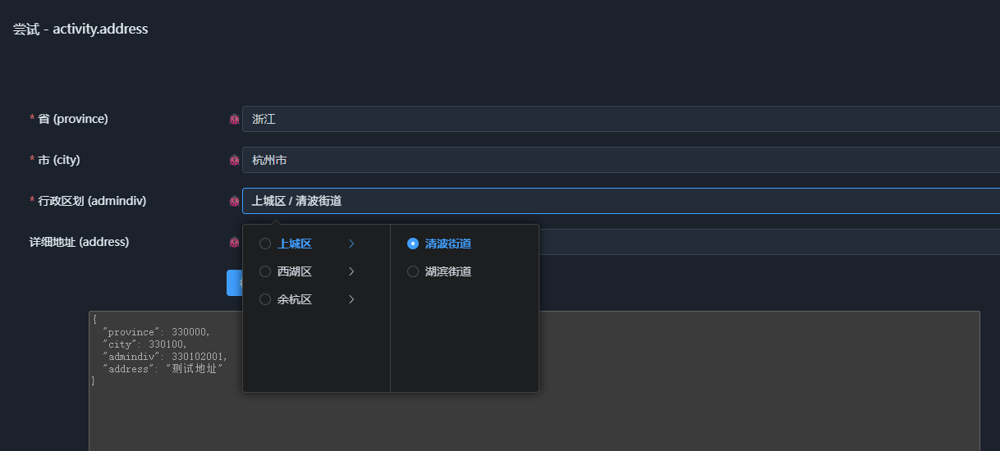

# 04. 枚举原型

枚举原型用于描述一组有限的命名取值。与普通标量不同，枚举不仅有实际的数据值（`string`、`int` 或 `Flags`），还可以将这些取值组织成可访问的条目树，供执行层进行查询、级联选择和校验。

相关实现集中在四处：

- `Schema/EnumSchema.cs`：枚举原型、定义体和使用形式的声明；
- `Runtime/Type/EnumType.cs`：枚举类型的运行时实现；
- `Node/EnumNode.cs`：枚举值节点；
- `Generator/EnumGenerator.cs`：从 C# 枚举生成 Schema。


## 1. 原型声明

```csharp
[Meta<SchemaKind>(SCHEMA_KIND_NODE_ENUM, SCHEMA_KIND_ORDER_ENUM)]
[Meta<NodeKind>(NODE_KIND_ENUM, SCHEMA_KIND_ORDER_ENUM)]
[Meta<NodeValueKind>(NODE_KIND_ENUM, SCHEMA_KIND_ORDER_ENUM)]
[Meta<NodeType>(typeof(RuntimeEnumType))]
[Meta<SchemaUsage>(typeof(EnumUsage))]
[Meta<SchemaGenerator>(typeof(EnumGenerator))]
[Meta<Append>(typeof(EntrySource), typeof(Default), typeof(BlackList), typeof(WhiteList), typeof(Valid))]
[Meta<EnumValue>]
public sealed class EnumKind;
```

`EnumKind` 通过元数据声明枚举的原型标识、节点分类、运行时类型、使用形式和生成器，同时指定枚举支持的语义属性。

其中，`NodeKind` 与 `NodeValueKind` 分别描述节点分类和值分类；`NodeType` 指定运行时实现；`SchemaUsage` 和 `SchemaGenerator` 则分别关联枚举的使用形式与 C# 枚举生成机制。

这些元数据通过原型注册机制关联到具体实现，读者可以直接沿着声明查看对应代码，无需在文档中逐项展开。


## 2. 枚举定义体

枚举定义体由 `EnumSchema` 描述，包含三个字段：

- `Type`：指定枚举的值类型。
- `Values`：定义枚举条目。
- `Cascade`：为每层级联提供描述，也限制最大级联深度。

### 值类型与条目

`Type` 支持三种形式：

| 类型 | 值类型 | 典型用途 |
|---|---|---|
| `String` | `string` | 具有命名值的枚举 |
| `Int` | `long` | 使用整数编号的枚举 |
| `Flags` | `long` | 可组合的位标志 |

`Values` 使用 `Entry<string>[]` 描述条目。其中Entry附着了`node.entry`原型，用于提供统一的级联描述。每个条目除实际值外，还可以携带 `display` 等显示属性，以及执行层支持的其他条目属性。

例如：

```json
{
  "namespace": "example",
  "name": "gender",
  "kind": "enum",
  "enum": {
    "type": "string",
    "values": [
      {
        "value": "unknown",
        "display": { "key": "unknown", "trans": [ { "lang": "zh", "tran": "未知" }] }
      },
      {
        "value": "male",
        "display": { "key": "male", "trans": [ { "lang": "zh", "tran": "男" }] }
      },
      {
        "value": "female",
        "display": { "key": "female", "trans": [ { "lang": "zh", "tran": "女" }] }
      }
    ]
  }
}
```

其中`display`的结构比较特殊，用于本地化显示文本，如果倾向于其它显示方式，可以单纯为`Display`属性配置`Invisible`属性为true，语义属性自身也是可以具有属性描述的。


## 3. 枚举使用形式

`EnumUsage` 不重新定义枚举值，而是描述某个使用场景下的选择规则。它支持白名单、黑名单、根节点、级联深度、仅选择叶节点以及单个位标志选择等属性。这些在定义枚举类型时，无法进行指定，需根据使用场景确定。例如下面的图中所有枚举值都是同一个类型，基于属性做不同的选择。



除了申明可用属性外，也申明了这些属性之间的依赖关系。例如，`WhiteList` 和 `BlackList` 可以影响默认值，`Root` 的候选条目由枚举定义动态计算，`CascadeDepth` 则控制级联深度。


## 4. 运行时与 C# 枚举生成

`EnumType` 负责加载枚举定义，并将条目组织成可查询的条目树。

`EnumNode` 则表示实际的枚举值，其内部根据枚举类型保存字符串或整数值，并提供与相应标量节点比较的能力。

`EnumGenerator` 可以从 C# 枚举生成 Schema。对于普通 C# 枚举，默认生成字符串枚举，条目值优先使用 `EnumMember` 指定的名称，否则使用字段名并转换为 camelCase；带有 `[Flags]` 的枚举则生成位标志枚举，使用字段的实际数值。

条目的显示文本可以从 XML 文档摘要生成，字段上的元数据也可以随条目一同生成。对于需要使用整数编号的普通枚举，可以直接在 Schema 中声明。

具体的生成规则和运行时处理过程，可以分别从 `EnumGenerator`、`EnumType` 和 `EnumNode` 的实现中继续了解。

## 5. 小结

枚举原型将有限取值组织为三个相互配合的部分：

- **定义体**描述值类型、条目集合及其语义属性；
- **使用形式**描述当前场景下的候选范围与选择规则；
- **运行时**提供条目访问、值处理及外部数据源接入能力。

这使枚举不仅是一组静态常量，还能通过语义属性和关系机制支持不同的使用场景，并在运行时以统一的条目结构进行访问。同时语义和C#类型被一起定义，这也是维持同一个份语义作为真相。