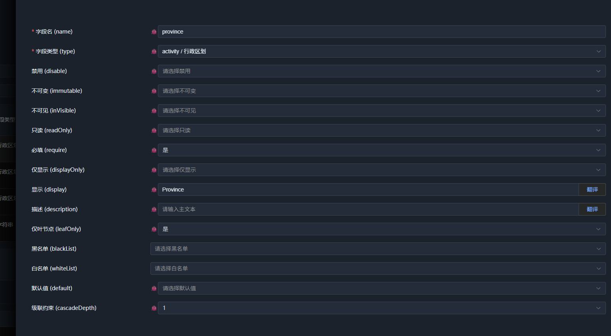
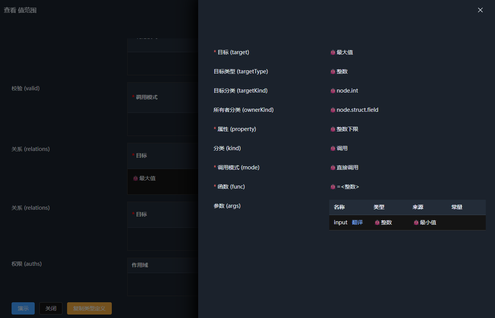
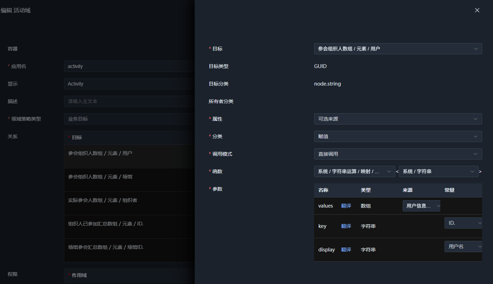

# 05. 结构体原型

结构体原型描述一组具名字段。与标量和枚举不同，结构体的值由多个字段组成，每个字段自身又是一个完整的语义类型，可以是标量、枚举、数组或另一个结构体。

与结构体相关的实现集中在以下位置：

- `Schema/StructSchema.cs`：结构体原型、定义体、字段和使用形式；
- `Runtime/Type/StructType.cs`：结构体类型及字段的运行时实现；
- `Node/StructNode.cs`：结构体值节点；
- `Generator/StructGenerator.cs`：从 C# 类型生成 Schema；
- `Property/Struct/`：结构体相关属性，如 `StructValue`、`DisplayOnly`、`Unpack`、`Attach` 和 `OverrideFields`。

## 1. 泛型与关系

结构体原型的声明与前面介绍的原型类似，这里重点关注新增的 `Generics` 和 `Relations`：

```csharp
[Meta<Append>(
    typeof(Generics),
    typeof(Relations),
    typeof(EntrySourceProvider),
    typeof(AccessValueTypeProvider),
    typeof(TypeProvider),
    typeof(KindProvider),
    typeof(Valid))]
```

`Generics` 提供泛型支持，`Relations` 则允许结构体参与语义关系的定义和处理。其他属性暂不展开，后续可以结合定义域中的实际用法了解。

例如，`system.entry<system.string>` 是一个指定了泛型参数的结构体类型，其 `value` 字段的类型会由通用类型 `system.object` 收窄为 `system.string`。

泛型同样应用于语义函数，例如 `system.math.add<T>`，其泛型参数可以受到数值类型约束。通过泛型参数与类型约束，语义类型和函数可以在复用结构的同时保留类型信息。


## 2. 结构体字段

结构体定义体通过 `Fields` 保存字段列表，每个字段由 `StructFieldSchema` 描述。其基本结构只有 `name` 和 `type`：

```csharp
[Meta<SchemaType>($"{NS_SYSTEM_SCHEMA_STRUCT}.field")]
[Meta<TypeProvider>(nameof(Type))]
public sealed class StructFieldSchema : PropertyOwner, IErrorProvider
{
    [Meta<SchemaType>(typeof(Identifier))]
    [Meta<PrimaryIndex>]
    public string Name { get; set; } = string.Empty;

    [Meta<SchemaType>(typeof(ValueType))]
    public string Type { get; set; } = string.Empty;

    [SchemaIgnore]
    public string? Error { get; set; }
}
```

这里虽然声明了 `node.struct.field` 原型，但 C# 中的 `StructFieldSchema` 并没有直接附着这个原型。原因在于，字段的完整定义需要根据实际使用场景组合不同的语义属性。

例如，字段自身可以具有 `Visible`、`ReadOnly`、`Require` 等属性；当字段类型为枚举时，还可能需要 `Cascade`、`Root` 等枚举使用属性；如果字段类型为数组，也需要支持数组相关的配置。

前端的 `schema-node-core/src/schema/struct/meta.ts` 展示了这一组合过程：

```ts
// 申明结构体字段的定义体，附加`node.struct.field`原型
@Meta(SchemaKind, [SCHEMA_KIND_NODE_STRUCT_FIELD, SCHEMA_KIND_ORDER_STRUCT_FIELD])
@Meta(Append, [Disable, Display, Description, Visible, InVisible, Immutable, ReadOnly, Require, OverrideType, Init])
@Meta(SchemaType, `${NS_SYSTEM_SCHEMA_STRUCT}.fielddefine`)
@Meta(Attach, SCHEMA_KIND_NODE_STRUCT_FIELD)
class StructFieldDefine {}

// 结构体字段的完整定义，包含所有可能的属性
@Meta(SchemaType, `${NS_SYSTEM_SCHEMA_STRUCT}.field`)
@Meta(TypeProvider, 'type')
class StructFieldSchemaMeta implements StructFieldSchema {
  @Meta(SchemaType, NS_SYSTEM_IDENTIFIER)
  @Meta(Require, true)
  @Meta(PrimaryIndex)
  name!: string;

  @Meta(SchemaType, NS_SYSTEM_SCHEMA_NODE_VALUE_TYPE)
  @Meta(Require, true)
  type!: string;

  // 使用结构体字段的定义体，并展开它的所有内容-即所有node.struct.field关联的属性
  @Meta(SchemaType, `${NS_SYSTEM_SCHEMA_STRUCT}.fielddefine`)
  @Meta(Unpack, true)
  fieldDefine?: {};

  // 当type是数组时，单独展开数组的属性
  @Meta(SchemaType, `${NS_SYSTEM_SCHEMA_ARRAY}.usage`)
  @Meta(Unpack, true)
  @Relation(Visible, 'call', buildFuncCall(NS_SYSTEM_SCHEMA_REFLECT_IS_NODE_KIND, "@type", false, NODE_KIND_ARRAY))
  arrayDefine?: {};

  // 展开显示type的值类型用属性，如果type是数组，则采用数组的元素类型
  @Meta(SchemaType, NS_SYSTEM_OBJECT)
  @Meta(Unpack, true)
  @Relation(Visible, 'call', buildFuncCall(`${NS_SYSTEM_LOGIC}.notempty`, "@type"))
  @Relation(OverrideType, 'call', buildFuncCall(`${NS_SYSTEM_SCHEMA_REFLECT_TYPE}.getusagetype`, "@type", true))
  valueDefine?: {};
}
```

`StructFieldDefine` 声明字段自身支持的属性，并通过 `Attach` 将 `node.struct.field` 原型关联到该定义体。

字段的完整结构还包含三个展开入口：

- `fieldDefine`：展开字段自身的属性；
- `arrayDefine`：当字段类型为数组时，提供数组使用属性；
- `valueDefine`：根据字段类型展开对应的使用属性，并通过 `OverrideType` 动态确定属性所使用的类型。

因此，字段的最终定义不是单一原型的简单映射，而是根据字段类型和使用场景组合多个属性集合。
这里也体现了 `Attach` 的实际含义：它描述的是特定定义结构与原型的关联，而不能简单理解为某个 C# 类型天然就是该原型的定义体。



> 这也是之前明确写明一个实体可能附着多个原型的原因。所以，有时将原型视为接口，视为属性的附着点，会更简单些。


## 3. 数据访问路径

结构体字段之间的关系，往往需要通过访问路径定位目标及其参数来源。

例如，简单的最小值、最大值约束可以引用同一结构体中的字段。



但在实际业务中，访问目标可能位于多层嵌套的数组和结构体中。随着语义类型不断组合，访问路径的深度和结构也无法由内核预先确定



为此，SchemaNode 通过 `IValueTypeAccess` 提供访问路径相关的能力：

```csharp
IValueTypeAccess? GetAccessValueType(string path);
IEnumerable<Entry<string>> GetAccessEntries();
bool HasAccessEntries { get; }
```

对于 `StructType`，可访问的条目来自它的字段列表。每个字段又具有自己的值类型；如果该类型继续提供访问路径，就可以沿着类型结构继续访问。

这样，关系机制无需内置针对各种数据结构的路径解析规则，而是通过类型提供的访问信息逐层确定路径及其目标值类型。

## 4. 通用访问路径

除了类型自身提供的访问路径，系统还定义了通用访问路径。例如 `SelfAccessPath` 提供 `$self`，用于访问当前节点自身：

```csharp
public class SelfAccessPath : IValueAccessPathHandler
{
    public Task LoadAsync(ISchemaContext context) => Task.CompletedTask;

    public string Path => NODE_SELF;

    public IValueTypeAccess? GetAccessValueType(IValueTypeAccess owner)
        => owner;

    public IValueAccess? GetAccessValue(
        IValueAccess owner,
        IValueAccess? node = null)
        => node ?? owner;
}
```

这类通用路径是现有实现中尚未完全收敛到原型契约的部分。目前它主要服务于定义域中的类型使用，可以先作为独立的辅助机制理解，暂不将其视为已经确立的公共语义。

## 5. 结构体校验

`StructValue` 是结构体专用的校验属性。当结构体数据触发校验时，它负责遍历字段并执行相应的约束校验，随后处理结构体类型所声明的关系校验。

核心逻辑可以概括为：

```csharp
foreach (var field in type.GetFields().Where(f => f.Type != null && f.DisplayOnly != true))
{
    if (node.GetAccessValue(field.Name) is not { } dataNode)
        continue;

    // 基于字段约束进行校验
    foreach (IConstraintProperty constraint in field.Constraints)
    {
        bool? result = await constraint.ValidateAsync(context, dataNode);
        if (result.HasValue)
            dataNode.RecordConstraint(constraint, result.Value);
    }
}

await type.ValidateWithRelationsAsync(context, node);
```

字段约束与关系校验共同参与结构体的校验过程。关系可以提供额外的校验依据，因此不能简单地将结构体校验理解为对每个字段独立执行一次检查；最终行为取决于字段约束和相关关系的具体定义。

这里的关键是职责分离：`StructValue` 负责组织结构体校验流程，具体约束由对应的语义属性及其执行逻辑处理，关系则描述属性之间的关联。


## 6. Unpack 属性

`Unpack` 可以将某个字段的内部结构展开到父级结构中。例如，动态列场景下，可以先将 `data` 声明为 `system.object`，再通过 `OverrideType` 或 `OverrideFields` 提供实际类型。

默认的数据结构可能是：

```json
{
  "name": "张三",
  "data": {
    "age": 18,
    "gender": "男"
  }
}
```

当使用 `Unpack` 展开 `data` 字段时，呈现的数据结构可以变为：

```json
{
  "name": "张三",
  "age": 18,
  "gender": "男"
}
```

`Unpack` 展示了语义属性如何影响结构的展开方式，而不必为不同的数据结构另行定义专用类型。它也说明，语义类型描述的不只是字段和数据值，还可以通过属性表达数据在特定场景下的组织方式。

其他字段属性，如 `Require`、`Visible` 和 `ReadOnly`，也可以结合语义配置界面和对应的属性实现继续了解。


## 7. 小结

结构体原型以字段列表构建复合语义类型，并通过类型访问机制支持嵌套路径，通过关系描述字段之间的关联，通过结构体校验属性组织约束执行。

字段本身的定义则体现了原型和属性的组合方式：字段基础结构相对简单，完整的语义定义根据字段类型和使用场景展开。`Unpack` 等属性进一步说明，结构体的语义不仅包括数据结构本身，也包括数据如何被组织和使用。