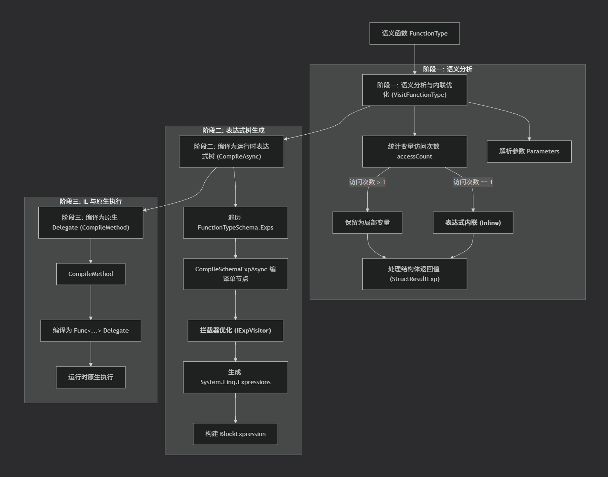

# 08. 函数原型

函数原型描述可被调用的计算单元。函数接受一组具名参数，返回一个值，也可以通过表达式组合成更复杂的计算。

与其他原型不同，函数不是数据值，不会创建普通的数据节点，也不参与结构体的字段布局。它描述的是计算，并通过函数调用被属性、关系和表达式引用。

与函数相关的实现主要集中在以下位置：

- `Schema/FunctionSchema.cs`：函数定义、参数、表达式和调用结构。
- `Runtime/Type/FunctionType.cs`：函数类型加载与调用执行。
- `Generator/FunctionGenerator.cs`：从 C# 静态方法生成函数 Schema。

## 1. 原型声明与定义体

函数原型通过 `FunctionKind` 声明：

```csharp
[Meta<SchemaKind>(SCHEMA_KIND_NODE_FUNCTION, SCHEMA_KIND_ORDER_FUNC)]
[Meta<NodeKind>(NODE_KIND_FUNCTION, SCHEMA_KIND_ORDER_FUNC)]
[Meta<NodeType>(typeof(FunctionType))]
[Meta<SchemaGenerator>(typeof(FunctionGenerator))]
[Meta<Append>(typeof(Generics), typeof(Relations))]
public sealed class FunctionKind;
```

该声明确定函数的分类、运行时类型、生成方式，以及函数支持的泛型和关系。函数定义通过 `FunctionProperty` 附着到对应的语义类型上。函数的关系主要表现在它的参数上，在函数被调用时，实际参数会被关系约束，确保参数使用符合函数的定义。

函数定义体 `FunctionSchema` 包含三个主要字段：

```csharp
public sealed class FunctionSchema : PropertyOwner
{
    public string Return { get; set; } = string.Empty;
    public FuncArg[]? Args { get; set; } = [];
    public FuncExp[] Exps { get; set; } = [];
}
```

- `Return`：函数返回值的语义类型。
- `Args`：具名参数列表，每个参数声明名称和类型，并可附加必填、默认值等属性。
- `Exps`：表达式列表，用于组合函数调用，构成函数体。

例如，一个年龄校验函数可以声明为：

```json
{
  "namespace": "example",
  "name": "checkAge",
  "kind": "function",
  "function": {
    "return": "system.bool",
    "args": [
      {
        "name": "age",
        "type": "system.int",
        "require": true
      }
    ],
    "exps": [
      {
        "name": "E1",
        "return": "system.bool",
        "call": {
          "func": "system.logic.gt",
          "mode": "call",
          "args": [
            { "source": "age" },
            { "value": 18 }
          ]
        }
      }
    ]
  }
}
```

该定义声明了一个接收整数参数并返回布尔值的函数。表达式 `E1` 调用 `system.logic.gt`，比较参数 `age` 是否大于等于 18。

表达式可以引用函数参数，也可以引用之前表达式的结果，从而形成计算链。一般默认最后一个表达式的值作为函数的返回值。

但如何函数返回值是结构体，且最后一个表达式的返回值不满足，则基于结构体的字段名称，从函数的参数和表达式中找到对应的，将它们的值构造为结构体返回，所以，当返回类型是结构体时，结构体的字段会变成表达式名字的可选列表，以便降低配置难度。


## 2. 函数调用

`FuncCall` 描述一次函数调用，与 `FunctionSchema` 描述函数本身相区别。它包含被调用的函数、调用模式、参数，以及调用结果相关的类型信息。

调用参数由 `CallArg` 表示，分为两种来源：

- `Source`：从当前上下文读取的值，例如函数参数、表达式结果或访问路径。
- `Value`：直接提供的字面常量。

例如：

```json
{
  "func": "system.logic.gte",
  "mode": "call",
  "args": [
    { "source": "age" },
    { "value": 18 }
  ]
}
```

这里的 `age` 是从上下文读取的参数，而 `18` 是字面常量。

`FuncCall` 统一了函数调用的描述方式，因此表达式、属性和关系可以复用相同的调用结构，而不需要各自定义一套函数调用格式。

## 3. 调用模式

函数调用不局限于直接执行一次。`ApplyMode` 还定义了针对集合的应用方式：

| 模式 | 含义 |
| --- | --- |
| `Call` | 直接调用一次 |
| `Map` | 对集合元素分别调用，形成结果集合 |
| `Reduce` | 对集合进行累积计算 |
| `First` / `Last` | 查找第一个或最后一个满足条件的元素 |
| `Filter` | 筛选满足条件的元素 |
| `Count` | 统计满足条件的元素数量 |
| `All` / `Any` | 判断是否所有元素或任意元素满足条件 |

这些模式由同一套调用描述承载。调用模式决定函数如何应用于参数集合，而不是要求每一种模式都定义一套独立的函数类型。

这个设计是函数式的高阶函数的设计，但我们并不希望将函数作为参数传递，所以，我们将高阶函数弱化为调用模式，系统可以基于模式来调用函数。

实际可用的模式由运行时根据函数返回类型等信息提供，并通过关系约束调用定义。


## 4. 运行时与执行来源

`FunctionType` 负责加载函数定义，并将参数、表达式、返回类型和关系转换为运行时可使用的结构。

函数的执行来源主要有三种：

- **系统函数**：由 C# 静态方法实现，例如 `system.logic.gte`。
- **表达式函数**：通过 `Exps` 组合其他函数调用，由运行时解释或编译执行。
- **远程函数**：没有本地表达式实现，通过 `IFunctionSchemaProvider` 转交给外部提供者执行。

三种来源共享函数定义和调用契约，但具体执行方式不同。尤其是远程函数，调用方可以只依赖函数 Schema，而不必持有其实际实现。

函数原型也支持泛型、参数默认值、可变参数，以及 `ServerOnly`、`NoCache`、`Converter` 等标志。这些信息通过属性和关系附着于函数或参数，由运行时在加载、校验和执行时消费。


## 5. 从 C# 静态方法生成

除了直接声明 JSON Schema，SchemaNode 还可以通过 `FunctionGenerator` 将 C# 静态方法转换为函数定义。

生成器根据方法签名解析参数和返回类型，并读取相关元数据。例如，参数的默认值、可空性、可变参数声明和类型覆盖，都可以影响生成结果；XML 文档注释则可以用于生成函数和参数的说明。

例如：

```csharp
/// <summary>逻辑运算</summary>
[Meta<SchemaType>("system.logic")]
public static class SystemLogic
{
    /// <summary>大于等于</summary>
    public static bool Gte(long left, long right)
        => left >= right;
}
```

该方法可以生成 `system.logic.gte` 函数 Schema，包含两个整数参数和布尔返回类型。由于系统函数已有 C# 实现，其定义不需要再提供表达式体。

生成机制使现有代码能够进入统一的语义描述体系；而直接声明的表达式函数和远程函数，则可以在不要求本地 C# 方法实现的情况下使用相同的调用结构。


## 6. 函数的多目标编译系统

在C#中，语义函数将经历两次编译，一次语义执行树，一次表达式执行树。最终编译为Delegate，确保原生执行的性能。



但二次编译的主要目的，是基于语义函数的意图，和调用场景，可以对编译结果进行转换。

例如，App方言中，对一个表的访问可能分多次调用定义，第一次指定数据源，然后可以多次使用`Filter`模式，进行筛选，如果函数是一条条表达式死板的执行，第一次指定数据源请求会拉取所有数据，这是不允许的（实际上，直接执行什么都不返回），在编译过程中，这类处理会被合并，加上`Skip`, `Take` 等函数调用，最后构成请求。

这样的处理方式还有很多，所以，这个系统并非单纯的将语义函数直接编译，而是将语义函数视为意图，和调用时的场景，进行语义推理，然后完成编译，即保证了性能，又确保基于语义的唯一性，实现系统的大幅度优化，和特用。在App方言中，还可以看到更多的例子。

这个系统的底层在`Runtime/Compile`中实现。有兴趣可以让AI帮助导读，因为首先实现语义执行树，然后实现表达式的执行树，都是偏编译器的实现。


## 7. 小结

函数原型将计算描述组织为几个相互关联的部分：

- **函数定义体**描述返回类型、参数和表达式。
- **`FuncCall`**描述一次调用，包括函数、调用模式和参数来源。
- **表达式**将多个调用组合成更复杂的计算。
- **运行时**负责加载函数定义，并根据函数的执行来源选择相应的执行方式。
- **生成器**允许从 C# 静态方法生成符合统一结构的函数定义。

函数不需要持有业务数据，也不依赖某一种固定执行方式。它通过统一的语义定义和调用结构，被属性、关系和表达式复用；具体计算可以由本地方法、表达式执行机制或远程提供者完成。