# 01. 配置语义类型（Core）

本章介绍如何通过前端配置器定义语义类型。整个过程不依赖具体执行层，无需启动后端，即可完成类型定义与调试。这里配置的语义类型是执行层无关的，所以，它们可以在任何执行层被使用。

如果需要进一步使用数据读写、权限和工作流，请继续阅读下一章。

**说明：** JSON 是配置器导入导出及执行层传递时采用的序列化格式，并非语义类型本身。可以将其理解为一种能够被执行层解析的结构化表达。

## 1. 开始之前：理解语义类型

如果已经阅读过架构文档，可以直接跳到下一节。

SchemaNode 将需求转化为确定的语义表达，使语义定义不必与具体的执行逻辑绑定。不同执行层可以依据自身能力解释和处理相同的语义定义。

例如，数字 `55` 本身只表示一个数值。当我们为它附加 `Display: "年龄"`、`LowLimit: 0` 等属性时，它就具有了明确的业务含义。

我们将这样的数据及其语义描述称为**语义实体**。语义实体包含三个基本要素：

- **数据**：实体实际承载的值或结构。
- **属性**：描述实体的含义、约束及其他特征。
- **关联（Relation）**：描述实体之间的关系，以及如何通过这些关系影响或计算属性。

同类语义实体可以通过**语义类型**统一定义其结构、属性和关联。具体实体提供实际数据，并依据类型定义获得相应的语义。

因此，配置语义类型，就是将数据结构及其语义属性、关联定义出来，使其能够被执行层理解和使用。

## 2. 使用在线配置器

### 2.1 打开配置器

访问：

<https://kurapica.github.io/schema-node-man/#/type>

这是 [`schema-node-man`](https://github.com/kurapica/schema-node-man) 的静态构建版本。

它的启动逻辑见 [main.ts](../../../../schema-node-man/src/main.ts#L27-L38)：先通过 `initSchemaRuntime()` 初始化 Core 运行时，再通过 `reloadStorageSchemas()` 从浏览器缓存恢复类型定义。

整个过程不需要启动后端。

### 2.2 基本操作流程

1. 打开页面，建议先开启右上角的 `调试模式`，便于查看实体节点的属性与关联。
2. 点击 `上传`，导入已有 JSON，例如 [type.json](../tryit/schema/type.json)，也可以直接点击 `新增`。
3. 在 `类型管理` 中创建和维护命名空间、标量、枚举、结构体、数组及函数类型。
4. 配置完成后，点击 `下载` 导出 JSON，可纳入版本管理或交给前端项目使用。

**注意：** 这里的 `上传` 和 `下载` 操作针对选中的类型，不会自动包含其依赖类型。App 应用管理中的导入导出则针对完整应用，可以包含应用关联的全部语义类型。

完整的在线体验步骤见 [01. 语义类型演示](../tryit/01-type.md)。

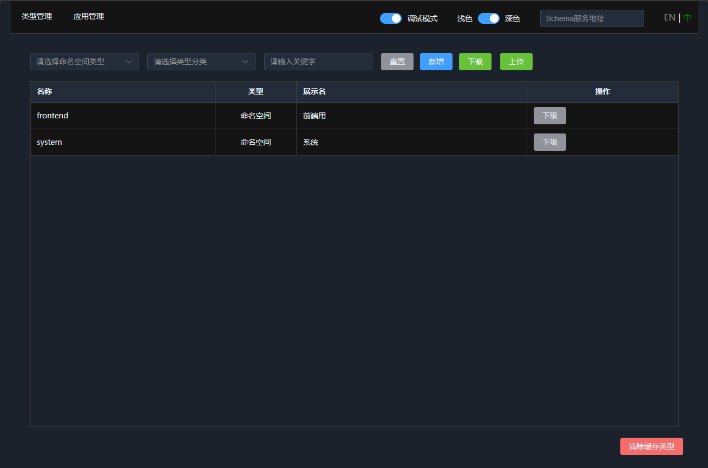

## 3. 类型管理

点击顶部的 `类型管理`，页面主要分为三个区域：

| 区域 | 内容 | 功能 |
| --- | --- | --- |
| 筛选栏 | `命名空间`、`类型`、`关键字`、`筛选`、`重置` | 筛选和导航 |
| 类型列表 | `名称`、`类型`、`展示名`、`操作` | 浏览和管理类型 |
| 底部 | `清除缓存类型` | 清除缓存的类型定义 |

右上角的 `Schema服务地址` 用于连接后端的 SchemaNode 服务。通常，在独立体验 Core 时无需配置；`SchemaNode.App` 项目附带了完整的 `schema-node-man` 静态构建，也可以直接使用。

### 3.1 浏览与命名空间下钻

| 操作 | 说明 |
| --- | --- |
| `下级` | 仅命名空间行出现，进入该命名空间查看子类型 |
| `查看` | 以只读方式打开类型定义 |
| `编辑` | 打开可编辑的抽屉 |
| `删除` | 满足删除条件时才显示 |

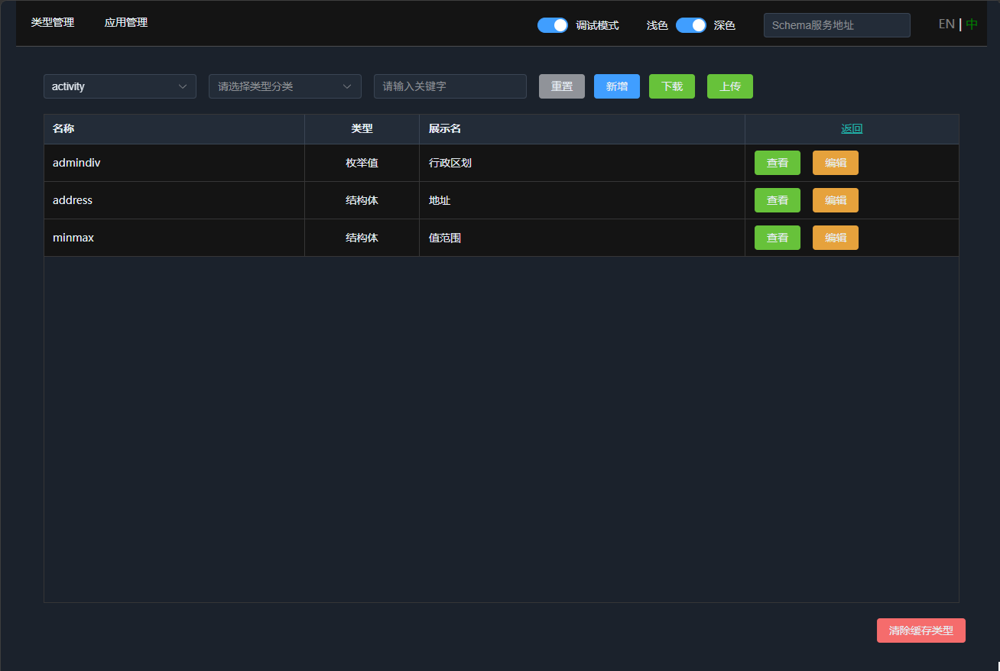

## 4. 创建语义类型

点击 `新增`，编辑器会创建一个用于构建语义类型的结构体。选择不同的类型分类，可以定义不同用途的语义类型。

### 4.1 命名空间

首先创建一个命名空间，用于组织后续定义的类型。

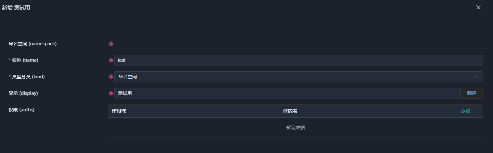

命名空间只承载层级关系，本身没有业务字段。它为类型提供稳定的命名路径，例如 `demo.sport`。

权限配置暂时可以忽略，后续在 App 应用中再介绍。

创建完成后，可以在类型列表中通过 `下级` 进入该命名空间。

### 4.2 标量类型

标量类型用于定义字符串、整数、日期等基础数据，以及基于这些数据扩展出的业务类型。

例如，我们可以创建一个手机号类型：

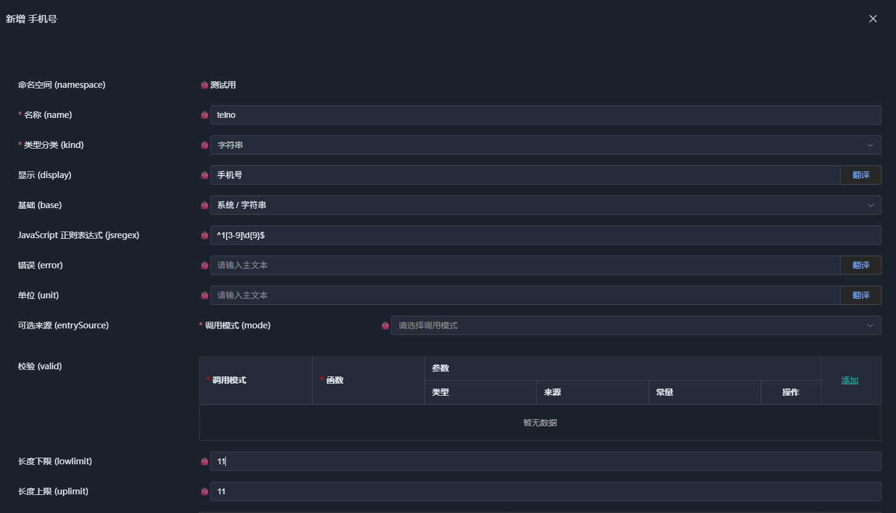

选择基础类型以继承其属性，再配置所需的语义属性，例如 `Display`（展示名）和校验规则。

界面展示的属性并非固定列表。Core 可以通过属性定义扩展可用的语义属性，相关实现可在 `schema-node-core` 中按属性名搜索。具体的内核解析机制将在后续文档中介绍。

### 4.3 枚举

枚举用于定义一组有限的可选值，也可以通过级联结构表达多层级的选项。

例如，下面以行政区划为例，展示四级级联结构：省、市、地、县。

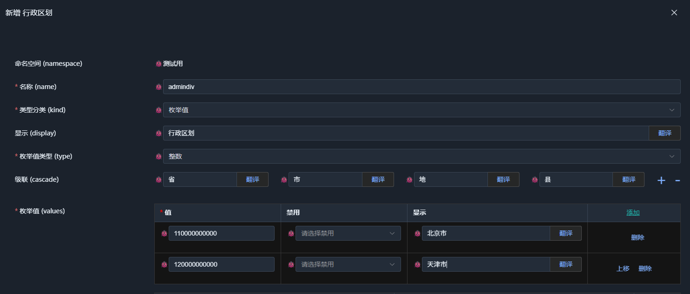

先添加测试用枚举项并保存。定义级联子项之前，需要先保存父级枚举。

重新编辑时，可以看到下级入口：

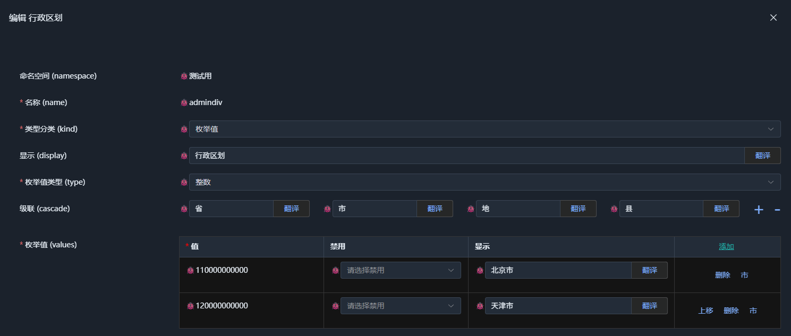

点击下级的级联名称，即可展开下级枚举并添加选项：

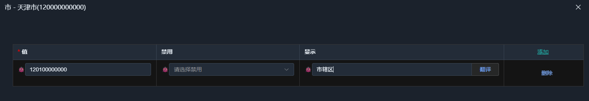

依照同样的方式，可以定义任意层级的级联枚举。

如果不指定级联层级名称，则默认只有一层，即普通枚举。

### 4.4 结构体

结构体是 Core 中的重要语义数据类型，用于组合多个字段。除了定义字段列表（Fields），还可以定义字段及其下级元素之间的关联（Relations）。

#### 4.4.1 字段定义

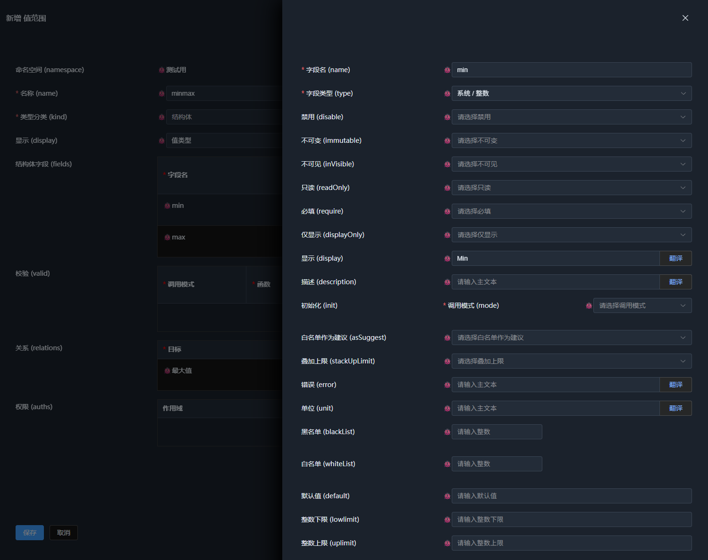

结构体字段可以配置通用属性，例如 `Require`、`Readonly`，也可以配置与字段类型有关的属性，例如整数类型的 `LowLimit` 和 `UpLimit`。

其中，几个常用属性值得单独说明：

- `DisplayOnly`：仅用于展示，不作为持久化数据存储。常见用法是通过 Relation 为其 `Default` 属性提供计算结果。在 App 应用中，它也常用于跨表查询得到的展示字段。如果复杂关联需要中间计算结果，也可以设置 `DisplayOnly` 字段保存中间值，并配合 `Invisible` 隐藏该字段。
- `Display`：展示名称，例如表单标签、表格表头等。其值支持本地化字符串，可用于多语言场景。
- `Init`：初始化值或初始化行为。目前数组添加一行时会使用这一机制，例如从后端获取 UUID 并将其设置为新行的主键。

其他属性可结合具体场景理解。

#### 4.4.2 关联定义

字段属性可以直接描述一个实体自身的特征。当某个属性需要依赖其他实体的数据时，则可以通过 Relation 定义这种关联。

下面仍使用 `minmax` 示例，配置 `min` 对 `max` 下限的约束：

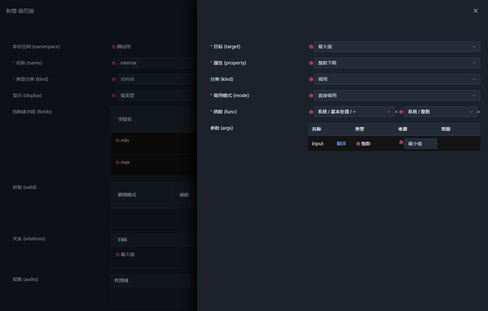

关联会记录其提供者，以便执行时定位需要访问的实体。配置时需要指定两个关键内容：

- **作用目标**：关联要影响哪个实体，由当前类型的结构决定。
- **作用属性**：关联要影响目标实体的哪个属性，可选项由目标及其属性类型决定。

在本例中，作用目标是 `max` 字段，其类型为整数，因此可以选择整数下限属性。

关联提供的属性也可以是函数调用。例如，输入字段的 `EntrySource` 属性可以通过函数提供级联数据源，而函数参数可能来自其他实体，此时就需要通过关联绑定参数来源。

如果直接在输入字段上配置这个属性，字段自身会成为属性提供者，无法正确定位兄弟字段或其他实体节点。因此，需要使用关联显式指定数据来源。

关联的执行方式可以扩展注册，系统默认提供以下几种：

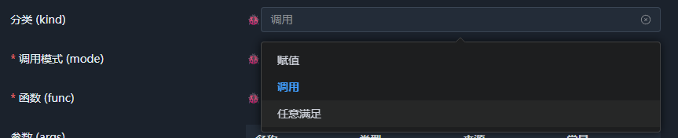

- **赋值**：将配置值直接赋给作用属性，只执行一次。
- **调用**：调用指定函数，并将返回值赋给作用属性。系统可以根据函数参数订阅相关实体的数据变更，自动更新计算结果。
- **任意**：配置多个函数调用，任意一个调用返回 `true`，作用属性即为 `true`；否则为 `false`。

其中，调用是最常用的方式，需要配置函数调用的三个部分。

**调用模式（Mode）**

指定函数的调用方式。除直接调用外，还支持 `Map`、`Filter`、`Reduce` 等高阶调用模式。可选模式取决于目标属性的类型。

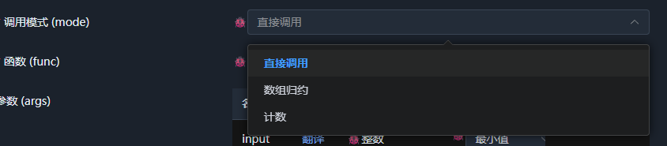

**函数（Func）**

选择需要调用的语义函数。`system` 命名空间下提供了许多预置函数，配置器会根据目标属性的类型进行筛选。

系统函数中有不少泛型函数，需要指定具体类型。例如，本例将整数类型作为函数的类型参数，以确保返回值能够用于整数下限属性。

**参数（Args）**

根据函数定义绑定参数来源。本例使用直接赋值函数，将参数来源设置为 `min`，即可把 `min` 的值提供给目标属性。

系统函数较多，可以在实际配置过程中逐步熟悉。连接后端后，还可以注册自己的函数供语义类型使用。

完成配置后，点击 `查看`，再点击左下角的演示按钮，即可实时测试类型的效果。

调试时，可以将鼠标移到 `bug` 按钮上，查看实体当前的属性和关联状态：

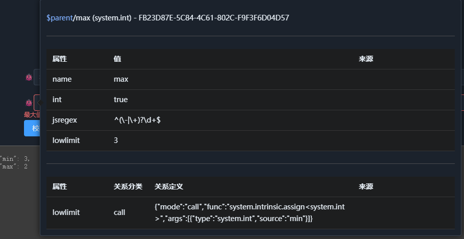

这是观察语义定义如何影响实体运行状态的便捷工具。

### 4.5 数组

数组用于定义一组同类型的实体。创建数组之前，先创建一个合适的结构体类型。

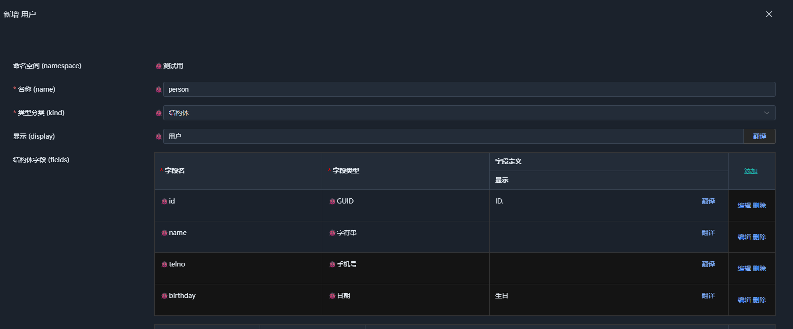

本例使用 `system.guid` 作为 `ID` 字段类型，并配置初始化方法：

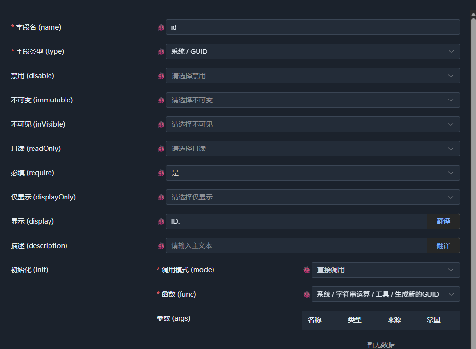

手机号使用前面定义的 `test.telno` 类型，其余字段使用 `system` 命名空间下的基础类型。

接下来，基于该结构体创建数组类型。选择数组分类后，直接指定元素数据类型即可。通常不必手动设置数组类型名称，`Name` 和 `Display` 会提供默认值；如果不覆盖这些值，调整元素结构体的 `Display` 时，数组类型的展示名也可以随之更新。

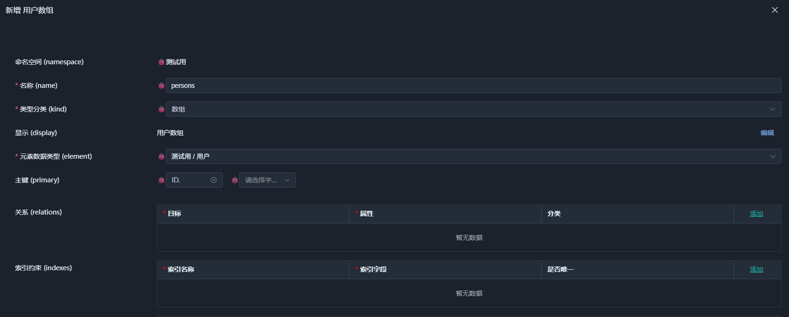

数组主要需要配置两项内容：

- **元素数据类型**：决定数组中的每一项是什么结构。
- **主键列表**：用于标识数组中的元素。本例选择 `ID`。

数组本身也可以定义关联。

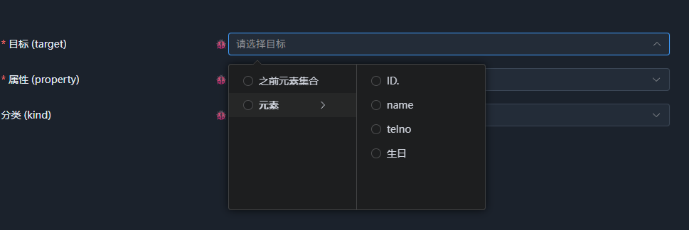

数组关联提供两个特殊的目标选项：`之前的元素集合` 和 `元素`。其中，`元素` 可以进一步选择元素内的字段。

不要直接将 `之前的元素集合` 作为作用目标，因为它代表的是集合上下文，通常应作为函数参数，而不是需要赋值的目标属性。

例如，计算当前行之前所有行的分配量，可以将之前的元素集合传给函数，再依据计算结果限制当前行的值。

由于数组定义了元素结构体和主键，在 App 应用中，也可以将它用作逻辑数据表的类型。

### 4.6 函数

函数也是一种语义类型。实际上，前面使用的属性也有相应的语义类型定义，只是目前属性类型由代码声明，尚未开放界面配置。

函数是一种特殊的语义类型：它没有普通的数据值，而是根据参数和表达式执行计算并返回结果。

下面定义一个用于计算用户年龄的函数：

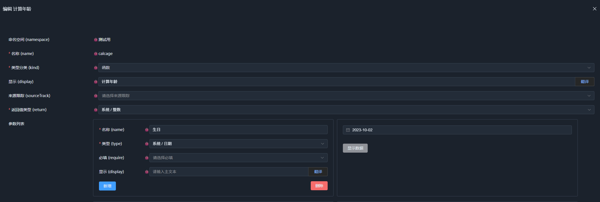

函数主要包含返回类型、参数表和表达式列表。其中，返回值类型与参数类型构成函数对外提供的主要接口。

函数也可以为调用参数定义关联关系，但目前相关配置较复杂，暂时只支持通过代码声明。

确定返回类型和参数后，可以通过调用已有函数构建计算逻辑：

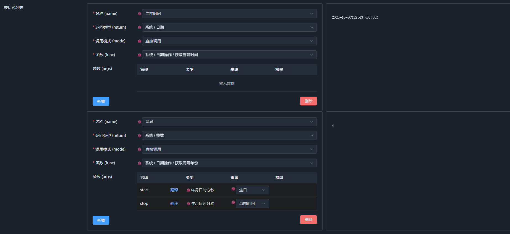

本例包含两个表达式：第一个获取当前时间，第二个计算生日与当前时间之间的差值。

完整的年龄计算还需要判断当年生日是否已过，再决定是否减一。这里仅展示基本配置过程。可以尝试使用 `逻辑操作` 中的 `条件选择` 补充这部分逻辑。

函数表达式按照列表顺序执行。如果最后一个表达式的类型与函数返回类型一致，则其值就是函数返回值。

如果返回类型是结构体，而最后一个表达式不能直接返回该类型，则可以通过与结构体字段名对应的表达式（包括参数）构建返回结构体。这种方式可以简化结构体结果的构造。

函数不支持传统的控制语句，可以使用 `逻辑操作` 中的 `条件选择` 表达条件逻辑；如果需要提前结束执行，可以使用 `基础处理` 中的 `满足条件返回` 等操作。

对于数组操作，可以调整调用模式，使用 `Map`、`Reduce` 等高阶函数。由于配置器可以直接选择相应模式，这里不再展开。

通常我们配置的语义函数，只涉及数据转换，所以，它是纯函数的设计，用于表达意图，尽可能确保易用性，不允许内部出现控制语句，造成调试和判定困难。

而复杂的处理，一个可以通过执行层注册语义函数来覆盖，例如将已有微服务的API做一个代理调用函数即可，相关的类型和函数都会被注册为语义类型，在界面上可以选择和配置。

另一个则是基于函数的语义意图，在执行层基于推理机制来完成，例如行权限，可以简单的配置为对上传数据的校验，但系统可以基于函数的内容，在查询时将它编译为生成查询树，实现对查询结果的筛选。

当然还有更复杂的执行流程支持，在下一章的工作流中会详细介绍。

#### 4.6.1 使用函数计算动态属性

函数定义完成后，为 `Person` 结构体添加 `age` 字段，并设置为 `DisplayOnly`，再通过关联配置它的默认值：

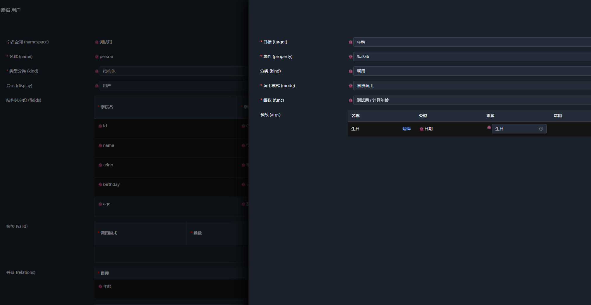

保存后，演示这个用户数组：

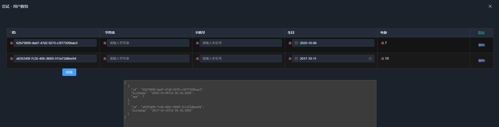

可以看到，`age` 会根据生日动态计算。修改生日后，年龄也会随之更新。

至此，我们完成了从数据结构、语义属性到函数和关联的配置示例。

## 5. 在自有前端项目中使用

完成类型定义后，可以将导出的 JSON 纳入项目版本管理，并在自己的前端项目中加载和使用。

完整步骤与运行效果见 [如何引入前端项目](../tryit/01-type.md#如何引入前端项目)。

如果需要定制视图组件或替换前端组件库，请参阅 [05. 定制前端视图](05-views.md)。

## 6. 连接后端后有什么变化

以上操作在独立使用 Core 时就可以完成。如果之后将管理器连接到 `SchemaNode.App`，主要变化在于类型的保存位置和读取方式，类型定义本身不需要修改。

| 场景 | 保存位置 |
| --- | --- |
| 浏览器中的类型，或未配置服务地址 | 浏览器 `localStorage` |
| 新建类型，或来源为服务端的类型，且已配置服务地址 | 服务端 `IAppDataProvider` |

连接方式与保存规则见 [03. 启动 SchemaNode.App 并配置应用](03-apps.md)。

## 7. 小结

本章介绍了如何通过在线配置器定义语义类型，包括命名空间、标量、枚举、结构体、数组和函数，以及如何通过关联将它们组合起来。

SchemaNode.Core 定义了语义类型的描述方式、公共语义属性和类型加载机制，并根据类型定义构造相应的语义实体。具体的执行能力则由执行层提供。

但，**定义语义类型并不等于实现一套完整的业务应用**。类型描述了数据及其语义，执行层负责将这些语义应用于具体场景，例如前端的视图渲染，后端的权限校验，数据处理等，都是基于同一语义进行不同目的的解释和执行。

接下来可以继续：

- 直接在前端使用 → [04. 定制前端视图](04-views.md)
- 启动执行层并使用应用 → [02. 启动 SchemaNode.App 并配置应用](02-apps.md)