# 02. 启动 SchemaNode.App 并配置应用

上一章的语义类型可以脱离后端独立存在，但和代码一样，光定义类型并不能完成功能，我们需要配合执行流程来使用，但执行流程和具体的执行层关联很大。

类似于我们将数据类型从代码中提取为语义自给的语义类型，我们也可以将特定执行环境中可变的部分提取出来，构成特殊的语义申明，来描述实际的执行流程。这种可以称为语义方言，因为它定义的并不是类型，方言代表的执行层特化的语义描述。

本章开始引入执行层：`SchemaNode.App`。它引入了一种语义方言，用于申明应用和应用容器，逻辑表字段，工作流处理等，通过流程配置，使语义类型获得实际的执行用途。

另外，该执行层同时定了系统级应用用于承载语义类型定义，当`schema-node-man`和后端关联后，语义类型的存储由后端完成。

## 0. 环境准备

参考 [环境准备](../tryit/02-app.md#环境准备)，不再重复。如果想研究 `SchemaNode.App` 的更多细节，可以参考 [SchemaNode.App 文档](../app/01-overview.md)。

启动后可以直接访问内置的配置管理页面

```text
http://localhost:8000/schema-node-man
```

## 1. 应用管理

点击顶部的 `应用管理`，页面主要分为二个区域：

| 区域 | 内容 | 功能 |
| --- | --- | --- |
| 筛选栏 | `应用容器`、`关键字`、`筛选`、`重置` | 筛选和导航 |
| 应用列表 | `名称`、`展示名`、`操作` | 浏览和管理应用 |


## 2 应用容器
应用容器是应用的容器，用于组织和管理应用。应用容器是没有配置逻辑表字段的应用，它只用于应用管理，也可以进行多级权限配置等。

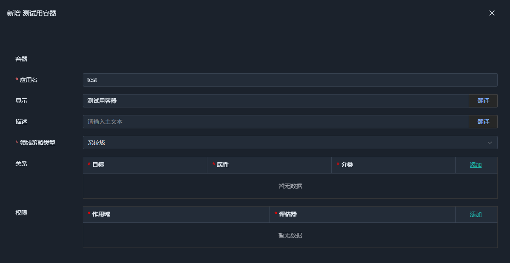

进入test应用容器，我们开始先构建一个用户域用来做权限管理。

## 3 用户域

类似test应用容器，在它下级，创建一个`user`用户域，用于管理用户。注意领域策略需要选择`系统级`，这样它的数据是全局的，这里不配置租户隔离之类。

### 3.1 用户类型

先切换到`类型管理`，添加一个`test`命名空间，然后进入它的下级，添加如下的用户类型：

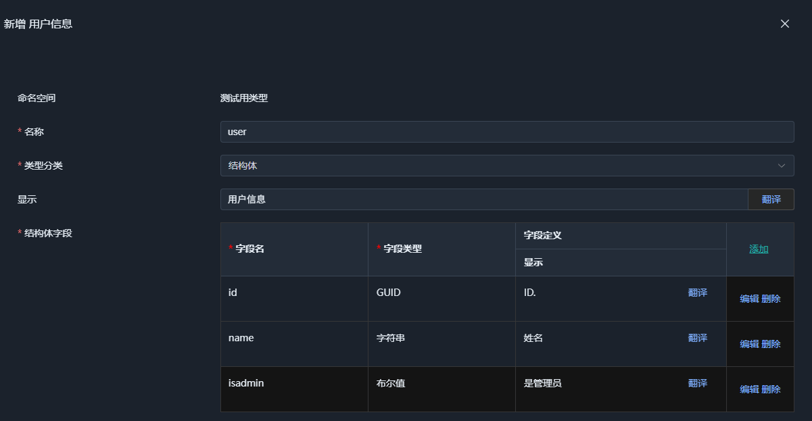

id和name都是必填，id可以配置为自动生成，在上一章已经演示过。因为是测试，不配置密码之类。

> 其实大部分情况下，SchemaNode系统可以和已有的微服务集成，所以通常不会基于SchemaNode系统来构建用户域。因为涉及登录，鉴权等处理，这些依赖于执行层实现，也就是，对于非通用性能力，SchemaNode不会尝试在内核提供，而是给出如何通过语义方言实现的方式。

> 我们需要确保的是，SchemaNode可以融入已有的系统，方便的提供二次开发能力，而非包办一切。

然后创建`users`用户列表类型：

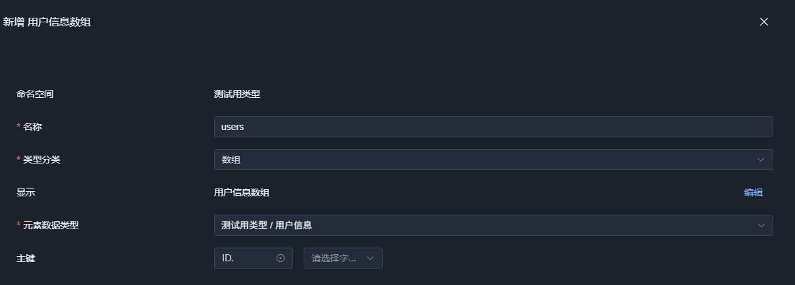

注意选择好主键。

### 3.2 用户列表逻辑字段

然后切换到`应用管理`，进入test应用容器，点击用户域的字段按钮:

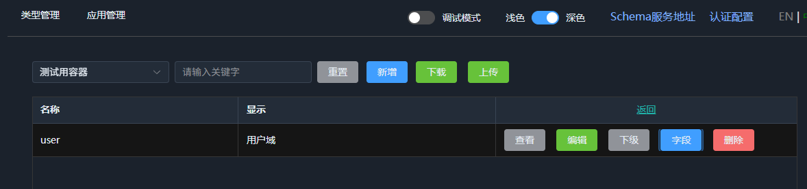

可以看到它的逻辑字段列表:

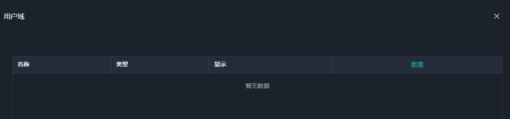

点击新增，直接选择刚才创建的类型，名字会被自动填充，记得选择启用存储。

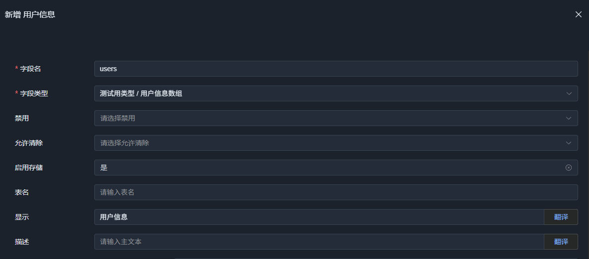


### 3.3 填写用户列表数据

保存后，可以点击左下角的`演示`按钮，就是进行实际的数据操作。点击`加载数据`，用于从后端加载数据，并初始化显示表单，添加几个用户，确保有一个被设置为管理员。记录下它的id。

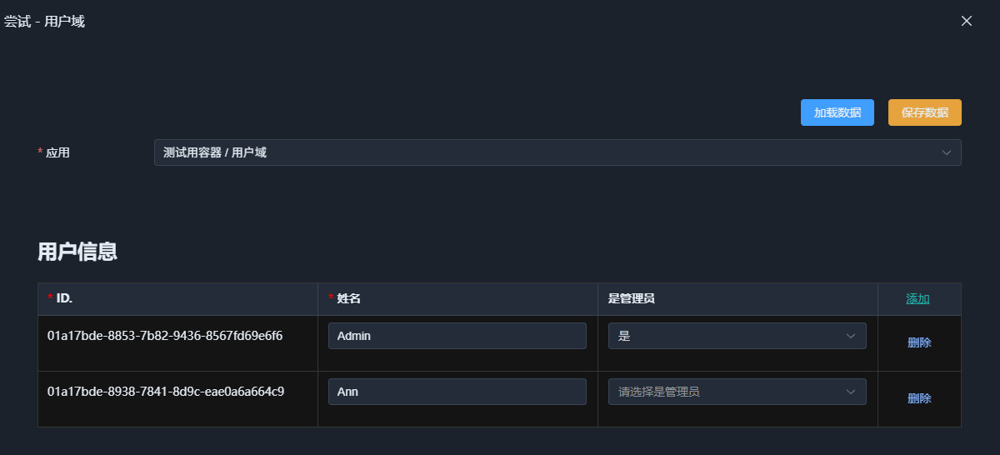


### 3.4 认证配置

保存数据后，按Esc一路返回到应用管理页面。点击它右上角的`认证配置`，进入认证配置页面。

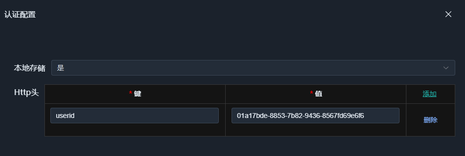

这里是模拟微服务的认证处理结果，基于`SchemaNode.Example`的配置，我们使用userid在请求头中传递用户信息。将刚才创建的管理员ID填写进去。


### 3.5 定义管理员判定函数

切换到类型管理页面的test命名空间，在定义了用户域和字段后，我们可以定义一个函数，用于判断用户是否是管理员。注意这个函数的返回值是布尔值，并且没有入参。


第一个表达式是基于当前访问上下文来获取用户id，这个上下文通常在SchemaNode.Example中有配置，微服务可以注册不同的上下文，例如租户id等等，之后可以用于做租户隔离。

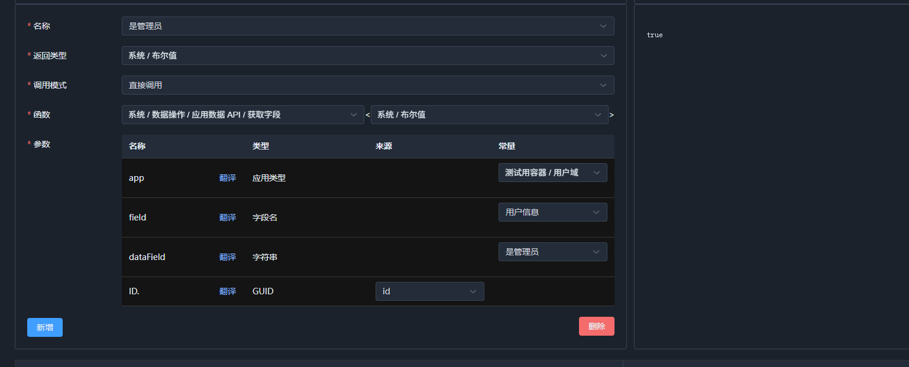

App应用在数据操作中注册了多个函数，用于获取和设置数据，注意设置数据的api被限定为工作流专用，这是避免被直接调用，确保数据的安全性。这类使用的获取字段，是基于主键访问获取逻辑表的单个字段值。

这里我们获取`是管理员`即可，因为它符合函数的返回值类型，所以，我们不用再继续配置。保存即可。

> 现实项目中，管理员一般由微服务注册的函数来判定，不过上面的方式可以基于数据进行额外的角色判定，对RABC等权限模型是有效的补充。


### 3.6 权限配置

退回类型管理页面，并回到最顶层命名空间，然后编辑`System系统`命名空间。为它配置三种类型限制，先放开`类型定义读取`和`函数执行`。

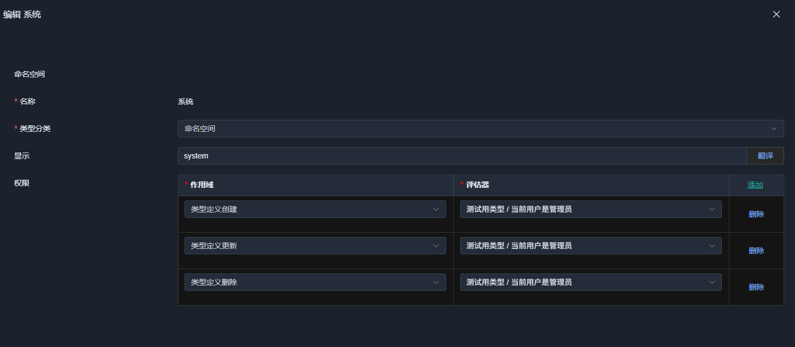

App系统设计的权限是基于命名空间和应用容器这种树状结构，在上层拥有对应权限的用户，自然也拥有下层命名空间（类型），应用容器（应用）的对应权限。但是因为无法配置System的上层命名空间，所以，用一直存在的System命名空间作为根来配置。

同样，切换到应用管理页面，修改`System应用容器`的权限，放开`类型定义读取`和`函数执行`。

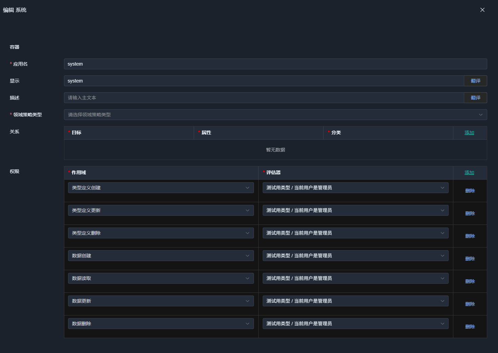

相比类型多了数据处理相关的权限。保存后，可以修改认证配置，例如换一个id，然后刷新页面可以看到，已经无法在新建和编辑了，这个限制是后端生效的，然后前端获取后，会基于权限进行判断。

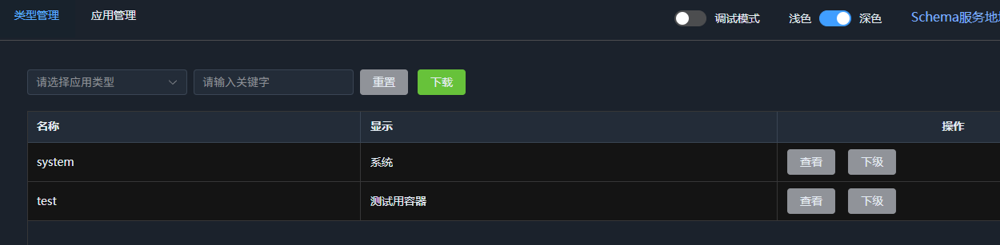

为了能够在各种场景下工作，即可以独立运行，又可以嵌入到已有的系统中，所以，应用系统设计的权限是基于语义函数配置的，即可以在内部调用微服务的权限判定函数，又可以基于访问用户和项目等数据进行进一步判定。

管理员在系统级被设置后，可以在下级的命名空间和应用容器中配置其它角色的访问权限，来实现多层级的权限管理。

稍后，还会看到行权限，列权限相关的配置方案。


## 4 项目域

下面构造一个特定的项目管理域，管理员可以构建项目，目的，分配管理人，管理人仅可查看自身相关的项目。 

### 4.1 项目域逻辑字段

同样，先创建结构体和数组类型:

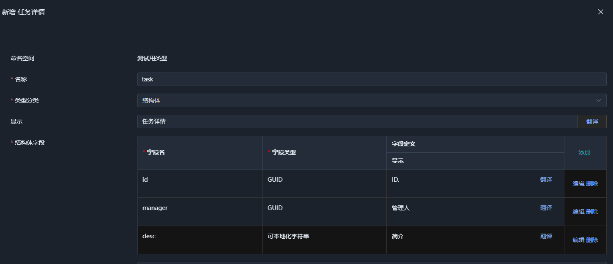

数组创建类似创建用户列表，这里跳过，然后到应用管理的`test`应用容器下创建，task任务域，仍然采用系统级。添加任务字段：

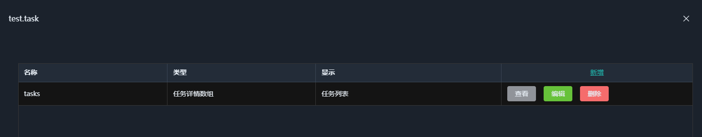

同时将用户域的用户列表作为引用添加到任务域中，方便引用数据。

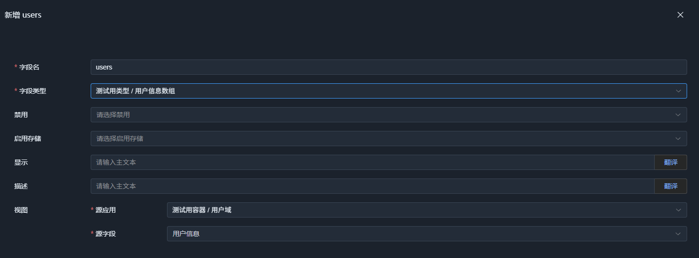

### 4.2 将用户列表作为选项

保存后，Esc回到应用管理界面，选择编辑任务域。添加一个关联，它是将用户列表字段作为管理人的选择项目使用。

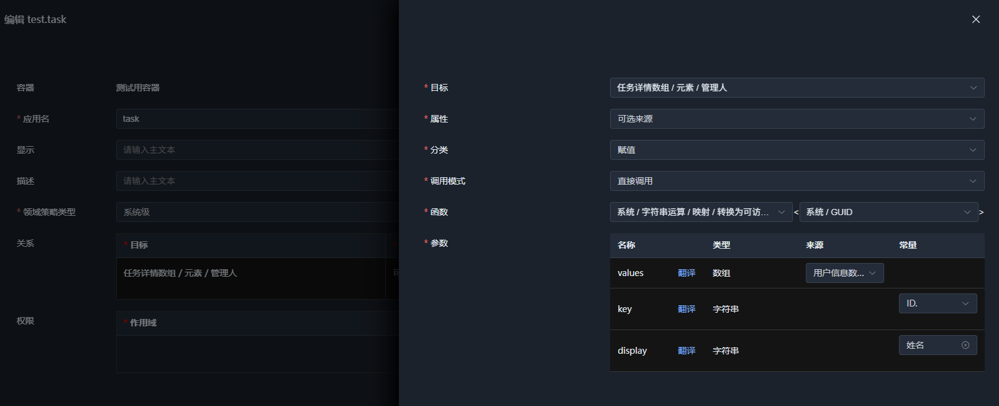

现在作为管理员，我们可以演示任务域的字段，为其它用户添加项目。

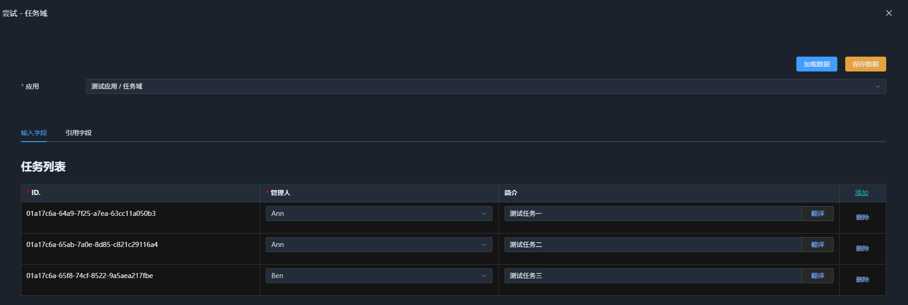

可以看到管理人是可选择的。目前这个页面依然是仅管理员可见，现在，我们添加一个判定用户是管理人的函数，和一个过滤函数，来确保管理人可以看到自己相关的项目。

### 4.3 判定用户属于项目管理人

第一步和判定管理员一样，先获取当前访问上下文的用户id。

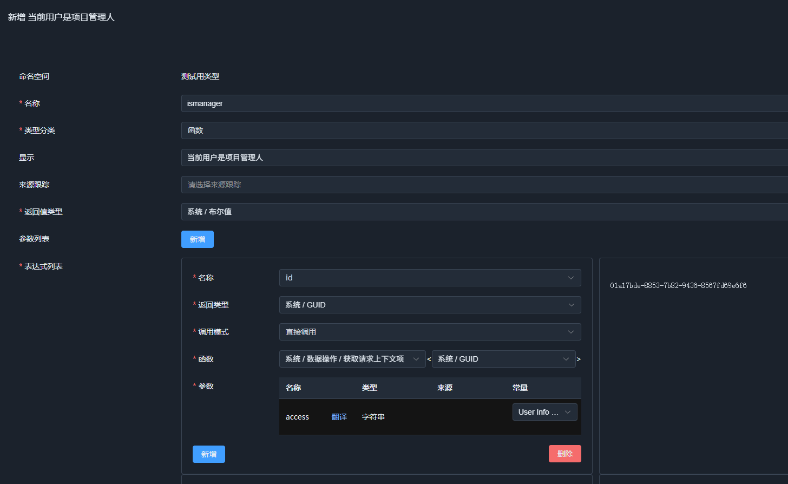

这次我们采用对数据源多次处理的方式进行判定。

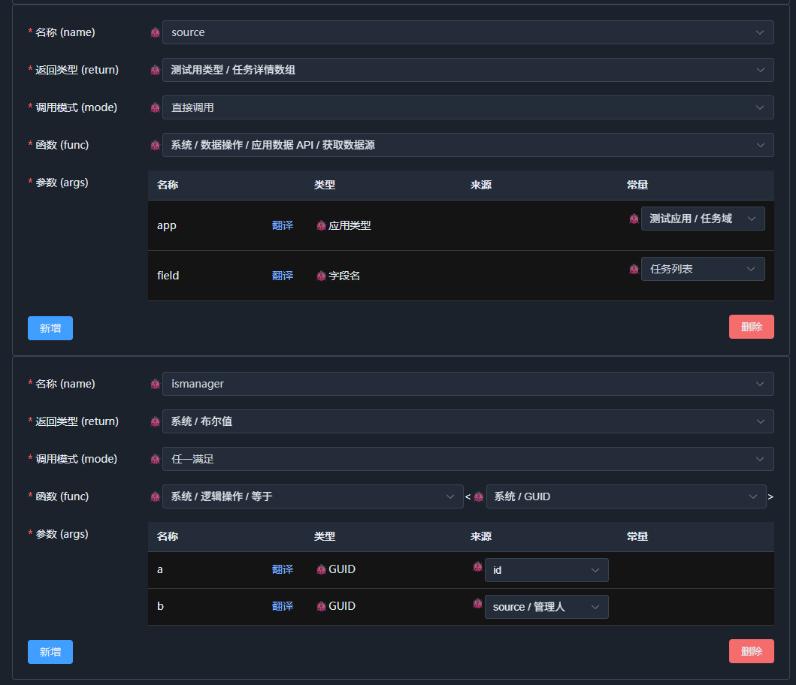

获取数据源用于获取应用指定逻辑字段的所有数据，当然，因为它只是表明了数据来源，所以不会实际请求。基于后续对数据源的处理，才会决定意图如何被执行，稍后我们会看到执行SQL。

申明数据源后，首先做了过滤，既当前用户id和管理人id需要一致。


然后我们补充了对过滤结果的计数和最终判定，如果计数大于0，说明当前用户是管理人，否则不是。

因为这个执行只能靠后端执行，所以前端右侧无法显示对应结果。我们可以用PostMan进行测试。

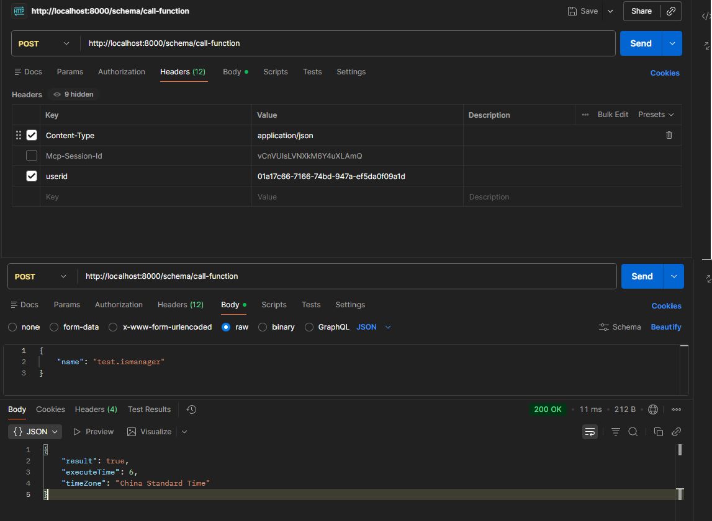

它的执行SQL如下：

```sql
 SELECT EXISTS (SELECT 1  From `dyn_test_task_tasks` t0 WHERE (t0.`manager` = '01a17c66-7166-74bd-947a-ef5da0f09a1d') AND 1=1 LIMIT 1) AS exists_flag;
 ```

 实际的编译结果如下：

 ```C#
.Block(System.Boolean $var1) {
    $var1 = (System.Boolean).Call SchemaNode.Utility.Extension.Convert(
        .Constant<System.RuntimeType>(System.Boolean),
        .Call (.Call (.Call SchemaNode.Data.AppDataQueryExtension.GetSchemaDataAsync(
            $var2,
            "test.task",
            "tasks",
            null,
            .Constant<SchemaNode.Data.AppSchemaDataResult>(Exist),
            .New SchemaNode.Data.AppSchemaDataFilterBinary(
                .Constant<SchemaNode.Enum.LogicType>(Equal),
                .New SchemaNode.Data.AppSchemaDataFilterField("manager"),
                .New SchemaNode.Data.AppSchemaDataFilterValue((System.Object).Call (.Call SchemaNode.Function.SystemData.getcontext(
                        $var2,
                        "user.id")).GetValueOrDefault())),
            0,
            0,
            False,
            null,
            null)).GetAwaiter()).GetResult())
}
```

系统会将语义函数解析为AST语义执行树，然后基于语义解析后，转换，修改最后得到表达式执行树，经过一次编译后，用于以后的执行，直到函数被修改后，才会重新编译，所以性能就是C#的原生性能。
 

### 4.4 管理人用过滤函数

我们需要让一个管理人只能看到自身相关的项目，所以，我们可以定制这样一个过滤函数。

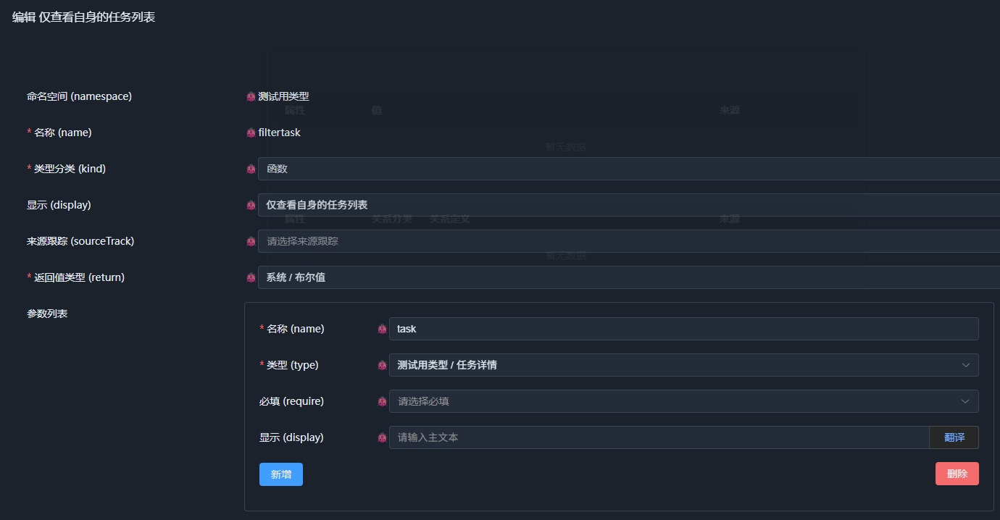
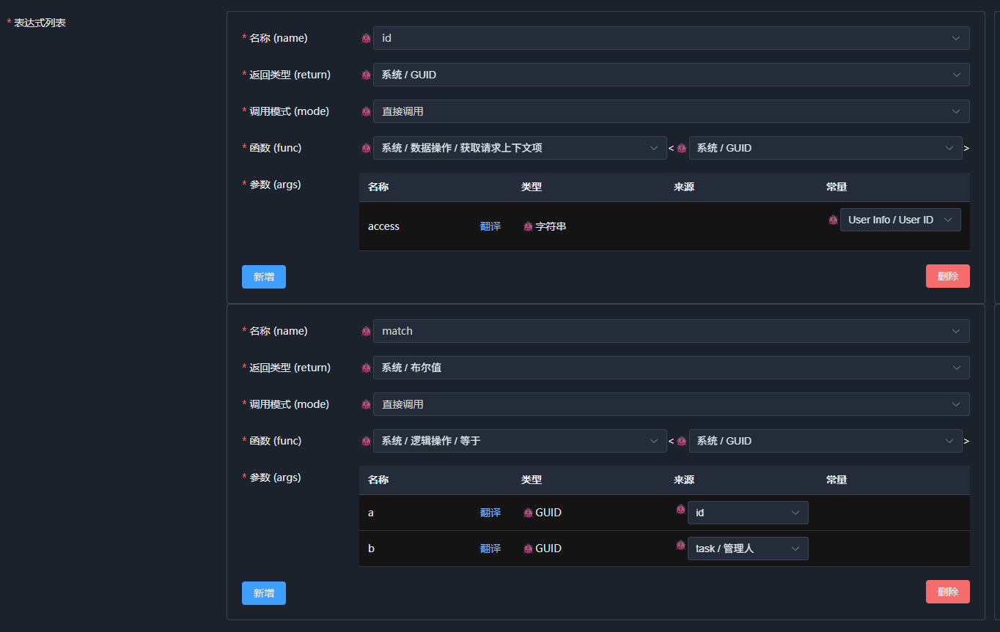

它很简单，将任务信息结构体传进去，然后将用户id和管理人id进行对比，直接返回对比结果即可。

上面定义的管理人判定函数和这里的过滤函数就构成了行权限，当当前用户是管理人时，就会启用这个过滤函数。

过滤函数有两种用途:

1. 提交数据时直接做校验。
2. 查询数据时，编译器会修改返回结果，函数返回的是查询执行计划，这个查询会和其它查询条件合并，验证后，才会执行。


### 4.5 配置管理人对任务域的访问权限

现在回到应用管理，打开任务域的字段列表，修改任务列表字段:

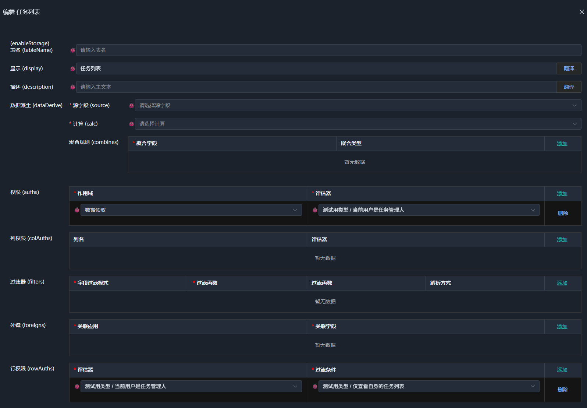

首先我们配置了管理人可以读取这个字段的数据，然后我们配置了管理人访问时的过滤条件。现在可以切到我们使用的管理员账号，查看结果:

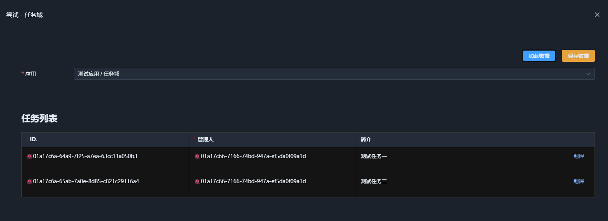

因为用户对`users`字段没有访问权限，所以，这里看到的用户名是ID，而不是实际名称，也可以为`users`字段添加访问权限，来显示用户名。

下面是查询时执行的SQL:

```sql
SELECT t0.`id`, t0.`manager`, t0.`desc_key`, t0.`desc_trans` FROM `dyn_test_task_tasks` t0 JOIN (SELECT `_seqno`  From `dyn_test_task_tasks` t0 WHERE ('01a17c66-7166-74bd-947a-ef5da0f09a1d' = t0.`manager`) AND 1=1 ORDER BY t0.`_seqno`) t ON t0.`_seqno` = t.`_seqno` ORDER BY t0.`_seqno`;
```

也说明我们定义的简单过滤函数，被转换为SQL执行计划了。


## 5 项目信息域

项目域主要完成了项目信息的存储和查询。现在我们基于项目构建一个新的应用，注意，领域策略类型使用业务目标，既这个应用需要指定一个target作为业务目标。例如项目id，用户id，组织机构id等等。

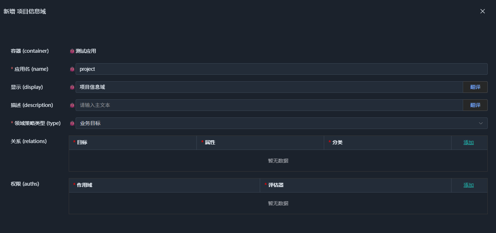

> 这个设计一个理由是将App 嵌入微服务中使用时，用户，组织机构和项目等的管理并非需要在 SchemaNode.App 这样的面向语义系统中完成，因为可能已经存在，或者需要和其它微服务的关联度较高，也有很多情况，纯基于语义模式对几乎无变化的场景来说，有些过重，所以，我们可以由其它系统提供业务ID，然后在 App 应用系统中围绕它进行业务数据管理即可。


### 5.1 配置外键关联

这个域的主要访问人是项目的管理人。再添加其它业务表前，我们需要在项目域`task`中配置外键关联。编辑它的tasks字段:

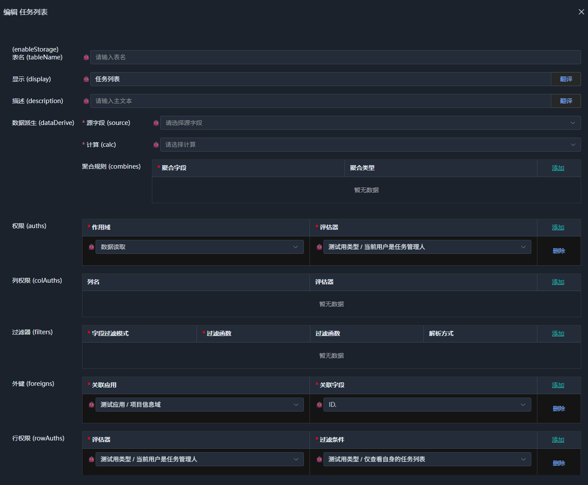

这里重点是外键配置中，将项目信息域的业务目标和表的`id`字段做了关联。意味着，这张表的`id`字段，就是项目的业务ID。


### 5.2 配置视图

现在我们可以在项目信息域中添加对应的视图，确保能拿到指定项目的管理人。注意这种设计是避免直接跨域查询的必要设计，所有操作都是基于在同一个应用中进行设计的。

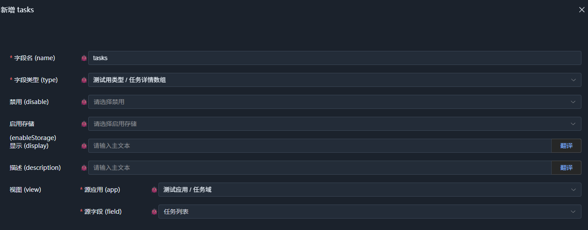

> 在添加用户域的用户表做视图时，不需要这样操作是因为用户域是系统级，没有业务目标。

现在直接演示一下，可以看到和我们给定的业务目标一致的项目被查询出来了。

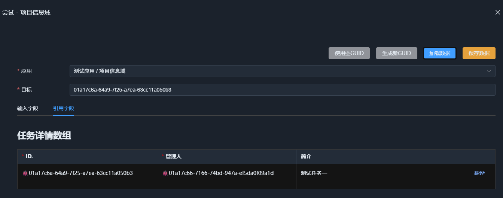


### 5.3 配置管理人访问权限

当给定一个任务id时，它的视图会限制只能查询到这个任务的管理人，所以，和之前配置的管理人访问权限一样，我们可以添加一个新的函数做管理人判定。

这里可以用一个小技巧，查看原本的`当前用户是任务管理人`函数，然后点击`复制类型定义`即可。

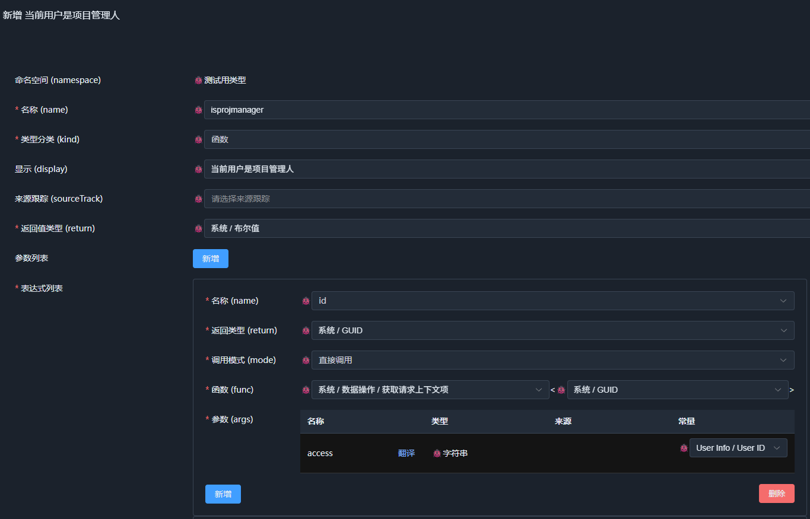
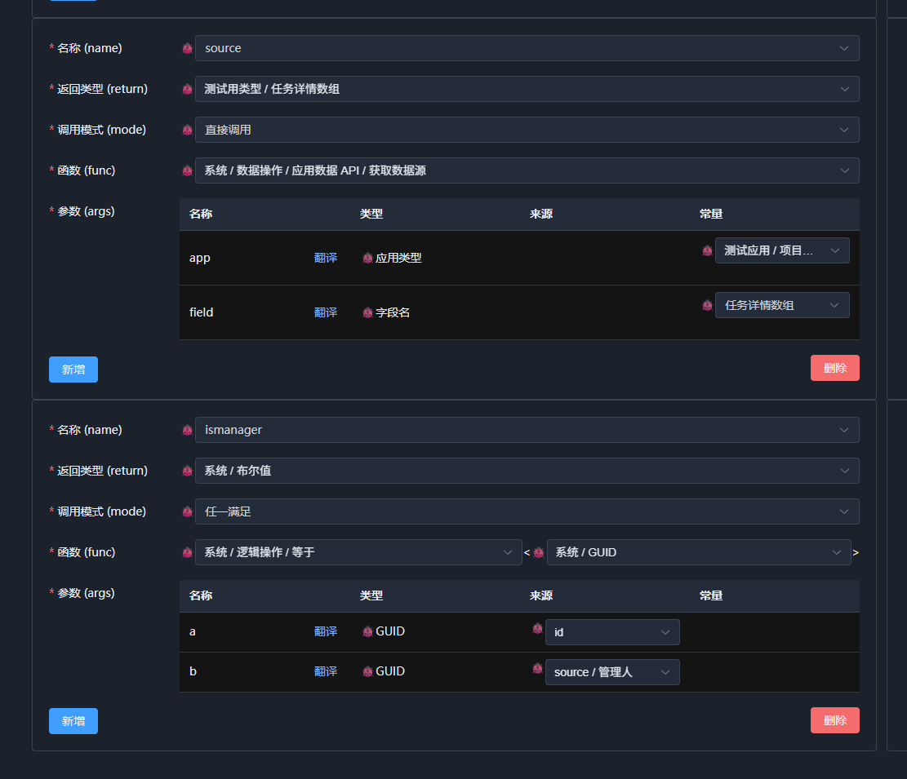

然后我们给与管理人完全的访问权限。注意是编辑应用本身，不用详细去处理应用的每个字段：

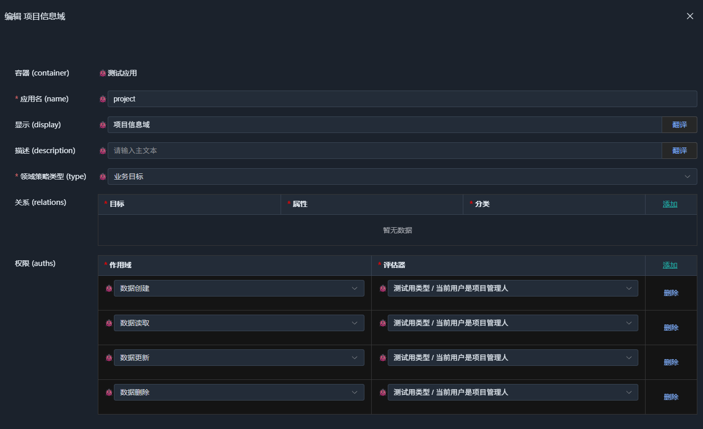

保存后，通过认证配置，切换成第一个任务的管理人id，然后演示下`项目信息域`，可以看到视图字段的数据可以被正确看到，说明配置成功，可以再实时切换其它id，再去查看，这时候数据不会被加载。

> 这里没有继续配置字段的行权限和数据过滤，因为访问在入口时就控制了。


### 5.4 添加项目分支任务表

接下来，我们添加一个项目分支任务和它的数组，分支任务会指定项目周期。然后我们会将项目周期计算为天数，做一个整体汇总。

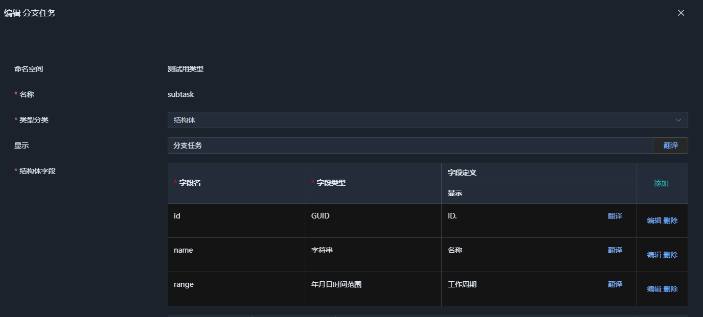

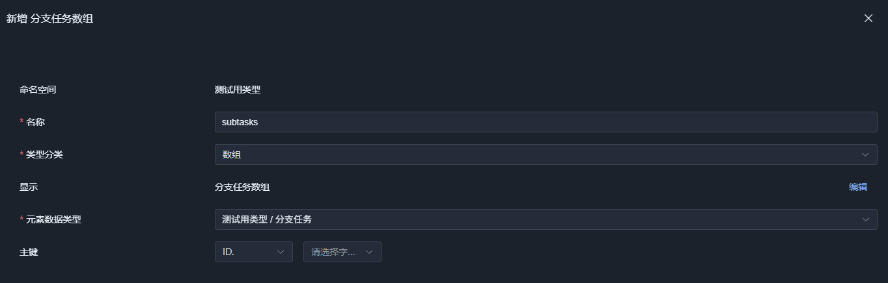
 
再配置一个计算分支任务的天数的函数。

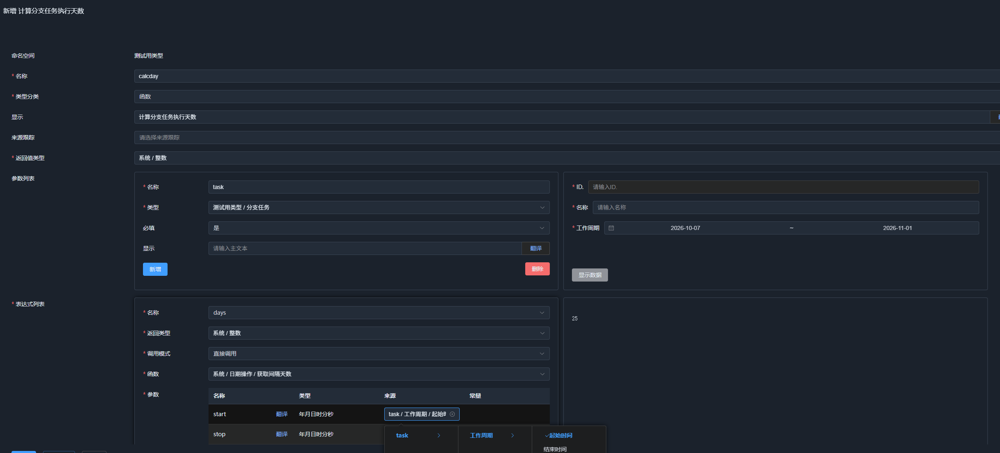


### 5.5 添加项目信息域字段和推送

回到项目信息域，添加一个分支任务字段。

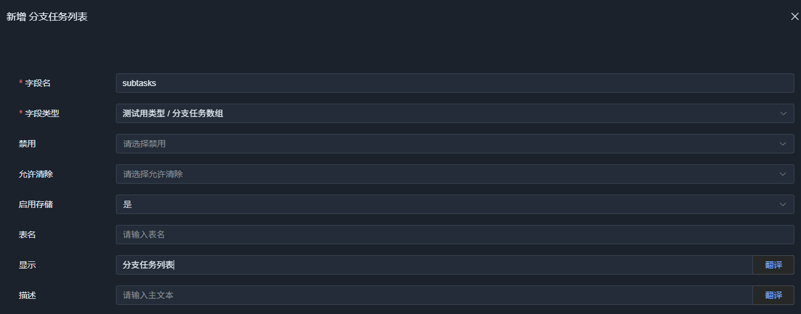

然后添加一个计算总时长的字段，并且配置它从分支任务中推送数据。

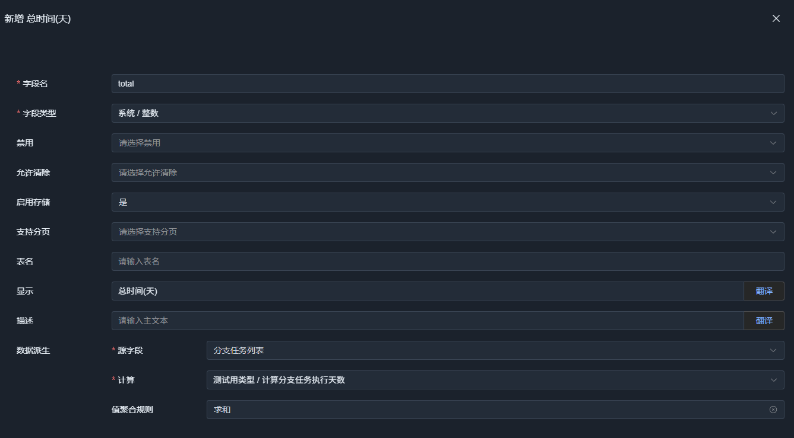

现在可以切换到 Ann 的账号，然后演示这个应用，添加一些数据，保存后，再切换到`输出字段`页面，可以看到分支任务的总时长被计算出来了。

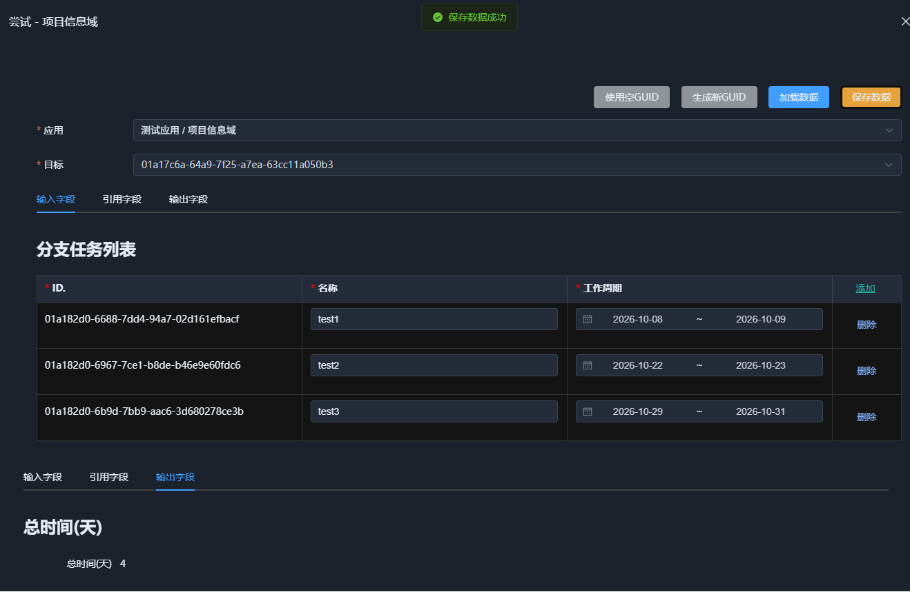

至于数据血缘，在[02. App 应用演示](../tryit/02-app.md)中已经演示过了，这里只是介绍如何配置数据推送。


## 结语

以上，我们完整走通了基于 App 应用系统为不同问题域构建应用，以及通过外键和视图实现跨域查询的常规闭环。在这个过程中，我们演示了如何基于公共语义类型配合应用方言来构建完整的业务逻辑。

你可以直观地看到：当我们将高并发、事务互斥、物理存储以及 SQL 拼装等底层执行细节彻底剥离后，业务逻辑本身变得何等纯粹。 配置人员（甚至未来的 AI）不再被“SQL 如何组织、UI 如何联动”这些偶然复杂度所羁绊。开发者只需声明语义，引擎自会兜底一切。这就是将业务回归本质的降维体验。

更重要的是，这种解耦让执行层得以脱离业务进行独立迭代。例如上面演示的“判定用户是否为管理人”，底层引擎完全可以用最笨的方式（查询全量数据在内存中判定），但执行层开发人员通过识别“存在性检查”这一意图，直接将其编译为带 LIMIT 1 的高效 SQL，实现了极大的性能跃升。

另一个显著的例子是复杂条件的查询。在过往代码中，前端传入的查询表单、用户的角色行权限、以及其它业务逻辑产生的过滤条件，往往需要开发人员编写极为复杂的字符串拼接逻辑。而在 SchemaNode 中，这些条件会被统一合并为一棵逻辑查询树。这棵查询树可以被继续代数展开、砍枝、校验，最终自动生成一棵极致优化的 SQL。整个过程，无需任何人为的代码干预。

> 注：实际应用中，App 的逻辑表还可以声明过滤方式，其中支持配置过滤函数。过滤函数的参数会自动构成查询表单，而函数本身则和行权限一样，被编译器处理，最终融入那棵统一的查询树中。

> 创建应用时，策略的第三个模式`隔离上下文`，实际是基于上下文中存在的组织id，租户id等构造数据隔离，不过因为 Example 的上下文只配置了用户id，所以这里不做展示。