# 3 工作流

工作流系统虽然依托于应用（处理数据，继承权限等），但它实际是应用下的一个子原型，所以拆出来独立说明，当然，它实际是在应用系统工作3年后才增加的，是需求驱动的产物，借助已有的语义类型和语义函数处理，还有App对业务数据的管控，工作流的复杂度仅来源于流程调度。

它提供了：

- 多种触发方式：支持事件触发、定时触发和手动触发。
- 声明式流程编排：通过节点及其依赖关系描述工作流，使用有向无环图组织执行顺序。
- 可扩展的执行节点：节点通过语义类型声明参数、载荷、状态及执行能力，无需为每种业务流程重新设计一套工作流模型。
- 条件分支与并发控制：基于节点能力配置分支、分叉及相关执行控制。
- 事件驱动的流程衔接：通过等待事件等机制，将不同事件与工作流连接起来。
- 业务数据与权限继承：工作流依托所属应用运行，复用 App 的业务数据访问、角色权限和数据权限管控，而不是另建一套权限系统。
- 复用语义函数：流程节点可以借助已有语义类型和语义函数完成业务处理，避免在工作流引擎中重复实现数据操作和业务逻辑。
- 执行状态与过程记录：通过节点状态和应用已有的事件处理机制，支持流程推进及相关操作记录。
- 可配置的执行策略：将分支、取消、保存等执行行为作为节点能力配置，而不是将所有行为固化在工作流引擎中。
- 工作流状态持久化与恢复：通过保存工作流执行状态，在服务重启等情况下恢复尚未完成的流程，减少对人工干预和重复执行的依赖。

下面只做简单的使用介绍，详细内容在[工作流](../app/08-workflow.md)中介绍。

承接上一章的内容，我们为子任务的修改添加一个日志记录，当任务内容被修改后，用于记录修改的内容和时间。

## 1. 新建日志记录

新建一个日志记录，它的id不要配置初始化，直接对应子任务的id。

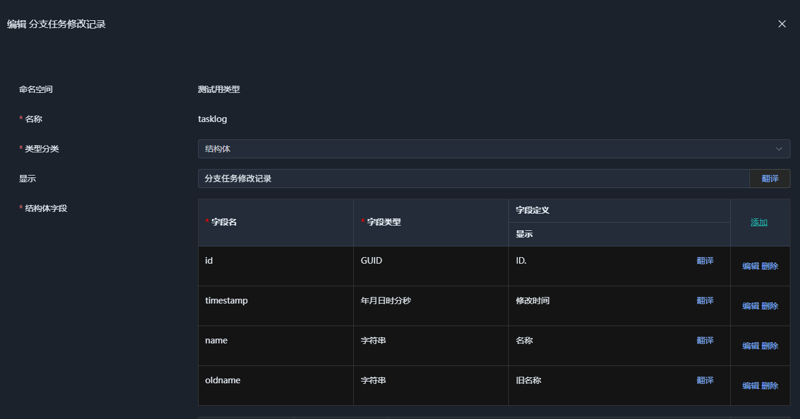

新建对应的数组，配置主键为`id`和`timestamp`。

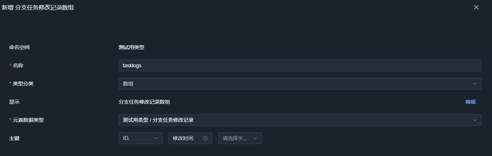

然后，在`project - 项目信息域`中添加一个`log`逻辑表字段，不要配置数据派生，这次走工作流写入。

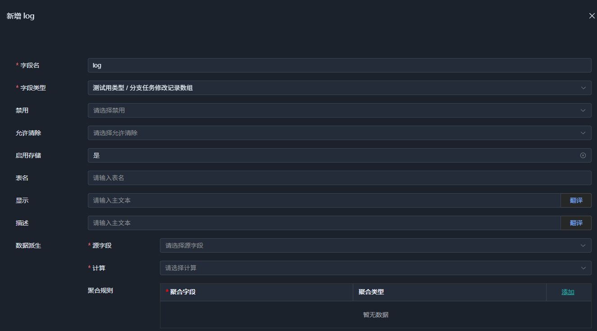

然后最后，编辑`project`应用，将这个字段配置为只读，确保无法被直接修改。

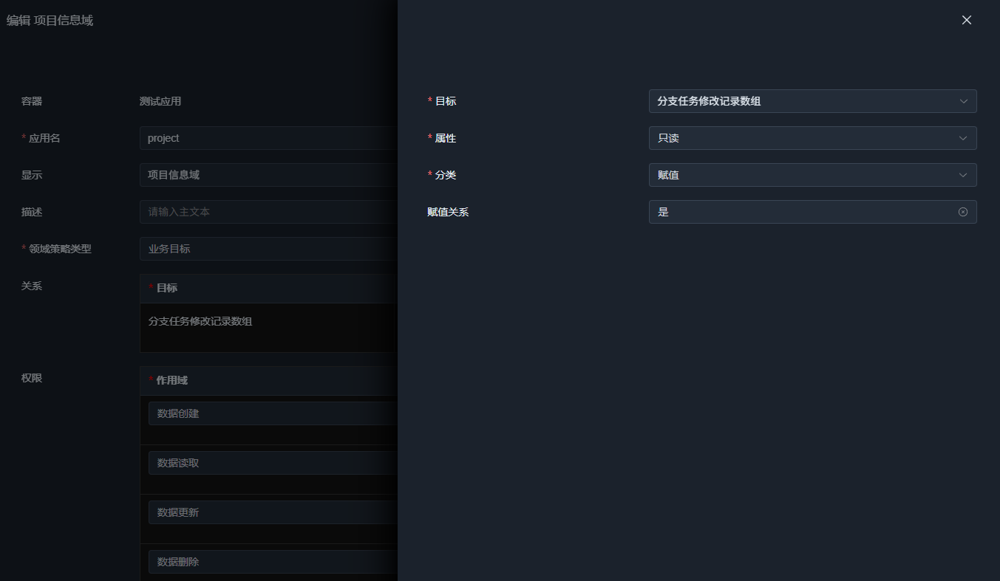

## 2. 新建日志记录生成函数

这里我们将基于新旧子任务的内容，生成一个日志记录。

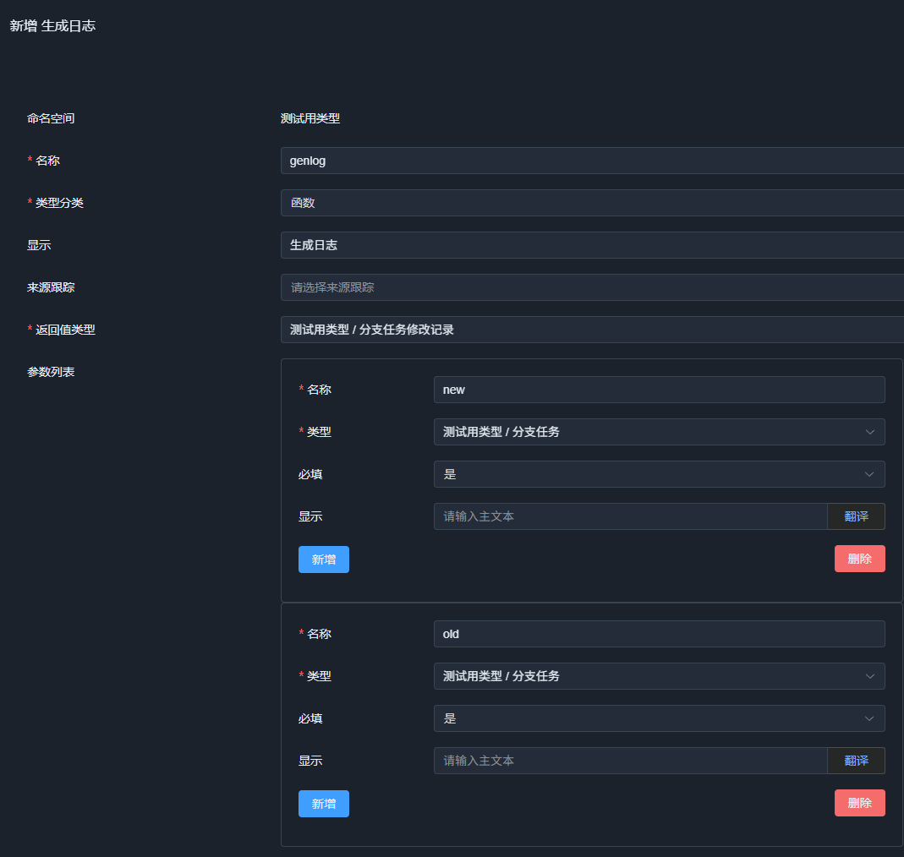

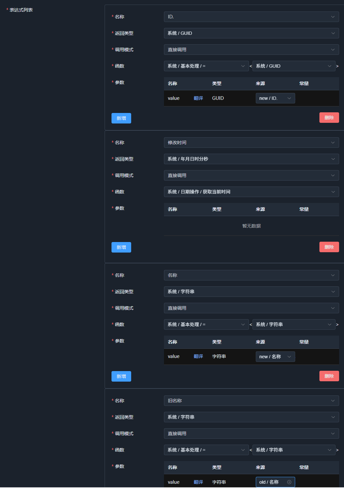

只需要表达式名字和结构体字段名一致即可，实际操作时，会发现，表达式名称下拉框是直接选择即可的。

保存备用。

## 3. 创建工作流

点击`project`应用的`工作流`页面，然后选择创建一个新的工作流:

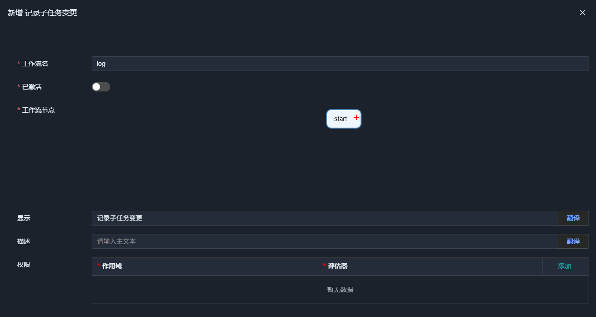

### 3.1 等待数据更新

点击`start`，它是默认的第一个节点，一般用于触发工作流的执行，例如等待事件，定时器，或者手动触发。

节点类型决定了节点的功能和执行策略，以及工作流配置，参数，等细节，也会确定工作流节点的返回值类型。

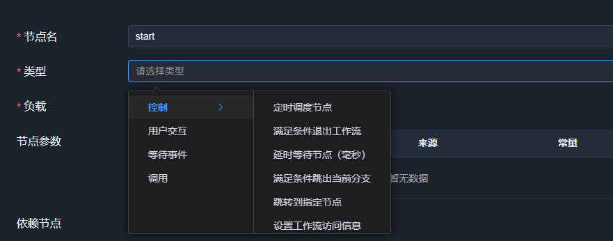

工作流节点类型是 App 申明的，但同样可以在第三方扩展，这里我们需要跟踪数据更新事件：

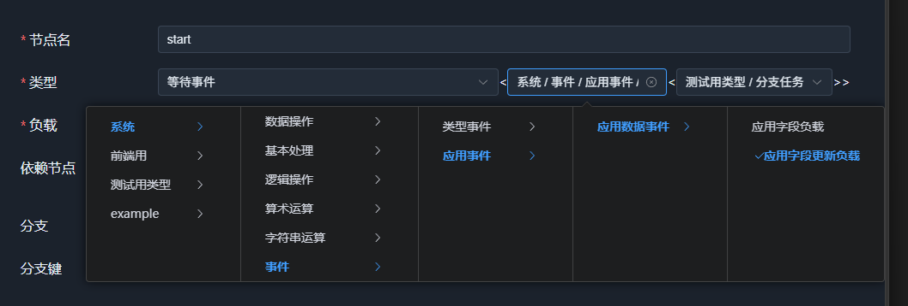

这里的泛型决定了节点的返回值类型，因为这个事件订阅修改，所以，会返回最新数据和原始数据。我们将基于对比来判定是否修改。注意，这里只是申明了返回值类型，已经节点类型是等待事件，但还没有指定具体哪个事件。

下面是`start`的完整配置:

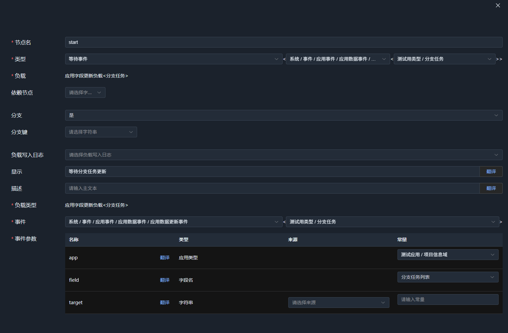

这里的重点，必须选择`分支`为true，这是确保它不会执行一次就结束，而是每次事件触发，都会fork一个子工作上下文去执行对应的数据包。

然后，在事件参数中我们指定了要等待的应用和逻辑字段表，这用于缩小等待的事件范围，只处理子任务的修改事件。

> 负载写入日志是用于在保存工作流状态时，是否写入当前节点的负载，便于测试，不过很多时候负载意义不大，而且数据量很大，建议关闭。但如果工作流预期执行时间比较长，有可能执行过程中服务器重启，导致需要恢复，这时负载可以被恢复，才能确保工作流的执行。这是一个基于现实的取舍问题

### 3.2 判定是否修改

保存`start`节点后，点它旁边的+号，添加一个下级节点:

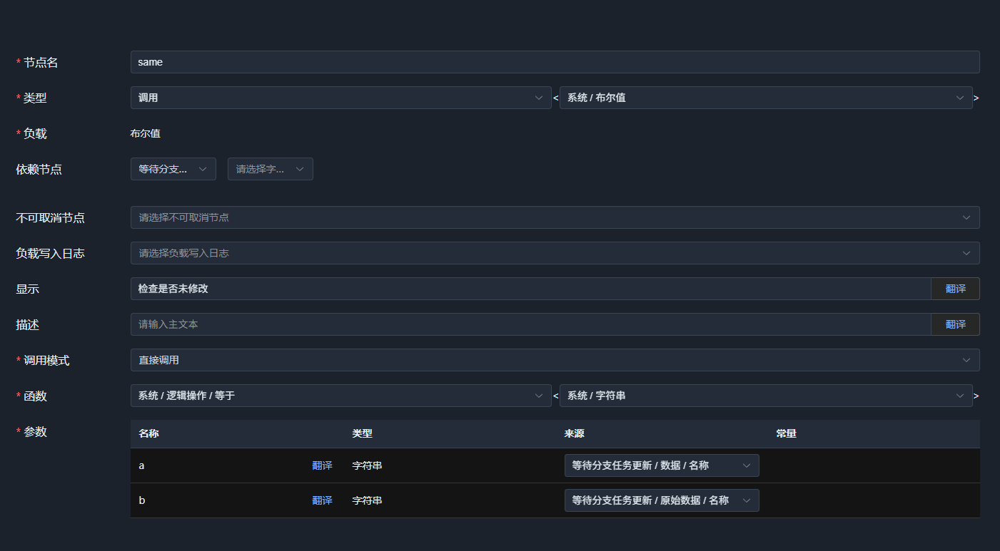

这个节点，采用函数调用，这是最常用的节点，可以调用函数，并且将函数返回值作为节点的返回值。 同时它可以方位之前节点的返回值，作为函数参数，这里我们简单比较了新旧子任务的内容是否一致。

### 3.3 无修改则结束

当没有修改时，我们不做记录，直接结束工作流，同样点击`检查是否未修改`节点的+号，添加一个下级节点:
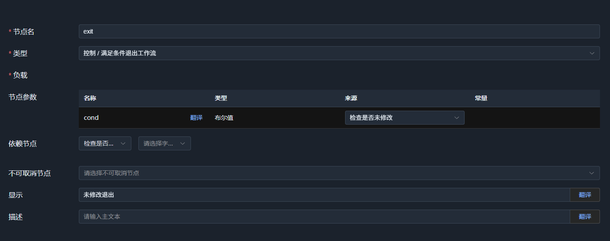

### 3.4 生成日志记录

继续添加一个下级节点，调用日志记录生成函数:

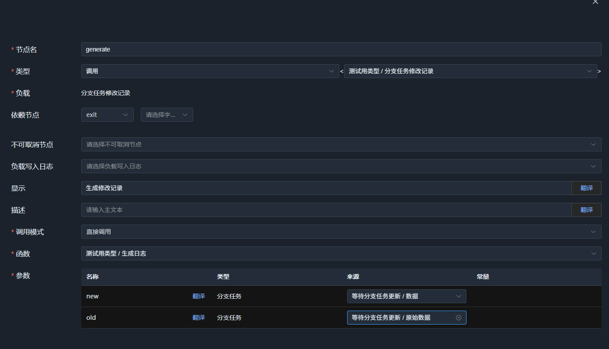

### 3.5 写入日志记录

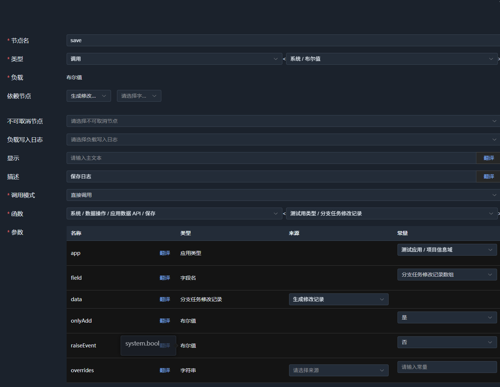

## 4. 激活工作流

在工作流管理界面，点击`激活`按钮，即可激活工作流，没有错误会变成`停用`按钮。

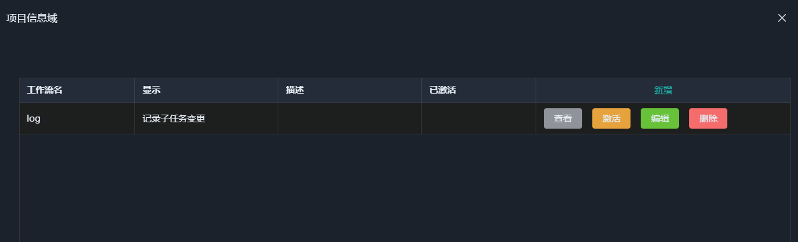

## 5. 测试

现在可以演示`任务信息域`的字段，加载一个任务，修改子任务内容，然后保存，稍等片刻，重新加载数据，就可以看到日志记录被写入了。

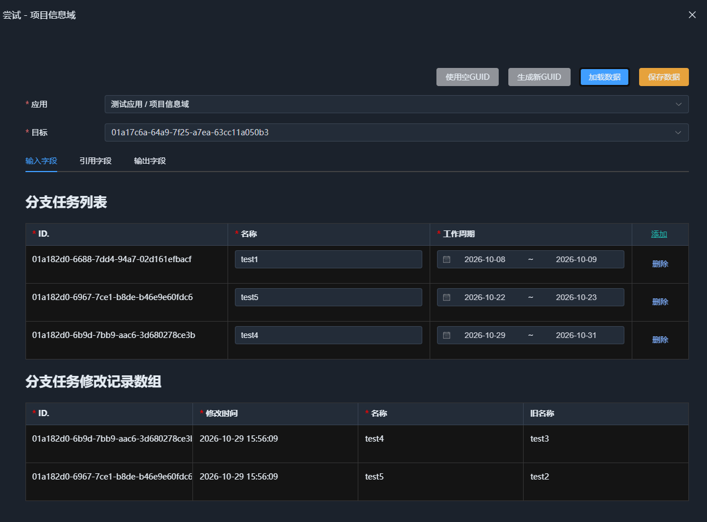

## 总结

事件系统包含应用数据事件，类型变更事件（极少用到），也可以将微服务队列中的消息队列注册为事件，这点在`SchemaNode.Kafka`和`SchemaNode.RabbitMQ`中都有实现。
 
工作流系统实际主要完成节点调配，节点可以不断扩展，只要提供`Settings-配置`, `Session-会话`, `Args-执行参数`， `Payload-返回负载` 配置，工作流调度就可以基于它完成工作。

本章只是入门介绍。

综合Core和App系统来说，Core将数据转换定义为语义函数，而App将流程调度定义为工作流，这实际是一个特殊的拆分，前者更容易做意图表达和分析，后者则面向实际的复杂业务场景。