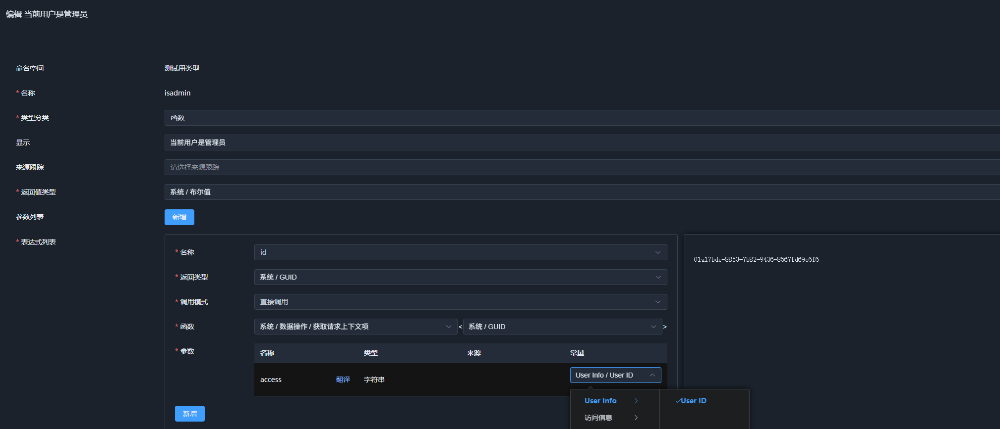

# 04. 嵌入已有微服务

前几章讲的是“从零配置”：先定义语义类型（可以只在浏览器里配置），再在应用管理里建应用、字段和工作流。

真实项目通常不是从零开始：微服务里已经有 DTO、鉴权上下文、业务 API 和消息队列。本章说明如何把这些**已有能力**接到 SchemaNode 上，让 Core 与 App 作为语义层嵌入微服务，而不是替换微服务。

本章的四条主线：

| 已有能力 | 接入方式 | 语义层产物 |
| --- | --- | --- |
| 请求身份（用户、组织） | `ISchemaContextItemProvider<T>` | `system.context` 结构体 |
| 已有类型（DTO、枚举） | `[Meta<SchemaType>]` | 结构体、枚举、数组类型 |
| 已有 API | static 方法调用已有封装 | 函数 + 相关类型 |
| 已有消息队列 | `KafkaEvent` / `RabbitEvent` + 主题特性 | 事件 |

完成这四步后，微服务原有能力就能被语义类型、函数、事件和工作流复用。底层机制可参考 [02-schema.md](../app/02-schema.md)、[03-runtime.md](../app/03-runtime.md) 与 [09-event.md](../app/09-event.md)。

---

## 1. 嵌入方式总览

SchemaNode 不接管微服务的 HTTP 路由、数据库和消息中间件。它只做三件事：

1. 从请求里收集上下文；
2. 把已有 C# 类型和函数映射成 Schema；
3. 把消息队列里的消息转换成事件。

```text
已有微服务                              SchemaNode 语义层
──────────                              ─────────────────
HTTP 请求 / 网关 ── UserInfoMiddleware ──► UserInfoProvider ──► system.context
已有 DTO / 枚举 ── [Meta<SchemaType>] ──► 结构体 / 枚举 / 数组
已有 API 封装 ── static 方法 ──────► 语义函数（工作流可用）
Kafka / RabbitMQ ── KafkaEvent / RabbitEvent ──► 语义事件（工作流可订阅）
```

服务端装配仍然只有一条主线：

```csharp
builder.Services
    // 1. 上下文：注册当前请求的用户、组织实例与 Provider
    .AddScoped<UserInfo>()
    .AddScoped<UserInfoProvider>()

    // 2. 类型与函数：扫描入口程序集（已打 [Meta<SchemaType>] 的类型会自动注册）
    .AddAppSchemaAssembly<Program>()

    // 3. 生成系统 Schema，包括 system.context
    .PrepareSchemaRuntime();
```

这段顺序与 [Program.cs](../../../SchemaNode.Example/Program.cs#L48-L77) 一致。这里只保留与嵌入相关的三行；App 还需要 `WithSchemaApiProtocol`、`AddSchemaStorageProvider` 以及应用数据提供器，完整写法见 [Program.cs](../../../SchemaNode.Example/Program.cs#L52-L66)。

请求管道里，先填充上下文，再挂 Schema API：

```csharp
app.UseMiddleware<UserInfoMiddleware>();
app.UseSchemaApis(enableAppDataApi: true, enableSchemaManage: true);
```

见 [Program.cs](../../../SchemaNode.Example/Program.cs#L82-L85)。

最后启动语义运行时：

```csharp
await app.Services.InitSchemaRuntimeAsync();
await app.Services.ActivateSchemaRuntimeAsync();
```

见 [Program.cs](../../../SchemaNode.Example/Program.cs#L101-L102)。

---

## 2. 请求上下文：UserInfoProvider 与 system.context

上下文是鉴权、派生、工作流里读取“当前用户是谁、属于哪个组织”的唯一入口。SchemaNode 不规定身份来源，只要求把身份放进一个 Provider。

### 2.1 定义上下文类型

`SchemaNode.Example` 里只有一个最小示例：

```csharp
[Meta<SchemaType>("example.user")]
public class UserInfo
{
    /// <summary>
    /// User ID
    /// </summary>
    public string? Id { get; set; }
}
```

见 [UserInfo.cs](../../../SchemaNode.Example/Components/UserInfo.cs#L9-L15)。

`[Meta<SchemaType>("example.user")]` 做了两件事：

- 让这个普通 C# 类被 `StructGenerator` 生成为结构体类型；
- 让 `system.context` 里的字段名取 `example.user` 的最后一段，即 `user`。

所以函数里访问用户 ID 的路径是 `user.id`，不是 `userinfo.id`。字段名的生成规则见 [NodeRuntimeStageHandler.cs](../../../SchemaNode.Core/Service/NodeRuntimeStageHandler.cs#L214-L224)。

真实微服务通常还需要组织、租户等字段，直接在同一个类型上扩展即可：

```csharp
[Meta<SchemaType>("example.user")]
public class UserInfo
{
    public string? Id { get; set; }
    public string? OrgId { get; set; }
    public string? TenantId { get; set; }
}
```

对应的上下文路径分别是 `user.id`、`user.orgId`、`user.tenantId`。

### 2.2 实现 Provider

Provider 把“当前请求里的 C# 实例”交给 SchemaNode：

```csharp
public class UserInfoProvider(UserInfo? userInfo) : ISchemaContextItemProvider<UserInfo>
{
    public bool HasItem => userInfo != null;

    public UserInfo GetItem()
        => userInfo ?? throw new InvalidOperationException("UserInfo is not available");
}
```

见 [UserInfoProvider.cs](../../../SchemaNode.Example/Components/UserInfoProvider.cs#L8-L17)。

接口本身很薄，关键是四个成员：

| 成员 | 作用 |
| --- | --- |
| `HasItem` | 当前请求有没有这个上下文项 |
| `GetItem()` | 返回强类型实例 |
| `TryGetItem(out T?)` | 默认实现会调用 `GetItem()` 并捕获异常 |
| `TrySetItem(T)` | 默认返回 `false`；需要跨作用域复制上下文时才实现 |

定义见 [ISchemaContextItemProvider.cs](../../../SchemaNode.Core/Context/ISchemaContextItemProvider.cs#L8-L79)。

### 2.3 在请求管道里填充

示例用中间件从请求头读取用户 ID：

```csharp
public class UserInfoMiddleware(RequestDelegate next)
{
    public async Task Invoke(HttpContext context, UserInfo user)
    {
        if (context.Request.Headers.TryGetValue("userid", out var userid))
        {
            user.Id = userid;
        }
        await next(context);
    }
}
```

见 [UserInfoMiddleware.cs](../../../SchemaNode.Example/Components/UserInfoMiddleware.cs#L7-L23)。

这里 `Invoke` 的 `UserInfo user` 参数由 DI 按请求作用域注入，和 `UserInfoProvider` 拿到的是同一个实例。真实项目可以换成：

- 从网关注入的 `X-User-Id`、`X-Org-Id` 请求头读取；
- 从 JWT 的 Claim 读取；
- 从已有的 `IHttpContextAccessor`、租户解析服务读取。

只要在进入 Schema API 之前把值写进 scoped 的 `UserInfo` 即可。

### 2.4 注册顺序与生命周期

```csharp
.AddScoped<UserInfo>()
.AddScoped<UserInfoProvider>()
```

见 [Program.cs](../../../SchemaNode.Example/Program.cs#L48-L49)。

四个容易踩的点：

1. **必须注册具体类型**。`OnServiceInitialized` 扫描的是 `ServiceDescriptor.ServiceType` 的接口，见 [NodeRuntimeStageHandler.cs](../../../SchemaNode.Core/Service/NodeRuntimeStageHandler.cs#L58-L71)。写 `AddScoped<ISchemaContextItemProvider<UserInfo>, UserInfoProvider>()` 时，`ServiceType` 是接口本身，扫描不到；应像示例一样注册 `UserInfoProvider`。
2. **必须放在 `PrepareSchemaRuntime()` 之前**。`PrepareSchemaRuntime` 会立刻用当前 `IServiceCollection` 做一次扫描并缓存 Provider 类型，见 [Service.cs](../../../SchemaNode.Core/Service/Service.cs#L130-L147)。之后再注册的 Provider 不会进入 `system.context`。
3. **跟随请求作用域**。`SchemaContext` 是 scoped 的，见 [Service.cs](../../../SchemaNode.Core/Service/Service.cs#L117-L119)。Provider 也应该是 scoped，否则会把上一个请求的用户带到下一个请求。
4. **字段名不能重复**。字段名取 Schema 类型名的最后一段；多个 Provider 的类型最后一段相同（例如 `example.user` 和 `user`）时，`system.context` 里会出现同名字段。

### 2.5 system.context 是怎么生成的

系统 Schema 加载阶段会遍历所有 Provider，把每个上下文类型变成 `system.context` 的一个字段：

```csharp
StructFieldSchema field = new()
{
    Name = schemaType.GetSchemaName(), // example.user -> user
    Type = schemaType
};
fieldTypes.Add(field);
provider.BindSchemaContextItemProvider(field.Name, schemaType, providerType, itemType);
```

见 [NodeRuntimeStageHandler.cs](../../../SchemaNode.Core/Service/NodeRuntimeStageHandler.cs#L199-L228)。

最终生成的结构体是：

```text
system.context
└── user : example.user
    ├── id : system.string
    ├── orgId : system.string
    └── tenantId : system.string
```

这段结构会以只读系统类型的形式出现在类型管理里，函数编辑器的 `system.data.getcontext` 也能据此选择访问路径和返回类型。



### 2.6 用 system.data.getcontext 读取

`getcontext` 是 Core 提供的系统函数：

```csharp
[Meta<SchemaType>(NS_SYSTEM_DATA)]
public static class SystemData
{
    public static T? getcontext<T>(SchemaContext context, string access)
    {
        IValueAccess? item = context.GetContextItem(access);
        return item != null ? item.GetValue<T>() : default(T?);
    }
}
```

见 [SystemData.cs](../../../SchemaNode.Core/Function/SystemData.cs#L20-L36)。

访问路径的规则在 [SchemaContext.cs](../../../SchemaNode.Core/Context/SchemaContext.cs#L632-L643)：

- 以第一个 `.` 为界，前半段是 `system.context` 的字段名（如 `user`）；
- 后半段是字段内的访问路径（如 `id`、`orgId`）；
- 先按字段名找到 Provider，把 C# 实例转成数据节点，再取子字段。

在配置管理器的函数里，典型写法是：

```text
system.data.getcontext<system.string>("user.id")
system.data.getcontext<system.string>("user.orgId")
system.data.getcontext<example.user>("user")
```

返回类型必须和字段实际类型匹配。`SchemaNode.Example` 的 `UserInfo.Id` 是 `string`，所以用它时写 `system.string`；如果微服务里的 `Id` 是 `Guid`（演示应用 `activity.json` 里就是 `system.guid`），则写 `system.guid`，不要照抄示例。

### 2.7 组织 ID 要不要单独做一个 Provider

两种做法都可以：

| 做法 | 适用场景 |
| --- | --- |
| 把 `OrgId` 放在 `UserInfo` 上 | 组织信息只有一个 ID，或者就是用户的属性 |
| 单独定义 `OrgInfo` + `OrgInfoProvider` | 组织有名称、层级、配置等多个字段 |

单独定义时，`system.context` 会多一个 `org` 字段：

```csharp
[Meta<SchemaType>("example.org")]
public class OrgInfo
{
    public string? Id { get; set; }
    public string? Name { get; set; }
}
```

函数里就可以写 `system.data.getcontext<system.string>("org.id")`。

### 2.8 在静态函数里直接拿上下文

如果不是在表达式里，而是在 C# 静态函数里，可以绕过 `getcontext`，直接按类型取：

```csharp
UserInfo? user = context.GetContextItem<UserInfo>();
```

`GetContextItem<T>()` 的实现在 [SchemaContext.cs](../../../SchemaNode.Core/Context/SchemaContext.cs#L618-L622)。

这样拿到的就是 Provider 返回的强类型对象，适合在静态函数里继续调用已有服务。

---

## 3. 已有类型：[`Meta<SchemaType>`]

已有 DTO 不需要改结构，只需要加一个特性。

### 3.1 把 DTO 注册成结构体

```csharp
[Meta<SchemaType>("demo.order.info")]
public class OrderInfo
{
    public string Id { get; set; } = string.Empty;
    public decimal Amount { get; set; }
    public DateTimeOffset CreatedAt { get; set; }
}
```

`StructGenerator` 会：

- 读取所有可读可写的实例属性（getter 不是 private，且没有 `[SchemaIgnore]`）；
- 把属性名转成 camelCase 字段名：`Id` → `id`、`Amount` → `amount`；
- 把可空属性标记为非必填；
- 把 XML 注释作为字段展示名。

见 [StructGenerator.cs](../../../SchemaNode.Core/Generator/StructGenerator.cs#L90-L119)。

如果某个属性不想暴露，加 `[SchemaIgnore]`；如果想覆盖字段的语义类型，在属性上加 `[Meta<SchemaType>]`。

### 3.2 枚举与数组

同一套机制也适用于已有枚举：

```csharp
[Meta<SchemaType>("demo.order.status")]
public enum OrderStatus
{
    Created,
    Paid,
    Shipped
}
```

如果结构体上有主键或索引，`StructGenerator` 还会生成一个配套的数组类型：

```csharp
[Meta<SchemaType>("demo.order.info")]
public class OrderInfo
{
    [Meta<PrimaryIndex>(0)]
    public string Id { get; set; } = string.Empty;

    public decimal Amount { get; set; }
}
```

此时会同时得到 `demo.order.info` 和 `demo.order.infos`。规则见 [StructGenerator.cs](../../../SchemaNode.Core/Generator/StructGenerator.cs#L195-L217)。

### 3.3 注册程序集

类型只有位于“已注册的 Schema 程序集”里才会被扫描。`AddAppSchemaAssembly<T>()` 注册 `T` 所在的程序集：

```csharp
.AddAppSchemaAssembly<Program>()
```

见 [AppService.cs](../../../SchemaNode.App/Service/AppService.cs#L66-L70)。

如果已有 DTO 在独立类库里：

```csharp
.AddAppSchemaAssemblies(typeof(OrderInfo).Assembly)
```

`AddSchemaAssemblies` 会自动把核心程序集放在最前、入口程序集放在最后，内部按程序集去重，见 [Service.cs](../../../SchemaNode.Core/Service/Service.cs#L39-L77)。

同样，这一步必须在 `PrepareSchemaRuntime()` 之前完成。

> **截图占位（待补）**：类型管理里出现 `demo.order` 命名空间，下面有 `info`、`infos`、`status` 等类型。

### 3.4 类型、函数、事件分别由谁生成

一个带 `[Meta<SchemaType>]` 的类型会交给哪些 Generator，由 `OfNodeKind` 决定：

| C# 形态 | 需要的特性 | 生成结果 |
| --- | --- | --- |
| 普通类 / 结构体 | `[Meta<SchemaType>]` | 结构体（有索引时附带数组） |
| `enum` | `[Meta<SchemaType>]` | 枚举 |
| 静态类 | `[Meta<SchemaType>]` | 命名空间 + 每个静态方法一个函数 |
| 事件类 | `[Meta<OfNodeKind>(NODE_KIND_EVENT)]` + `[Meta<SchemaType>]` | 事件 |

分发逻辑见 [NodeRuntimeStageHandler.cs](../../../SchemaNode.Core/Service/NodeRuntimeStageHandler.cs#L335-L361)。

---

## 4. 已有 API 调用：定义 static 方法

微服务内部通常已经封装了服务间调用：HTTP/RPC 客户端、服务发现、鉴权头、令牌透传、重试都在封装里。SchemaNode 不需要再提供一层服务调用或鉴权封装，直接定义一个 static 方法调用已有封装即可。

带 `[Meta<SchemaType>]` 的静态类会被注册成命名空间，每个 `public static` 方法注册成函数，见 [FunctionGenerator.cs](../../../SchemaNode.Core/Generator/FunctionGenerator.cs#L41-L65)。相关的 DTO 也会因 `[Meta<SchemaType>]` 成为语义类型，所以这些函数可以直接被工作流、权限表达式、派生规则使用。

### 4.1 写一个 static 方法

```csharp
[Meta<SchemaType>("demo.api.order")]
public static class OrderFunctions
{
    [Meta<SchemaType>("demo.api.order.get")]
    public static Task<OrderInfo?> GetOrder(SchemaContext context, string orderId)
        => context.GetRequiredService<IOrderApiClient>().GetOrderAsync(orderId);

    [Meta<SchemaType>("demo.api.order.pull")]
    public static Task<List<OrderInfo>> PullOrders(SchemaContext context, DateTimeOffset since)
        => context.GetRequiredService<IOrderApiClient>().ListOrdersAsync(since);
}
```

四个关键点。

**第一，直接调用微服务已有封装。** `IOrderApiClient` 就是微服务原来的调用封装，鉴权、服务发现、重试都在里面，SchemaNode 不介入。`context.GetRequiredService<IOrderApiClient>()` 只是从当前作用域取出这个封装；如果微服务用的是静态入口，也可以直接调用静态方法。

**第二，类必须是静态类。** `FunctionGenerator` 只处理 `IsAbstract && IsSealed` 且带 `[Meta<SchemaType>]` 的类，见 [FunctionGenerator.cs](../../../SchemaNode.Core/Generator/FunctionGenerator.cs#L44-L48)。

**第三，`SchemaContext` 是可选的首个参数。** 它不是业务参数，会被自动隐藏，调用时由运行时注入当前上下文，见 [FunctionGenerator.cs](../../../SchemaNode.Core/Generator/FunctionGenerator.cs#L83-L88)。需要当前用户或组织时用它读取：

```csharp
UserInfo? user = context.GetContextItem<UserInfo>();
```

**第四，参数和返回值要能解析成语义类型。** `string`、`DateTimeOffset` 等标量直接可用；`OrderInfo` 这类 DTO 建议加 `[Meta<SchemaType>]` 明确命名。不加特性时框架也会按类名自动生成一个类型，但命名空间和名字不可控，容易和已有类型冲突。无法解析时会在生成阶段抛出 “Can't resolve parameter type” 异常，见 [FunctionGenerator.cs](../../../SchemaNode.Core/Generator/FunctionGenerator.cs#L156-L167)。

### 4.2 类型和函数一起注册

上面的代码会同时产生两类语义资产：

| C# 声明 | 语义层产物 |
| --- | --- |
| `OrderInfo` | `demo.order.info` 结构体 |
| `List<OrderInfo>` | `system.list<demo.order.info>`；`OrderInfo` 有主键时还会生成 `demo.order.infos` 数组 |
| `OrderFunctions` | `demo.api.order` 命名空间 + `get`、`pull` 函数 |

这里没有额外的注册代码；只要静态类和 DTO 位于已注册的程序集里，`FunctionGenerator` 和 `StructGenerator` 会分别接管它们。注册程序集的方式见 3.3。

### 4.3 函数名与注册

`FunctionGenerator` 的默认命名规则：

```text
<类上的 SchemaType 命名空间>.<方法名小写>
```

所以类上的 `demo.api.order` + 方法 `GetOrder` 会得到 `demo.api.order.getorder`。如果想让名字更自然，在方法上再写一个 `[Meta<SchemaType>]`：

```csharp
[Meta<SchemaType>("demo.api.order.get")]
public static Task<OrderInfo?> GetOrder(SchemaContext context, string orderId) ...
```

此时完整函数名就是 `demo.api.order.get`。规则见 [FunctionGenerator.cs](../../../SchemaNode.Core/Generator/FunctionGenerator.cs#L56-L63)。想隐藏某个方法，加 `[SchemaIgnore]`。

### 4.4 在工作流里使用：数据同步

函数注册后，工作流可以直接按函数名调用。例如做一个订单数据同步：

```text
定时触发
  → demo.api.order.pull(since = 上次同步时间)
  → system.list<demo.order.info>
  → 遍历
  → system.data.app.save<demo.order.info>
```

整条链路只引用 `demo.api.order.pull` 和 `demo.order.info`，不关心底层是 HTTP、gRPC 还是别的协议；鉴权头、令牌和服务地址都由 `IOrderApiClient` 负责。`PullOrders` 返回的普通 C# 对象会被框架转成语义数据节点，后续节点可以直接读取 `id`、`amount` 等字段。

### 4.5 调用方式

| 场景 | 方式 |
| --- | --- |
| 配置管理器 / 前端 | 按函数名调用 `/schema/call-function` |
| 权限、派生、工作流表达式 | 直接引用函数节点 |
| 服务端代码 | `context.CallFunctionAsync(func, args)` |

HTTP 调用的请求体对应 [CallFunction.cs](../../../SchemaNode.App/Api/Schema/Info/CallFunction.cs#L47-L80)：

```json
{
  "name": "demo.api.order.get",
  "args": ["order-123"],
  "app": "demo.order",
  "target": "order-123"
}
```

`app` 与 `target` 可选，用于设置访问上下文；`name`、`args` 必填。路由前缀由 `UseSchemaApis(prefix: "schema")` 决定，拼接规则见 [Service.cs](../../../SchemaNode.App/Http/Service.cs#L154-L181)。

### 4.6 注意事项

- **复用已有封装，不要重复实现鉴权。** 令牌透传、租户头、服务发现、重试都应该留在微服务原有的调用封装里；SchemaNode 只负责把调用暴露成函数。
- **静态方法只做转发，不堆业务逻辑。** 业务规则仍然在已有服务里，避免语义层和微服务出现两套实现。
- **数据同步要考虑幂等。** 工作流可能重试，`PullOrders` 或写入节点应当按主键 upsert，或让已有封装提供幂等键。
- **异常向上抛出。** 工作流调用失败会让当前节点失败；需要补偿时，在工作流里显式加补偿节点，而不是在静态方法里吞掉异常。

---

## 5. 消息队列转事件

前几节是把已有能力暴露成类型和函数；这一节把消息队列也接进来——让一条 Kafka 或 RabbitMQ 消息变成一个系统认识的事件：有事件类型、有负载，能在工作流里直接订阅。


### 5.1 写一个事件类（以 Kafka 为例）

```csharp
using SchemaNode.Attribute;
using SchemaNode.Kafka;
using SchemaNode.Property.Core;
using System.Text.Json.Serialization;
using static SchemaNode.Utility.Constant;

[Meta<OfNodeKind>(NODE_KIND_EVENT)]
[Meta<SchemaType>("demo.order.event.created")]
[KafkaTopic("order-created")]
public sealed class OrderCreatedEvent : KafkaEvent<OrderCreatedPayload>;

[Meta<SchemaType>("demo.order.payload.created")]
public sealed class OrderCreatedPayload
{
    [JsonPropertyName("orderId")]
    public string OrderId { get; set; } = string.Empty;

    [JsonPropertyName("orgId")]
    public string? OrgId { get; set; }
}
```

几个写法各管一件事：

| 写法 | 作用 |
| --- | --- |
| `KafkaEvent<OrderCreatedPayload>` | 事件携带的负载就是这个类型 |
| `[KafkaTopic("order-created")]` | 订阅哪个 Kafka 主题；要多个主题就多写几个 |
| `[Meta<SchemaType>("demo.order.event.created")]` | 事件在类型管理和工作流里显示的名字 |
| `[Meta<OfNodeKind>(NODE_KIND_EVENT)]` | 声明这是事件类，别再当成普通结构体 |

另外两点：事件类只是个空壳，不要写构造函数，需要的数据一律放进 Payload；Payload 的字段名要和上游 JSON 对得上，上游是 camelCase 就用 `[JsonPropertyName]` 写清楚。

### 5.2 注册并启动消费

Kafka 的消费者仍由宿主自己创建，SchemaNode 不接管消息中间件的连接：

```csharp
using Confluent.Kafka;

builder.Services.AddSingleton<IConsumer<string, byte[]>>(_ =>
    new ConsumerBuilder<string, byte[]>(new ConsumerConfig
    {
        BootstrapServers = builder.Configuration["Kafka:BootstrapServers"],
        GroupId = builder.Configuration["Kafka:GroupId"],
        AutoOffsetReset = AutoOffsetReset.Earliest
    }).Build());

builder.Services
    .AddSchemaKafkaEvent()           // 让系统认识 Kafka 事件
    .AddAppSchemaAssembly<Program>() // 扫描你自己写的事件类
    .PrepareSchemaRuntime();
```

注意 `AddSchemaKafkaEvent()` 和 `AddAppSchemaAssembly<Program>()` 都要放在 `PrepareSchemaRuntime()` 之前。

`AddSchemaKafkaEvent()` 只负责“让系统知道有哪些事件”，不会自己开始消费。服务启动后还要把事件源拉起来，加一个最小的后台服务就够了：

```csharp
public sealed class SchemaEventSourceHost(IServiceProvider services) : BackgroundService
{
    protected override async Task ExecuteAsync(CancellationToken stoppingToken)
    {
        using IServiceScope scope = services.CreateScope();
        SchemaContext context = scope.ServiceProvider.GetRequiredService<SchemaContext>();

        foreach (IEventSource source in services.GetServices<IEventSource>())
            await source.StartAsync(context, stoppingToken);

        await Task.Delay(Timeout.Infinite, stoppingToken);
    }
}

builder.Services.AddHostedService<SchemaEventSourceHost>();
```

宿主在 `app.Run()` 启动时会拉起 `BackgroundService`，此时运行时已经初始化完成，事件源能扫描到已注册的事件类。

### 5.3 在工作流里订阅

事件注册好后，回到应用的工作流页面，新建一个 `start` 节点，选择“等待事件”，事件类型选 `demo.order.event.created`。做法和 [03-workflow.md](03-workflow.md) 里的任务日志完全一样：

- 打开 `分支`，这样每来一条消息都会 fork 一个子流程，而不是只执行一次就结束；
- 如果同类事件还可能来自别的应用或字段，再在事件参数里收窄范围；
- 下游节点可以直接读负载里的字段（比如 `orderId`），也能照常用 `system.data.getcontext` 拿当前用户。

这里不用关心消息是怎么被解析的：系统已经把 JSON 转成 Payload 类型，再交给工作流。

### 5.4 Kafka 主题与订阅主题（可选）

`[KafkaTopic]` 决定从哪个 Kafka 主题取消息；工作流订阅看的是事件自己的主题，默认匹配所有主题，所以一般不用管。只有想让工作流按更细的主题订阅时，才需要覆写：

```csharp
public sealed class OrderCreatedEvent : KafkaEvent<OrderCreatedPayload>
{
    public override string Topic => "order/created";
    public override string MatchTopic => "order/#";
}
```

主题通配符规则见 [09-event.md](../app/09-event.md#L37-L63)。

### 5.5 RabbitMQ：同样的做法

把基类和特性换成 RabbitMQ 版本即可：

```csharp
[Meta<OfNodeKind>(NODE_KIND_EVENT)]
[Meta<SchemaType>("demo.order.event.created")]
[RabbitQueue("schema-order-created")]
[RabbitBinding("order-exchange", "order.created", "topic")]
public sealed class OrderCreatedEvent : RabbitEvent<OrderCreatedPayload>;
```

`[RabbitQueue]` 是队列名，`[RabbitBinding]` 是交换机、路由键和交换机类型，两者都可以写多个。

连接同样交给宿主创建，再调用 `AddSchemaRabbitEvent()` 注册：

```csharp
builder.Services.AddSingleton<IConnection>(_ =>
    new ConnectionFactory { Uri = new Uri(builder.Configuration["RabbitMQ:Uri"]!) }
        .CreateConnectionAsync().GetAwaiter().GetResult());

builder.Services
    .AddSchemaRabbitEvent()
    .AddAppSchemaAssembly<Program>()
    .PrepareSchemaRuntime();
```

启动消费的方式与 Kafka 完全一样，5.2 里的后台服务不用改。实际项目通常只选一种传输；如果同一个事件要同时从两种传输消费，写成两个类，避免同名冲突。

### 5.6 几条实用提醒

- **一个 Kafka 主题只对应一个事件类。** 同一事件需要多个主题时，多写几个 `[KafkaTopic]`。
- **事件类不要写构造函数。** 需要的数据放进 Payload。
- **Payload 字段名要和上游 JSON 一致。** 对不上时用 `[JsonPropertyName]` 显式指定。
- **Payload 类型建议显式命名。** 加上 `[Meta<SchemaType>]`，避免自动生成的类型名和已有类型撞车。
- **事件源要显式启动。** 只注册不启动，消息不会变成事件，工作流也不会被触发。
- **重试和确认交给原消息框架。** Kafka 的提交策略、RabbitMQ 的重试与死信策略该怎么配还怎么配，SchemaNode 不做重投。


---

## 6. 语义化清单

把四类能力接好之后，原有微服务的大部分能力都可以被语义层复用：

| 微服务能力 | 接入点 | 语义层产物 | 典型用途 |
| --- | --- | --- | --- |
| 请求身份、租户、组织 | `ISchemaContextItemProvider<T>` | `system.context` 字段 | 权限表达式、派生、审计 |
| 已有 DTO / 枚举 | `[Meta<SchemaType>]` | 结构体 / 枚举 / 数组 | 应用字段、表单、查询 |
| 已有业务 API | static 方法调用已有封装 | 函数 + 类型 | 权限、派生、工作流、数据同步 |
| 已有消息队列 | `KafkaEvent` / `RabbitEvent` | 事件 + 负载类型 | 事件驱动工作流、异步通知 |

建议的落地顺序：

1. 先做上下文：让 `system.data.getcontext` 能读到 `user.id`、`user.orgId`；
2. 再做类型：把应用要用的 DTO 和枚举加上 `[Meta<SchemaType>]`；
3. 然后做函数：把最常用的已有 API 写成 static 方法，内部调用已有封装；
4. 最后做事件：把领域消息接成 `KafkaEvent` / `RabbitEvent`。

每一步都可以独立验证，不需要一次性改造整个微服务。SchemaNode 只读取和使用已有能力，不改变微服务原有的数据与调用链。
