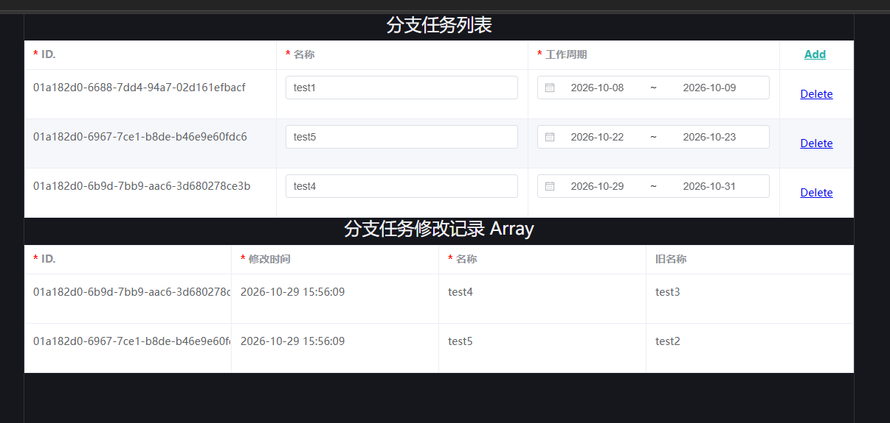

# 05. 前端使用和定制视图组件

在 [01. 语义类型演示](../tryit/01-type.md#如何引入前端项目)中，我们已经演示了如果用`<schema-view type='xxxxx' v-model="data"/>`来基于一个语义类型及数据渲染出一个表单。

`schema-node-vue-view` 是vue3+element-plus的视图库。它是为了实现`schema-node-man`预备的，当然也适用于后台管理，或者对前端样式要求不高的场景。

下面我们基于它说明如何为特定的语义类型注册视图组件。实际整个视图库被替代的代价很低，因为它们只负责呈现，和业务逻辑，数据关联完全无关。


## 1. 语义数据节点

整个 SchemaNode 系统设计围绕 语义实体、语义类型、语义原型 三者进行设计。

`schema-node-core` 是 SchemaNode 基于TypeScript的核心库，它提供了前端的完整语义运行时。

它将基于语义类型将数据封装为`DataNode`（数据节点），每个节点自行管理自身的值，属性等，也基于类型申明的关联完成属性的更新，以及自身的校验等逻辑，例如配置了`entrySource`属性的节点，会自行维护它的级联可选列表，类似枚举值，配置语义类型时的各种下拉选择也是基于这点实现。

如果要为特定的语义类型注册视图，那么首先需要大概了解下`DataNode`的对外接口。

### 1.1 可用属性

* `name` 可读，节点的名称，类似结构体的字段名。
* `access` 可读，节点的访问路径，一些特殊的UI渲染库需要。
* `value` 可读/可写，节点的当前值的计算值。
* `rawValue` 可读, 节点的当前值的原始值。
* `original` 可读，节点的初始值。
* `submitValue` 可读，节点的提交值。
* `changed` 可读，节点是否被修改过。
* `isValid` 可读，节点是否校验通过。

### 1.2 常用方法

* `confirm()`, 保存当前值为初始值，重置修改状态。
* `reset()`, 重置当前值为初始值。
* `getPropertyValue(property: string | PropertyCtor)`, 获取指定属性值。
* `getPropertyValues(property: string | PropertyCtor[])`, 获取指定属性值的迭代器，对于可堆积属性，可能存在多个，例如校验属性, PropertyCtor是属性的类型。
* `subscribe(func: Observer<[IValueAccess, unknown]>, immediate?: boolean): Function`, 订阅节点值变化，返回取消订阅函数。
* `subscribeProperty(property: string | PropertyCtor, func: Observer<[IValueAccess, PropertyCtor, unknown, unknown]>, immediate?: boolean): Function`, 订阅指定属性值变化，返回取消订阅函数，返回值最后两个是当前值和旧值。
* `subscribeViolated(func: Observer<[IValueAccess, boolean]>, immediate?: boolean): Function`, 订阅节点校验状态变化，返回取消订阅函数。

### 1.3 常用属性

创建自定义视图，核心是订阅节点的值，属性，校验状态变化，不过校验状态在对`el-form`的封装视图中已经处理了，所以，只需要订阅节点的值，属性变化即可。

下面是一些常用属性类型(可以直接从schema-node-core引用)，更多可以基于类型配置的属性来判定。

* Default - 默认值
* Require - 必填
* Readonly - 只读
* Disable - 禁用
* AsSuggest - 级联数据仅作为建议，而非强制
* LeafOnly - 级联只能选择叶子节点
* EntrySourceVersion - 级联数据版本，因为EntrySource和一些相关属性变化后，原本的级联数据可能会失效，所以需要订阅EntrySourceVersion变化。


## 2. 自定义视图组件

详细的自定义方式，可以参考`schema-node-vue-view`项目中各个视图的处理。因为脱离了业务，所以里面只是订阅数据，属性的变更来驱动渲染。
而现在AI足以将这个视图库完整翻译为基于其它库的实现。所以，下面仅针对属性细节做个说明。

### 2.1 属性订阅

如果不是做通用视图，只针对特定语义类型处理，那么实际在配置时，已经清楚有哪些属性可以订阅了，而对于通用视图，则可以无视掉和校验相关的属性，专注于渲染相关属性即可。

参考`inputView`的处理逻辑:

```ts
// state change
if (props.readonly) {
  state.readonly = true;
}
else {
  subs.push(subscribeAncestorProperty(node, ReadOnly, (values: boolean[]) => state.readonly = values.some(v => v), true));
  subs.push(subscribeAncestorProperty(node, Disable, (values: boolean[]) => state.disable = values.some(v => v), true));
}
subs.push(node.subscribeProperty(Default, (owner: IValueAccess, propCtor: PropertyCtor, newValue: any, oldValue: any) => state.default = newValue, true));
subs.push(node.subscribeProperty(Require, (owner: IValueAccess, propChange: PropertyCtor, newValue: any, oldValue: any) => state.require = newValue as boolean, true));
subs.push(node.subscribeProperty(AsSuggest, (owner: IValueAccess, propChange: PropertyCtor, newValue: any, oldValue: any) => state.asSuggest = newValue as boolean, true));
subs.push(node.subscribeProperty(LeafOnly, (owner: IValueAccess, propChange: PropertyCtor, newValue: any, oldValue: any) => state.leafOnly = newValue as boolean, true));
```

大部分基于`node.subscribeProperty`订阅属性变化来驱动页面更新，只有`Readonly`和`Disable`需要订阅祖先属性变化。

`subscribeAncestorProperty`是schema-node-vue-view库提供的一种订阅祖先属性变化的方法。直接复制即可。

关于`EntrySourceVerson`的处理相对复杂，可以参考`schema-node-vue-view`项目中`inputView`的`rebuildOptions`方法，它实际只是从node获取级联数据，而并不关心级联数据如何获取到，以及如何维护。

### 2.2 注册视图组件

在`schema-node-vue-view/src/indexts`中，注册了默认的视图组件，类似，第三个字段对应skin，默认是`default`，如果指定skin没有对应组件，则退回默认组件。

```ts
regSchemaTypeView(NS_SYSTEM_RANGE_FULL_DATE, rangeDateView[, 'default']);
```

实际就是基于语义类型的名称，注册对应的视图组件即可。


## 3. SchemaView 组件

SchemaView 是`schema-node-vue-view`项目中提供的一个核心组件，它的功能其实比较简单，基于指定的语义类型或者已有节点，自动选择合适的视图组件来渲染。
下面是它的常用属性，注意，它可以将非自身的属性透传给最终的视图组件，例如`el-table`自身属性。


| Prop | 说明 |
| --- | --- |
| `node` | 已有的 `DataNode`；提供后不再新建节点 |
| `type` | 类型名；没有 `node` 时按它创建节点 |
| `modelValue` | 与 `v-model` 配合的节点值 |
| `value` | 只读显示时使用的值，不建立双向绑定 |
| `props` | 新建节点时要设置的属性集合 |
| `skin` | 视图皮肤，默认 `default`，用于同一类型的多套视图 |
| `inForm` | 表单展示方式，('expand', 'expand2', 'expand3', 'expandall', 'nest', '') |
| `text` | 只读文本对齐方式：`left`、`right`、`center` |
| `readonly` | 只读模式 |
| `rootDiv` | `AppNode` 字段懒加载时的滚动容器 |
| `instantValid` | 输入时立即校验 |
| `debug` | 显示类型、属性等调试信息 |

两种典型用法：

```vue
<!-- 自己持有节点 -->
<schema-view :node="fieldNode" :readonly="true" text="left" />

<!-- 按类型创建节点，并用 v-model 取值 -->
<schema-view
  v-model="data"
  type="activity.address"
  :in-form="SchemaNodeFormType.ExpandAll"
  text="left"
/>
```

`inForm` 传 `true` 时，组件会自动选择：能按单值展示的类型用 `Nest`，否则用 `Expand`，这里指层级展开方式，特别是结构体嵌套，如果要展平，可以配置。

组件会把默认插槽透传给实际视图，因此可以包装任意字段的输入区域。


## 4. 展示 App 应用

我们已经演示了如何使用`SchemaView`组件，处理语义类型和数据，但核心还是如何处理类似 App 这样的业务逻辑。

如果还未创建测试项目，请遵照[01. 语义类型演示](../tryit/01-type.md#如何引入前端项目)的演示，创建一个测试项目。

接下来，我们打通它和后端的访问，并且将[# 02. 启动 SchemaNode.App 并配置应用](../02-apps.md)中完成的应用配置，实际展示到测试项目中。

### 4.1 打通后端访问

我们需要配置后端的访问路径，以及一个简化的认证头，将之前使用的用户id配置到认证头，确保对应用有访问权限。

```ts
setSchemaApiBaseUrl('http://localhost:8000/schema') // Set the schema api base url
setSchemaApiHeaders([{
    key: 'userid',
    value: '01a17c66-707b-7b48-9ed4-95708f073678'
}])
```

### 4.2 展示 App 应用

替换`App.vue`的所有内容为：

```vue
<template>  
  <el-form v-if="appNode" ref="form" label-width="140px" :model="appNode.rawValue">
    <template v-for="f in appNode.inputFields" :key="f.id">
      <h2>{{ _L(f.getPropertyValue(Display)) || f.name }}</h2>
      <schema-view text="left" :node="f" :in-form="true"></schema-view>
    </template>
  </el-form>
</template>

<script lang="ts" setup>
import { _LS, Display } from "schema-node-core"
import { ElForm } from "element-plus"
import { schemaView, _L } from "schema-node-vue-view"
import { onMounted, ref } from "vue";
import { getAppNode, type AppNode } from "schema-node-app";

const appNode = ref<AppNode | undefined>(undefined)
  
onMounted(async () => {
  appNode.value = await getAppNode({
    app: 'test.project',
    target: '01a17c6a-64a9-7f25-a7ea-63cc11a050b3',
    fields: [],
    take: 5,
    schemaOnly: true
  })

  console.log(appNode.value)
})

</script>
```

使用`getAppNode`方法指定应用的名称和目标id，即可获取到应用的节点，目标id就是[# 02. 启动 SchemaNode.App 并配置应用](../02-apps.md) 测试中用到的`项目id`。

注意，这里配置了`schemaOnly: true`，表示只获取应用的schema，不获取数据。这样，字段会在进入展示时，进行懒加载，避免初期加载数据量过大。

可以看到数据加载出来了，剩下不过是样式和布局问题。




### 4.3 App 数据的提交

如果要参考完整的App声明周期，可以参考`schema-node-man`的`tryapp.vue`组件，它就是配置UI的演示组件。

App 数据的提交涉及两部分，一部分是校验，一部分是提交。

校验部分对应:

```ts
// el-form自身校验，可以触发错误显示，首次展示时，通常不会显示错误信息，避免影响用户操作
await form.value?.validate()

// vue需要toRaw获取原始节点，不然一些访问无法通过代理模式获取
// 这里拿到的是App节点，包含所有逻辑表字段
const node = toRaw(appNode.value!)

// 校验节点是否有效，实际就是所有已加载的可输入逻辑表字段是否有效
if (!node.isValid) {
  // 如果无效，可以遍历所有错误节点，记录错误信息
  for(const n of node.getErrorNodes())
    logger.error(n)
  ElMessage.error(_L.value["frontend.view.error"])
  return
}
```

然后提交比较简单:

```ts
const r = await node.submit(); // 提交所有数据修改
if (!r?.result) {
  ElMessage.error(_L.value(r?.error || "frontend.view.savefailed"))
  return
}
else {
  ElMessage.success(_L.value("frontend.view.savesuccess"))
}
```